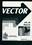

=== " N°1, July 1993"

    ## N°1, July 1993 { #contents-n1-july-1993 }

    | Page | Article | Author |
    | ---: | --- | --- |
    | 3 | [Editorial: APL in Business](../v10n1-p3-editorial-apl-in-business/) | Anthony Camacho |
    |  | **APL NEWS** |  |
    | 5 | [Quick Reference Diary](../v10n1-p5-quick-reference-diary/) |  |
    | 9 | [General Correspondence](../10/1/VOL.10-NO.1-JULY-1993.pdf#page=11) (PDF) |  |
    | 9 | &emsp;[Review of APL\*PLUS II v4.0](../v10n1-p9-review-of-apl-plus-ii-v4/) | James G Wheeler |
    | 10 | &emsp;[A Comment on “Announcing The APL Review”](../v10n1-p10-comment-on-announcing-the-apl-review/) | Martin Gfeller |
    |  | British APL Association News: |  |
    | 11 | &emsp;[BAA-GUI Workshop](../v10n1-p11-baa-gui-workshop/) | Duncan Pearson |
    | 12 | &emsp;[“APL in Business” Conference Prospectus](../v10n1-p12-apl-in-business-conference-prospectus/) |  |
    | 14 | &emsp;[Annual Accounts](../v10n1-p14-annual-accounts/) | Nicholas Small |
    | 15 | &emsp;[AGM Report](../v10n1-p15-agm-report/) | David Eastwood |
    | 19 | &emsp;[News from Sustaining Members](../v10n1-p19-news-from-sustaining-members/) | Gill Smith |
    | 25 | [The Education Vector](../v10n1-p25-the-education-vector/) | Alan Mayer |
    | 27 | &emsp;[Step by Step Analysis of Variance](../art10005290/) | Alan Mayer |
    | 34 | &emsp;[Backtracking, Queens and Permutations](../art10003110/) | Ted Emms |
    | 39 | &emsp;[Cows and Bulls](../art10005300/) | Alan Mayer |
    |  | **REVIEWS SECTION** |  |
    | 41 | [APL Product Guide](../v10n1-p41-apl-product-guide/) | Gill Smith |
    | 53 | [The Sharp APL Reference Manual](../art10000670/) | Jonathan Barman |
    | 55 | [Update on ISI APLIWIN](../art10000680/) | Jonathan Barman |
    | 59 | [Dyalog APL: Programming for Windows](../art10000690/) | Jonathan Barman |
    |  | **RECENT MEETINGS:** |  |
    | 70 | [Business Graphics — A Second Look](../10/1/VOL.10-NO.1-JULY-1993.pdf#page=72) (PDF) | George MacLeod |
    | 70 | &emsp;[Meeting: Business Graphics](../art10005960/) (PDF only) | George MacLeod |
    | 70 | &emsp;[Meeting: Business Graphics– A Second Look](../art10012290/) | George MacLeod |
    |  | **GENERAL ARTICLES** |  |
    | 74 | [K](../art10010830/) | Arthur Whitney |
    | 80 | [Windows BMP Bitmap Files and APL](../art10001820/) | Ray Cannon |
    | 97 | [Coast-to-Coast: Managing with Objects](../art10008460/) | Adrian Smith |
    |  | **TECHNICAL SECTION** |  |
    | 114 | [Technical Correspondence](../10/1/VOL.10-NO.1-JULY-1993.pdf#page=116) (PDF) |  |
    | 114 | &emsp;[A Windows GOTCHER for APLIWIN](../v10n1-p114-windows-gotcher-for-apliwin/) | Anthony Camacho |
    | 116 | &emsp;[Errors in “Integrating with Insight”](../v10n1-p116-errors-in-integrating-with-insight/) | John R. Clark |
    | 117 | [A Standard Font Dialogue Box from Dyalog APL/W using ⎕NA](../10/1/VOL.10-NO.1-JULY-1993.pdf#page=119) (PDF) | Duncan Pearson |
    | 117 | &emsp;[A Standard Font Dialogue Box using •NA](../art10006420/) (PDF only) | Duncan Pearson |
    | 117 | &emsp;[A standard font dialogue box using ⎕NA](../art10012320/) | Duncan Pearson |
    | 125 | [The MAGIC goes away — Opening the Boxes](../art10002800/) | Mike Day |
    | 137 | [The Fractal MAGIC Universe](../art10004670/) | Gérard Langlet |
    | 143 | [Index to Advertisers](../10/1/VOL.10-NO.1-JULY-1993.pdf#page=145) (PDF) |  |

    [PDF of the whole issue](1/VOL.10-NO.1-JULY-1993.pdf)

=== " N°2, October 1993"

    ## N°2, October 1993 { #contents-n2-october-1993 }

    | Page | Article | Author |
    | ---: | --- | --- |
    | 3 | [Editorial: APL 93 at Toronto](../v10n2-p3-editorial-apl-93-at-toronto/) | Anthony Camacho |
    |  | **APL NEWS** |  |
    | 5 | [Quick Reference Diary](../v10n2-p5-quick-reference-diary/) |  |
    |  | General Correspondence |  |
    | 7 | &emsp;[The APL 93 Russian Fund](../v10n2-p7-the-apl-93-russian-fund/) | Ben Best |
    | 13 | [News from Sustaining Members](../v10n2-p13-news-from-sustaining-members/) | Gill Smith |
    | 17 | [The Education Vector](../v10n2-p17-the-education-vector/) | Alan Mayer |
    | 19 | &emsp;[Review: “Introduction to APL\*PLUS/PC” by Maurice Dalois](../10/2/VOL.10-NO.2-OCTOBER-1993.pdf#page=21) (PDF) | Alan Mayer |
    | 19 | &emsp;&emsp;[Review: “Introduction to APL\*PLUS/PC” by Maurice Dalois](../art10005310/) (PDF only) | Alan Mayer |
    | 999 | &emsp;&emsp;[Review: "Introduction to APL\*PLUS/PC" by Maurice Dalois](../art10012400/) | Alan Mayer |
    | 21 | &emsp;[J-ottings](../art10010000/) | Norman Thomson |
    | 24 | &emsp;[An Improvement to LOGGAMMA](../art10012490/) | Norman Thomson |
    | 25 | &emsp;[Cows and Bulls: A Solution](../art10003120/) | Ted Emms |
    |  | **REVIEWS SECTION** |  |
    | 33 | [APL Product Guide](../v10n2-p33-apl-product-guide/) | Gill Smith |
    | 45 | [GDDME - a First Look](../art10008470/) | Adrian Smith |
    | 49 | [Helm — A Company-oriented Decision Support System (DSS)](../art10007510/) | Jon Sandles |
    |  | **RECENT MEETINGS: APL93 at Toronto** |  |
    | 56 | [Conference Roundup](../art10000150/) | Sylvia Camacho |
    |  | APL93 Tutorial: |  |
    | 63 | &emsp;[Solving Wicked Problems with APL](../art10004950/) | Chris Lee |
    | 67 | [Programming the ISI Window Driver](../art10003960/) | Eric Iverson |
    | 87 | [Workshop: a GUI Standard for APL](../v10n2-p87-workshop-a-gui-standard-for-apl/) |  |
    | 91 | [David Steinbrook and Eugene McDonnell ‘From Trees into Boxes’](../v10n2-p91-from-trees-into-boxes/) | Anthony Camacho |
    | 92 | [Robert Bernecky ‘Array Morphology’](../v10n2-p92-array-morphology/) | Anthony Camacho |
    | 93 | [Norman Thomson ‘Understanding ANOVA the APL Way’](../v10n2-p93-understanding-anova-the-apl-way/) | Sylvia Camacho |
    | 95 | [APL in Satellite Surveillance](../art10007410/) | Jack Rudd |
    | 110 | [Postscript: “Don’t Stop Thinking About Tomorrow”](../art10012450/) | Adrian Smith |
    |  | **GENERAL ARTICLES** |  |
    | 114 | [Mineswooper: GOTO Considered Futile](../art10008480/) | Adrian Smith |
    | 119 | [J Solution to New Scientist Enigma 685](../art10011160/) | David Ziemann |
    |  | **TECHNICAL SECTION** |  |
    | 126 | [Hackers’ Corner: A Windows Task-Killer for APL](../10/2/VOL.10-NO.2-OCTOBER-1993.pdf#page=128) (PDF) | Duncan Pearson |
    | 126 | &emsp;[Hacker’s Corner: A Windows Task Killer](../art10006430/) (PDF only) | Duncan Pearson |
    | 126 | &emsp;[Hacker's Corner: A Windows Task Killer](../art10012420/) | Duncan Pearson |
    | 128 | [At Play with J](../art10005370/) | Eugene E McDonnell |
    | 130 | [Migrating Mainframe APL2/TSO Applications to APL\*PlusII/386](../art10003280/) | Allan Gay |
    | 133 | [A GDDM Simulation for APL\*PlusII/386](../art10003290/) | Allan Gay |
    | 143 | [Index to Advertisers](../10/2/VOL.10-NO.2-OCTOBER-1993.pdf#page=145) (PDF) |  |

    [PDF of the whole issue](2/VOL.10-NO.2-OCTOBER-1993.pdf)

=== " N°3, January 1994"

    ## N°3, January 1994 { #contents-n3-january-1994 }

    | Page | Article | Author |
    | ---: | --- | --- |
    | 3 | [Editorial](../art10012530/) | Anthony Camacho |
    |  | **APL NEWS** |  |
    | 5 | [Quick Reference Diary](../v10n3-p5-quick-reference-diary/) |  |
    |  | APL94: The Language and its Application |  |
    | 6 | &emsp;[Conference Prospectus](../v10n3-p6-conference-prospectus/) |  |
    | 9 | [News from Sustaining Members](../v10n3-p9-news-from-sustaining-members/) | Gill Smith |
    | 17 | [The Education Vector](../v10n3-p17-the-education-vector/) | Alan Mayer |
    | 19 | &emsp;[Letter](../v10n3-p19-iverson-letter/) | Kenneth E. Iverson |
    | 19 | &emsp;[Editorial Comment](../v10n3-p19-editorial-comment/) | Alan Mayer |
    | 21 | &emsp;[APL-Defined Functions for the Calculation of Determinants](../art10004420/) | Joseph De Kerf |
    | 23 | &emsp;[Taylor Arithmetic](../art10009290/) | Walter Spunde |
    | 29 | &emsp;[J-ottings 2](../art10010010/) | Norman Thomson |
    |  | **REVIEWS SECTION** |  |
    | 33 | [APL Product Guide — Updates](../v10n3-p33-apl-product-guide-updates/) | Gill Smith |
    | 35 | [GDDME by Lingo Allegro — Update](../art10008490/) | Adrian Smith |
    |  | **RECENT MEETINGS** |  |
    | 37 | [APL93 Conference Evaluation Survey](../art10003380/) | Marc Griffiths |
    | 41 | [APLomb: the view through Quad-shaped spectacles](../art10002300/) | Ian A. Clark |
    |  | BAA-GUI |  |
    | 51 | &emsp;[Dyalog APL Session](../10/3/VOL.10-NO.3-JANUARY-1994.pdf#page=53) (PDF) | Jonathan Barman |
    | 51 | &emsp;&emsp;[BAA-GUI Workshop Dyalog APL Sessions](../art10000490/) (PDF only) |  |
    | 51 | &emsp;&emsp;[Workshop: Dyalog APL Sessions](../art10012510/) |  |
    | 57 | &emsp;[APL\*PLUS II Session](../10/3/VOL.10-NO.3-JANUARY-1994.pdf#page=59) (PDF) | Anthony Camacho |
    | 57 | &emsp;&emsp;[BAA-GUI Workshop APL\*PLUS II Sessions](../art10000500/) (PDF only) |  |
    | 57 | &emsp;&emsp;[Workshop: APL\*PLUS II Sessions](../art10012520/) |  |
    | 60 | [APL\*PLUS III — a First Look](../art10010800/) | Adrian Smith |
    |  | **GENERAL ARTICLES** |  |
    | 67 | [When is Easter?](../art10001830/) | Ray Cannon |
    | 76 | &emsp;[Date of Easter in J](../art10005380/) | Eugene McDonnell |
    | 78 | [A Note on the Easter Algorithm in J](../art10008040/) | Keith Smillie |
    | 81 | [ASLGREG: Proposed Additional Features Predictions with Confidence Limits](../art10006030/) | Ellis Morgan |
    | 94 | [The N-Queens Problem in 1 line](../art10007880/) | R.G. Selfridge |
    |  | **TECHNICAL SECTION** |  |
    | 96 | [Hackers’ Corner: Minding your .INIs](../10/3/VOL.10-NO.3-JANUARY-1994.pdf#page=98) (PDF) | Adrian Smith |
    | 96 | &emsp;[Hacker’s Corner: Minding Your .INIs](../art10008500/) (PDF only) | Adrian Smith |
    | 96 | &emsp;[Hacker's Corner: Minding Your .INIs](../art10012660/) | Adrian Smith |
    | 100 | [At Play with J](../art10005390/) | Eugene McDonnell |
    | 106 | [Loops in APL2](../art10003480/) | H Haussmann |
    | 113 | [A Control Operator](../art10007480/) | Denis Samson |
    | 124 | [The Ultimate TURING Proof](../art10004680/) | G.A. Langlet |
    | 133 | [A VSAM Simulation for APL\*PlusII/386](../art10003300/) | Allan Gay |
    | 143 | [Index to Advertisers](../10/3/VOL.10-NO.3-JANUARY-1994.pdf#page=145) (PDF) |  |

    [PDF of the whole issue](3/VOL.10-NO.3-JANUARY-1994.pdf)

=== " N°4, April 1994"

    ## N°4, April 1994 { #contents-n4-april-1994 }

    | Page | Article | Author |
    | ---: | --- | --- |
    | 3 | [Editorial: The First Ten Years](../art10012730/) | Anthony Camacho |
    | 4 | &emsp;[Preparing for Swansea](../v10n4-p4-preparing-for-swansea/) | Adrian Smith (Workshop Co-ordinator) |
    |  | **APL NEWS** |  |
    | 5 | [Quick Reference Diary](../v10n4-p5-quick-reference-diary/) |  |
    | 7 | [Update on APL94](../art10012820/) | Alain Delmotte |
    |  | British APL Association News: |  |
    | 10 | [Obituary: Mike Gregory](../v10n4-p10-obituary-mike-gregory/) | John Searle |
    | 11 | [News from Sustaining Members](../v10n4-p11-news-from-sustaining-members/) | Gill Smith |
    | 17 | [The Education Vector](../v10n4-p17-the-education-vector/) | Alan Mayer |
    | 18 | &emsp;[J: A First Lesson](../art10005860/) | Donald McIntyre |
    | 30 | &emsp;[A Note on Primes](../art10003130/) | Ted Emms |
    |  | **REVIEWS SECTION** |  |
    | 33 | [APL Product Guide: Updates](../v10n4-p33-apl-product-guide-updates/) | Gill Smith |
    | 39 | [Calculus by K.E. Iverson](../10/4/VOL.10-NO.4-APRIL-1994.pdf#page=41) (PDF) | Keith Smillie |
    | 39 | &emsp;[Review: “Calculus” by Ken Iverson](../art10008050/) (PDF only) | Keith Smillie |
    | 39 | &emsp;[Review: "Calculus" by Ken Iverson](../art10012800/) | Keith Smillie |
    |  | **RECENT MEETINGS** |  |
    | 44 | [McIntyre’s J Workshop at Greenock](../v10n4-p44-j-at-greenock/) | Norman Thomson |
    | 44 | [Visit To APL Centres in Russia November 1993](../art10005100/) | Gary Littlejohn |
    | 48 | [February Meeting: Eastwood and Cyriax](../10/4/VOL.10-NO.4-APRIL-1994.pdf#page=50) (PDF) | Adrian Smith |
    | 48 | &emsp;[Meeting: The Toronto Toolkit](../art10003100/) | David Eastwood |
    | 50 | &emsp;[Performance of Large APL Systems](../art10002740/) (PDF only) | Peter Cyriax |
    |  | **GENERAL ARTICLES** |  |
    | 58 | [Standardization Beyond the Language](../art10003340/) | Gfeller and Kromberg |
    | 64 | [A Common Approach to the Windows GUI (Dyalog APL/W and APL\*PLUS III)](../art10008510/) | Adrian Smith and Duncan Pearson |
    | 78 | [What’s in a Name?](../art10001650/) | Sylvia Camacho |
    | 83 | [Drawing the Line](../art10005970/) | George MacLeod |
    | 92 | [AMORTIZE: a Windows Application in J](../art10006290/) | Thomas M. Olsen |
    |  | **TECHNICAL SECTION** |  |
    | 106 | [Technical Editorial: in Search of Contexts](../art10008520/) | Adrian Smith |
    | 108 | [Hackers’ Corner: Flying Windows](../10/4/VOL.10-NO.4-APRIL-1994.pdf#page=110) (PDF) | Jonathan Barman |
    | 108 | &emsp;[Hacker’s Corner: Flying Windows](../art10000700/) (PDF only) | Jonathan Barman |
    | 108 | &emsp;[Hacker's Corner: Flying Windows](../art10012700/) | Jonathan Barman |
    | 110 | [Finding the 10 to the 10th Prime](../art10005400/) | Gene McDonnell |
    | 114 | [APL - a Client-Server Language?](../art10004560/) | Morten Kromberg |
    | 124 | [A Note on Probabilities in the F-Distribution](../art10008060/) | Keith Smillie |
    | 126 | [Defined Operator Simulation for APL\*PLUS II](../art10003310/) | Allan Gay |
    | 133 | [Inner Products for Range Tests](../art10000710/) | Jonathan Barman |
    | 136 | [Another Use of Not-Equals-Scan](../art10001520/) | Anthony Camacho |
    | 141 | [Vectype: Preparing APL Code for Publication](../art10008530/) | Adrian Smith |
    | 143 | [Index to Advertisers](../10/4/VOL.10-NO.4-APRIL-1994.pdf#page=145) (PDF) |  |

    [PDF of the whole issue](4/VOL.10-NO.4-APRIL-1994.pdf)
