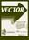
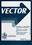
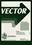

=== " N°1, July 1994"

    ## N°1, July 1994 { #contents-n1-july-1994 }

    | Page | Article | Author |
    | ---: | --- | --- |
    | 3 | [Editorial: a Language for the Elite!](../art10001530/) | Anthony Camacho |
    | 4 | &emsp;[10 Years Ago: Editorial from Vector 1.1](../v11n1-p4-ten-years-ago-editorial/) | Robert Bittlestone |
    |  | **APL NEWS** |  |
    | 5 | [Quick Reference Diary](../v11n1-p5-quick-reference-diary/) |  |
    | 7 | [APL94 Abstracts](../art10000160/) |  |
    |  | British APL Association News: |  |
    | 13 | &emsp;[EGM Report, AGM Report, Annual Accounts, Regulations](../v11n1-p13-egm-agm-accounts-regulations/) |  |
    | 21 | [News from Sustaining Members](../v11n1-p21-news-from-sustaining-members/) |  |
    | 29 | [The Education Vector](../v11n1-p29-the-education-vector/) | Ian Clark |
    | 31 | &emsp;[Jot-Dot-Floor: Working with Large Integers](../art10002310/) | Ian Clark |
    | 36 | &emsp;[J: A Second Lesson](../art10005870/) | Donald McIntyre |
    |  | **REVIEWS SECTION** |  |
    | 45 | [APL Product Guide](../v11n1-p45-apl-product-guide/) | Gill Smith |
    | 57 | [Jim Weigang’s \*APL Notes\*](../11/1/VOL.11-NO.1-JULY-1994.pdf#page=59) (PDF) | Walter Spunde |
    | 57 | &emsp;[Review: “APL Notes” by Jim Weigang](../art10009300/) (PDF only) | Walter Spunde |
    | 57 | &emsp;[Review: "APL Notes" by Jim Weigang](../art10012960/) | Walter Spunde |
    | 61 | [APL\*PLUS/PC Version 11](../art10010760/) | Adam Weber |
    | 65 | [J Release 2 (Iverson Software Inc.)](../art10011170/) | Dave Ziemann |
    | 75 | [APL\*PLUS III Gui Implementation](../art10006440/) | Duncan Pearson |
    | 84 | [... and Control Structures](../art10008540/) | Adrian Smith |
    |  | **RECENT MEETINGS** |  |
    | 92 | [James Wheeler demonstrates PLUS III](../art10010810/) | notes by Anthony Camacho |
    | 96 | [David Piper on Objects and APL](../11/1/VOL.11-NO.1-JULY-1994.pdf#page=98) (PDF) |  |
    | 96 | &emsp;[Meeting: AnOOPL – An Object-Oriented Programming Language](../art10006890/) (PDF only) | David Piper |
    | 96 | &emsp;[Meeting: AnOOPL– An Object-Oriented Programming Language](../art10012910/) | David Piper |
    | 101 | [Namespaces and Dyalog APL Version 7](../art10007730/) | notes by Adrian Smith |
    |  | **GENERAL ARTICLES** |  |
    | 108 | [To Be, Or Not To Be — That is the Gazodenplatz](../art10005990/) | Peter Merritt |
    | 109 | [Windows Development with APL\*PLUS III](../art10004980/) | Eric Lescasse |
    | 119 | [The BAA Membership Database](../art10007960/) | Nicholas Small |
    |  | **TECHNICAL SECTION** |  |
    | 126 | [Hackers’ Corner: Native Files without Tears](../11/1/VOL.11-NO.1-JULY-1994.pdf#page=128) (PDF) | Adrian Smith |
    | 126 | &emsp;[Hacker’s Corner: Native Files in Dyalog APL (Without Tears)](../art10008550/) (PDF only) | Adrian Smith |
    | 126 | &emsp;[Hacker's Corner: Native Files in Dyalog APL (Without Tears)](../art10012940/) | Adrian Smith |
    | 129 | [Technical Correspondence](../11/1/VOL.11-NO.1-JULY-1994.pdf#page=131) (PDF) |  |
    | 129 | &emsp;[↑ It or Leave It in Dyalog APL/W](../art10004270/) | Jan Karman |
    | 131 | &emsp;[To Suffer the Slings and Vectors of the BAA](../art10000380/) | Ajay Askoolum |
    | 134 | &emsp;[Adverb/Conjunction Combinations in J](../art10009480/) | Gordon Sutcliffe |
    | 136 | [At Play with J - Control Structures](../art10005410/) | Gene McDonnell |
    | 139 | [A Windows-driven Menu Driver](../art10004280/) | Jan Karman |
    | 143 | [Index to Advertisers](../11/1/VOL.11-NO.1-JULY-1994.pdf#page=145) (PDF) |  |

    [PDF of the whole issue](1/VOL.11-NO.1-JULY-1994.pdf)

=== " N°2, October 1994"

    ## N°2, October 1994 { #contents-n2-october-1994 }

    | Page | Article | Author |
    | ---: | --- | --- |
    | 3 | [Editorial: Monsieur Langlet’s Enterprise](../11/2/VOL.11-NO.2-OCTOBER-1994.pdf#page=5) (PDF) | Anthony Camacho |
    | 3 | &emsp;[Editorial: Monsieur Langlet’s Enterprise](../art10001540/) (PDF only) | Anthony Camacho |
    | 3 | &emsp;[Editorial: Monsieur Langlet's Enterprise](../art10013030/) | Anthony Camacho |
    |  | **APL NEWS** |  |
    | 5 | [Quick Reference Diary](../v11n2-p5-quick-reference-diary/) |  |
    | 7 | [APL95: Call for Participation](../v11n2-p7-apl95-call-for-participation/) |  |
    | 13 | [News from Sustaining Members](../v11n2-p13-news-from-sustaining-members/) | Gill Smith |
    | 17 | [The Education Vector](../v11n2-p17-the-education-vector/) | Ian Clark |
    | 20 | &emsp;[Jot-Dot-Floor: Domino](../art10002320/) | Ian Clark |
    | 24 | &emsp;[J-ottings 3: Atop and Agenda](../art10010020/) | Norman Thomson |
    | 28 | &emsp;[J: Bibliography](../v11n2-p28-j-bibliography/) | Donald B. McIntyre |
    | 29 | &emsp;[Cows and Bulls – A Solution](../art10010940/) | Anne Wilson |
    | 30 | &emsp;[More about Fractional Series](../art10009500/) | J.R. Sutton |
    |  | **REVIEWS SECTION** |  |
    | 33 | [APL Product Guide — Updates](../v11n2-p33-apl-product-guide-updates/) | Gill Smith |
    | 38 | [Les APL Etendus (par Bernard Legrand)](../11/2/VOL.11-NO.2-OCTOBER-1994.pdf#page=40) (PDF) | Adrian Smith |
    | 38 | &emsp;[Review: “Les APLs Etendus” by Bernard Legrand](../art10008560/) (PDF only) | Adrian Smith |
    | 38 | &emsp;[Review: "Les APLs Etendus" by Bernard Legrand](../art10013090/) | Adrian Smith |
    |  | **RECENT MEETINGS** |  |
    | 42 | [\*APL in Business\* at EBMS, Swansea](../11/2/VOL.11-NO.2-OCTOBER-1994.pdf#page=44) (PDF) |  |
    | 42 | &emsp;[Chairman’s Impressions: What you Saw was (more or less) what you Got](../v11n2-p42-chairmans-impressions/) | Adrian Smith |
    | 44 | &emsp;[Opening Plenary](../art10007520/) | Jon Sandles |
    | 47 | &emsp;[Gareth Brentnall’s Logol Workshop](../v11n2-p47-logol-workshop/) | Jon Sandles |
    | 48 | &emsp;[Duncan Pearson’s DDE and DLL Workshop](../v11n2-p48-dde-and-dll-workshop/) | Ray Cannon |
    | 49 | &emsp;[Correspondence](../v11n2-p49-ellis-morgan-correspondence/) | Ellis Morgan |
    | 50 | &emsp;[Croesoe a Cymru and the APL Welsh Hwyrnos](../art10010820/) | Diane Whitehouse |
    | 53 | [\*APL 94\* at Antwerp: Roundup](../11/2/VOL.11-NO.2-OCTOBER-1994.pdf#page=55) (PDF) | Anthony & Sylvia Camacho |
    | 53 | &emsp;[APL94 (Antwerp) Conference Reports](../art10000170/) (PDF only) |  |
    | 53 | &emsp;[Conference Reports](../art10013010/) |  |
    | 59 | &emsp;[Reflections](../v11n2-p59-reflections/) | Ray Cannon |
    | 60 | &emsp;[Binary Algebra Workshop (Foils)](../art10004690/) | Gérard Langlet |
    |  | **GENERAL ARTICLES** |  |
    | 68 | [Windows Development with APL\*PLUS III (Part II)](../art10004990/) | Eric Lescasse |
    | 82 | [Chaotic Behaviour Revisited](../art10004700/) | Gérard Langlet |
    | 86 | [Fractals RYIJ](../art10007160/) | Clifford A. Reiter |
    | 105 | [One Font to Rule Them All](../art10008570/) | Adrian Smith |
    |  | The Random Vector |  |
    | 109 | &emsp;[Understanding Statistical Theory Through Simulation](../art10000340/) | David Appleton |
    |  | **TECHNICAL SECTION** |  |
    | 118 | [Hackers’ Corner: Making Noises with APL](../11/2/VOL.11-NO.2-OCTOBER-1994.pdf#page=120) (PDF) | Adrian Smith |
    | 118 | &emsp;[Hacker’s Corner: Making Noises in APL](../art10008580/) (PDF only) | Adrian Smith |
    | 118 | &emsp;[Hacker's Corner: Making Noises in APL](../art10013080/) | Adrian Smith |
    | 123 | [Technical Correspondence](../11/2/VOL.11-NO.2-OCTOBER-1994.pdf#page=125) (PDF) |  |
    | 123 | &emsp;[J Compositions](../art10010030/) | Norman Thomson |
    | 124 | &emsp;[J Compositions](../art10003810/) | Roger Hui |
    | 126 | [Causeway: a Technical Architecture](../art10006450/) | Duncan Pearson |
    | 143 | [No SX please, we’re APLers](../11/2/VOL.11-NO.2-OCTOBER-1994.pdf#page=145) (PDF) | Ray Cannon |
    | 143 | &emsp;[No SX please – we’re APLers](../art10001840/) (PDF only) | Ray Cannon |
    | 143 | &emsp;[No SX please – we’re APLers](../art10013040/) | Ray Cannon |
    | 150 | [Bracket Axis Simulation for APL\*PLUS II/386](../art10003320/) | Allan Gay |
    | 158 | [Guidelines for Vector authors](../art10008590/) | Adrian Smith |
    | 159 | [Index to Advertisers](../11/2/VOL.11-NO.2-OCTOBER-1994.pdf#page=161) (PDF) |  |

    [PDF of the whole issue](2/VOL.11-NO.2-OCTOBER-1994.pdf)

=== " N°3, January 1995"

    ## N°3, January 1995 { #contents-n3-january-1995 }

    | Page | Article | Author |
    | ---: | --- | --- |
    | 3 | [Guest Editorial:](../art10006460/) | Duncan Pearson |
    |  | **APL NEWS** |  |
    | 5 | [Quick Reference Diary](../v11n3-p5-quick-reference-diary/) |  |
    | 7 | [News from Sustaining Members](../v11n3-p7-news-from-sustaining-members/) | Gill Smith |
    | 11 | [The Education Vector](../v11n3-p11-the-education-vector/) | Ian Clark |
    | 14 | &emsp;[Jot-Dot-Floor](../11/3/VOL.11-NO.3-JANUARY-1995.pdf#page=16) (PDF) | Ian Clark |
    | 14 | &emsp;&emsp;[Jot-Dot-Floor](../art10002330/) (PDF only) | Ian Clark |
    | 999 | &emsp;&emsp;[Jot-Dot-Floor ...or Jot-Dot-Min?](../art10013120/) | Ian Clark |
    | 17 | &emsp;[J-ottings 4](../art10010040/) | Norman Thomson |
    | 21 | &emsp;[The Common Mean and APL](../art10004430/) | Joseph De Kerf |
    | 23 | &emsp;[Word-search Squares in I-APL](../art10005940/) | Bill McLean |
    |  | **REVIEWS SECTION** |  |
    | 27 | [APL Product Guide — Complete](../v11n3-p27-apl-product-guide-complete/) | Gill Smith |
    |  | **RECENT MEETINGS** |  |
    | 42 | [APL94: The APL Theory of Human Vision](../art10004710/) | Gérard Langlet |
    | 52 | [Germany: Die Programmiersprache APL](../v11n3-p52-die-programmiersprache-apl/) |  |
    | 53 | &emsp;[APL at Corona/Nordstern](../art10003000/) | Dieter Düren |
    | 60 | [Helsinki: Causeway Workshop](../art10008600/) | Adrian Smith |
    |  | **SPECIAL FEATURE: Namespaces** |  |
    | 65 | &emsp;[Namespaces Special Feature](../v11n3-p65-namespaces-special-feature/) |  |
    | 66 | [The Use of Namespaces for Encapsulation — a Practical Introduction](../art10002890/) | Peter Donnelly |
    | 75 | [Namespaces](../art10005000/) | Eric Lescasse |
    | 92 | [Namespaces: A Way to a Well Organized World or Just Another Means to Multiply your Chaos](../art10004310/) | Kimmo Kekäläinen |
    | 96 | [Coast-to-Coast revisited](../v11n3-p96-coast-to-coast-revisited/) | Adrian Smith |
    | 97 | [**TECHNICAL SECTION**](../v11n3-p97-technical-section/) |  |
    | 99 | [Puzzle Corner: The Age of the Vicar](../art10009690/) | Alan Sykes |
    | 101 | [The Axiom Waltz](../art10004720/) | Gérard Langlet |
    | 111 | [At Work and Play with J](../11/3/VOL.11-NO.3-JANUARY-1995.pdf#page=113) (PDF) | Eugene McDonnell |
    | 111 | &emsp;[At Play with J: Jacobi’s Method](../art10005420/) (PDF only) | Eugene McDonnell |
    | 111 | &emsp;[At Play with J: Jacobi's Method](../art10013180/) | Eugene McDonnell |
    | 119 | [Bodyguard of Lies](../art10006000/) | Peter Merritt |
    | 122 | [Causeway: Making Menus](../art10008610/) | Adrian Smith |
    | 130 | [J Inscription 0 :](../art10006210/) | Richard Oates |
    | 142 | [Nice One, Microsoft!](../v11n3-p142-nice-one-microsoft/) | Gérard Langlet via Adrian Smith (Vector Production) |
    | 143 | [Index to Advertisers](../11/3/VOL.11-NO.3-JANUARY-1995.pdf#page=145) (PDF) |  |

    [PDF of the whole issue](3/VOL.11-NO.3-JANUARY-1995.pdf)

=== " N°4, April 1995"

    ## N°4, April 1995 { #contents-n4-april-1995 }

    | Page | Article | Author |
    | ---: | --- | --- |
    | 3 | [Editorial:](../art10013240/) | Anthony Camacho |
    |  | **APL NEWS** |  |
    | 5 | [Quick Reference Diary](../v11n4-p5-quick-reference-diary/) |  |
    | 7 | [Correspondence](../11/4/VOL.11-NO.4-APRIL-1995.pdf#page=9) (PDF) |  |
    | 7 | &emsp;[Croeso i Gymru (letter)](../v11n4-p7-croeso-i-gymru/) | John Sullivan |
    | 8 | [APL 95 Panels and Workshops](../v11n4-p8-apl-95-panels-and-workshops/) |  |
    | 10 | &emsp;[Abstracts](../art10000180/) |  |
    | 13 | &emsp;[The APL95 Software Exchange](../v11n4-p13-apl95-software-exchange/) | Dick Holt |
    | 14 | [News from Sustaining Members](../v11n4-p14-news-from-sustaining-members/) | Gill Smith |
    | 17 | [The Education Vector](../v11n4-p17-the-education-vector/) | Ian Clark |
    | 21 | &emsp;[Jot-Dot-Min](../11/4/VOL.11-NO.4-APRIL-1995.pdf#page=23) (PDF) | Ian Clark |
    | 21 | &emsp;&emsp;[Jot-Dot-Min](../art10002340/) (PDF only) | Ian Clark |
    | 999 | &emsp;&emsp;[Jot-Dot-Min: an outer-product of rock-bottom APL matters](../art10013250/) | Ian Clark |
    | 27 | &emsp;[J-ottings 5: Append Items](../art10010050/) | Norman Thomson |
    | 30 | &emsp;[Fractnomials?](../art10009510/) | J.R. Sutton |
    |  | **REVIEWS SECTION** |  |
    | 34 | [APL Product Guide — Complete](../v11n4-p34-apl-product-guide-complete/) | Gill Smith |
    | 49 | [Locales in J](../art10001310/) | Chris Burke |
    | 53 | [J 2.05 for Windows](../art10011180/) | David Ziemann |
    |  | **RECENT MEETINGS** |  |
    | 62 | [APL in a Client-Server Environment BAA Workshop report](../art10007530/) | Jon Sandles |
    |  | **GENERAL ARTICLES: and J Feature** |  |
    | 69 | [Here be Dragons](../art10001660/) | Sylvia Camacho |
    | 76 | [Teaching with an Executable Notation](../art10004010/) | Ken Iverson |
    | 93 | [The Perils of Subtraction](../art10005880/) | Donald B. McIntyre |
    | 104 | [Primes, Spirals and Coffee Tables](../art10008070/) | Keith Smillie |
    | 110 | [Stereograms in J](../art10002490/) | E.A. Clough |
    |  | **TECHNICAL SECTION** |  |
    | 118 | [Puzzle Corner: The Age of the Vicar (solution)](../art10009700/) | Alan Sykes |
    | 119 | [Technical Correspondence](../11/4/VOL.11-NO.4-APRIL-1995.pdf#page=121) (PDF) |  |
    | 119 | &emsp;[Namespaces and ⎕SE](../v11n4-p119-namespaces-and-se/) |  |
    | 120 | &emsp;[More on APL 2.5](../v11n4-p120-more-on-apl-2-5/) | I Phelphritt (nee Leigh) |
    | 121 | &emsp;[Understanding your File Timestamps](../art10001850/) | Ray Cannon |
    | 123 | &emsp;[The Common Mean](../art10003820/) | Roger Hui |
    | 124 | &emsp;[IBM pre-announces the Pentium... in 1977!](../v11n4-p124-ibm-pre-announces-the-pentium/) | Bob Hoekstra |
    | 124 | &emsp;[Cut and Paste from Winword to APL](../v11n4-p124-cut-and-paste-from-winword-to-apl/) | Jan Karman (phone call) |
    | 125 | &emsp;[Chaos – Computer Error not to Blame](../art10007970/) | Nicholas Small |
    | 127 | &emsp;[Answers to J problems from Vector 11.3](../art10010060/) | Norman Thomson |
    | 131 | &emsp;[ASCII Representation of APL Characters](../art10004020/) | Ken Iverson |
    | 135 | [At Work and Play with J: Cribbage 15s](../art10005430/) | Gene McDonnell |
    | 139 | [Functional Programming in J for Operations Research](../art10001290/) | Richard Brown |
    | 155 | [J 2.05 for Windows (concluded)](../11/4/VOL.11-NO.4-APRIL-1995.pdf#page=157) (PDF) | David Ziemann |
    | 159 | [Index to Advertisers](../11/4/VOL.11-NO.4-APRIL-1995.pdf#page=161) (PDF) |  |
    | 159 | [Submitting Material to Vector](../v11n4-p159-submitting-material-to-vector/) |  |

    [PDF of the whole issue](4/VOL.11-NO.4-APRIL-1995.pdf)
