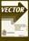

=== " N°1, July 1995"

    ## N°1, July 1995 { #contents-n1-july-1995 }

    | Page | Article | Author |
    | ---: | --- | --- |
    | 3 | [Editorial](../art10013260/) | Anthony Camacho |
    |  | **APL NEWS** |  |
    | 5 | [Quick Reference Diary](../v12n1-p5-quick-reference-diary/) |  |
    | 6 | [APL96 Western Europe](../v12n1-p6-apl96-western-europe/) |  |
    | 7 | [Correspondence](../12/1/VOL.12-NO.1-JULY-1995.pdf#page=9) (PDF) |  |
    | 7 | &emsp;[Too Much Diversity in APL?](../v12n1-p7-too-much-diversity-in-apl/) | Joseph De Kerf |
    | 9 | &emsp;[Minutes of Annual General Meeting, Friday 19 May 1995](../v12n1-p9-minutes-of-agm-1995/) | Sylvia Camacho |
    | 11 | [British APL Association Annual Accounts](../v12n1-p11-annual-accounts/) |  |
    | 13 | [News from Sustaining Members](../v12n1-p13-news-from-sustaining-members/) | Gill Smith |
    | 17 | [The Education Vector](../v12n1-p17-the-education-vector/) | Ian Clark |
    | 20 | &emsp;[Jot-Dot-Min: Stereo Vision](../art10002350/) | Ian Clark |
    | 25 | &emsp;[J-ottings 6: Indexing Arrays in J](../art10010070/) | Norman Thomson |
    | 30 | &emsp;[J – Where Have All the Variables Gone?](../art10009310/) | Walter Spunde |
    | 33 | [APL Product Guide — Updates](../v12n1-p33-apl-product-guide-updates/) | Gill Smith |
    | 38 | [Book Review: \*Making APL Readable\*](../art10001550/) | Anthony Camacho |
    |  | **RECENT MEETINGS: APL95 at San Antonio** |  |
    | 41 | [Conference Reports](../art10000190/) |  |
    | 51 | &emsp;[Machine Learning Algorithms](../art10007540/) | Jon Sandles |
    | 53 | &emsp;[Business Graphics Workshop](../art10008620/) | Adrian Smith |
    | 56 | &emsp;[Portability Workshop](../v12n1-p56-portability-workshop/) | Eke van Batenburg |
    |  | **GENERAL ARTICLES** |  |
    | 60 | [Voyages in Dragon Country](../art10001670/) | Sylvia Camacho |
    | 67 | [Teaching with an Executable Notation (Part 2)](../art10004030/) | Ken Iverson |
    | 74 | [Multiprecision Arithmetic (Part 1)](../art10009390/) | John Sullivan |
    |  | **The Random Vector** |  |
    | 86 | [Probabilities for Elementary Distributions](../art10009710/) | Alan Sykes |
    | 93 | [A Quite Different New Primitive](../art10004730/) | Gérard Langlet |
    | 102 | [The Complete Elliptic Integrals and APL](../art10004440/) | Joseph De Kerf |
    | 106 | &emsp;[Production Manager’s Observation](../v12n1-p106-production-managers-observation/) |  |
    | 107 | [The Common Mean, Non-negative Definite Matrices, and APL](../art10010700/) | Dietrich Trenkler |
    |  | **TECHNICAL SECTION** |  |
    | 114 | [Hacker’s Corner: Driving the MS Daisy-wheel](../art10001860/) | Ray Cannon |
    | 120 | [A Virtual Classroom](../v12n1-p120-a-virtual-classroom/) |  |
    | 121 | [Technical Correspondence](../12/1/VOL.12-NO.1-JULY-1995.pdf#page=123) (PDF) |  |
    | 121 | &emsp;[More Thoughts on Dragons](../art10004740/) | Gérard Langlet |
    | 123 | &emsp;[Non-Syllogistic Mathematical Proof](../12/1/VOL.12-NO.1-JULY-1995.pdf#page=125) (PDF) | Gérard Langlet |
    | 123 | &emsp;&emsp;[Letter: Non-Syllogistic Mathematical Proof](../art10004750/) (PDF only) | Gérard Langlet |
    | 123 | &emsp;&emsp;[Letter: Non-syllogistic mathematical proof](../art10013290/) | Gérard Langlet |
    | 125 | [At Work and Play with J:](../art10005440/) | Gene McDonnell |
    | 129 | [“Correct” Windows File Behaviour](../art10006470/) | Duncan Pearson |
    | 137 | [Native File Functions for Dyalog APL](../art10008630/) (PDF only) | Adrian Smith |
    | 143 | [Index to Advertisers](../12/1/VOL.12-NO.1-JULY-1995.pdf#page=145) (PDF) |  |

    [PDF of the whole issue](1/VOL.12-NO.1-JULY-1995.pdf)

=== " N°2, October 1995"

    ## N°2, October 1995 { #contents-n2-october-1995 }

    | Page | Article | Author |
    | ---: | --- | --- |
    | 3 | [Editorial: Is There Anybody Out There?](../art10013310/) | Anthony Camacho |
    |  | **APL NEWS** |  |
    | 5 | [Quick Reference Diary](../v12n2-p5-quick-reference-diary/) |  |
    | 6 | [APL96 Lancaster](../v12n2-p6-apl96-lancaster/) | Adrian Smith |
    | 7 | [Correspondence](../12/2/VOL.12-NO.2-OCTOBER-1995.pdf#page=9) (PDF) |  |
    | 7 | &emsp;[Proposed common APL coding](../art10002100/) | Bill Chang |
    | 9 | &emsp;[Some Comments](../v12n2-p9-some-comments/) | Adrian Smith |
    | 10 | [British APL Association News](../v12n2-p10-british-apl-association-news/) | Sylvia Camacho |
    | 11 | [News from Sustaining Members](../v12n2-p11-news-from-sustaining-members/) | Gill Smith |
    | 17 | [The Education Vector](../v12n2-p17-the-education-vector/) | Ian Clark |
    | 21 | &emsp;[J-ottings 7: Control Structures](../art10010080/) | Norman Thomson |
    | 26 | &emsp;[Polynomial Interpolation](../art10006060/) | Antje Muller |
    | 31 | &emsp;[Matrix Decomposition](../art10010090/) | Norman Thomson |
    | 33 | [APL Product Guide — Full](../v12n2-p33-apl-product-guide-full/) | Gill Smith |
    | 46 | [Dyalog APL/W for Windows 95 — First Impressions](../art10008640/) | Adrian Smith |
    |  | **RECENT MEETINGS** |  |
    | 50 | [DDE Workshop Notes](../art10006480/) | Duncan Pearson |
    |  | **GENERAL ARTICLES** |  |
    | 56 | [The Ball Clock Problem](../art10003830/) | Roger Hui |
    | 67 | [Is APL a Team Sport?](../art10001040/) | Douglas Bohrer |
    | 76 | [Multiprecision Arithmetic (Part II)](../art10009400/) | John Sullivan |
    |  | **The Random Vector** |  |
    | 87 | [Computing Clopper-Pearson Confidence Limits by the Illinois Method](../art10010710/) | Dietrich Trenkler |
    | 95 | [The Incomplete Elliptic Integrals and APL](../art10004450/) | Joseph De Kerf |
    |  | **TECHNICAL SECTION** |  |
    | 102 | [Hacker’s Corner: Gremlins, Pixels and Brownie Points](../art10001870/) |  |
    | 105 | [Technical Correspondence](../12/2/VOL.12-NO.2-OCTOBER-1995.pdf#page=107) (PDF) |  |
    | 105 | &emsp;[APL-Fortran calls using ⎕NA](../art10007890/) | R.G Selfridge |
    | 109 | &emsp;[Calculating Probabilities](../art10010100/) | Norman Thomson |
    | 111 | &emsp;[Floating-Point Precision](../v12n2-p111-floating-point-precision/) | Joseph De Kerf |
    | 113 | &emsp;[Microsoft Announces APL for the 8088 - almost 20 years late!](../12/2/VOL.12-NO.2-OCTOBER-1995.pdf#page=115) (PDF) | Adrian Smith |
    | 115 | [At Work and Play with J: The Bauer-Mengelberg Problem](../art10005450/) | Gene McDonnell |
    | 123 | [Elegant Programming](../art10001320/) | Chris Burke |
    | 131 | [A Fractal Verb in J](../art10006220/) | Richard Oates |
    | 135 | [Tilting at Windmills: a New Attack on Nested Arrays](../art10001050/) | Douglas Bohrer |
    | 141 | [J Locales](../v12n2-p141-j-locales/) | Richard Oates |
    | 143 | [Index to Advertisers](../12/2/VOL.12-NO.2-OCTOBER-1995.pdf#page=145) (PDF) |  |

    [PDF of the whole issue](2/VOL.12-NO.2-OCTOBER-1995.pdf)

=== " N°3, January 1996"

    ## N°3, January 1996 { #contents-n3-january-1996 }

    | Page | Article | Author |
    | ---: | --- | --- |
    | 3 | [Editorial: the Place of APL](../art10013320/) | Anthony Camacho |
    |  | **APL NEWS** |  |
    | 5 | [Quick Reference Diary](../v12n3-p5-quick-reference-diary/) |  |
    | 6 | [APL96: Call for Participation](../v12n3-p6-apl96-call-for-participation/) |  |
    | 11 | [News from Sustaining Members](../v12n3-p11-news-from-sustaining-members/) | Gill Smith |
    | 17 | [The Education Vector](../v12n3-p17-the-education-vector/) | Ian Clark |
    | 21 | &emsp;[Counting Problem](../v12n3-p21-counting-problem/) | Tony Goddard |
    | 27 | &emsp;[Towers of Hanoi, Simplified in J](../art10006570/) | Howard Peelle |
    | 27 | &emsp;[J-ottings 8: Transcribing from APL to J](../art10010110/) | Norman Thomson |
    | 33 | [APL Product Guide](../v12n3-p33-apl-product-guide/) | Gill Smith |
    | 47 | [Experiences with the Use of Causeway](../art10004290/) | Jan Karman |
    | 51 | [Managing Objects in Causeway](../art10007550/) | Jon Sandles |
    | 55 | [The Kunzle Planning System (KPS)](../art10002360/) | Ian Clark |
    |  | **RECENT MEETINGS** |  |
    | 60 | [Share-Guide and APL Club Germany](../v12n3-p60-share-guide-and-apl-club-germany/) | Adrian Smith |
    | 61 | &emsp;[Putting a GUI Interface on Legacy Systems](../art10001260/) | Jim Brown |
    | 63 | [**GENERAL ARTICLES**](../v12n3-p63-general-articles/) |  |
    | 64 | [Font for the Future](../art10000890/) | Eke van Batenburg |
    | 70 | [Multiprecision Arithmetic III](../art10009410/) | John Sullivan |
    | 79 | [Turtle Graphics in J](../art10000940/) | David Benn |
    | 98 | [3-Dimensional Noughts and Crosses](../art10006490/) | Duncan Pearson |
    | 108 | [Rain - Extending to 3D](../art10008650/) | Adrian Smith |
    |  | **The Random Vector** |  |
    | 117 | [A Note on Programming Style](../art10003840/) | Roger Hui and K.E. Iverson |
    | 122 | [The Incomplete Elliptic Integrals and APL - an Extension](../v12n3-p122-incomplete-elliptic-integrals-extension/) | Joseph De Kerf |
    |  | **TECHNICAL SECTION** |  |
    | 127 | [Hacker’s Corner: Oh \*\*\*\* !! I Hadn’t Saved That!](../v12n3-p127-hackers-corner-oh-i-hadnt-saved-that/) | Dave Phillips |
    | 130 | [Technical Correspondence](../12/3/VOL.12-NO.3-JANUARY-1996.pdf#page=132) (PDF) |  |
    | 130 | &emsp;[Fractions as Sequences of Integers](../art10010120/) | Norman Thomson |
    | 131 | &emsp;[Miaou = Cat!](../v12n3-p131-miaou-cat/) | Claude Henriod |
    | 133 | [At Work and Play with J: Heron’s Rule & Integer-Area Triangles](../art10005460/) | Gene McDonnell |
    | 143 | [Index to Advertisers](../12/3/VOL.12-NO.3-JANUARY-1996.pdf#page=145) (PDF) |  |

    [PDF of the whole issue](3/VOL.12-NO.3-JANUARY-1996.pdf)

=== " N°4, April 1996"

    ## N°4, April 1996 { #contents-n4-april-1996 }

    | Page | Article | Author |
    | ---: | --- | --- |
    | 3 | [Editorial](../art10013340/) | Anthony Camacho |
    |  | **APL NEWS** |  |
    | 5 | [Quick Reference Diary](../v12n4-p5-quick-reference-diary/) |  |
    | 6 | [APL96 Invitation and Abstracts](../art10000200/) |  |
    | 12 | [News from Sustaining Members](../v12n4-p12-news-from-sustaining-members/) | Gill Smith |
    | 17 | [The Education Vector](../v12n4-p17-the-education-vector/) | Ian Clark |
    | 20 | &emsp;[Jot-Dot-Min: Weaving Patterns and Cellular Automata](../art10002370/) | Ian Clark |
    | 27 | &emsp;[J-ottings 9: The Power Conjunction](../art10010130/) | Norman Thomson |
    | 32 | &emsp;[Towers of Hanoi from 15 Years Ago](../v12n4-p32-towers-of-hanoi/) | Adrian Smith |
    | 33 | [APL Product Guide — Updates](../v12n4-p33-apl-product-guide-updates/) | Gill Smith |
    | 38 | [AP119/W - a First Look](../art10004930/) | Timo Laurmaa |
    | 47 | [The JADS/SMS Utility Management System](../art10007560/) | Jon Sandles |
    | 56 | [Dyalog-8 Control Structures and Native Files: some Timings](../art10008660/) | Adrian Smith |
    |  | **RECENT MEETINGS** |  |
    | 58 | [Causeway at the Toronto APL/SIG](../art10003390/) | Marc Griffiths |
    |  | **GENERAL ARTICLES** |  |
    | 64 | [Migration From APL2 to APL/W](../art10009530/) | Rex Swain |
    | 73 | [Multiprecision Arithmetic Part IV](../art10009420/) | John Sullivan |
    |  | **The Random Vector** |  |
    | 81 | [Polynomial Multiplication with Circulant Matrices: Insights Using APL](../art10007400/) | Lew Robinson |
    | 98 | [Confidence Limits](../art10010140/) | Norman Thomson |
    |  | **TECHNICAL SECTION** |  |
    | 108 | [Hacker’s Corner: A New Frock for IRMA](../art10008670/) | Adrian Smith |
    | 112 | [Technical Correspondence](../12/4/VOL.12-NO.4-APRIL-1996.pdf#page=114) (PDF) |  |
    | 112 | &emsp;[Divided Differences: Reply to Hui & Iverson](../art10010150/) | Norman Thomson |
    | 116 | [A Different DDE Application](../art10009430/) | John Sullivan |
    | 119 | [An Internet Extension to 3D Noughts and Crosses](../art10004940/) | Timo Laurmaa |
    | 123 | [At Work and Play with J: Year’s Digits for 1996](../art10005470/) | Gene McDonnell |
    | 113 | [Linear Recurrences and Matrix Powers](../art10003850/) | Roger Hui |
    | 127 | [Roger and the Amazing Technicolor Ballclock](../art10010160/) | Norman Thomson |
    | 131 | [Index to Volumes 1 - 12](../v12n4-p131-index-to-volumes-1-12/) |  |
    | 143 | [Index to Advertisers](../12/4/VOL.12-NO.4-APRIL-1996.pdf#page=145) (PDF) |  |

    [PDF of the whole issue](4/VOL.12-NO.4-APRIL-1996.pdf)
