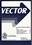
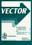

=== " N°1, July 1996"

    ## N°1, July 1996 { #contents-n1-july-1996 }

    | Page | Article | Author |
    | ---: | --- | --- |
    | 3 | [Editorial](../art10006500/) | Duncan Pearson |
    |  | **APL NEWS** |  |
    | 5 | [Quick Reference Diary](../v13n1-p5-quick-reference-diary/) |  |
    | 12 | [News from Sustaining Members](../v13n1-p12-news-from-sustaining-members/) | Gill Smith |
    | 17 | [The Education Vector](../v13n1-p17-the-education-vector/) | Ian Clark |
    | 20 | &emsp;[Functional Programming in J (Part 1)](../art10006580/) | Howard Peelle |
    | 29 | &emsp;[J-ottings 10: Interest Calculations](../art10010170/) | Norman Thomson |
    | 33 | [APL Product Guide](../v13n1-p33-apl-product-guide/) | Gill Smith |
    |  | **PRODUCT REVIEWS** |  |
    | 48 | [J3 - J Grows Up!](../art10000520/) | John Baker, Martin Neitzel |
    | 54 | [Dyalog APL/W 7.2 and 8.0](../art10001430/) | Bob Byers |
    | 64 | [Fractals, Visualization, and J](../art10002600/) | Nicholas Cox |
    |  | **RECENT MEETINGS** |  |
    | 68 | [IBM GSE and APL Club Germany](../art10008680/) | Adrian Smith |
    | 71 | [Eric Iverson at the BAA](../art10008690/) | Adrian Smith |
    | 76 | [BAA Vendor Forum](../art10007570/) | Jon Sandles |
    |  | **GENERAL ARTICLES** |  |
    | 86 | [Parallel Processing with J](../art10001230/) | Brisson and Reiter |
    | 96 | [APL and J (1) - Function Rank](../art10001330/) | Chris Burke |
    | 102 | [Solving Nonogram Puzzles with APL](../art10010900/) | Alan J Wilson |
    |  | **TECHNICAL SECTION** |  |
    | 116 | [Hacker’s Corner: A Word6 APL Keyboard](../art10000390/) | Ajay Askoolum |
    | 119 | [Technical Correspondence](../13/1/VOL.13-NO.1-JULY-1996.pdf#page=121) (PDF) |  |
    | 119 | &emsp;[Coverage probabilities](../v13n1-p119-coverage-probabilities/) | Norman Thomson |
    | 121 | &emsp;[LaTeX and Vector](../v13n1-p121-latex-and-vector/) | Dietrich Trenkler |
    | 122 | [Advanced Windows Programming with APL and Delphi](../art10005010/) | Eric Lescasse |
    | 143 | [APL Operators and J](../art10010180/) | Norman Thomson |
    | 149 | [The J DLL and Extended Integers](../art10001340/) | Chris Burke |
    | 154 | [At Play with J: Riding a Unicycle](../art10005480/) | Gene McDonnell |
    | 159 | [Index to Advertisers](../13/1/VOL.13-NO.1-JULY-1996.pdf#page=161) (PDF) |  |

    [PDF of the whole issue](1/VOL.13-NO.1-JULY-1996.pdf)

=== " N°2, October 1996"

    ## N°2, October 1996 { #contents-n2-october-1996 }

    | Page | Article | Author |
    | ---: | --- | --- |
    | 3 | [Editorial](../art10013370/) | Duncan Pearson |
    |  | **APL NEWS** |  |
    | 5 | [Quick Reference Diary and Call for Nominations](../v13n2-p5-quick-reference-diary/) |  |
    | 7 | [Correspondence](../13/2/VOL.13-NO.2-OCTOBER-1996.pdf#page=9) (PDF) |  |
    | 7 | &emsp;[The APL Skills Database](../v13n2-p7-apl-skills-database/) | Richard Procter |
    | 8 | &emsp;[Why Isn’t APL Used More Widely](../v13n2-p8-why-isnt-apl-used-more-widely/) | R.G. Brown |
    | 9 | &emsp;[re Vector Vol.12 No.3, January 1996, pp 133 - 142](../v13n2-p9-re-vector-12-3-pp-133-142/) | Eddie Clough |
    | 10 | &emsp;[While in J...](../v13n2-p10-while-in-j/) | Nick Cox |
    | 12 | &emsp;[Sylvester’s Algorithm](../art10006590/) | Howard Peelle |
    | 14 | &emsp;[Arrays, Arrays, wherefor art thou Arrays?](../v13n2-p14-arrays-arrays-wherefor-art-thou-arrays/) | Richard J. Procter |
    | 16 | [Vector on the Web](../art10001880/) | Ray Cannon |
    | 20 | [News from Sustaining Members](../v13n2-p20-news-from-sustaining-members/) | Gill Smith |
    | 25 | [The Education Vector](../v13n2-p25-the-education-vector/) | Ian Clark |
    | 27 | &emsp;[The Hidden Variable Approach?](../art10009320/) | Walter Spunde |
    | 29 | &emsp;[Functional Programming in J (Part 2)](../art10006600/) | Howard Peelle |
    | 37 | &emsp;[J-ottings 11](../art10010190/) | Norman Thomson |
    | 41 | [APL Product Guide - Updates](../v13n2-p41-apl-product-guide-updates/) | Gill Smith |
    | 47 | [**RECENT MEETINGS**](../v13n2-p47-recent-meetings/) |  |
    | 48 | [The First International J User Conference (Toronto, June 24th — 25th 1996)](../art10004050/) | Duncan Pearson |
    | 51 | [APL96 at Lancaster (July 28th - August 1st 1996)](../13/2/VOL.13-NO.2-OCTOBER-1996.pdf#page=53) (PDF) |  |
    | 51 | &emsp;[A Conference Diary](../v13n2-p51-a-conference-diary/) | Ray Cannon |
    | 60 | &emsp;[TCP/IP with Timo Laurmaa](../v13n2-p60-tcp-ip-with-timo-laurmaa/) | Jon Sandles |
    | 65 | &emsp;[ODBC Client-Server with Morten Kromberg](../v13n2-p65-odbc-client-server-with-morten-kromberg/) | Bronwen Tuffen |
    | 68 | &emsp;[Nested Arrays with Phil Benkard](../v13n2-p68-nested-arrays-with-phil-benkard/) | Jon Sandles |
    | 70 | &emsp;[Gui Programming and Multi-dimensional DBs](../v13n2-p70-gui-programming-and-multi-dimensional-dbs/) | Marc Griffiths |
    | 77 | &emsp;[A Consultant’s View](../v13n2-p77-a-consultants-view/) | Richard Procter |
    | 83 | &emsp;[Conference Roundup](../v13n2-p83-conference-roundup/) | Adrian Smith |
    | 87 | [**GENERAL ARTICLES**](../v13n2-p87-general-articles/) |  |
    | 88 | [Dynamic Functions in Dyalog APL](../art10007740/) | John Scholes |
    | 99 | [OLE Automation with Dyalog APL](../art10002900/) | Peter Donnelly |
    | 108 | [Perfect Shuffles in J](../art10006610/) | Howard Peelle |
    | 117 | [Calendar Calculations in J](../art10008080/) | Keith Smillie |
    | 128 | [Swinging with APL: the Simple Pendulum](../art10004460/) | Joseph De Kerf |
    |  | **TECHNICAL SECTION** |  |
    | 134 | [Hacker’s Corner: APLPLUS/PC & Windows 95](../art10010770/) | Adam Weber |
    | 135 | [A Word (or Two) from our Spenser](../art10010200/) | Norman Thomson |
    | 137 | [APL2 and J (2) - Indexing](../art10001350/) | Chris Burke |
    | 144 | [At Play with J: Volutes](../art10005490/) | Gene McDonnell |
    | 154 | [Extended Integers in J](../art10003860/) | Roger Hui |
    | 158 | [The Last Great Empty-Array Joke](../v13n2-p158-last-great-empty-array-joke/) | Adrian Smith |
    | 159 | [Index to Advertisers](../13/2/VOL.13-NO.2-OCTOBER-1996.pdf#page=161) (PDF) |  |

    [PDF of the whole issue](2/VOL.13-NO.2-OCTOBER-1996.pdf)

=== " N°3, January 1997"

    ## N°3, January 1997 { #contents-n3-january-1997 }

    | Page | Article | Author |
    | ---: | --- | --- |
    | 3 | [Editorial](../art10013380/) | Duncan Pearson |
    |  | **APL NEWS** |  |
    | 5 | [Quick Reference Diary](../v13n3-p5-quick-reference-diary/) |  |
    | 7 | [Correspondence](../13/3/VOL.13-NO.3-JANUARY-1997.pdf#page=9) (PDF) |  |
    | 7 | &emsp;[«écœuré»](../v13n3-p7-ecoeure/) | Gérard Langlet |
    | 8 | &emsp;[Antecedent Precipitation Index](../art10009330/) | Roger Stokes |
    | 12 | &emsp;[While still in J ...](../v13n3-p12-while-still-in-j/) | Norman Thomson |
    | 12 | &emsp;[British J Association?](../v13n3-p12-british-j-association/) | Don Mattern |
    | 13 | &emsp;[Leaving the Nest](../art10001280/) | Robert G. Brown |
    | 15 | [Vector on the Internet](../art10001890/) | Ray Cannon |
    | 18 | [News from Sustaining Members](../v13n3-p18-news-from-sustaining-members/) | Gill Smith |
    | 21 | [The Education Vector](../v13n3-p21-the-education-vector/) | Ian Clark |
    | 22 | &emsp;[Functional Programming in J (Part 3)](../art10006620/) | Howard Peelle |
    | 29 | &emsp;[J-ottings 12](../art10010210/) | Norman Thomson |
    | 37 | [APL Product Guide](../v13n3-p37-apl-product-guide/) | Gill Smith |
    |  | **PRODUCT REVIEWS** |  |
    | 52 | [New Trace Facilities in J 3.03](../art10003870/) | Roger Hui |
    |  | **RECENT MEETINGS** |  |
    | 62 | [APL2000 at Orlando](../art10008700/) | Adrian Smith |
    | 74 | [Danish APL Group at Copenhagen](../art10002260/) | Gitte & Stefano |
    |  | **GENERAL ARTICLES** |  |
    | 77 | [Import/Export and the Wealth of Namespaces](../art10001060/) | Douglas Bohrer |
    | 85 | [How to Ride a “BiCypher”](../art10001900/) | Ray Cannon |
    |  | **TECHNICAL SECTION** |  |
    | 90 | [Hacker’s Corner: Clipboarding APL Arrays](../art10008710/) | Adrian Smith |
    | 92 | [APL+Win and VBXs](../art10005020/) | Eric Lescasse |
    | 112 | [J and APL Operators](../art10010220/) | Norman Thomson |
    | 118 | [APL and J (3): Operators Reduce, Scan, Outer Product](../art10001360/) | Chris Burke |
    | 127 | [At Play with J: Extended Integers](../art10005500/) | Gene McDonnell |
    | 136 | [Using a Defined Adverb to Trace Execution in Tacit Programs in J](../art10000060/) | David Alis |
    | 143 | [Index to Advertisers](../13/3/VOL.13-NO.3-JANUARY-1997.pdf#page=145) (PDF) |  |

    [PDF of the whole issue](3/VOL.13-NO.3-JANUARY-1997.pdf)

=== " N°4, April 1997"

    ## N°4, April 1997 { #contents-n4-april-1997 }

    | Page | Article | Author |
    | ---: | --- | --- |
    | 3 | [Editorial](../v13n4-p3-editorial/) | Duncan Pearson |
    |  | **APL NEWS** |  |
    | 5 | [Quick Reference Diary](../v13n4-p5-quick-reference-diary/) |  |
    |  | Correspondence |  |
    | 7 | &emsp;[Bob Bernecky \*et al\*](../art10000960/) |  |
    | 13 | [A BAA Meeting at Network City](../art10006520/) | Duncan Pearson |
    | 14 | [APL Characters on the World Wide Web](../art10001910/) | Ray Cannon |
    | 17 | [News from Sustaining Members](../v13n4-p17-news-from-sustaining-members/) | Gill Smith |
    | 21 | [The Education Vector](../v13n4-p21-the-education-vector/) | Ian Clark |
    | 23 | &emsp;[Functional Programming in J (Part 4)](../art10006630/) | Howard Peelle |
    | 37 | [APL Product Guide](../v13n4-p37-apl-product-guide/) | Gill Smith |
    |  | **PRODUCT REVIEWS** |  |
    | 51 | [APL Web Sites Reviewed](../art10007580/) | Jon Sandles |
    | 63 | [Advanced Windows Programming (Lescasse)](../art10000720/) | Jonathan Barman |
    | 73 | [\*NewLeaf\* Page Layout Tools](../art10001440/) | Bob Byers |
    |  | **GENERAL ARTICLES** |  |
    | 78 | [Controlling APL Software Releases](../art10003400/) | Marc Griffiths et al |
    | 89 | [C Source Code Modification using APL](../art10010780/) | Adam Weber |
    | 94 | [HTML Basics in APL+Win](../art10008720/) | Adrian Smith |
    | 104 | [Turtlegraphics with APL2](../art10007140/) | Rama and Barghoorn |
    | 110 | [Errata](../v13n4-p110-errata/) | Norman Thomson |
    | 110 | [Errata: Cyphers and At Play with J](../v13n4-p110-errata-cyphers-and-at-play-with-j/) |  |
    |  | **TECHNICAL SECTION** |  |
    | 111 | [Hacker’s Corner: Dynamic ⎕PW in Dyalog APL](../art10001920/) | Ray Cannon |
    | 113 | [APL and J (4): Function Application and Axis](../art10001380/) | Chris Burke |
    | 123 | [At Play with J: Stumping the Rocket Scientist](../art10005510/) | Gene McDonnell |
    | 130 | [Bookbinders’ Fun](../art10004300/) | Jan Karman |
    | 133 | [On First Encountering OLE](../art10008730/) | Adrian Smith |
    | 138 | [Memories of Gérard Langlet](../13/4/VOL.13-NO.4-APRIL-1997.pdf#page=140) (PDF) |  |
    | 138 | &emsp;[Obituary: Memories of Gérard Langlet (compiled Camacho)](../art10004760/) (PDF only) | Gérard Langlet |
    | 138 | &emsp;[Obituary: Memories of Gérard Langlet](../art10013390/) | Anthony Camacho |
    | 143 | [Index to Advertisers](../13/4/VOL.13-NO.4-APRIL-1997.pdf#page=145) (PDF) |  |

    [PDF of the whole issue](4/VOL.13-NO.4-APRIL-1997.pdf)
