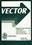

=== " N°1, August 1997"

    ## N°1, August 1997 { #contents-n1-august-1997 }

    | Page | Article | Author |
    | ---: | --- | --- |
    | 3 | [Editorial](../art10013400/) | Duncan Pearson |
    |  | **APL NEWS** |  |
    | 5 | [Quick Reference Diary](../v14n1-p5-quick-reference-diary/) |  |
    |  | Correspondence |  |
    | 7 | &emsp;[Norman Thomson \*et al\*](../v14n1-p7-optimizing-the-antecedent-precipitation-index/) |  |
    | 7 | &emsp;[APL and the rank operator](../v14n1-p7-apl-and-the-rank-operator/) | Norman Thomson |
    | 8 | &emsp;[The Enclose of an Empty Array](../v14n1-p8-enclose-of-an-empty-array/) | Joseph De Kerf |
    | 8 | &emsp;[Year 2000 — why the Consternation?](../v14n1-p8-year-2000-why-the-consternation/) | Bob Brown |
    | 11 | [British APL Association News](../v14n1-p11-british-apl-association-news/) |  |
    | 12 | &emsp;[AGM and Annual Accounts](../v14n1-p12-agm-and-annual-accounts/) |  |
    | 15 | [News from Sustaining Members](../v14n1-p15-news-from-sustaining-members/) | Gill Smith |
    | 33 | [The Education Vector](../14/1/VOL.14-NO.1-JULY-1997.pdf#page=35) (PDF) |  |
    | 33 | &emsp;[Jottings 13](../art10010230/) | Norman Thomson |
    | 38 | &emsp;[DNA Fingerprinting in APL](../art10002380/) | Ian Clark |
    | 46 | &emsp;[Do APL2 and J Come up to Scratch?](../art10010240/) | Norman Thomson |
    | 51 | &emsp;[The UK National Lottery](../art10010910/) | Alan Wilson |
    | 19 | [APL Product Guide](../v14n1-p19-apl-product-guide/) | Gill Smith |
    |  | **GENERAL ARTICLES** |  |
    | 58 | [OpenGL Graphics and J](../art10001370/) | Chris Burke |
    | 64 | [Emulation of AP207 in Dyalog APL](../art10007920/) | Skomorokhov & Kornilovsky |
    | 78 | [The IML Matrix Language: A Belated Introduction](../art10006910/) | Donald B. Pittenger |
    | 83 | [HTML Basics for APLers — Tables](../art10008740/) | Adrian Smith |
    |  | **TECHNICAL SECTION** |  |
    | 94 | [Namespaces in Causeway](../art10006510/) | Duncan Pearson |
    | 106 | [Object Oriented Programming with APL+Win](../art10005030/) | Eric Lescasse |
    | 129 | [APL and J (5): Operators — Inner Product, Each, Commute, Compose](../art10001390/) | Chris Burke |
    | 135 | [At Play with J: Oh, No, Not Eigenvalues Again!](../art10005520/) | Gene McDonnell |
    | 140 | [The API Problem as a Particular Recurrence Problem](../art10001420/) | Andrei Buzin |
    | 143 | [Index to Advertisers](../14/1/VOL.14-NO.1-JULY-1997.pdf#page=145) (PDF) |  |

    [PDF of the whole issue](1/VOL.14-NO.1-JULY-1997.pdf)

=== " N°2, October 1997"

    ## N°2, October 1997 { #contents-n2-october-1997 }

    | Page | Article | Author |
    | ---: | --- | --- |
    | 3 | [Editorial](../art10013410/) | Duncan Pearson |
    |  | **APL NEWS** |  |
    | 5 | [Quick Reference Diary](../v14n2-p5-quick-reference-diary/) |  |
    | 7 | [APL98 - Conference Information](../v14n2-p7-apl98-conference-information/) |  |
    |  | Correspondence |  |
    | 11 | &emsp;[Norman Thomson et al](../14/2/VOL.14-NO.2-OCTOBER-1997.pdf#page=13) (PDF) |  |
    | 11 | &emsp;[Accounts Correction](../v14n2-p11-accounts-correction/) | Nicholas Small |
    | 11 | &emsp;[Re: Year 2000](../v14n2-p11-re-year-2000/) | M.E. Martin |
    | 12 | &emsp;[Year 2000 — Why the Consternation?](../v14n2-p12-year-2000-why-the-consternation/) | Anne Wilson |
    | 14 | &emsp;&emsp;[Heron’s Rule and Integer Area Triangles](../art10004190/) | William Jones |
    | 15 | &emsp;&emsp;[A Little Hook for Understanding](../art10002610/) | Nicholas Cox |
    | 16 | &emsp;&emsp;[Enumerating and Generating Combinations](../art10010250/) | Norman Thomson |
    | 16 | &emsp;[Interesting Problem...](../v14n2-p16-interesting-problem/) | Ajay Askoolum |
    | 18 | [British APL Association News](../v14n2-p18-british-apl-association-news/) |  |
    | 19 | [APL Product Guide](../v14n2-p19-apl-product-guide/) | Gill Smith |
    |  | The Education Vector |  |
    | 33 | &emsp;[The Josephus Problem Generalized in J](../art10006640/) | Howard Peelle |
    | 38 | &emsp;[J-ottings 14](../art10010260/) | Norman Thomson |
    |  | **APL97 — NOTES, PHOTOS AND PAPERS** |  |
    | 43 | [APL97](../14/2/VOL.14-NO.2-OCTOBER-1997.pdf#page=45) (PDF) |  |
    |  | &emsp;Conference Reports | Pearson and Smith |
    | 43 | &emsp;&emsp;[APL97 (Toronto) Conference Reports](../art10000210/) |  |
    | 43 | &emsp;&emsp;[Conference: APL97 Reports](../art10006530/) | Duncan Pearson, Adrian Smith |
    | 58 | [APL and Nested Arrays — a Dream for Statistical Computation](../art10009730/) | Alan Sykes and Tom Stroud |
    | 71 | [Interactive Design of Structures: A Program for Everyone](../art10007330/) | Riebenbauer and Hoffmann |
    | 85 | [The Logical Piano of W. S. Jevons](../art10008090/) | Keith Smillie |
    | 92 | [APL97 Survey Results](../art10003730/) | Dick Holt |
    |  | **GENERAL ARTICLES** |  |
    | 100 | [How to Win Programming Language Battles](../art10006920/) | Donald Pittenger |
    |  | **TECHNICAL SECTION** |  |
    |  | Hackers’ Corner: |  |
    | 110 | &emsp;[A PostScript Type 1 Font Downloader](../art10009440/) | John Sullivan |
    | 112 | [Use of Multivariate Techniques for the Grouping Together of Districts](../art10003410/) | Guervos et al |
    | 121 | [Niven Numbers and APL](../art10004470/) | Joseph De Kerf |
    | 125 | [A Note on Cholesky Decomposition](../art10006190/) | Tapio Nummi |
    | 127 | [Index to Advertisers](../14/2/VOL.14-NO.2-OCTOBER-1997.pdf#page=129) (PDF) |  |

    [PDF of the whole issue](2/VOL.14-NO.2-OCTOBER-1997.pdf)

=== " N°3, January 1998"

    ## N°3, January 1998 { #contents-n3-january-1998 }

    | Page | Article | Author |
    | ---: | --- | --- |
    | 3 | [Editorial](../art10000400/) | Ajay Askoolum |
    |  | **APL NEWS** |  |
    | 7 | [Quick Reference Diary](../v14n3-p7-quick-reference-diary/) |  |
    | 9 | [APL99 — Call for Participation](../v14n3-p9-apl99-call-for-participation/) |  |
    | 11 | [Correspondence](../14/3/VOL.14-NO.3-JANUARY-1998.pdf#page=13) (PDF) |  |
    | 11 | &emsp;[Finding an Elephant](../v14n3-p11-finding-an-elephant/) | George MacLeod |
    | 12 | &emsp;[APL Null](../v14n3-p12-apl-null/) | Ajay Askoolum |
    | 13 | [News from Sustaining Members](../v14n3-p13-news-from-sustaining-members/) |  |
    | 16 | [APL Product Guide](../v14n3-p16-apl-product-guide/) | Gill Smith |
    | 30 | &emsp;[Review of APL97 CD Rom](../14/3/VOL.14-NO.3-JANUARY-1998.pdf#page=32) (PDF) | Adrian Smith |
    | 30 | &emsp;&emsp;[Review: APL97 CD Rom](../art10008750/) | Adrian Smith |
    | 30 | &emsp;&emsp;[APL97 (Toronto) CD Rom (with Abstracts)](../art10000220/) |  |
    | 36 | &emsp;[Review of \*ComLog\*](../art10007590/) | Jon Sandles |
    | 37 | &emsp;[Dyalog APL/M 8.1.2](../art10003600/) | Bob Hoekstra |
    |  | The Education Vector |  |
    | 53 | &emsp;[Zark Newletter Extracts](../art10007600/) | edited by Jon Sandles |
    | 56 | &emsp;[J-ottings 15](../art10010270/) | Norman Thomson |
    |  | **CONFERENCE REPORTS** |  |
    | 61 | [APL2000 Conference Report](../art10001930/) | Ray Cannon |
    | 69 | [Tool of Thought (X)](../art10007900/) | Ed Shaw |
    |  | **GENERAL ARTICLES** |  |
    | 71 | [The Computer Construction of Weaving Designs](../art10008100/) | Keith Smillie |
    | 82 | [HTML Basics for APLers — Lists](../art10008760/) | Adrian Smith |
    | 91 | [Using APL and J in Conjunction to Improve System Validity](../art10006930/) | Donald Pittenger |
    |  | **TECHNICAL SECTION** |  |
    | 98 | [Hackers’ Corner: the Windows Registry](../art10009450/) | John Sullivan |
    | 102 | [Technical Correspondence](../art10006900/) | Dave Piper |
    | 105 | [An ODBC Browser Using SQL and Dyalog APL](../art10009220/) | Richard Smith |
    | 109 | [Object Oriented Programming with APL+Win](../art10005040/) | Eric Lescasse |
    | 138 | [Armstrong Numbers and APL](../art10004480/) | Joseph De Kerf |
    | 143 | [Index to Advertisers](../14/3/VOL.14-NO.3-JANUARY-1998.pdf#page=145) (PDF) |  |

    [PDF of the whole issue](3/VOL.14-NO.3-JANUARY-1998.pdf)

=== " N°4, April 1998"

    ## N°4, April 1998 { #contents-n4-april-1998 }

    | Page | Article | Author |
    | ---: | --- | --- |
    | 3 | [Editorial](../14/4/VOL.14-NO.4-APRIL-1998.pdf#page=5) (PDF) | Stefano Lanzavecchia |
    | 3 | &emsp;[Editorial: Giochiamo col mondo](../art10004780/) | Stefano Lanzavecchia |
    | 3 | &emsp;[Editorial: Giochiamo col mondo](../art10013850/) | Stefano Lanzavecchia |
    |  | **APL NEWS** |  |
    | 7 | [Quick Reference Diary](../v14n4-p7-quick-reference-diary/) |  |
    |  | Correspondence |  |
    | 9 | &emsp;[Thomson, Clough, Henriod, Karman, Last, Selfridge](../art10010280/) |  |
    | 17 | [News from Sustaining Members](../v14n4-p17-news-from-sustaining-members/) |  |
    | 19 | [APL Product Guide](../v14n4-p19-apl-product-guide/) | Gill Smith |
    | 33 | &emsp;[Review of RainPro](../art10001450/) | Bob Byers |
    |  | The Education Vector |  |
    | 38 | &emsp;[Zark Newletter Extracts](../art10007610/) | edited by Jon Sandles |
    | 48 | &emsp;[J-ottings 16](../art10010290/) | Norman Thomson |
    | 53 | &emsp;[Volutes](../art10006650/) | Howard Peelle |
    |  | **GENERAL ARTICLES** |  |
    | 67 | [APL and J: Working Together, yet Separately](../art10006940/) | Donald Pittenger |
    | 74 | [Internet Programming with the Internet Server Auxiliary Processor](../art10004540/) | Andrei Kondrashev |
    | 91 | [HTML Basics for APLers (IV): Forms and Servers](../art10008770/) | Adrian Smith |
    | 103 | [J4 and OOP](../art10001400/) | Chris Burke |
    |  | **TECHNICAL SECTION** |  |
    | 112 | [Hackers’ Corner: Six Megabytes in 640K?](../art10001560/) | Anthony Camacho |
    |  | Technical Correspondence |  |
    | 117 | &emsp;[Cannon, Clough, Henriod](../14/4/VOL.14-NO.4-APRIL-1998.pdf#page=119) (PDF) |  |
    | 117 | &emsp;&emsp;[Letter: Working with compressed data](../art10001940/) | Ray Cannon |
    | 118 | &emsp;&emsp;[Letter: Niven Number Computing Speed](../art10002500/) | Eddie Clough |
    | 120 | &emsp;&emsp;[Letter: More on Niven Numbers](../art10003540/) | Claude Henriod |
    | 122 | [At Play with J: A Newer Random Link Generator](../art10005530/) | Gene McDonnell |
    | 128 | [Using OpenGL Graphics in Dyalog APL](../art10007930/) | Sasha Skomorokhov |
    | 143 | [Index to Advertisers](../14/4/VOL.14-NO.4-APRIL-1998.pdf#page=145) (PDF) |  |

    [PDF of the whole issue](4/VOL.14-NO.4-APRIL-1998.pdf)
