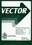
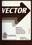
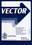

=== " N°1, July 2000"

    ## N°1, July 2000 { #contents-n1-july-2000 }

    | Page | Article | Author |
    | ---: | --- | --- |
    | 3 | [Editorial](../art10013500/) | Stefano Lanzavecchia |
    |  | **APL NEWS** |  |
    | 5 | [Quick Reference Diary](../v17n1-p5-quick-reference-diary/) |  |
    |  | British APL Association News |  |
    | 7 | &emsp;[AGM & Accounts](../17/1/VOL.17-NO.1-JULY-2000.pdf#page=9) (PDF) |  |
    | 7 | &emsp;&emsp;[Minutes of the meeting of the Committee of the British APL Association held on 19 May 2000 at the Royal Statistical Society](../art10014010/) | Anthony Comacho |
    | 10 | &emsp;&emsp;[British APL Association - summary of annual accounts 1999/2000](../art10014020/) | Nicholas Small |
    | 13 | &emsp;[Vendor Forum Report](../art10005200/) | Jonathan Manktelow |
    | 15 | [News from Sustaining Members](../art10014000/) |  |
    | 16 | [APL Product Guide](../v17n1-p16-apl-product-guide/) | Gill Smith |
    |  | The Education Vector |  |
    | 30 | &emsp;[Zark Newsletter Extracts](../v17n1-p30-zark-newsletter-extracts/) | edited by Jon Sandles |
    | 32 | &emsp;[Crossword](../v17n1-p32-crossword/) |  |
    | 35 | &emsp;[J-ottings 25: The I-spy book of J](../art10010390/) | Norman Thomson |
    | 40 | &emsp;[Magic Squares](../art10002410/) | Ian Clark |
    |  | **REVIEW** |  |
    | 48 | [Unix APL Power Shootout (Part 2)](../art10003660/) | Bob Hoekstra |
    |  | **GENERAL ARTICLES** |  |
    | 55 | [Introduction to Tree Searching in APL](../art10000790/) | Dan Baronet |
    | 68 | [ZarkWin: Windows Programming without ⎕WI](../art10000950/) | Gary Bergquist |
    | 83 | [After the Lord Mayor’s Show](../art10005980/) | George MacLeod |
    | 91 | [Taking the \*Migraine\* out of \*Migration\*](../art10003170/) | Walter G. Fil |
    |  | **TECHNICAL SECTION** |  |
    | 106 | [Technical Correspondence](../v17n1-p106-technical-correspondence/) | H.J.Veenendaal |
    | 110 | [At Play with J: Blists in OLEIS](../art10005610/) | Gene McDonnell |
    | 121 | [OOF: Getting a Better Grip on OLE Objects](../art10004570/) | Morten Kromberg |
    | 131 | [Bell Numbers and APL](../art10004510/) | Joseph De Kerf |
    | 143 | [Index to Advertisers](../17/1/VOL.17-NO.1-JULY-2000.pdf#page=145) (PDF) |  |

    [PDF of the whole issue](1/VOL.17-NO.1-JULY-2000.pdf)

=== " N°2, October 2000"

    ## N°2, October 2000 { #contents-n2-october-2000 }

    | Page | Article | Author |
    | ---: | --- | --- |
    | 3 | [Editorial](../art10013510/) | Stefano Lanzavecchia |
    |  | **APL NEWS** |  |
    | 5 | [Quick Reference Diary](../v17n2-p5-quick-reference-diary/) |  |
    |  | British APL Association News |  |
    | 7 | &emsp;[BCS Specialist Groups Congress](../art10001580/) | Anthony Camacho |
    | 9 | [News from Sustaining Members](../art10014040/) |  |
    | 10 | [APL Product Guide](../v17n2-p10-apl-product-guide/) | Gill Smith |
    |  | The Education Vector |  |
    | 25 | &emsp;[Zark Newsletter Extracts](../17/2/VOL.17-NO.2-OCTOBER-2000.pdf#page=27) (PDF) | edited by Jon Sandles |
    | 25 | &emsp;&emsp;[From Stephen Jaffe (ExxonMobil Research)](../v17n2-p25-from-stephen-jaffe/) | Stephen Jaffe |
    | 25 | &emsp;&emsp;[Utility Corner: Matrix Searching](../v17n2-p25-utility-corner-matrix-searching/) |  |
    | 31 | &emsp;&emsp;[Limbering Up: Comma-Delimited Data](../v17n2-p31-limbering-up-comma-delimited-data/) |  |
    |  | &emsp;&emsp;[Timings for CMIOTA](../art10014130/) | Gary Bergquist |
    | 32 | &emsp;[Crossword](../v17n2-p32-crossword/) |  |
    | 35 | &emsp;[The Funny Cube: some solutions](../art10004820/) | Stefano Lanzavecchia |
    | 51 | &emsp;[J-ottings 26: Here we go round ... and round and round ...](../art10010400/) | Norman Thomson |
    |  | **RECENT MEETINGS - APL Berlin 2000** |  |
    | 56 | [APL Berlin 2000 Reports](../art10000290/) | Stefano Lanzavecchia |
    | 106 | &emsp;[Some More of the Personalities at APL Berlin 2000](../art10014030/) |  |
    | 74 | [Dyalog 9 Workshop Notes](../art10002920/) | Peter Donnelly |
    | 91 | [R.I.P. OOF](../art10004580/) | Morten Kromberg |
    |  | **GENERAL ARTICLES** |  |
    | 98 | [CD Labels and More](../art10007210/) | Cliff Reiter |
    |  | **TECHNICAL SECTION** |  |
    | 108 | [Hacker’s Corner: How big is that Doggie in the Window?](../art10006300/) | Bill Parke, Adrian Smith |
    | 112 | [Technical Correspondence](../17/2/VOL.17-NO.2-OCTOBER-2000.pdf#page=114) (PDF) |  |
    | 112 | &emsp;[APL+Win Application Migration](../art10000450/) | Ajay Askoolum |
    | 112 | &emsp;[Bell numbers in Vector 17.1](../v17n2-p112-bell-numbers-in-vector-17-1/) | Eugene McDonnell |
    | 116 | [At Play with J: Someone Just Moved! Who Was It? or, Apter’s Puzzle](../art10005620/) | Gene McDonnell |
    | 131 | [The Generalized Tribonacci Sequence](../art10004520/) | Joseph De Kerf |
    | 143 | [Index to Advertisers](../17/2/VOL.17-NO.2-OCTOBER-2000.pdf#page=145) (PDF) |  |

    [PDF of the whole issue](2/VOL.17-NO.2-OCTOBER-2000.pdf)

=== " N°3, January 2001"

    ## N°3, January 2001 { #contents-n3-january-2001 }

    | Page | Article | Author |
    | ---: | --- | --- |
    | 3 | [Editorial](../art10013520/) | Stefano Lanzavecchia |
    |  | **APL NEWS** |  |
    | 5 | [Quick Reference Diary](../v17n3-p5-quick-reference-diary/) |  |
    |  | British APL Association News |  |
    | 6 | &emsp;[Notice of Annual General Meeting](../v17n3-p6-notice-of-annual-general-meeting/) |  |
    | 8 | [News from Sustaining Members](../art10014050/) |  |
    | 12 | [APL Product Guide](../v17n3-p12-apl-product-guide/) | Gill Smith |
    |  | The Education Vector |  |
    | 27 | &emsp;[Zark Newsletter Extracts](../17/3/VOL.17-NO.3-JANUARY-2001.pdf#page=29) (PDF) | edited by Jon Sandles |
    | 27 | &emsp;&emsp;[Corrections and Clarifications](../v17n3-p27-corrections-and-clarifications/) | Jon Sandles; code by Stephen Jaffe |
    | 28 | &emsp;&emsp;[Utility Corner: Comma-Delimited Data](../v17n3-p28-utility-corner-comma-delimited-data/) |  |
    | 32 | &emsp;&emsp;[Vector Update](../v17n3-p32-vector-update/) | Morten Kromberg |
    | 34 | &emsp;&emsp;[What about a solution in K?](../v17n3-p34-what-about-a-solution-in-k/) | Stefano Lanzavecchia |
    | 37 | &emsp;[Crossword](../v17n3-p37-crossword/) |  |
    | 39 | &emsp;[J-ottings 27: Obverse to Adverse :.:: a Trip along the Brailleway](../art10010410/) | Norman Thomson |
    |  | **REVIEW** |  |
    | 45 | [The Cogwheel Brain by Doron Swade](../art10001590/) | Anthony Camacho |
    |  | **RECENT MEETINGS** |  |
    | 50 | [Viking APL in Denmark](../art10010730/) |  |
    | 56 | &emsp;[Dragging and Dropping (workshop notes)](../art10008900/) | Adrian Smith |
    | 64 | [APL2000 User’s Meeting in Orlando](../art10000260/) | Adrian Smith |
    | 76 | &emsp;[A Grid Object for APL+Win](../art10005050/) | Eric Lescasse |
    |  | **GENERAL ARTICLES** |  |
    | 91 | [Hyperbolic Symmetry is a Breeze](../art10007220/) | Cliff Reiter |
    | 103 | [Working with Existing Ascii Files Using J Memory Mapping](../art10006950/) | Donald B. Pittenger |
    |  | **TECHNICAL SECTION** |  |
    | 112 | [Technical Correspondence](../17/3/VOL.17-NO.3-JANUARY-2001.pdf#page=114) (PDF) |  |
    | 112 | &emsp;[DNA Analysis in APL](../art10005630/) | Charles Brenner |
    | 113 | [At Play with J: Four Cubes Redux](../art10005640/) | Gene McDonnell |
    | 121 | [Reflexive Data Domains](../art10002190/) | Phil Chastney |
    | 131 | [Translate your Dyalog GUIs](../art10004320/) | Kimmo Kekäläinen |
    | 139 | [APL Unicode Font - Extended](../art10002200/) | Phil Chastney |
    | 143 | [Index to Advertisers](../17/3/VOL.17-NO.3-JANUARY-2001.pdf#page=145) (PDF) |  |

    [PDF of the whole issue](3/VOL.17-NO.3-JANUARY-2001.pdf)

=== " N°4, April 2001"

    ## N°4, April 2001 { #contents-n4-april-2001 }

    | Page | Article | Author |
    | ---: | --- | --- |
    | 3 | [Editorial](../art10013530/) | Stefano Lanzavecchia |
    |  | **APL NEWS** |  |
    | 5 | [Quick Reference Diary](../art10014070/) |  |
    | 7 | [APL2001: Information and Abstracts](../v17n4-p7-apl2001-information-and-abstracts/) |  |
    | 8 | [News from Sustaining Members](../art10014080/) |  |
    | 11 | [APL Product Guide](../v17n4-p11-apl-product-guide/) | Gill Smith |
    |  | The Education Vector |  |
    | 26 | &emsp;[Zark Newsletter Extracts](../v17n4-p26-zark-newsletter-extracts/) | edited by Jon Sandles |
    | 28 | &emsp;[Crossword](../v17n4-p28-crossword/) |  |
    | 31 | &emsp;[J-ottings 28: Just say it in J](../art10010420/) | Norman Thomson |
    | 38 | &emsp;[Puzzle Corner](../art10004830/) | Stefano Lanzavecchia |
    |  | **REVIEW** |  |
    | 48 | [XML in Dyalog APL Version 9](../art10000740/) | Jonathan Barman |
    | 65 | [J – the Natural Language for Analytical Computing](../art10014060/) |  |
    |  | **RECENT MEETINGS** |  |
    | 66 | [Forests in Finland V](../art10001990/) | Ray Cannon |
    | 78 | &emsp;[The Development and Q/A Process at Microsoft, US](../art10003690/) | Kari Höijärvi |
    | 85 | &emsp;[Array-based Logic](../art10002280/) | Klaus Klug Christiansen |
    |  | **GENERAL ARTICLES** |  |
    | 93 | [Dynamic Functions Masterclass](../art10007770/) | John Scholes |
    | 101 | [Over and Under: Celtic Knotwork Patterns](../art10010960/) | Anne Wilson |
    |  | **TECHNICAL SECTION** |  |
    | 112 | [Technical Correspondence](../17/4/VOL.17-NO.4.pdf#page=114) (PDF) |  |
    | 112 | &emsp;[Side effects in the Zark extracts](../v17n4-p112-side-effects-in-the-zark-extracts/) | Jonathan Barman |
    | 112 | &emsp;[Distributed rounding of a trial balance](../v17n4-p112-distributed-rounding-of-a-trial-balance/) | Jonathan Barman |
    | 113 | [At Play with J: Erdös Numbers and Pierce and Engel Expansions](../art10005650/) | Gene McDonnell |
    | 125 | [A New Life For ∇: Structure Control](../art10000900/) | F.H.D. van Batenburg |
    | 131 | [J Rational Numbers....](../art10009490/) | Gordon Sutcliffe |
    | 143 | [Index to Advertisers](../17/4/VOL.17-NO.4.pdf#page=145) (PDF) |  |

    [PDF of the whole issue](4/VOL.17-NO.4.pdf)
