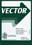
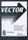
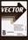

=== " N°1, July 2001"

    ## N°1, July 2001 { #contents-n1-july-2001 }

    | Page | Article | Author |
    | ---: | --- | --- |
    | 3 | [Guest Editorial](../art10013540/) | Anthony Camacho |
    |  | **APL NEWS** |  |
    | 5 | [Quick Reference Diary](../v18n1-p5-quick-reference-diary/) |  |
    | 7 | [An article not about APL](../v18n1-p7-an-article-not-about-apl/) | Bill Lam |
    |  | British APL Association News |  |
    | 8 | &emsp;[Minutes of the Meeting of the Committee of the British APL Association held on 18 May 2001](../v18n1-p8-minutes-of-the-committee-meeting/) | Anthony Camacho |
    | 9 | &emsp;[Minutes of the AGM of the British APL Association held on 18 May 2001](../v18n1-p9-minutes-of-the-agm/) | Anthony Camacho |
    | 13 | &emsp;[Competition Winner – “Spot the Axe”](../v18n1-p13-competition-winner-spot-the-axe/) |  |
    | 14 | [News from Sustaining Members](../art10014090/) |  |
    | 16 | [APL Product Guide](../v18n1-p16-apl-product-guide/) | Gill Smith |
    |  | The Education Vector |  |
    | 31 | &emsp;[Zark Newsletter Extracts](../18/1/VOL.18-NO.1-JULY-2001.pdf#page=33) (PDF) | edited by Jon Sandles |
    | 31 | &emsp;&emsp;[Combinations](../art10014440/) | Gary Bergquist |
    | 37 | &emsp;&emsp;[Limbering Up: Polyadic Functions](../v18n1-p37-limbering-up-polyadic-functions/) | Gary Bergquist |
    | 39 | &emsp;[Crossword](../v18n1-p39-crossword/) |  |
    | 42 | &emsp;[J-ottings 29: Power Steering Extra](../art10010430/) | Norman Thomson |
    |  | **RECENT MEETINGS - APL2001 at Yale** |  |
    | 48 | [My Yale 2001 Diary](../art10002000/) | Ray Cannon |
    |  | **GENERAL ARTICLES** |  |
    | 57 | [NavSim – a Shipping Simulator: Part I](../art10003420/) | Tomas Gustafsson |
    | 69 | [Web Image Galleries Made Routine](../art10007230/) | Clifford A. Reiter |
    |  | **TECHNICAL SECTION** |  |
    | 84 | [Hacker’s Corner: Compressing with GZIP](../art10008910/) | Adrian Smith |
    | 89 | [Technical Correspondence](../18/1/VOL.18-NO.1-JULY-2001.pdf#page=91) (PDF) |  |
    | 89 | &emsp;[Locally defined niladic functions](../art10004900/) | Phil Last |
    | 90 | &emsp;[Localising the effects of system functions in D](../art10014450/) | John Scholes |
    | 91 | [At Play with J: Boggle](../art10005660/) | Gene McDonnell |
    | 103 | [J is for JPEG: Windows Bitmap to JPEG Baseline Compression](../art10002810/) | Richard Dazeley |
    | 125 | [Inversion of Boolean Matrices](../art10002950/) | Michel Dumontier |
    | 134 | [Matrix inversion modulo p Linear systems modulo p](../art10002960/) | Michel Dumontier |
    | 143 | [Index to Advertisers](../18/1/VOL.18-NO.1-JULY-2001.pdf#page=145) (PDF) |  |

    [PDF of the whole issue](1/VOL.18-NO.1-JULY-2001.pdf)

=== " N°2, October 2001"

    ## N°2, October 2001 { #contents-n2-october-2001 }

    | Page | Article | Author |
    | ---: | --- | --- |
    | 3 | [Editorial](../art10013550/) | Stefano Lanzavecchia |
    |  | **APL NEWS** |  |
    | 9 | [Correspondence](../art10014420/) |  |
    |  | APL2002 in Madrid |  |
    | 11 | &emsp;[Conference Site and Call for Papers](../v18n2-p11-conference-site-and-call-for-papers/) |  |
    |  | British APL Association News |  |
    | 14 | &emsp;[An Implementation of A](../art10008920/) | Adrian Smith |
    | 18 | &emsp;[News from Sustaining Members](../art10014100/) |  |
    | 23 | [APL Product Guide](../v18n2-p23-apl-product-guide/) | Gill Smith |
    |  | The Education Vector |  |
    | 38 | &emsp;[Zark Newsletter Extracts](../18/2/VOL.18-NO.2-OCTOBER-2001.pdf#page=40) (PDF) | edited by Jon Sandles |
    | 38 | &emsp;&emsp;[Polyadic Functions](../art10014430/) | Gary Bergquist |
    | 43 | &emsp;&emsp;[Limbering Up: Killing Comments](../v18n2-p43-limbering-up-killing-comments/) | Gary Bergquist |
    | 44 | &emsp;&emsp;[Primitive Pointers](../v18n2-p44-primitive-pointers/) | Gary Bergquist |
    | 45 | &emsp;&emsp;[Editor’s Note: COMBIN Timings](../v18n2-p45-combin-timings/) |  |
    | 47 | &emsp;[Crossword](../v18n2-p47-crossword/) |  |
    | 50 | &emsp;[J-ottings 30: Jaesthetics](../art10010440/) | Norman Thomson |
    | 56 | &emsp;[Getting Started with A](../art10008930/) | Adrian Smith |
    | 64 | &emsp;[An Elementary Tutorial on Conjunctions](../art10005890/) | Donald B. McIntyre |
    |  | **GENERAL ARTICLES** |  |
    | 78 | [Using Structures between GUI and Relational Databases](../art10003430/) | Tomas Gustafsson |
    | 86 | [Can Anyone Tell Me Where I’m Wrong?](../art10001700/) | Sylvia Camacho |
    |  | **TECHNICAL SECTION** |  |
    | 97 | [Hacker’s Corner: Formatting Dates in Dyalog APL and APL+Win](../art10008940/) | Adrian Smith |
    | 104 | [Technical Correspondence](../18/2/VOL.18-NO.2-OCTOBER-2001.pdf#page=106) (PDF) |  |
    | 104 | &emsp;[Conditional Idioms](../art10004910/) | Phil Last |
    | 106 | &emsp;[Matrix inversion modulo p](../art10009470/) | John Sullivan |
    | 110 | [Persistence and Shadows](../art10009740/) | Stephen Taylor |
    | 117 | [MUCIPHER: a New Short Cipher that Escapes Cryptanalysis](../art10002970/) | Michel Dumontier |
    | 132 | [Function Models](../art10002210/) | Phil Chastney |
    | 143 | [Index to Advertisers](../18/2/VOL.18-NO.2-OCTOBER-2001.pdf#page=145) (PDF) |  |

    [PDF of the whole issue](2/VOL.18-NO.2-OCTOBER-2001.pdf)

=== " N°3, January 2002"

    ## N°3, January 2002 { #contents-n3-january-2002 }

    | Page | Article | Author |
    | ---: | --- | --- |
    | 3 | [Editorial](../art10013560/) | Stefano Lanzavecchia |
    |  | **APL NEWS** |  |
    | 5 | [Quick Reference Diary](../v18n3-p5-quick-reference-diary/) |  |
    |  | British APL Association News |  |
    | 7 | &emsp;[Notice of AGM and call for new committee](../v18n3-p7-notice-of-agm-and-call-for-new-committee/) |  |
    | 8 | &emsp;[Update on A+ for Windows](../art10008950/) |  |
    | 9 | &emsp;[News from Sustaining Members](../art10014110/) |  |
    | 15 | [APL Product Guide](../v18n3-p15-apl-product-guide/) | Gill Smith |
    | 31 | [Review of “J: the Natural Language for Analytic Computing”](../art10007240/) | Cliff Reiter |
    |  | The Education Vector |  |
    | 38 | &emsp;[Zark Newsletter Extracts](../18/3/VOL.18-NO.3-JANUARY-2002.pdf#page=40) (PDF) | edited by Jon Sandles |
    | 38 | &emsp;&emsp;[Killing Comments](../art10014410/) | Gary Bergquist |
    | 42 | &emsp;&emsp;[Limbering Up: Generalised Searching](../v18n3-p42-limbering-up-generalised-searching/) | Gary Bergquist |
    | 49 | &emsp;[Crossword](../v18n3-p49-crossword/) |  |
    | 46 | &emsp;[Polyadic MORTGAGE as an APL2 operator](../v18n3-p46-polyadic-mortgage-as-an-apl2-operator/) | Claude Henriod |
    | 47 | &emsp;[MORTGAGE with a companion operator](../v18n3-p47-mortgage-with-a-companion-operator/) | Gianluigi Quario |
    | 52 | &emsp;[J-ottings 31: Symphony in J minor, op.31](../art10010450/) | Norman Thomson |
    |  | **RECENT MEETINGS – APL2000 at Naples** |  |
    | 57 | [Conference Report](../art10002010/) | Ray Cannon |
    | 64 | [Strategies for Dealing with Multiple Arguments: the Case for Names](../art10004620/) | Eric Landau |
    |  | **GENERAL ARTICLES** |  |
    | 71 | [What, in Computing, is Worth Learning?](../art10001600/) | Anthony Camacho |
    | 80 | [The Image2 Addon](../art10007250/) | Cliff and Zachary Reiter |
    | 89 | [Erratum – Function Models](../v18n3-p89-erratum-function-models/) |  |
    |  | **TECHNICAL SECTION** |  |
    | 90 | [Hacker’s Corner: Ghost Variables](../art10002020/) | Ray Cannon |
    | 93 | [At Play with J: The Counterfeit Coin Problem](../art10005670/) | Gene McDonnell |
    | 104 | [Bach’s Endlessly Rising Canon](../art10002030/) | Ray Cannon |
    | 115 | [Extending the Domains](../art10002220/) | Phil Chastney |
    | 127 | [Index to Advertisers](../18/3/VOL.18-NO.3-JANUARY-2002.pdf#page=129) (PDF) |  |

    [PDF of the whole issue](3/VOL.18-NO.3-JANUARY-2002.pdf)

=== " N°4, April 2002"

    ## N°4, April 2002 { #contents-n4-april-2002 }

    | Page | Article | Author |
    | ---: | --- | --- |
    | 3 | [Editorial](../art10013570/) | Stefano Lanzavecchia |
    |  | **APL NEWS** |  |
    | 7 | [Quick Reference Diary](../v18n4-p7-quick-reference-diary/) |  |
    | 9 | [Accepted Papers at APL2002](../v18n4-p9-accepted-papers-at-apl2002/) |  |
    |  | British APL Association News |  |
    | 12 | &emsp;[News from Sustaining Members](../art10014120/) |  |
    | 14 | [APL Product Guide](../v18n4-p14-apl-product-guide/) | Gill Smith |
    |  | The Education Vector |  |
    | 29 | &emsp;[Zark Newsletter Extracts](../18/4/VOL.18-NO.4-APRIL-2002.pdf#page=31) (PDF) | edited by Jon Sandles |
    | 29 | &emsp;&emsp;[Generalised Searching](../art10014390/) | Gary Bergquist |
    | 35 | &emsp;&emsp;[Limbering Up: Generalised Searching](../v18n4-p35-limbering-up-generalised-searching/) | Gary Bergquist |
    | 38 | &emsp;[Crossword](../v18n4-p38-crossword/) |  |
    | 41 | &emsp;[J-ottings 32: the Stylish Part of Vector](../art10010460/) | Norman Thomson |
    |  | **RECENT MEETINGS** |  |
    | 48 | [Report: Finnish Forests VI](../art10008960/) | Adrian Smith |
    | 50 | &emsp;[Dynamic Functions in Practice](../art10004070/) | Veli-Matti Jantunen |
    | 64 | &emsp;[Using OLE with Dyalog APL and Excel](../art10003670/) | Conrad Hoesle-Kienzlen |
    | 77 | &emsp;[A PDF Primer for APLers](../art10008970/) | Adrian Smith |
    | 85 | [Report: APL Germany in Munich](../art10008980/) | Adrian Smith |
    |  | **GENERAL ARTICLES** |  |
    | 88 | [Playing with the Beast Number with J](../art10002980/) | Michel Dumontier |
    | 100 | [The Abstraction Mechanisms of Vector Pascal](../art10002570/) | Paul Cockshott |
    | 113 | [Three Principles of Coding Clarity](../art10009750/) | Stephen Taylor |
    |  | **TECHNICAL SECTION** |  |
    | 126 | [Hacker’s Corner: Packages in Dyalog APL](../art10002040/) | Ray Cannon |
    | 129 | [Technical Correspondence](../art10014400/) | Norman Thomson |
    | 132 | [At Play with J: Second-order Josephus](../art10005680/) | Gene McDonnell |
    | 139 | [Hypergeometric Functions and CDFs in J](../art10007910/) | Ewart Shaw |
    | 143 | [Index to Advertisers](../18/4/VOL.18-NO.4-APRIL-2002.pdf#page=145) (PDF) |  |

    [PDF of the whole issue](4/VOL.18-NO.4-APRIL-2002.pdf)
