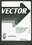
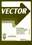

=== " N°1, July 1990"

    ## N°1, July 1990 { #contents-n1-july-1990 }

    | Page | Article | Author |
    | ---: | --- | --- |
    |  | **EDITORIAL** |  |
    | 3 | [Reliability of APL Systems](../v7n1-p3-reliability-of-apl-systems/) | Jonathan Barman |
    |  | **APL NEWS** |  |
    | 5 | [Quick Reference Diary](../v7n1-p5-quick-reference-diary/) |  |
    | 7 | [APL Course Diary](../v7n1-p7-apl-course-diary/) |  |
    | 9 | [General Correspondence](../7/1/VOL.7-NO.1-JULY-1990.pdf#page=11) (PDF) |  |
    | 9 | [British APL Association News](../v7n1-p9-british-apl-association-news/) | Graham Parkhouse |
    | 12 | &emsp;[News from Sustaining Members](../v7n1-p12-news-from-sustaining-members/) | Alison Chatterton |
    | 17 | [The Education VECTOR](../v7n1-p17-the-education-vector/) | Alan Sykes |
    | 19 | &emsp;[Communications](../v7n1-p19-communications/) | Alan Sykes |
    | 20 | &emsp;[Function Sampling with I-APL](../art10009260/) | Walter Spunde |
    | 27 | &emsp;[More String Manipulations](../art10009600/) | Alan Sykes |
    | 33 | [APL91: Conference Announcement](../v7n1-p33-apl91-conference-announcement/) | Curtis Jones |
    |  | [**REVIEWS**](../v7n1-p47-reviews-section/) |  |
    | 38 | [APL Product Guide](../v7n1-p38-apl-product-guide/) | Alison Chatterton |
    | 49 | [Dyalog APL for MS DOS](../art10008330/) | Adrian Smith |
    | 54 | [Powertools/CUA](../art10008340/) | Adrian Smith |
    | 57 | [Book Announcement: APL with a Mathematical Accent](../v7n1-p57-apl-with-a-mathematical-accent/) | Norman Thomson |
    |  | **RECENT MEETINGS** |  |
    | 60 | [Vendor Forum: 20th April 1990](../v7n1-p60-vendor-forum-20th-april-1990/) | Adrian Smith |
    |  | **SPECIAL FEATURE** |  |
    | 67 | [J: An Informal Introduction](../art10003990/) | Kenneth E. Iverson |
    |  | **GENERAL ARTICLES** |  |
    | 80 | [The APL Statistics Library Project](../art10006240/) | The ASL Team |
    | 90 | [Some Questions of Programming Style for the APL Statistical Library](../art10000310/) | David Appleton |
    | 96 | [APL-2741](../art10008350/) | Adrian Smith |
    |  | **TECHNICAL SECTION** |  |
    | 110 | [Hackers Corner: Lots More VGA Colours](../v7n1-p110-hackers-corner-lots-more-vga-colours/) | Adrian Smith |
    | 112 | [Technical Correspondence](../7/1/VOL.7-NO.1-JULY-1990.pdf#page=114) (PDF) |  |
    | 112 | &emsp;[The Dangers of APL RISC programming...](../v7n1-p112-dangers-of-apl-risc-programming/) | Bob Bykerk |
    | 113 | &emsp;[VCAT in Sharp APL](../v7n1-p113-vcat-in-sharp-apl/) | E.E. McDonnell |
    | 115 | &emsp;[How to Kill More Cats...](../v7n1-p115-how-to-kill-more-cats/) | Norman Thomson |
    | 117 | &emsp;[The power operator](../v7n1-p117-power-operator/) | John Scholes |
    | 117 | &emsp;[The INVERSE operator in APL2.5](../v7n1-p117-inverse-operator-in-apl2-5/) | I. Phelfritt (née Leigh) |
    | 118 | &emsp;[The APL\*PLUS ‘dead key’ Problem ...](../v7n1-p118-apl-plus-dead-key-problem/) | Cedric Heddle |
    | 119 | &emsp;[The Falkoff Keyboard: a Franco-Belgian Response!](../v7n1-p119-falkoff-keyboard-franco-belgian-response/) | Alain Delmotte |
    | 120 | &emsp;[Surely There Must Be a Better Way...](../v7n1-p120-surely-there-must-be-a-better-way/) | Adrian Smith |
    | 121 | &emsp;[Speculations on Fermat Equations ...](../v7n1-p121-speculations-on-fermat-equations/) | Anne D Wilson |
    | 124 | [APL Standards Update](../v7n1-p124-apl-standards-update/) | David Ziemann |
    | 127 | [A Survey of ⎕NC](../art10004390/) | Joseph L.F. de Kerf |
    | 143 | [Index to Advertisers](../7/1/VOL.7-NO.1-JULY-1990.pdf#page=145) (PDF) |  |
    | 143 | [Submitting Material to Vector](../v7n1-p143-submitting-material-to-vector/) |  |

    [PDF of the whole issue](1/VOL.7-NO.1-JULY-1990.pdf)

=== " N°2, October 1990"

    ## N°2, October 1990 { #contents-n2-october-1990 }

    | Page | Article | Author |
    | ---: | --- | --- |
    | 3 | [EDITORIAL: Namespaces](../v7n2-p3-editorial-namespaces/) | Jonathan Barman |
    |  | **APL NEWS** |  |
    | 5 | [Quick Reference Diary](../v7n2-p5-quick-reference-diary/) |  |
    | 7 | [APL Training Courses 1990-91](../v7n2-p7-apl-training-courses-1990-91/) |  |
    |  | British APL Association News: |  |
    | 9 | &emsp;[Outstanding Achievement Award](../v7n2-p9-outstanding-achievement-award/) | David Eastwood |
    | 11 | &emsp;[News from Sustaining Members](../v7n2-p11-news-from-sustaining-members/) | Alison Chatterton |
    | 17 | [The Education VECTOR](../v7n2-p17-the-education-vector/) | Alan Sykes |
    | 19 | &emsp;[Puzzle Corner: Chess Board Pattern](../v7n2-p19-puzzle-corner-chess-board-pattern/) | Alan Sykes |
    | 20 | &emsp;[‘DAYOFWEEK’: Education Vector 7.1](../v7n2-p20-dayofweek-education-vector-7-1/) | C.E. Williams |
    | 21 | &emsp;[Reading ASCII files into I-APL](../v7n2-p21-reading-ascii-files-into-i-apl/) | J.C. Hines |
    | 24 | &emsp;[Dbase and Lotus files into I-APL](../v7n2-p24-dbase-and-lotus-files-into-i-apl/) | W J Smith |
    | 25 | &emsp;[I-APL Constraints](../v7n2-p25-i-apl-constraints/) | Walter G Spunde |
    | 27 | &emsp;[Searching for Strings in Strings](../art10009610/) | Alan Sykes |
    |  | **REVIEWS** |  |
    | 33 | [APL Product Guide](../v7n2-p33-apl-product-guide/) | Alison Chatterton |
    | 43 | [APL Makes the Front Page in the USSR](../v7n2-p43-apl-makes-the-front-page-in-the-ussr/) | Anthony Camacho |
    |  | **RECENT MEETINGS** |  |
    | 50 | [Packaged Workspaces in APL2](../art10007950/) | Nick Small |
    | 63 | [Packaged Workspaces and their Implications for Application Design](../art10006840/) | Dave Piper |
    |  | **APL90: Conference News and Analysis** |  |
    | 76 | [APL 90 and the Ideal APL Conference](../v7n2-p76-apl-90-and-the-ideal-apl-conference/) | Anthony Camacho |
    | 80 | [A Personal View on APL 90](../v7n2-p80-a-personal-view-on-apl-90/) | Ray Cannon |
    | 81 | [АПЛ in The Soviet Union](../art10007850/) | John Searle |
    | 83 | [Reports on the Presentations](../v7n2-p83-reports-on-the-presentations/) | The Vector Team |
    | 95 | [APL90 Reflections](../v7n2-p95-apl90-reflections/) | John Searle |
    | 97 | [Pictures at an Exhibition](../v7n2-p97-pictures-at-an-exhibition/) |  |
    | 99 | [A Dictionary of J](../art10004000/) ⚠ | Ken Iverson |
    |  | **GENERAL ARTICLES** |  |
    | 118 | [Densities Well Suited for Statistics Problems](../art10010670/) | Dr Dietrich Trenkler |
    | 125 | [What’s Wrong with Parentheses?](../art10004400/) | Joseph De Kerf |
    |  | **TECHNICAL SECTION** |  |
    | 132 | [Hackers Corner: Unlocking in Dyalog APL](../v7n2-p132-hackers-corner-unlocking-in-dyalog-apl/) | Ray Cannon |
    | 133 | [Technical Correspondence](../7/2/VOL.9-NO.2-OCTOBER-1990.pdf#page=135) (PDF) |  |
    | 133 | &emsp;[Teaching nested arrays](../v7n2-p133-teaching-nested-arrays/) | Dave Piper |
    | 135 | [Comparison Tolerance Explained](../art10009970/) | Norman Thomson |
    | 138 | [Namespace Play](../art10000570/) | Jonathan Barman |
    | 143 | [Index to Advertisers](../7/2/VOL.9-NO.2-OCTOBER-1990.pdf#page=145) (PDF) |  |

    ⚠ The transcription is doubtful or missing; its page says why.

    [PDF of the whole issue](2/VOL.9-NO.2-OCTOBER-1990.pdf)

=== " N°3, January 1991"

    ## N°3, January 1991 { #contents-n3-january-1991 }

    | Page | Article | Author |
    | ---: | --- | --- |
    | 3 | [EDITORIAL: Solving Problems with APL](../v7n3-p3-editorial/) | Jonathan Barman |
    |  | **APL NEWS** |  |
    | 5 | [Quick Reference Diary](../v7n3-p5-quick-reference-diary/) |  |
    | 7 | [APL Training Courses 1991](../v7n3-p7-apl-training-courses-1991/) |  |
    | 8 | [General Correspondence](../7/3/VOL.7-NO.3-JANUARY-1991.pdf#page=14) (PDF) |  |
    | 8 | &emsp;[APL conference on CIX](../v7n3-p8-apl-conference-on-cix/) | Pan Pantziarka |
    |  | British APL Association News: |  |
    | 9 | &emsp;[Projects Report](../v7n3-p9-projects-report/) | John Searle |
    | 10 | &emsp;[Publicity Officer's Report](../v7n3-p10-publicity-officers-report/) | Jonathan Martin |
    | 11 | &emsp;[Thoughts on APL 1994](../v7n3-p11-thoughts-on-apl-1994/) | David Eastwood |
    | 13 | &emsp;[News from Sustaining Members](../v7n3-p13-news-from-sustaining-members/) | Alison Chatterton |
    | 17 | [The Education Vector](../v7n3-p17-the-education-vector/) | Alan Sykes |
    | 19 | &emsp;[Letters on String Manipulations in APL](../v7n3-p19-letters-on-string-manipulations-in-apl/) | Alan Sykes |
    | 24 | &emsp;[An APL SCRIPT Function](../art10009620/) | Alan Sykes |
    | 27 | &emsp;[A to B or not A to B?](../art10009630/) | Alan Sykes |
    | 33 | [The Random Vector](../v7n3-p33-the-random-vector/) | David Eastwood |
    | 35 | &emsp;[ASL News and Status - December 1990](../v7n3-p35-asl-news-and-status-december-1990/) | David Eastwood |
    | 36 | &emsp;[The Genesis of ASL](../art10006250/) | Tony O’Hagan |
    | 38 | &emsp;[Within ASL - Basic Statistics](../v7n3-p38-within-asl-basic-statistics/) |  |
    | 41 | &emsp;[WAGS: a Graphics Specification Language for ASL](../art10006260/) | Tony O’Hagan |
    |  | **REVIEWS** |  |
    | 50 | [APL Product Guide](../v7n3-p50-apl-product-guide/) | Alison Chatterton |
    | 61 | [Windows 3: the Implications for APL](../v7n3-p61-windows-3-the-implications-for-apl/) | Adrian Smith |
    | 65 | [First Catch your Function: the STSC Compiler](../art10001740/) | Ray Cannon |
    | 68 | [APL\*PLUS/PC Release 10](../art10000580/) | Jonathan Barman |
    |  | **RECENT MEETINGS** |  |
    | 76 | [PostScript Graphics in APL](../art10008360/) | Adrian Smith |
    | 93 | [Field Trip to Rowntree Mackintosh](../v7n3-p93-field-trip-to-rowntree-mackintosh/) | Sylvia Camacho |
    | 98 | [**GENERAL ARTICLES**](../v7n3-p98-general-articles/) |  |
    | 99 | [APL91 Update](../v7n3-p99-apl91-update/) | Charles Schulz |
    | 102 | [Soviet APL: a Historical Outline](../art10006010/) | Alexei I. Miroshnikov |
    | 109 | [Object Oriented Programming and APL](../art10004130/) | Zdenek V Jizba |
    |  | **TECHNICAL SECTION** |  |
    | 125 | [Hackers Corner: Check that Disk!](../v7n3-p125-hackers-corner-check-that-disk/) | Adrian Smith |
    | 126 | [Technical Correspondence](../7/3/VOL.7-NO.3-JANUARY-1991.pdf#page=132) (PDF) |  |
    | 126 | &emsp;[Workspace search function](../v7n3-p126-workspace-search-function/) | Peter Branson |
    | 127 | &emsp;[Packaged Workspaces in APL2/370](../v7n3-p127-packaged-workspaces-in-apl2-370/) | Nicholas Small |
    | 128 | &emsp;[PostScript Support for APL under Windows](../v7n3-p128-postscript-support-for-apl-under-windows/) | George MacLeod |
    | 130 | [Mice do it on the Mat](../art10001760/) | Ray Cannon |
    | 136 | [Problems for APL Buffs (III)](../art10004140/) | Zdenek V Jizba |
    | 143 | [Index to Advertisers](../7/3/VOL.7-NO.3-JANUARY-1991.pdf#page=149) (PDF) |  |
    |  | [Mandelbrot Sets](../art10001750/) (PDF only) | Ray Cannon |

    [PDF of the whole issue](3/VOL.7-NO.3-JANUARY-1991.pdf)

=== " N°4, April 1991"

    ## N°4, April 1991 { #contents-n4-april-1991 }

    | Page | Article | Author |
    | ---: | --- | --- |
    | 3 | [EDITORIAL: a Babel of APL Dialects?](../7/4/VOL.7-NO.4-APRIL-1991.pdf#page=5) (PDF) | Jonathan Barman |
    |  | **APL NEWS** |  |
    | 5 | [Quick Reference Diary](../7/4/VOL.7-NO.4-APRIL-1991.pdf#page=7) (PDF) |  |
    |  | British APL Association News: |  |
    | 7 | &emsp;[Recruitment Officer’s Report](../7/4/VOL.7-NO.4-APRIL-1991.pdf#page=9) (PDF) | Jill Moss |
    | 8 | &emsp;[News from Sustaining Members](../7/4/VOL.7-NO.4-APRIL-1991.pdf#page=10) (PDF) | Alison Chatterton |
    | 11 | [APL91 Abstracts](../7/4/VOL.7-NO.4-APRIL-1991.pdf#page=13) (PDF) |  |
    | 17 | [The Education Vector](../7/4/VOL.7-NO.4-APRIL-1991.pdf#page=19) (PDF) | Alan Sykes |
    | 19 | &emsp;[Shape, Ravel and Roll](../art10009270/) | Walter Spunde |
    | 25 | &emsp;[Execution Time](../art10009640/) (PDF only) | Alan Sykes |
    | 33 | [The Random Vector](../7/4/VOL.7-NO.4-APRIL-1991.pdf#page=35) (PDF) | David Eastwood |
    | 36 | &emsp;[The Genesis of ASL (2)](../art10006270/) (PDF only) | Tony O’Hagan |
    | 41 | &emsp;[The Regression Shelf](../art10009650/) (PDF only) | Alan Sykes |
    |  | **REVIEWS** |  |
    | 52 | [APL Product Guide](../7/4/VOL.7-NO.4-APRIL-1991.pdf#page=54) (PDF) | Alison Chatterton |
    | 62 | [ZARK: an APL Tutor](../art10010620/) (PDF only) | Emily Timson |
    | 67 | [APL.68000 Level II](../art10003530/) (PDF only) | Iain Hayward |
    | 74 | [APL\*PLUS/PC PostScript Support](../7/4/VOL.7-NO.4-APRIL-1991.pdf#page=76) (PDF) | Adrian Smith |
    |  | **RECENT MEETINGS** |  |
    | 76 | [GSS Graphics with APL\*PLUS/PC](../art10005950/) (PDF only) | George MacLeod |
    | 78 | [The Ideal Screen Editor](../art10001490/) (PDF only) | Anthony Camacho |
    | 83 | [APL Graphics - First Principles](../art10006340/) (PDF only) | Graham Parkhouse |
    |  | **GENERAL ARTICLES** |  |
    | 100 | [Writing Assembly Language Functions for ⎕NA](../art10003270/) (PDF only) | Allan Gay |
    | 110 | [Mandelbrot Sets](../art10001770/) (PDF only) | Ray Cannon |
    |  | **TECHNICAL SECTION** |  |
    | 116 | [NED: A nesting editor for APL\*PLUS/PC](../art10003140/) (PDF only) | Olle Evero |
    | 119 | [Thoughts on J←f g h](../art10004220/) (PDF only) | Maurice Jordan |
    | 126 | [Full Screen Methods with APL2](../art10001180/) (PDF only) | Peter Branson |
    | 133 | [A Note on the Match Function in APL](../art10004410/) (PDF only) | Joseph L.F. De Kerf |
    | 138 | [The Steam-Hammer and the Fly](../art10004640/) | Gerard A Langlet |
    | 143 | [Index to Advertisers](../7/4/VOL.7-NO.4-APRIL-1991.pdf#page=145) (PDF) |  |

    [PDF of the whole issue](4/VOL.7-NO.4-APRIL-1991.pdf)
