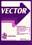
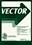
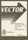

=== " N°1, July 1992"

    ## N°1, July 1992 { #contents-n1-july-1992 }

    | Page | Article | Author |
    | ---: | --- | --- |
    | 3 | [Editorial: Maximising the Reuse of Code and OOA](../art10000610/) | Jonathan Barman |
    |  | **APL NEWS** |  |
    | 5 | [Quick Reference Diary](../v9n1-p5-quick-reference-diary/) |  |
    | 7 | [APL Course Diary](../v9n1-p7-apl-course-diary/) |  |
    | 9 | [General Correspondence](../9/1/VOL.9-NO.1-JULY-1992.pdf#page=11) (PDF) |  |
    | 9 | &emsp;[The Hungarian Naming Convention](../v9n1-p9-hungarian-naming-convention/) | Ray Cannon |
    | 9 | &emsp;[STSC’s Double Whammy](../art10006850/) | David Piper |
    |  | British APL Association News: |  |
    | 13 | &emsp;[Committee News & Annual Accounts](../v9n1-p13-committee-news-annual-accounts/) |  |
    | 17 | &emsp;[BAA Publicity Ideas](../v9n1-p17-baa-publicity-ideas/) | Misha Jovanovic |
    | 19 | &emsp;[News from Sustaining Members](../v9n1-p19-news-from-sustaining-members/) | Gill Smith |
    | 23 | [The Education Vector](../v9n1-p23-the-education-vector/) | Alan Mayer |
    | 25 | &emsp;[The MAGIC Puzzle](../art10005920/) | Bill McLean |
    | 30 | &emsp;[Two Mathematical Functions](../v9n1-p30-two-mathematical-functions/) | C.E. Williams |
    | 32 | &emsp;[Workspace Listing in I-APL](../art10002830/) | Alain Delmotte |
    |  | **REVIEWS SECTION** |  |
    | 39 | [APL Product Guide](../v9n1-p39-apl-product-guide/) | Gill Smith |
    | 50 | [Six Months in the Life of VECTOR](../v9n1-p50-six-months-in-the-life-of-vector/) | John Searle |
    | 53 | [APL\*PLUS II/386 Version 4](../art10002660/) | David Crossley |
    |  | **RECENT MEETINGS** |  |
    | 62 | [French Visitors in Napoleon’s Footsteps](../art10002940/) | from the Obninsky News |
    | 64 | [Stone-walling in APL](../art10008420/) | Adrian Smith |
    |  | **GENERAL ARTICLES** |  |
    | 80 | [The \]HELP Command](../art10001800/) | Ray Cannon |
    | 85 | [Making a Calendar in J](../art10008010/) | Keith Smillie |
    | 92 | [Using J’s Boxed Arrays](../art10005830/) | Donald B. McIntyre |
    | 107 | [The Random Vector](../v9n1-p107-random-vector-editorial/) | David Eastwood |
    | 109 | &emsp;[Non-linear Regression Modelling in APL](../art10003590/) | Peter Hingley |
    |  | **TECHNICAL SECTION** |  |
    | 124 | [Hackers Corner: Using DOS File Functions](../art10006380/) | Duncan Pearson |
    | 126 | [Technical Correspondence](../9/1/VOL.9-NO.1-JULY-1992.pdf#page=128) (PDF) | Appleton & Thomson |
    | 126 | &emsp;[Letter: Non-linear Curve Fitting](../art10009980/) | Norman Thomson |
    | 130 | &emsp;[Letter: Strands in PLUS II](../art10006860/) | David Piper |
    | 131 | &emsp;[Letter: Cloning “After Dark”](../art10006390/) | Duncan Pearson |
    | 129 | &emsp;[Stirling Numbers](../v9n1-p129-stirling-numbers/) | David Appleton |
    |  | ∘.? (Random Jottings) |  |
    | 133 | &emsp;[DOIF Considered Harmful](../art10006870/) | Dave Piper |
    | 143 | [Index to Advertisers](../9/1/VOL.9-NO.1-JULY-1992.pdf#page=145) (PDF) |  |

    [PDF of the whole issue](1/VOL.9-NO.1-JULY-1992.pdf)

=== " N°2, October 1992"

    ## N°2, October 1992 { #contents-n2-october-1992 }

    | Page | Article | Author |
    | ---: | --- | --- |
    | 3 | [Editorial: APL, Windows and GUIs](../art10000620/) | Jonathan Barman |
    |  | **APL NEWS** |  |
    | 5 | [Quick Reference Diary](../v9n2-p5-quick-reference-diary/) |  |
    | 7 | [General Correspondence](../9/2/VOL.9-NO.2-OCTOBER-1992.pdf#page=9) (PDF) |  |
    | 7 | &emsp;[Six Months in the Life of Vector (letter)](../v9n2-p7-six-months-in-the-life-of-vector-letter/) | John Searle |
    | 7 | &emsp;[BAA overseas subscription (letter)](../v9n2-p7-baa-overseas-subscription-letter/) | David Crossley |
    |  | British APL Association News: |  |
    | 8 | &emsp;[News from Sustaining Members](../v9n2-p8-news-from-sustaining-members/) | Gill Smith |
    | 13 | [The Education Vector](../v9n2-p13-the-education-vector/) | Alan Mayer |
    | 15 | &emsp;[New Email Discussion List](../v9n2-p15-new-email-discussion-list/) |  |
    | 16 | &emsp;[Exploring MAGIC](../art10011140/) | Dave Ziemann |
    | 27 | &emsp;[Some Notes on Direct Definition](../art10005280/) | Alan Mayer |
    | 29 | [The Random Vector](../v9n2-p29-the-random-vector/) | David Eastwood |
    | 31 | &emsp;[ASL - The Future](../v9n2-p31-asl-the-future/) | Jake Ansell |
    | 32 | &emsp;[ASLGREG reviewed](../art10007490/) | Jon Sandles |
    | 34 | &emsp;[Comments on the ASLGREG Review](../v9n2-p34-comments-on-aslgreg-review/) | Alan Sykes |
    | 35 | &emsp;[Corrections to Known Bugs in ASLGREG (September 1992)](../v9n2-p35-corrections-to-known-bugs-in-aslgreg/) | Alan Sykes |
    | 37 | &emsp;[Reliability Data Analysis](../art10000120/) | Jake Ansell |
    |  | **REVIEWS SECTION** |  |
    | 41 | [APL Product Guide](../v9n2-p41-apl-product-guide/) | Gill Smith |
    | 53 | [Iverson’s Introduction to J](../art10008020/) | Keith Smillie |
    | 55 | [Dyalog APL/W](../art10006400/) | Duncan Pearson |
    |  | **RECENT MEETINGS: APL92 Conference Reports** |  |
    | 66 | [APL 92 Reports](../art10000130/) | Anthony Camacho |
    | 88 | [BEKTOP at St Petersburg](../v9n2-p88-bektop-at-st-petersburg/) | Ray Cannon |
    | 93 | [Pictures at an Exhibition](../v9n2-p93-pictures-at-an-exhibition/) |  |
    | 94 | [Quotable Quotes from APL 92](../v9n2-p94-quotable-quotes-from-apl-92/) | John Searle |
    | 95 | [**GENERAL ARTICLES**](../v9n2-p95-general-articles/) |  |
    | 96 | [Smalltalk, APL and J: an Exercise in Comparative Programming](../art10011150/) | Dave Ziemann |
    | 116 | [Object Oriented Extensions to APL and J](../art10003220/) | Robert J. Frey |
    | 126 | [APL92 Caption Contest](../v9n2-p126-apl92-caption-contest/) |  |
    | 127 | [**TECHNICAL SECTION**](../v9n2-p127-technical-section/) |  |
    | 128 | [Shared Variables and Windows DDE](../art10008430/) | Adrian Smith |
    | 139 | [Three Combinatoric Puzzles](../art10003780/) | Roger K.W. Hui |
    | 143 | [Index to Advertisers](../9/2/VOL.9-NO.2-OCTOBER-1992.pdf#page=145) (PDF) |  |

    [PDF of the whole issue](2/VOL.9-NO.2-OCTOBER-1992.pdf)

=== " N°3, January 1993"

    ## N°3, January 1993 { #contents-n3-january-1993 }

    | Page | Article | Author |
    | ---: | --- | --- |
    | 3 | [Editorial: Commercial APL](../art10000630/) | Jonathan Barman |
    |  | **APL NEWS** |  |
    | 5 | [Quick Reference Diary](../v9n3-p5-quick-reference-diary/) |  |
    | 7 | [APL Training Courses for 1993](../v9n3-p7-apl-training-courses-for-1993/) | Gill Smith |
    |  | British APL Association News: |  |
    | 9 | &emsp;[Note to Members on the Data Protection Act](../v9n3-p9-data-protection-act/) | Nicholas Small |
    | 10 | &emsp;[Projects Officer’s Report](../v9n3-p10-projects-officers-report/) | George Macleod |
    | 12 | &emsp;[News from Sustaining Members](../v9n3-p12-news-from-sustaining-members/) | Gill Smith |
    | 17 | [The Education Vector](../v9n3-p17-the-education-vector/) | Alan Mayer |
    | 19 | &emsp;[Hero vs Orc – A Battle Sequence in APL](../art10009280/) | Walter Spunde |
    | 29 | &emsp;[Teaching Mathematics with APL: Workshop Design](../art10006540/) | Howard Peelle |
    |  | **REVIEWS SECTION** |  |
    | 33 | [APL Product Guide](../v9n3-p33-apl-product-guide/) | Gill Smith |
    | 44 | [Windows Programming with APL\*PLUS II](../art10001810/) | Ray Cannon |
    |  | **RECENT MEETINGS:** |  |
    | 56 | [Meeting at Morgan Stanley, 23 October](../art10000640/) | Jonathan Barman |
    | 60 | [Speeding Up Your APL](../art10003080/) | David Eastwood |
    | 71 | [Genetic Algorithms: their APLication](../art10007500/) | Jon Sandles |
    | 79 | [APL-Club Germany, Schwetzingen, November 6 1992](../art10003090/) | David Eastwood |
    | 79 | &emsp;[An Application of APL in The Roofing Trade](../art10011190/) | Michael Zippel |
    | 81 | &emsp;[Compiled APL for Supercomputers](../art10007840/) | Walter Schwarz |
    |  | **GENERAL ARTICLES** |  |
    | 86 | [Seize the Time](../art10001130/) | Dick Bowman |
    | 89 | [A Little J Horner](../art10006550/) | Howard A. Peelle |
    | 91 | [From the Vital Execute to Fractals and 5-Fold Symmetry](../art10004660/) | Gérard A. Langlet |
    |  | **TECHNICAL SECTION** |  |
    | 98 | [Hackers Corner: Talking to PROGMAN](../art10008440/) | Adrian Smith |
    | 100 | [Technical Correspondence](../9/3/VOL.9-NO.3-JANUARY-1993.pdf#page=102) (PDF) |  |
    | 100 | &emsp;[APL2 Packages: a Cautionary Tale](../v9n3-p100-apl2-packages/) | Nicholas Small |
    | 101 | &emsp;[ASWI Programming Standards; some Whys.](../art10000880/) | F.H.D. van Batenburg |
    | 107 | [APL\*PLUS II Keyboard Configuration](../art10000370/) | Ajay Askoolum |
    | 113 | [Integrating with Insight](../art10009990/) | Norman Thomson |
    | 117 | [Some J Verbs for Orthogonal Factorial Experiments](../art10008030/) | Keith Smillie |
    | 125 | [Jacobi’s Method for Eigenvalues an Illustration of J](../art10005840/) | Donald McIntyre |
    | 134 | [AMENDMENT: “A Change for the Better”](../art10005850/) | Donald McIntyre |
    | 141 | [An Example of Intransitivity in Probability](../art10006360/) | Graham Parkhouse |
    | 143 | [Index to Advertisers](../9/3/VOL.9-NO.3-JANUARY-1993.pdf#page=145) (PDF) |  |

    [PDF of the whole issue](3/VOL.9-NO.3-JANUARY-1993.pdf)

=== " N°4, April 1993"

    ## N°4, April 1993 { #contents-n4-april-1993 }

    | Page | Article | Author |
    | ---: | --- | --- |
    | 3 | [Editorial: What you know is what you love](../art10000650/) | Jonathan Barman |
    |  | **APL NEWS** |  |
    | 5 | [Quick Reference Diary](../v9n4-p5-quick-reference-diary/) |  |
    | 7 | [APL Training Courses for 1993](../v9n4-p7-apl-training-courses-for-1993/) | Gill Smith |
    | 8 | [APL93 in Toronto](../9/4/VOL.9-NO.4-APRIL-1993.pdf#page=10) (PDF) |  |
    | 8 | &emsp;[Conference Invitation](../v9n4-p8-apl93-invitation/) |  |
    | 13 | &emsp;[Abstracts of Accepted Papers](../art10000140/) |  |
    |  | British APL Association News: |  |
    | 18 | &emsp;[Chairman’s Report](../v9n4-p18-chairmans-report/) | David Eastwood |
    | 20 | &emsp;[“The APL Review”](../v9n4-p20-the-apl-review/) | Alan Mayer |
    | 22 | &emsp;[News from Sustaining Members](../v9n4-p22-news-from-sustaining-members/) | Gill Smith |
    | 27 | [The Education Vector](../v9n4-p27-the-education-vector/) | Alan Mayer |
    | 29 | &emsp;[A Beginner’s Guide to Low Cost APLs](../art10003720/) | Dick Holt |
    | 36 | &emsp;[Workshop: Learning Maths with APL](../art10006560/) | Howard Peelle |
    | 41 | &emsp;[AN APL Scrabble Bag](../art10005930/) | Bill McLean, Ted Emms |
    |  | **REVIEWS SECTION** |  |
    | 43 | [APL Product Guide](../v9n4-p43-apl-product-guide/) | Gill Smith |
    | 55 | [APL\*Plus II/386 Version 5.0](../art10006880/) | Dave Piper |
    | 64 | [A First Look at the ISI APL/Windows (APLIWIN) Beta Release](../art10003330/) | Martin Gfeller |
    | 68 | [ISI APL: Programming for Windows](../art10000660/) | Jonathan Barman |
    | 80 | [APL — New Release](../v9n4-p80-apl-new-release/) | Jon Sandles |
    |  | **RECENT MEETINGS:** |  |
    | 82 | [APL-landing to Kronstadt island (an experience of APL operation)](../art10005160/) | from Pavel & Oleg Luksha |
    | 85 | [Roger Hui on “An Implementation of J”](../art10003790/) | notes by Anthony Camacho |
    |  | **GENERAL ARTICLES** |  |
    | 100 | [APL Experiences and MicroSoft’s Visual Basic for Windows](../art10000030/) | Martyn Adams |
    | 113 | [Hooking up to the Internet](../art10001140/) | Dick Bowman |
    |  | **TECHNICAL SECTION** |  |
    | 120 | [The Challenge of the New](../art10006410/) | Duncan Pearson |
    | 122 | [Technical Correspondence](../9/4/VOL.9-NO.4-APRIL-1993.pdf#page=124) (PDF) |  |
    | 122 | &emsp;[More on APL Packages](../v9n4-p122-more-on-apl-packages/) | A.J. Brown |
    | 123 | [Sharing the Spoils or Circling the Square](../art10002790/) | Mike Day |
    | 130 | [An Exchange on Primes](../art10003800/) | Roger K.W. Hui |
    | 135 | [Span Representation: Improving the Display of J Verbs](../art10006200/) | Richard Oates |
    | 138 | [An APL Truetype Font](../art10008450/) | Adrian Smith |
    | 143 | [Index to Advertisers](../9/4/VOL.9-NO.4-APRIL-1993.pdf#page=145) (PDF) |  |

    [PDF of the whole issue](4/VOL.9-NO.4-APRIL-1993.pdf)
