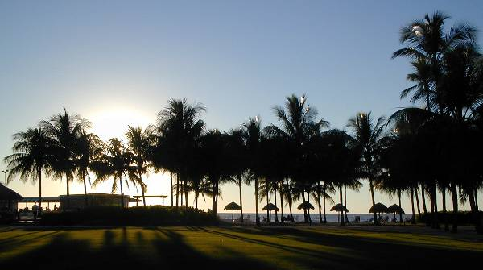
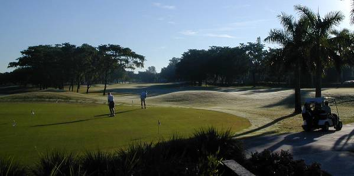
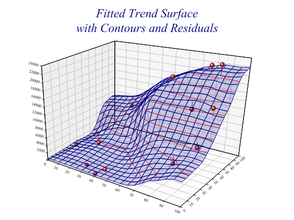
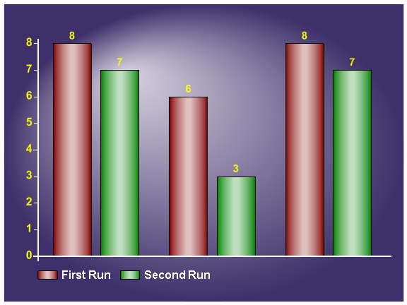
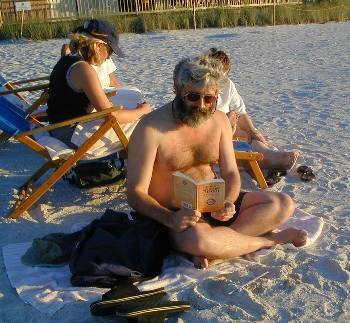

## APL2000 User Conference 2002 Nov 10th-13th at Naples, Florida

*reported by Adrian Smith*

## Location, Location

There is very little one could say against Naples (just at the moment I can’t think of anything) and an awful lot in its favour.

{ width="600" height="335" }

It was warm, but not hot. It was (mostly) dry but with a sea-breeze during the afternoon. The sun set over the sea. This being Florida, the beach is publicly owned, so you could hike about 2 miles North, and South as far as you wanted. Naples itself is about 3 miles further down the coast, but it is comfortable walking in the cool of the evening, and the choice of restaurants is excellent (but don’t be too late – they start closing up around 8:30).

The Naples Beach Hotel was only a bit posh, and the conference room-rate was extremely reasonable. The above shot shows the bar (the day’s sessions always finished in time to watch the sunset) and the beach. It is now a tradition of APL2000 conferences that breakfast is provided, which (a) neatly circumvents the one obvious piece of rip-off pricing and (b) is a great place to meet and natter in the cool of the early morning. I can report that Causeway made a handsome profit on the trip, and the ample networking opportunities had a lot to do with it.

The meeting rooms all opened out onto the balcony which fronted onto the ‘championship quality’ golf course, which looked a bit like this in the early morning:

{ width="599" height="299" }

Tempted? You should be! Actually the really good option was a very well-set-up practice ground with buckets of balls at $2 a time (clubs free). An excellent way to work off the effects of a sedentary morning was to take a bucket of balls and a 7‑iron and belt them satisfyingly into the distance.

## The Content

### Training days

The training days (Sunday and Wednesday) were dominated by a heavyweight introduction to APL and WebServices. You can read a little more about this in FM Waid’s article which follows this report on page 71 – Jonathan and I went off to “Corkscrew Swamp” to look for alligators and cypress trees so we will be catching up on this later. It is a particularly interesting new technology, and may well be responsible for many of the customer ‘win-backs’ which APL2000 are reporting. Probably it will be the hot technology of 2003, and it is particularly relevant to APLers working with ‘large organisations’, which just could mean *you*. Don’t ignore it, it won’t be going away.

### First Conference Day

**Sonia** booked us all in with her usual efficiency and **Eric Baelen** had picked himself up from the previous week’s Cognos Finance conference sufficiently to get things started with his usual  mix of enthusiasm and anecdote. Unfortunately, I was scheduled to present RainPro and NewLeaf opposite **Patrick Parks** on the ‘inner secrets’ of the new WebServices capability, so we will just have to wait for Patrick to send us something to publish here. There was also an excellent introduction to making an application multilingual, which is well-documented in the published papers. Maybe we will re-run this in a future Vector?

**Jonathan Manktelow** ran two sessions on getting the best out of the new ‘APLDraw’ OCX control which is shipping with APL+Win version 5. This is a full interface to GDI+ (native on XP and freely redistributable otherwise) which allows APLers to create all the standard image formats (JPEG, GIF, PNG etc) and exploit all the nice effects (like transparency and gradient fills) that come free with the system. It is a huge step forward from the old ‘Draw’ method and allows APL programmers to create genuinely leading-edge graphics with high efficiency.

<table cellspacing="0" cellpadding="0" hspace="0" vspace="0" align="left">
 <tr>
  <td valign="top" align="left">
  

  </td>
 </tr>
</table>

This is the sort of thing you can now do rather easily with APL (that shadow is done with a variable opacity black, so it correctly modifies whatever is beneath), and from my point of view, it offers me some really exciting new possibilities for RainPro charts.

As an example, here is a fitted 3D surface, which is partially transparent so that you can still see the data-points which are below it:

{ width="576" height="432" }

... or if you just want to take on PowerPoint at its own game, you can do your barcharts like this now:

{ width="576" height="432" }

I *think* I have got everything I need running with the new OCX as csView PG, so look forward to an upgrade of RainPro alongside the shipping version of APL+Win V5. It looks better, runs faster (about 3 times faster on average) and has simplified my viewer code enormously. Enough said.

**Eric Baelen** on “Making IE work for You” was a thorough introduction to using the WebBrowser object as a component of your application. This straightened out several issues for me (GraPL Desktop is about to gain a “Preview as SVG” panel as a consequence) and introduced some good new ideas, for example using a webform (bog standard HTML) to log errors and ‘Submit’ the error messages (with the user’s comments) directly to your server over the internet.

And so to the beachside barbeque and entertainment. We were not disappointed, in fact young Parks was so good on the piano that I bought 3 of his CDs.

### Second Conference Day

**Eric Lescasse** gave us a serious hit on the APL grid object. He showed a time-tabling application he had built for TF1 (the major French TV channel) which used the grid in any way you could think of, and several others besides. It was quite interesting to see one of his early panels from the initial ‘concept’ design which predated the grid, and managed most of the same tricks in raw Gui APL code. One day, he may re-code it to use the real grid, but I think he has more urgent calls on his time.

I missed out on the rest of the morning, but the papers on the enhancements to the session manager (**Mark Osborne**) and the Windows registry (**Brian Chizever**) were well-covered in the written proceedings. Likewise after lunch, we had **Marvin Renich** covering some undocumented ŒWCALL options and INI-file settings which may be generally useful. I gave a brief introduction to Genetic Algorithms (and solved at least one delegate’s ‘hard’ problem along the way) and we ended the afternoon with an excellent talk from **Rick Woll** of Allstate Insurance on the power of the WebServer concept in getting APL accepted within a corporate culture. I was particularly impressed with the simple, elegant, consistent design of the pages he showed. As he pointed out in his talk, the lady who builds the ‘website’ has little or no knowledge of APL, and he really doesn’t care about the input documents. He can focus on writing the APL code to convert an incoming set of parameters into an output set of values and associated text. The result is a clean, simple, maintainable APL ‘backend’ which is functionally well separated from the equally clean, simple HTML front end. Maybe there is a lesson here for the rest of us?!

## Summary

<table cellspacing="0" cellpadding="0" hspace="0" vspace="0" align="left">
 <tr>
  <td valign="top" align="left">
  

  </td>
 </tr>
</table>

Well worth the trip, if only to escape the English November for a week or so. We flew BA to Tampa and drove down the coast, which was a most enjoyable way to make the journey. The Cannons (pictured) took the Virgin route via Orlando which is particularly good value if you book early and buy the whole ‘package’ deal.

If APL2000 do it all over again next year, we will be there, war and weather permitting. Maybe this time I will get my 3-wood straightened out, if I work at it.

***
