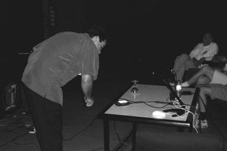

*reported by Anthony Camacho*
{ .byline }

APL 2002 was held from 22 to 25 July at the Universidad Autonoma de Madrid.

{ width="660" height="316" }

It was well organised. The display equipment worked. The rooms used were never overcrowded. There was an excellent computer workshop with internet access. The food was acceptable. The proceedings were given out at registration – a significant benefit as it enabled delegates to make a much better informed choice of papers to attend. Not only did every delegate get a Vector and a British APL Association CD containing the proceedings, the Vector archive and some free APLs and some of Adrian’s pictures, but also there were copies for everyone of *Les Nouvelles D’APL* from AFAPL and also another CD with A+ in versions for Windows and Unix from Morgan Stanley. There was an excellent conference bag, well designed, well made and with numerous zips and pockets, but there were no T-shirts or other give-aways. (The BAA CD is to be sent to all subscribers to Vector with issue 19.2.)

There were few hitches and they were all well dealt with; the worst was that on the first morning the coach to take us from the hotel to the university did not appear and we were carried in taxis after only about twenty minutes delay and the conference still started almost on time.

There were some good professional presentations, in particular from Dyadic, MicroAPL, Adrian Smith, APL 2000 and Soliton. The best presented conference paper was by Alan Mayer and Alan Sykes. There were some presentations where the author had done nothing to prepare except write the paper and/or had not tried a run through; you know who you are so we won’t add to your embarrassment by naming you.

The University is about half an hour from the centre of Madrid and is quite new. The building where the conference was held was opened in 1999 and felt a bit bleak. There was no place with comfortable chairs to relax and talk if no paper appealed, except the computer room, and since the buses left the hotels at eight thirty or so and did not get back till seven or after, the days were long and tiring.

{ width="661" height="325" }

There are 91 names on the list of participants; as far as I am aware only one paper had to be cancelled because there was no presenter for it.

<table cellpadding="6">
<tr valign="top"><td align="center"> 
  <b>
  The first sighting of Dyalog for the PocketPC 
  John Daintree demonstrates the London Routefinder</b>
 </td>
<td>
I suspect the highlight of the conference
was when John Daintree showed a pocket PC with a full implementation of Dyalog
APL - an excellent additional reason for keeping your functions (and function
lines) short! I want one. 

APL 2000 had significant enhancements to
announce, MicroAPL showed their excellent new multi-platform APL and Dyadic
introduced us to the joys of .NET.

At the banquet the only speech was by Bob
Brown who explained that the venue for APL 2003 was not yet decided and that
the SigAPL committee had not yet agreed on a recipient of the SigAPL
outstanding achievement award for this year. Lynne Shaw presented Jon McGrew
with the plaque for last year’s award, which was not ready in time to give it
to him at Yale (APL 2001). Everyone toasted Manuel Alfonseca (the Chairman of
the conference) and his staff for an excellently organised and run conference.
He deserves thanks from all of us. 
</td>
 </tr>
</table>

## My Impressions of the Conference

*from Ian Clark*

I for one did enjoy the conference, and since I paid my own way from start to finish (that must be a first!) I felt I’d got my money’s worth.

But no thanks to the formal content, which was pretty dismal. I did go to the last day, and I found the open discussion unexpectedly useful. I wish I’d taken notes. The rest wasn’t up to much.

Apart from the vendor material, always worthwhile, if only to see what they’re **not** doing, the only two papers that thrilled me were the one by the Alans and, surprisingly, Paul Cockshott’s on Vector Pascal. I’d reviewed that one, and warned him away from making too ‘academic’ a paper out of it as he was proposing to. I thought it was a long-shot for this conference, but if there was a theme for me, it was how to extend existing procedural languages to give APL-like array functionality, and Vector Pascal was right in there. Its application domain (effectively the cinema of the future) was fascinating to me.

So where was the problem? Couldn’t fault the organisation – although anything university-based has to reconcile the disparate needs of good hotel and food versus cheap university accommodation, which can mean a long trip between comfortable surroundings to chat and the actual presentations. As in this case. Too far to go back for a hanky. Like Anthony, I feel that if everything isn’t on-site it makes a long day of it. Particularly if there’s nowhere to chill-out—nowhere you don’t get shooed out of.

I seem to recall some discussion in the open session on Thursday of commercially-based versus academically-based APL conferences. I don’t think the APL world is dead by any means (last November at Naples, Florida showed a lot of life) but it may be in danger of fragmentation.

I think there are two issues. The comfort issue noted above, which TU-Berlin solved by being a city-centre university site close to the main hotels, and having excellent refreshment and sitting-around facilities just outside the (albeit severe) teaching rooms. And the content issue.

For the sake of clarity I’m going to be beastly and cruel here. I get the feeling with Hispanics that they think that if they just ignore the English-speaking world it will eventually go away. Yet here was Manuel hoping to help his university come out of the Franco closet into the Euro scene, indeed the world scene as represented by APL (which he might hope to be less English-dominated than most computer topics) and yet all it did was expose Spain for the backwater it still is. If we choose in future to have the world conference in a minor-league country, APL-wise (I’d be very careful to exclude say Finland or Denmark from such a designation!) then it’s going to be most important to act as uncle or guardian angel to the local group, without stealing its thunder, to ensure that major players get to submit good papers, and that the schedule doesn’t get filled with who-he’s who are desperate for the shop-window. If a good enough stream of papers don’t materialise, then a bit of cajoling and bullying will need to be done. And not just to plead for fillers from people who are going to turn up and simply ad-lib, or read out their vanilla-flavoured papers word-by-word, but by people who can be guaranteed to put on a good show.

## Some After-Dinner Thoughts

*from Stephen Taylor*

Years ago, a friend asked me what was the longest period I could recall between two cups of coffee. I was startled not to be able to think of one longer than 15 hours. A year ago I started work in APL after being away from it for 15 years. This is unusual and I learned some things I’m glad to know. The first is that I can give it up any time I want.

The second is that the toolset is way better than it was 15 years ago. If you’ve been working continuously in the language, getting these improvements bit by bit, you could overlook how far APL has come as a software development environment. 20 years ago it was a rogue: APL had almost no communication with other computer systems, and its programming environment was weak. Now it has a full development environment.

The third is very odd. Organisations that own APL systems almost all have ‘exit strategies’ for APL; or at least an intention to replace them with other technologies. There is something peculiar, and peculiar to APL, that our clients are willing to pay to get rid of our systems. Even more oddly, in the APL world we take this to be normal. We believe our systems are fast and cheap to develop and run. And we accept it as normal that our clients will take trouble to replace them. What is wrong with this picture?

When I was last in the APL world, people expressed hope that APL’s virtues would one day enjoy wide recognition. I no longer hear that. In contrast, speakers here have commented on how our numbers shrink year by year while our average age rises.

A shrinking user group and clients who intend to replace our systems: this makes the predictable future of APL very clear. It will disappear. This will not necessarily happen. But right now it is our predictable future. If we continue like this, APL will disappear from use.

I see no signs of J being taken up for commercial use. A+ usage is fading as Morgan Stanley slowly replaces with conventional, more cheaply maintained software the applications it developed rapidly in the 80s and 90s. K appears to be thriving modestly in close proximity to kdb.

I am interested in a different future, in which our technology flourishes. I have a self-interest: my productivity in APL commands a premium for  which I cannot charge in other languages. I want to work in APL, or J, or K, or something like them. I am going to assume that all of us here are at least in favour of a future in which these languages flourish, and that the same is true of the larger group of people at past conferences.

A general principle holds that when people espouse something for years and don’t get a result, something is not being said. There is something that the group as a whole is unwilling to look at, express, consider or otherwise deal with.

Some of us inquired into this over dinner during the conference. What is so terrible about our technology that our clients want to get rid of it? Our first thoughts sounded like this. Doesn’t fit in with the IT culture. APL people’s productivity make regular IT folk look bad. Impossible to manage or control.

Which was interesting, because these are not issues about the technology, but about us. Is it possible that WE are the problem? That it isn’t our software our clients are spending to get rid of, it’s us?

Perhaps it’s us, not our systems. There are real issues around managing APL software, but I suspect that rather than help IT departments solve them we have for long succumbed to the temptations of being maverick software gurus; and APL’s extraordinary productivity enabled us to get away with that for longer than anyone else could. Something like this is the thesis of an article Bob Brown and I are preparing. If that’s true, no wonder the IT boys want us out. We APLers have created a brush that I suspect J and K folk are taking care not to get tarred with.

What would the future we want look like? I need a new category to even pose the question. It is not the future of APL that precisely concerns me, but of something else, common to at least APL, A+, J and K. When programmers in these languages look at a program in C or Visual Basic, we all react with “it doesn’t have to be that laborious”. We have a common experience of dense, rigorously general, formal notation that gives us abstractive and expressive power. I don’t know a good name for this, so I’ll call it Dense General Notation or DGN. What divides DGNs from other languages matters more than differences between individual notations.

What would a future in which the DGNs flourish look like? Here are some suggestions.

1. A growing body of commercial developers working in DGNs.
2. World-class research being done in and on DGNs.
3. A vigorous annual joint conference held by a DGN SIG.
4. A web-based study and coaching programme.

Here’s something that’s inconsistent with that. You used to be able to smell the future at an APL conference. You could hear about work that might change the future use of computers. Some of that was being done ON the language, some of it IN the language. An APL conference was an exciting place to be even if you weren’t working in APL. You could sniff the future arriving, and some of it looked like arriving coded in APL. That no longer seems true. The people working on language development are now almost all working elsewhere. And if others are using APL to break radical new ground in their own fields, they’re not coming to our conferences to tell us about it.

Part of the last point must relate to the nearly complete disappearance of APL from education. We used to get a steady trickle of graduates entering the industry because they’d been exposed to APL and wanted more. That seems to have stopped in the UK. The slight use of APL or J in education in the UK is inconsistent with the claims we make for their benefits in exploring mathematics and theories in the natural sciences.

The separation between APL and J users cannot have helped this. As far as I can tell, the educators and the language developers now work with J, leaving a rump of software developers improving their tools (the current APL software development environments really are good) and managing the code base of commercial APL systems. This would explain something about our conferences. Stories of successful systems development can be instructive, but it’s hard to generate much excitement from them.

To address (1) I’ve started on a short series of articles arguing the case in systems development for maverick groups using DGNs to solve pressing problems. Morgan Stanley’s use of A+ to create complex risk-management software would be exemplary. I intend these articles for the IT sections of leading papers in London and New York.

More exposure and commercial credibility for DGNs as tools for smart software developers should stimulate interest within educational institutions and thus (2). The BAA is partly addressing (2) through its Schools Project, which is likely also to produce (4).

***
