The central limit theorem is of tremendous importance to statistical theory. Do students really understand it? How can we help them to? We present here a small revision project which makes students use simulation, most easily in APL, to investigate how addition of variates from the same distribution usually leads to a more nearly Normal distribution. The project is not suitable as an initial approach to the central limit theorem as it brings in too many other statistical ideas, though the simulation programs could be used by a lecturer to produce an informal graphical introduction to the theory. Many teachers probably already do just that; this is for the others. Theoretical results are summarised, not because they are unfamiliar but so that readers may the more quickly assess how much knowledge students must have to complete the project.

### The Central Limit Theorem

The central limit theorem states that if 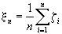 where *ξ<sub>i</sub>* are identically and independently distributed with mean and variance 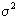 then

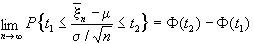

where  is the cumulative distribution function of the standard Normal distribution.

### The Project

<ol type="a">
<li>For each of the following five values of <code>α</code>, generate 10 random samples, each of size 1000, where observations are independently distributed as the sum of a standard exponential variates. (<code>α</code> = 1, 2, 5, 10 and 20). Calculate the skewness and kurtosis of each sample, and plot them (separately) against a suitable power of <code>α</code>. Plot the theoretical values of the skewness and kurtosis for all <code>α</code>≥1, remembering what distribution is formed by the sum of independent exponential variates with the same mean.</li>
<li>Repeat the exercise using rectangular variates. Superimpose the results on the graphs for the exponential distribution, adding again the theoretical values for all <code>α</code>. (You may find it easiest to use the rectangular distribution on [-1,1] for the theoretical part of this question, and to obtain the moments using Maple.)</li>
<li>Now generate 50 samples of 1000 and 50 samples of 100 variates which are the sum of 20 rectangular variates. Compare the standard deviations of your two sets of 50 estimates of skewness with the theoretical standard error of the estimate of skewness from a Normal sample. Do the same for kurtosis.</li>
<li>Repeat part (a) using Cauchy variates.</li>
<li>Discuss all of your results with reference to the central limit theorem.</li>
</ol>

### APL Functions

These are all very easy — indeed trivial — though to execute them you need to be able to use quite large workspaces. Since we are measuring tendency to Normality by skewness and kurtosis we need functions to evaluate these. Let us assume that the replicate samples are contained in the rows of a matrix: one possible function is:

```
   ∇Z←SKKUR X;N
[1] X←X-⍉(⌽⍴X)⍴(+/X)÷N←¯1↑⍴X
[2] X←X÷⍉(⌽⍴X)⍴((+/X×X)÷N)*0.5
[3] Z←((+/X*3),[1.5](+/X*4))÷N
   ∇
```

We need to be able to generate rectangular, exponential and Cauchy variates:

```
   ∇Z←RECT N
[1] Z←(N⍴2147483647)÷2147483648
   ∇

   ∇Z←EXPN N
[1] Z←-ëRECT N
   ∇

   ∇Z←CAUCHY N
[1] Z←3○○¯0.5+RECT N
   ∇
```

The last two of these programs use the inverse of the appropriate distribution functions, which we give here for completeness. For the exponential distribution with unit mean 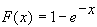, and for the Cauchy distribution 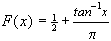.

Finally we need to be able to add the random variates to form the matrices for evaluation of skewness and kurtosis:

```
   ∇Z←REPSNalpha SUM distn
[1] Z←+/⍎distn,' ',⍕REPSNalpha
   ∇
```

where the left-hand parameter contains the number of replicates (10 in most of the project), the sample size (1000 or 100 in the project) and the number of variates to be added (the 5 values of a). The right-hand parameter is the name of one of the functions which generate the random variates. The calculations for part (c) may therefore be performed by calling

```
      SKKUR 50 100 20 SUM 'RECT'
      SKKUR 50 1000 20 SUM 'RECT'
```

### Theoretical results

The sum of a independent unit exponential variates is an Erlangian (or gamma) variate with distribution function 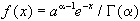 and characteristic function . Since the distribution is asymmetric, it is necessary for students to be able to calculate the central moments using the formulae 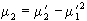 ; 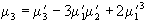 ; 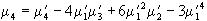. The variance, skewness (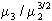) and kurtosis (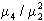) can be shown to be a, 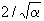, and 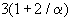 respectively. All these formulae may conveniently be found in Kotz and Johnson.¹

The characteristic function of the rectangular distribution on the interval 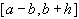 is 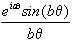. As suggested in the project, therefore, it is easiest to work with <i>a</i>=0, <i>b</i>=1, so that the characteristic function for the sum of `α` such rectangular variates is 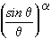. Maple² gives the Taylor expansion of this function as 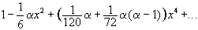 which can be manipulated into the form 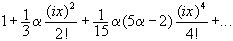 . From this we can see not only that the variance is , which is obviously true since the variance of the rectangular distribution on  is , but also that the kurtosis is 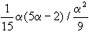 or 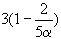. The skewness is of course zero. The Maple command which gives this result is

```
taylor( ((sin(x)/x)^alpha), x= 0, 6 ); .
```

though in fact working with *m* = 1/`α` makes the algebra easier.

For large samples of size *n* the variance of the skewness of a Normal distribution is approximately 6/<i>n</i>, and that of the kurtosis 24/<i>n</i>.

### Simulation Results

Figure 1 shows graphs of a set of simulations for the rectangular and exponential distributions. The student has to choose what power of `α` to plot the skewness and kurtosis against. Since the rectangular distribution is symmetrical it does not matter what power is chosen for skewness, but for the exponential distribution `α`<sup>-1/2</sup> is best as it shows the relationship as a straight line. For either distribution `α`<sup>-1</sup> is best for kurtosis for the same reason.

Figure 2 gives the same information for the Cauchy distribution. Note the considerable change of scale.

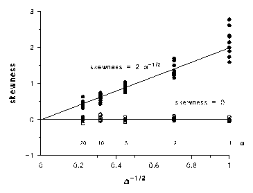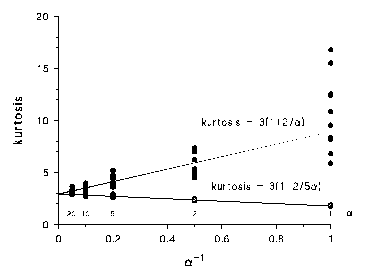

Figure 1. (a) skewness and (b) kurtosis of the sum of exponential (•) or rectangular (o) variates. Each point represents a sample of 1000 variates which are formed as the sum of `α` such variates, for `α` = 1, 2, 5, 10 or 20. The theoretical results are superimposed.

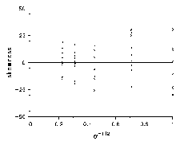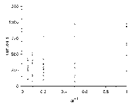

Figure 2. (a) skewness and (b) kurtosis of the sum of Cauchy variates. Each point represents a sample of 1000 variates which are formed as the sum of `α` Cauchy variates, for `α` = 1, 2, 5, 10 or 20.

What are students to make of such results? They ought to be struck by the closeness of the simulations to the theoretical results, and by the small amount of variability when rectangular variates are involved as compared to exponential variates. The greater variability when fewer variates are summed should also be clear. It should be obvious to them that the Cauchy results are totally different from those of the other two distributions. That the skewness tends to zero and the kurtosis to the value 3 as `α` gets large (though it does not need to be very large for the values to be close) should be clear evidence that the distributions are tending rapidly to Normality.

For the particular simulations carried out here for the sum of rectangular variates, when `α` = 20, we have results as in Table I.

<table align="center">                                                                                                                                    

 <tr>                                                                                                                                                   

  <td width="79" valign="top" style="’width:59.3pt;padding:0cm" 5.4pt 0cm 5.4pt&rsquo;>                                                                             

  <p class="MsoNormal" align="center" style="’text-align:center;line-height:normal;" mso-element:frame;mso-element-frame-hspace:9.0pt;mso-element-wrap:around; mso-element-anchor-vertical:paragraph;mso-element-anchor-horizontal:margin; mso-element-top:53.35pt&rsquo;></p>                                          

  <p class="MsoNormal" align="center" style="’text-align:center;line-height:normal;" mso-element:frame;mso-element-frame-hspace:9.0pt;mso-element-wrap:around; mso-element-anchor-vertical:paragraph;mso-element-anchor-horizontal:margin; mso-element-top:53.35pt&rsquo;></p>                                          

  </td>                                                                                                                                                 

  <td width="474" colspan="6" valign="top" style="’width:355.8pt;padding:0cm" 5.4pt 0cm 5.4pt&rsquo;>                                                                 

  <p class="MsoNormal" align="center" style="’text-align:center;line-height:normal;" mso-element:frame;mso-element-frame-hspace:9.0pt;mso-element-wrap:around; mso-element-anchor-vertical:paragraph;mso-element-anchor-horizontal:margin; mso-element-top:53.35pt&rsquo;>Sample                                                                           

  size</p>                                                        

  <p class="MsoNormal" align="center" style="’text-align:center;line-height:normal;" mso-element:frame;mso-element-frame-hspace:9.0pt;mso-element-wrap:around; mso-element-anchor-vertical:paragraph;mso-element-anchor-horizontal:margin; mso-element-top:53.35pt&rsquo;></p>                                          

  </td>                                                                                                                                                 

  <p class="MsoNormal"></p>                                                

 </tr>                                                                                                                                                  

 <tr>                                                                                                                                                   

  <td width="79" valign="top" style="’width:59.3pt;padding:0cm" 5.4pt 0cm 5.4pt&rsquo;>                                                                             

  <p class="MsoNormal" align="center" style="’text-align:center;line-height:normal;" mso-element:frame;mso-element-frame-hspace:9.0pt;mso-element-wrap:around; mso-element-anchor-vertical:paragraph;mso-element-anchor-horizontal:margin; mso-element-top:53.35pt&rsquo;></p>                                          

  <p class="MsoNormal" align="center" style="’text-align:center;line-height:normal;" mso-element:frame;mso-element-frame-hspace:9.0pt;mso-element-wrap:around; mso-element-anchor-vertical:paragraph;mso-element-anchor-horizontal:margin; mso-element-top:53.35pt&rsquo;></p>                                          

  </td>                                                                                                                                                 

  <td width="237" colspan="3" valign="top" style="’width:177.9pt;padding:0cm" 5.4pt 0cm 5.4pt&rsquo;>                                                                 

  <p class="MsoNormal" align="center" style="’text-align:center;line-height:normal;" mso-element:frame;mso-element-frame-hspace:9.0pt;mso-element-wrap:around; mso-element-anchor-vertical:paragraph;mso-element-anchor-horizontal:margin; mso-element-top:53.35pt&rsquo;>100</p>                                       

  <p class="MsoNormal" align="center" style="’text-align:center;line-height:normal;" mso-element:frame;mso-element-frame-hspace:9.0pt;mso-element-wrap:around; mso-element-anchor-vertical:paragraph;mso-element-anchor-horizontal:margin; mso-element-top:53.35pt&rsquo;></p>                                          

  </td>                                                                                                                                                 

  <td width="237" colspan="3" valign="top" style="’width:177.9pt;padding:0cm" 5.4pt 0cm 5.4pt&rsquo;>                                                                 

  <p class="MsoNormal" align="center" style="’text-align:center;line-height:normal;" mso-element:frame;mso-element-frame-hspace:9.0pt;mso-element-wrap:around; mso-element-anchor-vertical:paragraph;mso-element-anchor-horizontal:margin; mso-element-top:53.35pt&rsquo;>1000</p>                                      

  <p class="MsoNormal" align="center" style="’text-align:center;line-height:normal;" mso-element:frame;mso-element-frame-hspace:9.0pt;mso-element-wrap:around; mso-element-anchor-vertical:paragraph;mso-element-anchor-horizontal:margin; mso-element-top:53.35pt&rsquo;></p>                                          

  </td>                                                                                                                                                 

  <p class="MsoNormal"></p>                                                

 </tr>                                                                                                                                                  

 <tr style="’height:36.0pt’">                                                                                                                             

  <td width="79" valign="top" style="’width:59.3pt;padding:0cm" 5.4pt 0cm 5.4pt; height:36.0pt&rsquo;>                                                                                                                                       

  <p class="MsoNormal" align="center" style="’text-align:center;line-height:normal;" mso-element:frame;mso-element-frame-hspace:9.0pt;mso-element-wrap:around; mso-element-anchor-vertical:paragraph;mso-element-anchor-horizontal:margin; mso-element-top:53.35pt&rsquo;></p>                                          

  <p class="MsoNormal" align="center" style="’text-align:center;line-height:normal;" mso-element:frame;mso-element-frame-hspace:9.0pt;mso-element-wrap:around; mso-element-anchor-vertical:paragraph;mso-element-anchor-horizontal:margin; mso-element-top:53.35pt&rsquo;></p>                                          

  </td>                                                                                                                                                 

  <td width="79" valign="top" style="’width:59.3pt;padding:0cm" 5.4pt 0cm 5.4pt; height:36.0pt&rsquo;>                                                                                                                                       

  <p class="MsoNormal" align="center" style="’text-align:center;line-height:normal;" mso-element:frame;mso-element-frame-hspace:9.0pt;mso-element-wrap:around; mso-element-anchor-vertical:paragraph;mso-element-anchor-horizontal:margin; mso-element-top:53.35pt&rsquo;><!--[if !supportEmptyParas]--> <!--[endif]--></p>

  <p class="MsoNormal" align="center" style="’text-align:center;line-height:normal;" mso-element:frame;mso-element-frame-hspace:9.0pt;mso-element-wrap:around; mso-element-anchor-vertical:paragraph;mso-element-anchor-horizontal:margin; mso-element-top:53.35pt&rsquo;>Mean</p>                                      

  <p class="MsoNormal" align="center" style="’text-align:center;line-height:normal;" mso-element:frame;mso-element-frame-hspace:9.0pt;mso-element-wrap:around; mso-element-anchor-vertical:paragraph;mso-element-anchor-horizontal:margin; mso-element-top:53.35pt&rsquo;></p>                                          

  </td>                                                                                                                                                 

  <td width="79" valign="top" style="’width:59.3pt;padding:0cm" 5.4pt 0cm 5.4pt; height:36.0pt&rsquo;>                                                                                                                                       

  <p class="MsoNormal" align="center" style="’text-align:center;line-height:normal;" mso-element:frame;mso-element-frame-hspace:9.0pt;mso-element-wrap:around; mso-element-anchor-vertical:paragraph;mso-element-anchor-horizontal:margin; mso-element-top:53.35pt&rsquo;><!--[if !supportEmptyParas]--> <!--[endif]--></p>

  <p class="MsoNormal" align="center" style="’text-align:center;line-height:normal;" mso-element:frame;mso-element-frame-hspace:9.0pt;mso-element-wrap:around; mso-element-anchor-vertical:paragraph;mso-element-anchor-horizontal:margin; mso-element-top:53.35pt&rsquo;>Standard                                                        

  deviation</p>                                                                                                                       

  <p class="MsoNormal" align="center" style="’text-align:center;line-height:normal;" mso-element:frame;mso-element-frame-hspace:9.0pt;mso-element-wrap:around; mso-element-anchor-vertical:paragraph;mso-element-anchor-horizontal:margin; mso-element-top:53.35pt&rsquo;></p>                                          

  </td>                                                                                                                                                 

  <td width="79" valign="top" style="’width:59.3pt;padding:0cm" 5.4pt 0cm 5.4pt; height:36.0pt&rsquo;>                                                                                                                                       

  <p class="MsoNormal" align="center" style="’text-align:center;line-height:normal;" mso-element:frame;mso-element-frame-hspace:9.0pt;mso-element-wrap:around; mso-element-anchor-vertical:paragraph;mso-element-anchor-horizontal:margin; mso-element-top:53.35pt&rsquo;>Theoretical                                                     

  standard error</p>                                                                                                                  

  <p class="MsoNormal" align="center" style="’text-align:center;line-height:normal;" mso-element:frame;mso-element-frame-hspace:9.0pt;mso-element-wrap:around; mso-element-anchor-vertical:paragraph;mso-element-anchor-horizontal:margin; mso-element-top:53.35pt&rsquo;></p>                                          

  </td>                                                                                                                                                 

  <td width="79" valign="top" style="’width:59.3pt;padding:0cm" 5.4pt 0cm 5.4pt; height:36.0pt&rsquo;>                                                                                                                                       

  <p class="MsoNormal" align="center" style="’text-align:center;line-height:normal;" mso-element:frame;mso-element-frame-hspace:9.0pt;mso-element-wrap:around; mso-element-anchor-vertical:paragraph;mso-element-anchor-horizontal:margin; mso-element-top:53.35pt&rsquo;><!--[if !supportEmptyParas]--> <!--[endif]--></p>

  <p class="MsoNormal" align="center" style="’text-align:center;line-height:normal;" mso-element:frame;mso-element-frame-hspace:9.0pt;mso-element-wrap:around; mso-element-anchor-vertical:paragraph;mso-element-anchor-horizontal:margin; mso-element-top:53.35pt&rsquo;>Mean</p>                                      

  <p class="MsoNormal" align="center" style="’text-align:center;line-height:normal;" mso-element:frame;mso-element-frame-hspace:9.0pt;mso-element-wrap:around; mso-element-anchor-vertical:paragraph;mso-element-anchor-horizontal:margin; mso-element-top:53.35pt&rsquo;></p>                                          

  </td>                                                                                                                                                 

  <td width="79" valign="top" style="’width:59.3pt;padding:0cm" 5.4pt 0cm 5.4pt; height:36.0pt&rsquo;>                                                                                                                                       

  <p class="MsoNormal" align="center" style="’text-align:center;line-height:normal;" mso-element:frame;mso-element-frame-hspace:9.0pt;mso-element-wrap:around; mso-element-anchor-vertical:paragraph;mso-element-anchor-horizontal:margin; mso-element-top:53.35pt&rsquo;><!--[if !supportEmptyParas]--> <!--[endif]--></p>

  <p class="MsoNormal" align="center" style="’text-align:center;line-height:normal;" mso-element:frame;mso-element-frame-hspace:9.0pt;mso-element-wrap:around; mso-element-anchor-vertical:paragraph;mso-element-anchor-horizontal:margin; mso-element-top:53.35pt&rsquo;>Standard                                                        

  deviation</p>                                                                                                                       

  <p class="MsoNormal" align="center" style="’text-align:center;line-height:normal;" mso-element:frame;mso-element-frame-hspace:9.0pt;mso-element-wrap:around; mso-element-anchor-vertical:paragraph;mso-element-anchor-horizontal:margin; mso-element-top:53.35pt&rsquo;></p>                                          

  </td>                                                                                                                                                 

  <td width="79" valign="top" style="’width:59.3pt;padding:0cm" 5.4pt 0cm 5.4pt; height:36.0pt&rsquo;>                                                                                                                                       

  <p class="MsoNormal" align="center" style="’text-align:center;line-height:normal;" mso-element:frame;mso-element-frame-hspace:9.0pt;mso-element-wrap:around; mso-element-anchor-vertical:paragraph;mso-element-anchor-horizontal:margin; mso-element-top:53.35pt&rsquo;>Theoretical                                                     

  standard error</p>                                                                                                                  

  <p class="MsoNormal" align="center" style="’text-align:center;line-height:normal;" mso-element:frame;mso-element-frame-hspace:9.0pt;mso-element-wrap:around; mso-element-anchor-vertical:paragraph;mso-element-anchor-horizontal:margin; mso-element-top:53.35pt&rsquo;></p>                                          

  </td>                                                                                                                                                 

  <p class="MsoNormal"></p>                                                

 </tr>                                                                                                                                                  

 <tr>                                                                                                                                                   

  <td width="79" valign="top" style="’width:59.3pt;padding:0cm" 5.4pt 0cm 5.4pt&rsquo;>                                                                             

  <p class="MsoNormal" align="center" style="’text-align:center;line-height:normal;" mso-element:frame;mso-element-frame-hspace:9.0pt;mso-element-wrap:around; mso-element-anchor-vertical:paragraph;mso-element-anchor-horizontal:margin; mso-element-top:53.35pt&rsquo;>Skewness</p>                                  

  <p class="MsoNormal" align="center" style="’text-align:center;line-height:normal;" mso-element:frame;mso-element-frame-hspace:9.0pt;mso-element-wrap:around; mso-element-anchor-vertical:paragraph;mso-element-anchor-horizontal:margin; mso-element-top:53.35pt&rsquo;></p>                                          

  </td>                                                                                                                                                 

  <td width="79" valign="top" style="’width:59.3pt;padding:0cm" 5.4pt 0cm 5.4pt&rsquo;>                                                                             

  <p class="MsoNormal" align="center" style="’text-align:center;line-height:normal;" mso-element:frame;mso-element-frame-hspace:9.0pt;mso-element-wrap:around; mso-element-anchor-vertical:paragraph;mso-element-anchor-horizontal:margin; mso-element-top:53.35pt&rsquo;> -0.032</p>                                                                                        

  <p class="MsoNormal" align="center" style="’text-align:center;line-height:normal;" mso-element:frame;mso-element-frame-hspace:9.0pt;mso-element-wrap:around; mso-element-anchor-vertical:paragraph;mso-element-anchor-horizontal:margin; mso-element-top:53.35pt&rsquo;></p>                                          

  </td>                                                                                                                                                 

  <td width="79" valign="top" style="’width:59.3pt;padding:0cm" 5.4pt 0cm 5.4pt&rsquo;>                                                                             

  <p class="MsoNormal" align="center" style="’text-align:center;line-height:normal;" mso-element:frame;mso-element-frame-hspace:9.0pt;mso-element-wrap:around; mso-element-anchor-vertical:paragraph;mso-element-anchor-horizontal:margin; mso-element-top:53.35pt&rsquo;>  0.230</p>                                                                                        

  <p class="MsoNormal" align="center" style="’text-align:center;line-height:normal;" mso-element:frame;mso-element-frame-hspace:9.0pt;mso-element-wrap:around; mso-element-anchor-vertical:paragraph;mso-element-anchor-horizontal:margin; mso-element-top:53.35pt&rsquo;></p>                                          

  </td>                                                                                                                                                 

  <td width="79" valign="top" style="’width:59.3pt;padding:0cm" 5.4pt 0cm 5.4pt&rsquo;>                                                                             

  <p class="MsoNormal" align="center" style="’text-align:center;line-height:normal;" mso-element:frame;mso-element-frame-hspace:9.0pt;mso-element-wrap:around; mso-element-anchor-vertical:paragraph;mso-element-anchor-horizontal:margin; mso-element-top:53.35pt&rsquo;>  0.245</p>                                                                                        

  <p class="MsoNormal" align="center" style="’text-align:center;line-height:normal;" mso-element:frame;mso-element-frame-hspace:9.0pt;mso-element-wrap:around; mso-element-anchor-vertical:paragraph;mso-element-anchor-horizontal:margin; mso-element-top:53.35pt&rsquo;></p>                                          

  </td>                                                                                                                                                 

  <td width="79" valign="top" style="’width:59.3pt;padding:0cm" 5.4pt 0cm 5.4pt&rsquo;>                                                                             

  <p class="MsoNormal" align="center" style="’text-align:center;line-height:normal;" mso-element:frame;mso-element-frame-hspace:9.0pt;mso-element-wrap:around; mso-element-anchor-vertical:paragraph;mso-element-anchor-horizontal:margin; mso-element-top:53.35pt&rsquo;>  0.001</p>                                                                                        

  <p class="MsoNormal" align="center" style="’text-align:center;line-height:normal;" mso-element:frame;mso-element-frame-hspace:9.0pt;mso-element-wrap:around; mso-element-anchor-vertical:paragraph;mso-element-anchor-horizontal:margin; mso-element-top:53.35pt&rsquo;></p>                                          

  </td>                                                                                                                                                 

  <td width="79" valign="top" style="’width:59.3pt;padding:0cm" 5.4pt 0cm 5.4pt&rsquo;>                                                                             

  <p class="MsoNormal" align="center" style="’text-align:center;line-height:normal;" mso-element:frame;mso-element-frame-hspace:9.0pt;mso-element-wrap:around; mso-element-anchor-vertical:paragraph;mso-element-anchor-horizontal:margin; mso-element-top:53.35pt&rsquo;>  0.073</p>                                                                                        

  <p class="MsoNormal" align="center" style="’text-align:center;line-height:normal;" mso-element:frame;mso-element-frame-hspace:9.0pt;mso-element-wrap:around; mso-element-anchor-vertical:paragraph;mso-element-anchor-horizontal:margin; mso-element-top:53.35pt&rsquo;></p>                                          

  </td>                                                                                                                                                 

  <td width="79" valign="top" style="’width:59.3pt;padding:0cm" 5.4pt 0cm 5.4pt&rsquo;>                                                                             

  <p class="MsoNormal" align="center" style="’text-align:center;line-height:normal;" mso-element:frame;mso-element-frame-hspace:9.0pt;mso-element-wrap:around; mso-element-anchor-vertical:paragraph;mso-element-anchor-horizontal:margin; mso-element-top:53.35pt&rsquo;>  0.077</p>                                                                                        

  <p class="MsoNormal" align="center" style="’text-align:center;line-height:normal;" mso-element:frame;mso-element-frame-hspace:9.0pt;mso-element-wrap:around; mso-element-anchor-vertical:paragraph;mso-element-anchor-horizontal:margin; mso-element-top:53.35pt&rsquo;></p>                                          

  </td>                                                                                                                                                 

  <p class="MsoNormal"></p>                                                

 </tr>                                                                                                                                                  

 <tr>                                                                                                                                                   

  <td width="79" valign="top" style="’width:59.3pt;padding:0cm" 5.4pt 0cm 5.4pt&rsquo;>                                                                             

  <p class="MsoNormal" align="center" style="’text-align:center;line-height:normal;" mso-element:frame;mso-element-frame-hspace:9.0pt;mso-element-wrap:around; mso-element-anchor-vertical:paragraph;mso-element-anchor-horizontal:margin; mso-element-top:53.35pt&rsquo;>Kurtosis</p>                                  

  <p class="MsoNormal" align="center" style="’text-align:center;line-height:normal;" mso-element:frame;mso-element-frame-hspace:9.0pt;mso-element-wrap:around; mso-element-anchor-vertical:paragraph;mso-element-anchor-horizontal:margin; mso-element-top:53.35pt&rsquo;></p>                                          

  </td>                                                                                                                                                 

  <td width="79" valign="top" style="’width:59.3pt;padding:0cm" 5.4pt 0cm 5.4pt&rsquo;>                                                                             

  <p class="MsoNormal" align="center" style="’text-align:center;line-height:normal;" mso-element:frame;mso-element-frame-hspace:9.0pt;mso-element-wrap:around; mso-element-anchor-vertical:paragraph;mso-element-anchor-horizontal:margin; mso-element-top:53.35pt&rsquo;>2.87</p>                                      

  <p class="MsoNormal" align="center" style="’text-align:center;line-height:normal;" mso-element:frame;mso-element-frame-hspace:9.0pt;mso-element-wrap:around; mso-element-anchor-vertical:paragraph;mso-element-anchor-horizontal:margin; mso-element-top:53.35pt&rsquo;></p>                                          

  </td>                                                                                                                                                 

  <td width="79" valign="top" style="’width:59.3pt;padding:0cm" 5.4pt 0cm 5.4pt&rsquo;>                                                                             

  <p class="MsoNormal" align="center" style="’text-align:center;line-height:normal;" mso-element:frame;mso-element-frame-hspace:9.0pt;mso-element-wrap:around; mso-element-anchor-vertical:paragraph;mso-element-anchor-horizontal:margin; mso-element-top:53.35pt&rsquo;>0.42</p>                                      

  <p class="MsoNormal" align="center" style="’text-align:center;line-height:normal;" mso-element:frame;mso-element-frame-hspace:9.0pt;mso-element-wrap:around; mso-element-anchor-vertical:paragraph;mso-element-anchor-horizontal:margin; mso-element-top:53.35pt&rsquo;></p>                                          

  </td>                                                                                                                                                 

  <td width="79" valign="top" style="’width:59.3pt;padding:0cm" 5.4pt 0cm 5.4pt&rsquo;>                                                                             

  <p class="MsoNormal" align="center" style="’text-align:center;line-height:normal;" mso-element:frame;mso-element-frame-hspace:9.0pt;mso-element-wrap:around; mso-element-anchor-vertical:paragraph;mso-element-anchor-horizontal:margin; mso-element-top:53.35pt&rsquo;>0.49</p>                                      

  <p class="MsoNormal" align="center" style="’text-align:center;line-height:normal;" mso-element:frame;mso-element-frame-hspace:9.0pt;mso-element-wrap:around; mso-element-anchor-vertical:paragraph;mso-element-anchor-horizontal:margin; mso-element-top:53.35pt&rsquo;></p>                                          

  </td>                                                                                                                                                 

  <td width="79" valign="top" style="’width:59.3pt;padding:0cm" 5.4pt 0cm 5.4pt&rsquo;>                                                                             

  <p class="MsoNormal" align="center" style="’text-align:center;line-height:normal;" mso-element:frame;mso-element-frame-hspace:9.0pt;mso-element-wrap:around; mso-element-anchor-vertical:paragraph;mso-element-anchor-horizontal:margin; mso-element-top:53.35pt&rsquo;>2.93</p>                                      

  <p class="MsoNormal" align="center" style="’text-align:center;line-height:normal;" mso-element:frame;mso-element-frame-hspace:9.0pt;mso-element-wrap:around; mso-element-anchor-vertical:paragraph;mso-element-anchor-horizontal:margin; mso-element-top:53.35pt&rsquo;></p>                                          

  </td>                                                                                                                                                 

  <td width="79" valign="top" style="’width:59.3pt;padding:0cm" 5.4pt 0cm 5.4pt&rsquo;>                                                                             

  <p class="MsoNormal" align="center" style="’text-align:center;line-height:normal;" mso-element:frame;mso-element-frame-hspace:9.0pt;mso-element-wrap:around; mso-element-anchor-vertical:paragraph;mso-element-anchor-horizontal:margin; mso-element-top:53.35pt&rsquo;>0.13</p>                                      

  <p class="MsoNormal" align="center" style="’text-align:center;line-height:normal;" mso-element:frame;mso-element-frame-hspace:9.0pt;mso-element-wrap:around; mso-element-anchor-vertical:paragraph;mso-element-anchor-horizontal:margin; mso-element-top:53.35pt&rsquo;></p>                                          

  </td>                                                                                                                                                 

  <td width="79" valign="top" style="’width:59.3pt;padding:0cm" 5.4pt 0cm 5.4pt&rsquo;>                                                                             

  <p class="MsoNormal" align="center" style="’text-align:center;line-height:normal;" mso-element:frame;mso-element-frame-hspace:9.0pt;mso-element-wrap:around; mso-element-anchor-vertical:paragraph;mso-element-anchor-horizontal:margin; mso-element-top:53.35pt&rsquo;>0.15</p>                                      

  <p class="MsoNormal" align="center" style="’text-align:center;line-height:normal;" mso-element:frame;mso-element-frame-hspace:9.0pt;mso-element-wrap:around; mso-element-anchor-vertical:paragraph;mso-element-anchor-horizontal:margin; mso-element-top:53.35pt&rsquo;></p>                                          

  </td>                                                                                                                                                 

  <p class="MsoNormal"></p>                                                

 </tr>                                                                                                                                                  

</table>

Table I. Values of skewness and kurtosis of samples of size 100 and 1000 of the sum of 20 rectangular variates; means and standard deviations are given for 50 samples of each size. Theoretical values are also given for the standard errors of estimates of skewness from samples of size 100 and 1000 from a Normal distribution.

Students should not only see that the simulations give values for skewness and kurtosis which agree well with theoretical values; they should also note that the standard deviations of their sample values for both skewness and kurtosis agree well with the theoretical values of the standard errors of the estimates.

The best students might look more closely at the individual results, rather than merely summarise them in this way. They might notice that for the smaller sample size the distribution of values of kurtosis is somewhat skew.

### Discussion

The central limit theorem is the basis for much of the methodology of applied statistics. If it did not hold, the pre-eminence of methods based on the Normal distribution would not exist; for example the calculation of confidence intervals for sample means would not take place as it does, nor would the method of least squares be so important. It is necessary that students of statistics understand it, not merely as a statement but also in terms of its consequences.

What we have tried to do here is present a short project which puts the theorem in perspective. It also tries to tie together various other aspects of a statistics course. Most students will find the moments of the gamma distribution either by looking them up in a reference book or by remembering that they can integrate 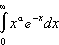.

The slightly unusual choice of notation (using `α` instead of k perhaps) was meant to guide them gently to this integral. For the rectangular distribution they have been pointed towards the characteristic function, and unless they are very adept at handling series they will almost certainly require to demonstrate some ability with a computer-algebra package. To examine the sampling variance of skewness and kurtosis they will have to perform some straightforward descriptive statistics, and they must also show that they can produce simple computer graphics; here we have used the Fig.P package³. And of course they must be able to write the short programs necessary to generate the random variates from the appropriate distributions and calculate the skewness and kurtosis. No single part of the project is difficult, but it tests a variety of important statistical and mathematical skills.

The use of the sum of variates from an asymmetric distribution such as the exponential is quite important, as the approach to Normality is more impressive than from a symmetric distribution, but of course other distributions may be used. The fact that the distribution of the sum of variates from the logistic distribution approaches a value of 3 for kurtosis no faster than those from a rectangular distribution might be of some interest. Maple will show this quite easily:

```
readlib(coeftayl);
f:=(Pi*I*x/sin(Pi*I*x))^(1/m);
c2:=-2*coeftayl(f,x=0,2);
c4:=24*coeftayl(f,x=0,4);
simplify(c4/c2^2);
```

Any project involving random numbers is by its nature unpredictable. The teacher cannot know exactly what data will be produced unless he specifies the programs for random number generation and insists on the seed to be used. The first of these actions takes away a good deal of the learning process the project is designed to engender, and the second will justly be viewed as extremely suspicious. It is therefore important that simulation projects should not rely on small experiments where strange outcomes are more likely to occur. However, even when large numbers are involved it is important to make sure that results are not over-interpreted; in the graphs related to the Cauchy distribution, for example, there is the suspicion that the kurtosis may be slightly less varied for larger values of `α`.

If a poor student suggests this, it may indicate that he is not fully aware of the ramifications of the Cauchy distribution, though a good student may wonder if it could be something to do with standardising by a variance which exists only for a sample. The results for the other distributions are more important than such points; the reason for introducing the Cauchy distribution into the project is to show that the conditions under which the central limit theorem can be proved really matter: the mean and standard deviation must exist. This is sometimes regarded by students as rather frivolous, but the vast difference in the results between the two ’proper’ distributions and the Cauchy distribution should make the point clearly.

There are, of course, many places in statistical education where simulation can aid understanding, and APL is a most convenient language in which to perform such exercises. It is to be hoped that use of the language will continue to help students to understand more fully these essential concepts.

### References

1. Kotz S & Johnson NL (1988). *Encyclopedia of Statistical Sciences*. Wiley, New York.
2. Waterloo Maple Software (1993). *Maple V*. University of Waterloo, Canada.
3. Fig.P Software Corporation (1992). *Fig.P (version 6.0)*. Biosoft, Cambridge, UK.

***
