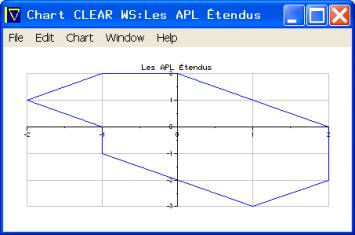
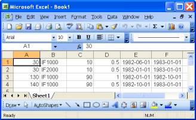
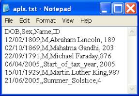
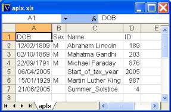

by Ajay Askoolum
{ .byline }

MicroAPL have released version 3.0 of their APLX interpreter; this version offers major (unique) enhancements in the way APL can handle data in the workspace and manage its transfer and acquisition to and from other applications/resources available in the host environment.

All the enhancements are exposed using new <span class="APLU">⎕</span> functions and new objects for the <span class="APLU">⎕wi</span> function. This may seem like pandering to the APL developer who does not want to stray beyond the comfort zone of the workspace. However, APLX is a cross-platform interpreter and <span class="APLU">⎕</span> functions, where the interpreter transparently manages the internal differences, are a clean way of providing consistent facilities.

Should the developer choose to build for a single platform, say, Windows, APLX can also harness platform-specific features such as Win32 APIs. The deployment of APIs not only makes an application robust (and endows APLX with behaviour consistent with other applications that deploy the same APIs) but also saves the overhead of writing, testing, and maintaining APL code for the same purpose.

## Code re-use with <span class="APLU">⎕na</span>

Consider the following task: programmatically verify the existence of an Access database and if it does not exist, create it – bear in mind that an MDB file has a custom internal structure. The application expects a database named C:\\MYLOC\\QTR1\\MYDB.MDB. The likely scenarios are as follows:

- One or more levels in the path tree, and therefore the file, do not exist.
- The path exists but the file does not.
- Neither the path nor the file exists.

A pure APL solution will not only be verbose but also require the Access application (used as a COM server) to create the file if it does not exist. A solution based on APIs is simpler – in this instance, neither the path nor the file exists.

```
       ∇CreateMDB
 [1]   File←'C:\MYLOC\QTR1\MYDB.MDB' ⍝ File to create
 [2]   Path←(⌽∨\'\'=⌽R)/R
 [3]   'MakeSureDirectoryPathExists' ⎕na
             'I4 imagehlp|MakeSureDirectoryPathExists <CT[*]'
 [4]   0 0⍴MakeSureDirectoryPathExists Path
 [5]   'PathFileExists' ⎕na 'I4 shlwapi|PathFileExistsA <CT[*]'
 [6]   :If ~×PathFileExists File
 [7]     'SQLConfigDataSource' ⎕na
              'odbccp32|SQLConfigDataSource U4 U2 <CT[*] <CT[*]'
 [8]     SQLConfigDataSource 0 4
              'Microsoft Access Driver (*.mdb)'('CREATE_DB=',File)
 [9]   :EndIf
       ∇  2005-05-07 9.12.09
```

The Internet and the APLX manuals, respectively, document and clarify the deployment of Win32 APIs. After running this function, it would be possible to verify the existence of the database using the PathFileExists function. A more robust test is to verify whether Access can open the file.

```
       'AC' ⎕wi 'Create' 'Access.Application'
       'AC' ⎕wi 'XOpenCurrentDataBase' 'C:\MYLOC\QTR1\MYDB.MDB'
       'AC' ⎕wi 'XCurrentProject.FullName 'C:\MYLOC\QTR1\MYDB.MDB
       'AC' ⎕wi 'Quit'
```

Access does indeed recognise the new file. This demonstrates how close APL comes to application development by the collation of existing building blocks.

## Charts using <span class="APLU">⎕chart</span>

In his book, *Les APL Étendus* (Masson, 1994, ISBN 2-225-84579-4), B. Legrand discusses the area and perimeter of 2-D surfaces using a chart example. In a single expression, APLX draws the surface, as shown in [Figure 1](#fig1).

```
'type=line' 'x=First' 'title=Les APL Étendus' ⎕chart ⊃x y
```

This function provides a powerful tool for visualising data on demand: for example, a menu option can read any highlighted data from any source – the grid object, a text file, or an HTML page in the browser object – and provide a chart, and allow the user complete control on its presentation via the standard menu.

<table border="0" cellspacing="0" cellpadding="4" width="100%">

  <tr>

    <td width="40%" valign="top">


      <p class="Bodytext">The x-y coordinates of the surface are:</p>

      <pre class="APLU"> x←0 2   2  1 ¯1 ¯1 ¯2 ¯1 0
 y←2 0 ¯2 ¯3 ¯1  0  1  2 2</pre>

      <p class="Bodytext">The menu options allow further dynamic
  refinements and the saving of the chart as a free-standing file. Even Excel
  requires multiple steps and programming to achieve the same result!</p>
    </td>
    <td width="59%" valign="top">


      <p class="Picture">
          <a name="fig1"></a>

          

          </p>

      <p align="center"><b>Figure 1. Legrand’s Chart</b></p>
    </td>
  </tr>

</table>

This is a powerful demonstration of APLX’s ability to enhance programmer productivity. Besides the system function <span class="APLU">⎕chart</span> there is a chart and a series object, accessible via the standard <span class="APLU">⎕wi</span> function, for more sophisticated graphical representation of workspace data.

## Structured Query Language using <span class="APLU">⎕sql</span>

This system function provides a platform independent means of accessing any ODBC-compliant data source (USER/SYSTEM Data Source Names (DSNs) or DSN-less connections are supported but not provider connections.) It takes an optional left-hand argument, and returns a 3-element nested result; the right-hand argument varies depending on the first element of the right-hand argument.

It is not as flexible/powerful as raw ODBC API calls or as ActiveX Data Object (ADO). However, <span class="APLU">⎕sql</span> is much simpler to use and fits with traditional APL programmer expectations: all the code and data is in the workspace.

I would recommend that the optional-left-hand argument is always specified, and that DSN-less connections be used for the following reasons:

The left-hand argument is an integer that represents the handle of an ODBC connection. Should multiple concurrent connections be necessary, it is advisable to specify the left-hand argument: it provides the context for <span class="APLU">⎕sql</span> operations. The default tie number is 0 and both positive and negative numbers may be used.

Both USER (accessible only by the user who creates it) and SYSTEM (accessible by any user of the computer on which it exists) DSNs are stored in the Windows Registry: besides the overhead of reading the Registry, such DSNs are not easily distributable with an application. FILE DSNs (held in the filing system and therefore easily distributable) are not supported.

In order to be able to associate the left-hand argument with a data source, you might consider using an implicit numbering convention such as the one listed in Table 1.

<table border="1" cellspacing="0" cellpadding="2">

  <tr>

    <td width="200" valign="top" bgcolor="#E0E0E0">


      Left-Hand Argument</td>
    <td width="409" valign="top" bgcolor="#E0E0E0">


      Data Source</td>
  </tr>

  <tr>

    <td width="200" valign="top">


      16</td>
    <td width="409" valign="top">


      Text files, including CSV files</td>
  </tr>

  <tr>

    <td width="200" valign="top">


      32 </td>
    <td width="409" valign="top">


      Excel workbooks</td>
  </tr>

  <tr>

    <td width="200" valign="top">


      64 </td>
    <td width="409" valign="top">


      Access databases</td>
  </tr>

  <tr>

    <td width="200" valign="top">


      128 </td>
    <td width="409" valign="top">


      Oracle databases</td>
  </tr>

  <tr>

    <td width="200" valign="top">


      256</td>
    <td width="409" valign="top">


      SQL Server databases</td>
  </tr>

  <tr>

    <td width="200" valign="top">


      512</td>
    <td width="409" valign="top">


      DB2 databases</td>
  </tr>
  <caption align="bottom"><a name="table1"><b>Table 1. Making tie numbers intuitive</b></a></caption>
</table>

This numbering scheme bestows the tie numbers with clues as to their respective data sources; should multiple tie numbers be required, increment the base tie number by one (subject to not exceeding the base number for the next data source). This may be especially helpful when an application supports several data sources: given the tie number, the help desk will know what data source is involved. If this convention is used, the following function will return the association of tie number to data source (note: the function does not verify whether the elements of its right-hand argument actually exist as tie numbers):

```
      ∇Z←L Tie R
[1]   (Z L)←R(R≠0)
[2]   Z←L/Z
[3]   Z←('Text' 'Excel' 'Access' 'Oracle' 'SQL Server' 'DB2' 'Unknown')
          [16 32 64 128 256 512⍳2*⌊2⍟|Z]
[4]   Z←L\Z
[5]   ((~L)/Z)←⊂'Unknown'
[6]   Z←(⊃,¨R),⊃Z ⍝ TIP: ,¨ turns simple vectors into nested vectors
      ∇  2005-05-22 9.08.34
```

```
         ⎕sql 'Connections'
   129 258 0 ¯512 513 512

         Tie (⎕sql 'Connections'),8982
     129 Oracle
     258 SQL Server
       0 Unknown
    ¯512 DB2
     513 DB2
     512 DB2
    8982 Unknown
```

## Typical DSN-less Connection Strings

Table 2 lists typical connection strings for the data sources considered:

<table border="1" cellspacing="0" cellpadding="2">

  <tr>

    <td valign="top" bgcolor="#E0E0E0" width="104">


      Data Source</td>
    <td width="534" valign="top" bgcolor="#E0E0E0">


      Connection String
    </td>
  </tr>

  <tr>

    <td width="104" valign="top">


      Text
    </td>
    <td width="534" valign="top">


      Driver={Microsoft Text Driver (*.txt;
  *.csv)};DBQ=C:\;
    </td>
  </tr>

  <tr>

    <td width="104" valign="top">


      Excel
    </td>
    <td width="534" valign="top">


      Driver={Microsoft Excel Driver
  (*.xls)};DBQ=C:\APLX.XLS;
    </td>
  </tr>

  <tr>

    <td width="104" valign="top">


      Access
    </td>
    <td width="534" valign="top">


      Driver={Microsoft Access Driver
  (*.mdb)};DBQ=C:\APLX.MDB;
    </td>
  </tr>

  <tr>

    <td width="104" valign="top">


      Oracle
    </td>
    <td width="534" valign="top">


      Driver={Oracle in
  OraHome9};Server=D2K1Z01J;Database=hr;UID=@;PWD=#;
    </td>
  </tr>

  <tr>

    <td width="104" valign="top">


      SQL Server
    </td>
    <td width="534" valign="top">


      Driver={SQL
  Server};Server=D2K1Z01J;Database=pubs;UID=@;PWD=#;
    </td>
  </tr>

  <tr>

    <td width="104" valign="top">


      DB2
    </td>
    <td width="534" valign="top">


      Driver={IBM DB2 ODBC DRIVER};UID= @;PWD=
  #;DBALIAS=SAMPLE;
    </td>
  </tr>
  <caption align="bottom"><b>Table 2. Connection strings</b></caption>
</table>

Some aspects of the connection strings need clarification:

Parts of connection string will vary depending on your setup; @ denotes the user ID, # denotes the password; if either or both of these parameters are blank, they can be omitted, alternatively, use =; as their respective values.

For the Text driver, DBQ denotes the location but for the Excel and Access drivers, it denotes a fully qualified file name.

For Oracle, HR is a supplied database as is PUBS for SQL Server.

For DB2, SAMPLE is an alias for the default TOOLSDB database created during setup; DBALIAS= is a hybrid of the Microsoft DBQ= and Oracle Database= parameters.

For Oracle, the driver name is likely to vary, depending on the version installed.

For Oracle and SQL Server, the server name will vary.

For MSDE2000 (found on the Office 2000 Professional CD) and SQLExpress (the beta version is freely downloadable subject to end user license agreement from Microsoft) use the SQL Server connection string. These work with SQL Server databases but have restrictions on size and the number of concurrent users; they can be used for development and the databases can be upgraded to SQL Server.

On the Windows platform, ODBC compliant data sources include:

Text files, including CSV files; fixed and ragged edge records are supported.

Excel workbooks.

File based databases such as Access.

Server based databases such as Oracle, SQL Server, DB2, etc.

<span class="APLU">⎕sql</span> can enumerate the DB2 databases that are available: for DB2, the dedicated syntax for connection does not rely on the specification of a driver.

```
           ⎕sql 'DataSources' 'aplxdb2'
      0 0 0 0    TOOLSDB
                 SAMPLE

           ⎕sql 'DataSources' 'aplxodbc'
      0 0 0 0    MQIS                   SQL Server
                 Visio Database Samples Microsoft Access Driver (*.MDB)
                 MS Access Database     Microsoft Access Driver (*.mdb)
                 Excel Files            Microsoft Excel Driver (*.xls)
                 dBASE Files            Microsoft dBase Driver (*.dbf)
                 LocalServer            SQL Server
                 ORACLE9                Oracle in OraHome9
                 Text Driver            Microsoft Text Driver (*.txt; *.csv)
                 MYACCESS               Microsoft Access Driver (*.mdb)
                 IBM                    IBM DB2 ODBC DRIVER
```

It can also enumerate the ODBC drivers installed on a computer. On Linux and MacOS platforms, use unixODBC and iODBC drivers and data sources.

## Connecting to the Data Source

Without a connection to an underlying data source, <span class="APLU">⎕sql</span> is not of much use. Table 3 lists its parameters.

<table border="1" cellspacing="0" cellpadding="2">

  <tr>

    <td width="13%" valign="top" bgcolor="#E0E0E0">


      Parameters</td>
    <td width="21%" valign="top" bgcolor="#E0E0E0">


      Value</td>
    <td width="64%" valign="top" bgcolor="#E0E0E0">


      Notes</td>
  </tr>

  <tr>

    <td width="13%" valign="top">


      First</td>
    <td width="21%" valign="top">


      'Connect'</td>
    <td width="64%" valign="top">


      Always the same string. This is not as
  senseless as it might first appear.</td>
  </tr>

  <tr>

    <td width="13%" valign="top">


      Second</td>
    <td width="21%" valign="top">


      'aplxodbc' or 'aplxdb2' </td>
    <td width="64%" valign="top">


      MicroAPL use aplxodbc for ODBC data
  sources and aplxdb2 for DB2: Either may be used for DB2, depending on the
  third argument.</td>
  </tr>

  <tr>

    <td width="13%" valign="top">


      Third</td>
    <td width="21%" valign="top">


      Connection String or DSN name</td>
    <td width="64%" valign="top">


      The connections string and DSN may
  include the additional UID and PWD parameters.</td>
  </tr>

  <tr>

    <td width="13%" valign="top">


      [Fourth]</td>
    <td width="21%" valign="top">


      Other value </td>
    <td width="64%" valign="top">


      Optional. If necessary, specify UID.</td>
  </tr>

  <tr>

    <td width="13%" valign="top">


      [Fifth]</td>
    <td width="21%" valign="top">


      Other value</td>
    <td width="64%" valign="top">


      Optional. If necessary, specify PWD.</td>
  </tr>
  <caption align="bottom"><b>Table 3 Parameters</b></caption>
</table>

Should the parameters specified be incomplete, <span class="APLU">⎕sql</span> invokes the ODBC administrator dialogues to request additional information in order to establish a successful connection.

## DB2 can connect either way

Although MicroAPL have suggested the use of ‘aplxdb2’ for connection to DB2, ‘aplxodbc’ may also be used to access DB2 databases. This function demonstrates that it is possible to connect to DB2 databases using either ‘aplxodbc’ or ‘aplxdb2’:

```
     ∇IBM
[1] ⍝ Disconnect from all sources
[2]  0 0⍴∊(OEsql 'Connections')OEsql¨⊂'Disconnect'
[3] ⍝ Connect using aplxodbc
[4]  0 0⍴∊512 OEsql 'Connect' 'aplxodbc' 'Driver={IBM DB2 ODBC DRIVER};UID= ;PWD= ;DBALIAS=SAMPLE;'
[5] ⍝ Connect using aplxdb2
[6]  0 0⍴∊513 OEsql 'Connect' 'aplxdb2' 'SAMPLE'
[7]  (RC RM DataODBC)←512 OEsql 'Do' "SELECT * FROM EMP_ACT where PROJNO LIKE 'IF%' AND ACTNO<100;"
[8]  (RC RM DataDB2)←513 OEsql 'Do' "SELECT * FROM EMP_ACT where PROJNO LIKE 'IF%' AND ACTNO<100;"
     ∇ 2005-05-22 8.24.05
```

The two results – one based on ‘aplxodbc’ and the other on ‘aplxdb2’ – are identical. The data is returned as a nested matrix as shown in Figure 2.

The variables RC and RM return debugging information; in this specific instance, I know that there is nothing to debug as the expressions have worked.

Line \[7\] shows how to record the return values from <span class="APLU">⎕sql</span>.

The connection syntax is simpler, as seen in line \[6\], when using ‘aplxdb2’; however, the syntax in line \[4\] is more generic.

All the records resulting from the SQL is returned to the workspace: runtime workspace full errors are likely when processing a large number of records. On the other hand, as the data is in the workspace, it can easily be presented in the grid object. Moreover, if APLX is used to query databases interactively, it is preferable to have all the data in the workspace.

<table border="0" cellspacing="0" cellpadding="4" width="750">

  <tr>

    <td width="466" valign="top">

      <pre class="APLU" style="line-height:100%;">
┌→───────────────────────────────────────────────────┐
↓ ┌→─────┐ ┌→─────┐        ┌→─────────┐ ┌→─────────┐ │
│ │000030│ │IF1000│ 10 0.5 │1982-06-01│ │1983-01-01│ │
│ └──────┘ └──────┘        └──────────┘ └──────────┘ │
│ ┌→─────┐ ┌→─────┐        ┌→─────────┐ ┌→─────────┐ │
│ │000030│ │IF2000│ 10 0.5 │1982-01-01│ │1983-01-01│ │
│ └──────┘ └──────┘        └──────────┘ └──────────┘ │
│ ┌→─────┐ ┌→─────┐        ┌→─────────┐ ┌→─────────┐ │
│ │000130│ │IF1000│ 90 1   │1982-01-01│ │1982-10-01│ │
│ └──────┘ └──────┘        └──────────┘ └──────────┘ │
│ ┌→─────┐ ┌→─────┐        ┌→─────────┐ ┌→─────────┐ │
│ │000140│ │IF1000│ 90 0.5 │1982-10-01│ │1983-01-01│ │
│ └──────┘ └──────┘        └──────────┘ └──────────┘ │
└∊───────────────────────────────────────────────────┘</pre>


      <p align="center"><b>Figure 1 <span class="APLU">⎕sql</span> result</b></p>
    </td>
    <td width="282" valign="top" class="indent">


      <p>There is an inconsistency: numeric values are simple scalars and
  strings are nested vectors. This has the potential of causing unexpected
  runtime errors.</p>

      <p>Date values are returned as string in ISO 8601 format, that is, YYYY-MM-DD HH:MM:SS.</p>

      <pre class="APLU">     ⍴⊃DataDB2[1;5] ⍝ This is a Date
10
     DataDB2[1;5]
1982-06-01</pre>

    </td>
  </tr>

  <tr>

    <td width="466" valign="top">


      <pre class="APLU">

           DataODBC⌷DataDB2
1
     ⌷DataDB2 ⍝ I expected it to be  3!
2
     ⌷DataDB2[1;1]
2
     ⌷DataDB2[1;3]
0</pre>


      <pre class="APLU">&amp;nbsp;
    </pre>

    </td>
    <td width="282" valign="top">


      <pre class="APLU">

        ⌷¨DataODBC
  1 1 0 0 1 1
  1 1 0 0 1 1
  1 1 0 0 1 1
  1 1 0 0 1 1
  </pre>


</td>
  </tr>

</table>

It is easy to cope with a consistent YYYY-MM-DD format: either use SQL or APL code for the transformation into any other format. In order to provide consistency between the representation of dates retrieved from a database and those acquired from the user interface – which would be in the local regional format – some transformation will be necessary.

In contrast, ActiveX Data Object (ADO) returns dates as scalars, which have to be converted with code or SQL: it may be messy if the reference date is unknown or variable as it would be when several data sources are used. The following function extracts the same data as the function IBM above:

<pre class="APLU">      ∇Z←ADO;Cns;Sql
[1]   Cns←'Driver={IBM DB2 ODBC DRIVER};UID= ;PWD= ;DBALIAS=SAMPLE;'
[2]   Sql←∆SELECT * FROM EMP_ACT WHERE PROJNO LIKE 'IF%' AND ACTNO&lt;100∆
[3]   0 0⍴'ADORS' ⎕wi 'Create' 'ADODB.RecordSet'
[4]   0 0⍴'ADORS' ⎕wi 'XOpen' Sql Cns
[5]   Z←'ADORS' ⎕wi 'XGetRows'
[6]   'ADORS' ⎕wi 'XClose'
[7]   'ADORS' ⎕wi 'Delete'
      ∇  2005-05-17 17.57.31<p></p></pre>

<table border="0" cellspacing="0" cellpadding="4">

  <tr>

    <td valign="top" width="554">


      <p class="Bodytext">The result is shown in Figure 3.</p>

      <p class="Bodytext">Note the need for transformation (<span class="APLU">⍉</span>) to present the data in row-major tabulation and, as stated, the dates are scalars.</p>

      <p class="Bodytext">In order to present the dates in the user
  interface and for data arithmetic, it is necessary to convert the scalars to
  a date format. The conversion must use the same date reference as that used
  by the tool used to retrieve the records, in this case ADO.</p>
    </td>
    <td valign="top" width="298">


      <pre class="APLU" style="line-height:100%;">


  ┌→─────────────────────────────────────┐
  ↓ ┌→─────┐ ┌→─────┐                    │
  │ │000030│ │IF1000│ 10 0.5 30103 30317 │
  │ └──────┘ └──────┘                    │
  │ ┌→─────┐ ┌→─────┐                    │
  │ │000030│ │IF2000│ 10 0.5 29952 30317 │
  │ └──────┘ └──────┘                    │
  │ ┌→─────┐ ┌→─────┐                    │
  │ │000130│ │IF1000│ 90 1   29952 30225 │
  │ └──────┘ └──────┘                    │
  │ ┌→─────┐ ┌→─────┐                    │
  │ │000140│ │IF1000│ 90 0.5 30225 30317 │
  │ └──────┘ └──────┘                    │
  └∊─────────────────────────────────────┘</pre>

      <p align="center"><b>Figure 3. ADO result</b></p>
    </td>
  </tr>

</table>

The <span class="APLU">⎕sql</span> dates correspond to the scalar dates upon conversion: this is seen by sending the data to Excel and applying the date format:

<pre class="APLU">
     ∇Z←ADO2;Cns;Sql
[1]   Cns←'Driver={IBM DB2 ODBC DRIVER};UID= ;PWD= ;DBALIAS=SAMPLE;'
[2]   Sql←∆SELECT * FROM EMP_ACT WHERE PROJNO LIKE 'IF%' AND ACTNO&lt;100∆
[3]   0 0⍴'ADORS' ⎕wi 'Create' 'ADODB.RecordSet'
[4]   0 0⍴'ADORS' ⎕wi 'XOpen' Sql Cns
[5]   0 0⍴'xl' ⎕wi 'Create' 'Excel.Application'
[6]   0 0⍴'xl' ⎕wi 'XWorkbooks.Add'
[7]   'xl' ⎕wi 'Range().Value' 'A1:F4'(⍉'ADORS' ⎕wi 'GetRows')
[8]   'xl' ⎕wi 'Range().NumberFormat' 'E1:F4' ∆yyyy-mm-dd∆
[9]   'xl' ⎕wi 'visible' 1
[10]  'ADORS' ⎕wi 'XClose'
[11]  'ADORS' ⎕wi 'Delete'
[12]  'xl' ⎕wi 'Delete'
      ∇  2005-05-21 13.14.29<p></p></pre>

<table border="0" cellspacing="0" cellpadding="4">

  <tr>

    <td width="375" valign="top">


      <p class="Picture">


          

          </p>

      <p align="center"><b>Figure 4. Results in Excel</b></p>
    </td>
    <td width="323" valign="top">

      <p>
Figures 2, 3 and 4 show the same set
of records.
</p>

      <p>Use the APLX built-in grid object to
present the results of <span class="APLU">⎕sql</span> in the
user interface, where necessary,
because:
</p>

      <p>Additional steps to re-format data
will not be necessary.
Data will remain as retrieved from
the data source – note that column
A is numeric in Excel but is
character in the data source.


      </p>
    </td>
  </tr>

</table>

## Working with Tables

A database contains tables (a collection of records), which in turn, contain columns. Although it is convenient to visualize tables as the ubiquitous Excel worksheet, tables are different in several respects:

Tables contain raw data – there is no data formatting.

Records and columns do not have any relationships except those defined by constraints.

The database manages the addition and deletion of records: the developer is oblivious of the exact position or sequence of records.

The deletion of values in a column does not affect other values; for example, values in adjacent columns do not shift.

The developer will need to query whether a particular table exists, or enumerate the tables that exist, and the columns that each table has. <span class="APLU">⎕sql</span> provides intrinsic facilities for such queries. The syntax is:

```
 [Tie] ⎕sql 'Tables' [Catalog] [Schema] [Table] [Types]
```

Beneath the surface, <span class="APLU">⎕sql</span> is managing a very complex SQL statement that is database vendor specific.

The first two optional arguments, Catalog and Schema respectively define the owner and the table space: from the point of view of the developer, these can be ignored, usually. Different vendors have different names for the terms adopted by MicroAPL.

The third argument, Table, is the placeholder for a specific table name or, if omitted, for all table names.

The fourth optional argument, Types, allows the developer to enumerate subsets of tables that exist within the database.

During the maintenance cycle of an application, that is, when the application has acquired a legacy in the field, it is may be necessary to add new tables to existing databases. The application needs to check for the existence of a table before it creates it.

<table border="0" cellspacing="0" cellpadding="4">

  <tr>

    <td width="243" valign="top">


      <p class="Bodytext">Does the table EMPLOYEES exist in the HR database in ORACLE?</p>
    </td>
    <td width="373" valign="top">


      <pre class="APLU" style="line-height:100%;">           ⎕display 128 ⎕sql 'Tables' '' '' 'Employees' ''

      ┌→─────────────────────────────────────────────────────┐
      │ ┌→──────┐ ┌⊖┐ ┌→───────────────────────────────────┐ │
      │ │0 0 0 0│ │ │ ↓ ┌⊖┐ ┌→─┐ ┌→────────┐ ┌→──────┐ ┌⊖┐ │ │
      │ └~──────┘ └─┘ │ │0│ │OE│ │EMPLOYEES│ │SYNONYM│ │0│ │ │
      │               │ └~┘ └──┘ └─────────┘ └───────┘ └~┘ │ │
      │               │ ┌⊖┐ ┌→─┐ ┌→────────┐ ┌→────┐   ┌⊖┐ │ │
      │               │ │0│ │HR│ │EMPLOYEES│ │TABLE│   │0│ │ │
      │               │ └~┘ └──┘ └─────────┘ └─────┘   └~┘ │ │
      │               └∊───────────────────────────────────┘ │
      └∊─────────────────────────────────────────────────────┘</pre>


    </td>
  </tr>

</table>

Yes, there are two tables, one each in the OE and HR schemas of the ORACLE connection.

<table border="0" cellspacing="0" cellpadding="4">

  <tr>

    <td width="247" valign="top">


      <p class="Bodytext">Does a table EMPLOYEES of type TABLE exist?</p>
    </td>
    <td width="369" valign="top">


      <pre class="APLU" style="line-height:100%;">
           ⎕display 128 ⎕sql 'Tables' '' '' 'Employees'
      'TABLE'

      ┌→───────────────────────────────────────────────────┐
      │ ┌→──────┐ ┌⊖┐ ┌→─────────────────────────────────┐ │
      │ │0 0 0 0│ │ │ ↓ ┌⊖┐ ┌→─┐ ┌→────────┐ ┌→────┐ ┌⊖┐ │ │
      │ └~──────┘ └─┘ │ │0│ │HR│ │EMPLOYEES│ │TABLE│0│ │ │ │
      │               │ └~┘ └──┘ └─────────┘ └─────┘ └~┘ │ │
      │               └∊─────────────────────────────────┘ │
      └∊───────────────────────────────────────────────────┘</pre>


	  </td>
  </tr>

</table>

The previous two examples use the SQL tie number 128, defined using the connection string given above. In the latter example, if the first dimension of the third element is zero, the table does not exist.

It may also be necessary to add new columns to existing tables. APLX provides a means of doing so:

```
[Tie] ⎕SQL 'Columns' [Catalog] [Schema] [Table] [Column]
```

What columns exist in the AUTHORS table in the SQL SERVER PUBS database? This is using a different SQL tie number – 256.

```
           2↓256 ⎕sql 'Columns' '' '' 'AUTHORS' ''
       pubs dbo authors au_id    12 id      11 11       0                 12    11  1 NO  39
       pubs dbo authors au_lname 12 varchar 40 40       0                 12    40  2 NO  39
       pubs dbo authors au_fname 12 varchar 20 20       0                 12    20  3 NO  39
       pubs dbo authors phone     1 char    12 12       0    ('UNKNOWN')   1    12  4 NO  47
       pubs dbo authors address  12 varchar 40 40       1                 12    40  5 YES 39
       pubs dbo authors city     12 varchar 20 20       1                 12    20  6 YES 39
       pubs dbo authors state     1 char     2  2       1                  1     2  7 YES 39
       pubs dbo authors zip       1 char     5  5       1                  1     5  8 YES 39
       pubs dbo authors contract ¯7 bit      1  1  0    0                 ¯7        9 NO  50
```

Note that all the details relating to the definition of the table is returned. This is just short of creating the actual SQL script for the creation of the table:

```
      CREATE TABLE [authors] (
           [au_id] [id] NOT NULL ,
           [au_lname] [varchar] (40) COLLATE SQL_Latin1_General_CP1_CI_AS NOT NULL ,
           [au_fname] [varchar] (20) COLLATE SQL_Latin1_General_CP1_CI_AS NOT NULL ,
           [phone] [char] (12) COLLATE SQL_Latin1_General_CP1_CI_AS NOT NULL CONSTRAINT
      [DF__authors__phone__78B3EFCA] DEFAULT ('UNKNOWN'),
           [address] [varchar] (40) COLLATE SQL_Latin1_General_CP1_CI_AS NULL ,
           [city] [varchar] (20) COLLATE SQL_Latin1_General_CP1_CI_AS NULL ,
           [state] [char] (2) COLLATE SQL_Latin1_General_CP1_CI_AS NULL ,
           [zip] [char] (5) COLLATE SQL_Latin1_General_CP1_CI_AS NULL ,
           [contract] [bit] NOT NULL ,
           CONSTRAINT [UPKCL_auidind] PRIMARY KEY  CLUSTERED
           (
                [au_id]
           )  ON [PRIMARY] ,
            CHECK ([au_id] like '[0-9][0-9][0-9]-[0-9][0-9]-[0-9][0-9][0-9][0-9]'),
            CHECK ([zip] like '[0-9][0-9][0-9][0-9][0-9]')
 ) ON [PRIMARY]
 GO
```

This script was created by SQLDMO; it contains default details that are normally omitted from an SQL statement – note the correspondence between the script and what <span class="APLU">⎕sql</span> returns. The provision of the scripts for tables must be on the wish list of the next release: scripts would enable a hassle free distribution of applications during the maintenance cycle.

Does a column STATE exist in the table AUTHORS in the PUBS database?

```
     256 ⎕sql 'Columns' '' '' 'AUTHORS' 'STATE'
 0 0 0 0    pubs dbo authors state 1 char 2 2      1      1    2 7 YES 39
```

Yes, it does. Does a column named APLX exist in the same table?

```
     ⍴3⊃256 ⎕sql 'Columns' '' '' 'AUTHORS' 'aplx'
0 19
     ⍴3⊃256 ⎕sql 'Columns' '' '' 'AUTHORS' 'STATE'
1 19
```

The first dimension of the third element of the result is zero if the column does not exist.

## Working with SQL

SQL is an acronym for Structured Query Language, not Standard Query Language: that means that each driver exposes it own SQL engine. Although all SQL engines comply with most of the SQL92 standard, they also have vendor specific enhancements that are exclusive, inconsistent, or completely different, that is, elusive.

- The Microsoft drivers allow a number of Visual Basic/Visual Basic for Applications keywords as standard.
- The Microsoft T-SQL (SQL Server) and Oracle drivers allow the replacement of null values within the SQL statement but they use different keywords, ISNULL and NVL, respectively.
- Remember to use algebraic rather than APL relational operators within SQL statements; that is use &lt;> instead of <span class="APLU">≠</span> ‘not equal to’, etc.
- SQL has a null data type (a null value is not equal to any other value, not even another null value) that has no corresponding equivalent in APL. Use IS NULL or IS NOT NULL instead of = NULL or &lt;> NULL.
- SQL has its own conventions:  use uppercase, enclose embedded strings in single quotes, and end with a semi-colon. However, SQL statements are not case-sensitive.

Although SQL presents exciting opportunities for APL software development, it presents new challenges especially for applications designed to support several data sources – for example, one client may choose SQL Server while another opts for Oracle.

A generic SQL reference, preferably one that compares SQL dialects is a new requirement for APLX developers, that is, in addition to the APLX documentation. The reference should cover the following:

- The Data Query Language (DQL) component of SQL deals with the retrieval of data from a database – it is based on a single command SELECT. This is the most widely-used component of SQL. Although there is a single command, it is probably the most complex of all SQL commands that developers would deploy routinely.
- The Data Manipulation Language (DML) component of SQL deals with the modification of existing data in a database. The primary commands include INSERT, UPDATE, and DELETE.
- The Data Definition Language (DDL) component of SQL deals with the modification of the structure of existing databases and the creation of new databases. The primary commands include CREATE TABLE, CREATE DATABASE, ALTER TABLE, DROP TABLE, CREATE INDEX, and DROP INDEX.M/li>
- The Data Control Language (DCL) deals with database access permissions and used by database administrators who have unrestricted access. The commands in this component of SQL are ALTER PASSWORD, GRANT, REVOKE, and CREATE SYNONYM.

In addition to the SQL reference, database vendor specific references are required for working with databases. In essence, some aspects of data management are held in the data-tier (database) itself rather than in the business-tier (application code). Such references should include the following:

- Constraints: These define the relationship of columns in a table and among tables. For example, there may be such constraints as a column requiring a value (cannot be null) or being unique etc. Constraints reinforce data integrity and affect the way SQL acts on the data source.
- Triggers: These define event driven code that is run, triggered, under some circumstances. For example, a trigger may add a timestamp to a record whenever it is altered.
- Stored Procedures: In simplistic terms, these are complex SQL statements that are stored in and run from the database itself. Stored procedures are efficient because they are optimised by the SQL engine before being stored but SQL statements are optimised on demand.
- Indexes: These are metrics that are calculated and held in the database in order to speed up data access.

Usually, file based databases do not support triggers and stored procedures.

For a robust deployment of a relational database as the data-tier, a third reference is required – one on transaction processing, record locking and multi-user concurrent access management. This is likely to be vendor specific.

## Text Files as Relational Tables

A large number of APL applications rely on text files for incoming data. With the Microsoft text driver, <span class="APLU">⎕sql</span> can treat text files as relational tables – strictly speaking, they are not relational tables. This means that text file data can be manipulated without APL code, usually with recourse to native file functions, and data conversion routines are not necessary as the text driver returns data in the type that is appropriate. In order to promote robust handling of text files, the following is highly recommended:

<span class="indent">Include column headers in the first row
of data. </span>

<span class="indent">As the driver scans a default number of
rows in order to determine the data type for the column, the initial rows
should contain representative data as far as <i>type</i> is concerned.</span>

<span class="indent">Learn to creat</span>e the file SCHEMA.INI: this provides a greater degree of control on how the data is handled.

Consider the example shown in Figure 5:

<table border="0" cellspacing="0" cellpadding="4">


  <tr>


    <td valign="top" width="311">


      <p class="Picture">


          

          </p>

      <p align="center"><b>Figure 5. Text data source</b></p>
    </td>
    <td valign="top" width="488">


      <p class="Bodytext">The file contains the types of data routinely encountered in an APL
  application.</p>

      <p class="Bodytext">There are placeholders for missing values: see the last row in Figure
  5.</p>

      <p class="Bodytext">For a robust understanding of how to work with text data files and
  setup their DSNs, research SCHEMA.INI on the Internet.</p>
    </td>
  </tr>


</table>

Let us connect to the data source; note that the DBQ parameter specifies the location of the actual data source and not the name of the data source itself.

```
     16 ⎕sql 'Connect' 'aplxodbc'
        'Driver={Microsoft Text Driver (*.txt; *.csv)};DBQ=C:\;'
```

Some examples illustrating the power of SQL statements are shown below. Although APL coding can achieve the results of the SQL statements, SQL is far more efficient and has the least overhead.

*a. Select the records where the column SEX contains missing values:*

```
     16 ⎕sql 'Do' 'Select * FROM APLX.TXT WHERE SEX IS NULL;'
 0 0 0 0    2005-04-06 00:00:00    Start_of_tax_year 2005
            2005-06-21 00:00:00    Summer_Solstice      4
```

This query finds two records.

*b. Select the records where ID is in the range 100 to 300:*

```
     ⎕display 16 ⎕sql 'Do' 'SELECT * FROM APLX.TXT WHERE ID BETWEEN 100 AND 300;'
┌→──────────────────────────────────────────────────────────────────┐
│ ┌→──────┐ ┌⊖┐ ┌→────────────────────────────────────────────────┐ │
│ │0 0 0 0│ │ │ ↓ ┌→──────────────────┐ ┌→┐ ┌→──────────────┐     │ │
│ └~──────┘ └─┘ │ │1809-02-12 00:00:00│ │M│ │Abraham Lincoln│ 189 │ │
│               │ └───────────────────┘ └─┘ └───────────────┘     │ │
│               │ ┌→──────────────────┐ ┌→┐ ┌→─────────────┐      │ │
│               │ │1869-10-02 00:00:00│ │M│ │Mahatma Gandhi│  203 │ │
│               │ └───────────────────┘ └─┘ └──────────────┘      │ │
│               └∊────────────────────────────────────────────────┘ │
└∊──────────────────────────────────────────────────────────────────┘
```

*c. Refine the previous query by sorting the records in descending order of NAME.*

This illustrates the power of SQL statements and indicates the scope that exists for avoiding APL coding to manipulate source data.

```
     ⎕display 16 ⎕sql 'Do' 'SELECT * FROM APLX.TXT WHERE ID BETWEEN 100 AND 300 ORDER BY NAME DESC;'
┌→──────────────────────────────────────────────────────────────────┐
│ ┌→──────┐ ┌⊖┐ ┌→────────────────────────────────────────────────┐ │
│ │0 0 0 0│ │ │ ↓ ┌→──────────────────┐ ┌→┐ ┌→─────────────┐      │ │
│ └~──────┘ └─┘ │ │1869-10-02 00:00:00│ │M│ │Mahatma Gandhi│  203 │ │
│               │ └───────────────────┘ └─┘ └──────────────┘      │ │
│               │ ┌→──────────────────┐ ┌→┐ ┌→──────────────┐     │ │
│               │ │1809-02-12 00:00:00│ │M│ │Abraham Lincoln│ 189 │ │
│               │ └───────────────────┘ └─┘ └───────────────┘     │ │
│               └∊────────────────────────────────────────────────┘ │
└∊──────────────────────────────────────────────────────────────────┘
```

Data retain their expected type in the workspace:

```
     (RC RM Data)←16 ⎕sql 'Do' 'SELECT * FROM APLX.TXT WHERE ID BETWEEN 100 AND 300;'
     Data[1;4]×100
18900
```

*d. Add an arbitrary column and make NAME uppercase:*

```
     16 ⎕sql 'Do' ∆Select 'APLX_Demo' as MYVAR,UCASE(NAME) FROM APLX.TXT WHERE ID NOT BETWEEN 100 AND 300 ORDER BY NAME DESC;∆
0 0 0 0    APLX_Demo SUMMER_SOLSTICE
           APLX_Demo START_OF_TAX_YEAR
           APLX_Demo MICHAEL FARADAY
           APLX_Demo MARTIN LUTHER KING
```

SQL is far more efficient than the traditional approach of using native file functions. However, be wary of the vagaries of SQL dialects: a thorough understanding of SQL dialects will determine the databases that an application decides to support. It is acceptable that an application will contain database specific code: the more numerous the data sources supported, the bigger the overhead.

## Excel Workbooks as Relational Data Sources

I’ll use C:\\APL.TXT as the source for an XLS file: Start Excel, **File | Open**, select the file, highlight the range A1:D2 and name it MYTAB, and, finally, **File | SaveAs** an XLS file named APLX.XLS.

```
      32 ⎕sql 'Connect' 'aplxodbc' 'Driver={Microsoft Excel Driver (*.xls)};DBQ=C:\APLX.XLS;'
      32 ⎕sql 'Tables' '' '' '' ''
 0 0 0 0    C:\APLX    aplx$ SYSTEM TABLE
            C:\APLX    MYTAB TABLE
```

There are two tables: aplx$ is the sheet name and MYTAB is the named range we defined. Select each table in turn, as follows:

```
      32 ⎕sql 'Do' 'SELECT * FROM MYTAB;'
 0 0 0 0    12/02/1809 M Abraham Lincoln 189
      32 ⎕sql 'Do' 'SELECT * FROM [aplx$];'
 0 0 0 0                         M  Abraham Lincoln     189
                                 M  Mahatma Gandhi      203
                                 M  Michael Faraday     876
            2005-04-06 00:00:00     Start_of_tax_year  2005
            1929-01-15 00:00:00  M  Martin Luther King  987
            2005-06-21 00:00:00     Summer_Solstice       4
```

Note that a sheet name has $ as a suffix and it must be enclosed in square brackets: a name relating to a range is specified as it is.

What happened to the DOB field in the first three records? Null values are returned because the date range handled by the Excel driver (not Excel) starts 01/01/1900 and those dates were earlier than the start date. This is another quirk of SQL engines.

- Oracle supports dates in the year range ¯4713 to 9999.
- SQL Server has two date data types. The DATETIME type has the range 01/01/1753 to 31/12/9999 and the SMALLDATETIME type has the operational range 01/01/1900 to 06/06/2079.
- Access has a date range between year 100 and 9999.
- Excel uses 01/01/1900 as the default reference date. Optionally, this can be set to 01/01/1904. Dates later than 2078 may not be recognised.
- For text data sources, the Excel ranges apply.
- DB2 has a date range of 1 to 9999.

Let us select all individuals born after 01/01/1900 and create a flag to indicate whether an underscore exists in their names. The following function returns the SQL statement:

```
      ∇Z←GetSQL
[1]   Z←''
[2]   Z←Z,∆  SELECT NAME, ∆
[3]   Z←Z,∆         FORMAT(DOB) AS DOBIRTH,∆
[4]   Z←Z,∆         SEX,∆
[5]   Z←Z,∆         Format(ID,'0####'),∆
[6]   Z←Z,∆         IIF(INSTR(NAME,'_'),'','REAL NAME') AS FLAG ∆
[7]   Z←Z,∆    FROM [APLX$] ∆
[8]   Z←Z,∆   WHERE DOB > #01 JAN 1900#;∆
      ∇  2005-05-15 13.34.33
```

The result is shown below:

```
       ⎕display 32 ⎕sql 'Do' GetSQL
┌→─────────────────────────────────────────────────────────────────────────────┐
│ ┌→──────┐ ┌⊖┐ ┌→───────────────────────────────────────────────────────────┐ │
│ │0 0 0 0│ │ │ ↓ ┌→────────────────┐  ┌→─────────┐ ┌⊖┐ ┌→────┐ ┌⊖┐          │ │
│ └~──────┘ └─┘ │ │Start_of_tax_year│  │06/04/2005│ │0│ │02005│ │ │          │ │
│               │ └─────────────────┘  └──────────┘ └~┘ └─────┘ └─┘          │ │
│               │ ┌→─────────────────┐ ┌→─────────┐ ┌→┐ ┌→────┐ ┌→────────┐  │ │
│               │ │Martin Luther King│ │15/01/1929│ │M│ │00987│ │REAL NAME│  │ │
│               │ └──────────────────┘ └──────────┘ └─┘ └─────┘ └─────────┘  │ │
│               │ ┌→──────────────┐    ┌→─────────┐ ┌⊖┐ ┌→────┐ ┌⊖┐          │ │
│               │ │Summer_Solstice│    │21/06/2005│ │0│ │00004│ │ │          │ │
│               │ └───────────────┘    └──────────┘ └~┘ └─────┘ └─┘          │ │
│               └∊───────────────────────────────────────────────────────────┘ │
└∊─────────────────────────────────────────────────────────────────────────────┘
```

- Always construct SQL statements relating to DML as above to keep it readable: there is a vertical column of spaces separating SQL keywords from other text. Use double quotes within APL and reserve single quotes for embedded quotes.
- Note that the embedded INSTR (like <span class="APLU">⍷</span>) uses single quotes: in VBA, double quotes would be used.
- Literal dates are specified unambiguously.
- The date field DOB is transformed to UK short date regional format and has been renamed.
- ID is formatted with leading zeros.
- A number of VBA keywords (FORMAT, IIF, INSTR) are used within the SQL statement.

## The Browser Object

The new browser object enables any text file created by APLX and other applications to be viewed within the APL GUI session. This includes some custom format files such as XLS, see Figure 6.

<table border="0" cellspacing="0" cellpadding="4">


  <tr>


    <td valign="top">


      <p class="Picture">


          

          </p>

      <p align="center"><b>Figure 6. Workbook in browser object</b></p>
    </td>
    <td valign="top">


      <p class="Bodytext">The code is:</p>

      <pre class="APLU">
     ∇Browser
[1]  'BR' ⎕wi 'Create' 'Window'('scale' 5)('size' 470 800)
[2]  'BR.Web' ⎕wi 'New' 'Browser'('align' ¯1)
[3]  'BR.Web' ⎕wi 'onReady' ∆'BR' ⎕wi 'title' ('BR.Web' ⎕wi  'title')
[4]  'BR.Web' ⎕wi 'Load' 'C:\APLX.XLS'
[5]  0 0⍴⎕WE 'BR'
     ∇  2005-05-15 14.05.20</pre>


      <p> </p>
    </td>
  </tr>


</table>

Ideally, an application should construct HTML output and show it in the browser: further enhancements, such as printing and searching, are required as children of the browser object to make this type of facility useful.

Of course, the browser object can show/read web pages: refer to APLX documentation.

## Navigating SQL Results

As the result of the ‘Do’ directive causes the result of SQL statements to be returned to the workspace, the result can be assigned to an APL variable: an application can loop through the result by reference to the first dimension, which is also a count of the number of records returned.

Should the number of records be likely to cause a workspace-full error, <span class="APLU">⎕sql</span> offers another means of retrieving SQL results that mitigates this likelihood. Assume that the number of records returned is 5 million thereby guaranteeing workspace full errors. How will <span class="APLU">⎕sql</span> cope?

```
      ∇RecordLoop;Cns;Sql;RecordCount
[1]   Cns←'Driver={SQL Server};Server=D2K1Z01J;Database=pubs;UID=sa;PWD=;'
[2]   Sql←∆SELECT COUNT(*) FROM AUTHORS WHERE STATE IN('UT','MI');∆
[3]  ⍝ TIP: use 0 0⍴∊ to absorb nested return values
[4]   0 0⍴∊256 ⎕sql 'Disconnect' ⍝ Can disconnect arbitrary tie
[5]   0 0⍴∊256 ⎕sql 'Connect' 'aplxodbc' Cns ⍝ I know it will work
[6]   (RC RM Debug)←256 ⎕sql 'Describe'
[7]   (RC RM RecordCount)←256 ⎕sql 'Do' Sql
[8]   Sql←∆SELECT AU_FNAME,AU_LNAME,STATE FROM AUTHORS WHERE STATE IN('UT','MI');∆
[9]   0 0⍴∊256 ⎕sql 'Close' 'ThisSet' ⍝ Can Close arbitrarily
[10]  0 0⍴∊256 ⎕sql 'Prepare' 'ThisSet' Sql
[11]  0 0⍴∊256 ⎕sql 'Execute' 'ThisSet'
[12]  (RC RM Fields)←256 ⎕sql 'Describe' 'ThisSet'
[13]  :While 0≠,RecordCount
[14]    (RC RM Data)←256 ⎕sql 'Fetch' 'ThisSet' 1
[15]    Fields[1;]Fix Data
[16] ⍝ Call function to process variables here
[17]    RecordCount←RecordCount-1
[18]  :EndWhile
[19]  Z←256 ⎕sql 'Close' 'ThisSet'
[20]  0 0⍴⎕ex⊃Fields[1;] ⍝ Clear workspace
      ∇  2005-05-22 11.14.58
```

This function uses two more functions:

<table border="0" cellspacing="0" cellpadding="4">

  <tr>

    <td width="383" valign="top">


      <pre class="APLU">      ∇L Fix R
[1]   L←EnsureName¨L
[2]   ⍎'(',(⍕L),')←,R'
[3]  ⍝TIP ⍕ simpify nested vector using space
      ∇  2005-05-22 13.06.31</pre>


    </td>
    <td width="248" valign="top">


      <pre class="APLU">      ∇R←EnsureName R
[1]   ((R∊' ')/R)←'∆'
      ∇  2005-05-22 11.12.37</pre>


    </td>
  </tr>

</table>

The function Fix initialises global variables in the workspace: the variables are the column names extracted by the SQL statement. Since some column names may contain spaces in their names, the function EnsureName replaces embedded spaces by <span class="APLU">∆</span>. Databases allow column names with embedded spaces and such names are enclosed in square bracket within SQL statements. However, APL does not allow embedded spaces in variable names – the replacement of spaces by <span class="APLU">∆</span> makes the column names valid APL variable names, in most cases.

<table border="0" cellspacing="0" cellpadding="4">
  <tr>
    <td valign="top" width="41%">

      <p class="Bodytext">In line [6], details of the driver in use is captured in the variable
  Debug. <span class="APLU">⊃Debug</span> contains the information
  shown in the second column of Table 4.</p>

      <p class="Bodytext">This information is vital when debugging unexpected behaviour.</p>
    </td>
    <td valign="top" align="center" width="59%">

      <table border="1" cellspacing="0" cellpadding="2">

        <tr>

          <td valign="top" bgcolor="#E0E0E0">


            <font face="APLX Upright">Description</font>
          </td>
          <td width="50%" valign="top" bgcolor="#E0E0E0">

  <font face="APLX Upright">
            Value
  </font>
                  </td>
        </tr>

        <tr>

          <td>
	<font face="APLX Upright">
    Data source name
    </font>
          </td>
          <td> </td>
        </tr>

        <tr>

          <td>
	<font face="APLX Upright">

            Driver ODBC version
</font>
                    </td>
          <td>
	<font face="APLX Upright">


            03.52</font>
          </td>
        </tr>

        <tr>

          <td>
	<font face="APLX Upright">


            DBMS name

            </font>
          </td>
          <td>
    	<font face="APLX Upright">

            Microsoft
    SQL Server

            </font>
          </td>
        </tr>

        <tr>

          <td>
    	<font face="APLX Upright">

            DBMS
    version

            </font>
          </td>
          <td>
    	<font face="APLX Upright">

            08.00.0194

            </font>
          </td>
        </tr>

        <tr>


          <td>
    	<font face="APLX Upright">


            Driver
    name

            </font>
          </td>
          <td>
    	<font face="APLX Upright">


            SQLSRV32.DLL

            </font>
          </td>
        </tr>

        <tr>


          <td>
    	<font face="APLX Upright">


            Driver
    version

            </font>
          </td>
          <td>
    	<font face="APLX Upright">


            03.85.1117

            </font>
          </td>
        </tr>

        <tr>


          <td>
    	<font face="APLX Upright">

            Database name

            </font>
          </td>
          <td>
    	<font face="APLX Upright">
            Pubs

            </font>
          </td>
        </tr>

        <tr>


          <td>
    	<font face="APLX Upright">


            User name

            </font>
          </td>
          <td>
    	<font face="APLX Upright">


            Dbo

            </font>
          </td>
        </tr>

        <tr>


          <td>
    	<font face="APLX Upright">


            SQL conformance     

            </font>
          </td>
          <td>
    	<font face="APLX Upright">

            Core SQL Grammar

            </font>
          </td>
        </tr>

      </table>

      <p align="center"><b>Table 4. Connection details</b></p>
    </td>
  </tr>

</table>

In line \[12\] the names of the columns returned by the SQL statement are captured in the variable Fields whose first dimension is four: the rows contain names, descriptions, types, and whether the values can be null. The SQL statements in lines \[2\] and \[8\] are identical in terms of the conditions for the selection of records: the SQL statement in line \[2\] returns a count of the number of records. This is used to loop through the available records: this happens in lines \[13\] to \[18\]. The variables are fixed globally in line \[15\], and in line \[16\] the application can call any function that will process the variables as required, using global variable names. These names are overwritten at each iteration.

APLX’s documentation suggests the use of the return code, RC, in line \[14\] for managing the loop: if the last element is true, there are more records.

A function such as RecordLoop enables any number of records to be processed without the risk of encountering workspace full errors.

## On ‘Do’ and ‘Fetch’

The ‘Fetch’ predicate behaves exactly like ‘Do’ when the named result is not followed by an integer, which indicates the number of records to return.

```
      ∇DoFetch;Cns;Sql
[1]   Cns←'Driver={SQL Server};Server=D2K1Z01J;Database=pubs;UID=sa;PWD=;'
[2]   Sql←∆SELECT AU_FNAME,AU_LNAME,STATE FROM AUTHORS WHERE STATE IN('UT','MI');∆
[3]   0 0⍴∊256 ⎕sql 'Disconnect' ⍝ Can disconnect arbitrary tie
[4]   0 0⍴∊256 ⎕sql 'Connect' 'aplxodbc' Cns ⍝ I know it will work
[5]   (RC RM DO)←256 ⎕sql 'Do' Sql
[6]   0 0⍴∊256 ⎕sql 'Close' 'ThisSet' ⍝ Can Close arbitrarily
[7]   0 0⍴∊256 ⎕sql 'Prepare' 'ThisSet' Sql
[8]   0 0⍴∊256 ⎕sql 'Execute' 'ThisSet'
[9]   (RC RM FETCH)←256 ⎕sql 'Fetch' 'ThisSet'
[10]  Z←256 ⎕sql 'Close' 'ThisSet'
      ∇  2005-05-22 13.27.16
```

In line \[5\], the records are retrieved using the ‘Do’  predicate and the same records are retrieved using the ‘Fetch’ predicate in line \[9\]. The two sets of results are identical:

```
      DO⌷FETCH
1
```

The reason for providing two pathways is mysterious: I would prefer to use ‘Do’  for  SQL statements that do not return records and ‘Fetch’when the SQL statements do return records.

The ‘Fetch’predicate moves the record pointer to the next available record. If it is necessary to move to a previous record, it is necessary to re-execute the named result set and to use code to move to the required record. I hope that a future enhancement will provide a less arduous mechanism for moving to the first record or to an absolute position.

## What is the Purpose of Named Result Sets?

There are several reasons:

A single connection may have multiple named SQL result sets. The need for multiple result sets is quite common. Consider an application that produces invoices: it may create one named set for the list of customers and another for their orders.

When named result sets are ‘Prepare’(d), the SQL engine tokenises the SQL statement: this makes the execution of the SQL more efficient than the execution of SQL statements using ‘Do’. This may make a significant difference in the responsiveness of an application.

The SQL statement for a named result set may contain placeholders for parameters that will be substituted at run time, with ‘Execute’. Placeholders are denoted by a question mark (?).

### Multiple Named Result Sets

Depending on the driver, it may not be possible to create more than one named set. There is no mechanism to establish which driver supports multiple named sets and which do not using <span class="APLU">⎕sql</span> the only clue is the driver’s SQL conformance level – see Table 4.

The SQL Server driver does not appear to support multiple sets:

```
      ∇RecordLoop2;Cns
[1]   Cns←'Driver={SQL Server};Server=D2K1Z01J;Database=pubs;UID=sa;PWD=;'
[2]   0 0⍴∊256 ⎕sql 'Disconnect' ⍝ Can disconnect arbitrary tie
[3]   0 0⍴∊256 ⎕sql 'Connect' 'aplxodbc' Cns ⍝ I know it will work
[4]   0 0⍴∊256 ⎕sql 'Close' 'A1'
[5]   0 0⍴∊Z←256 ⎕sql 'Close' 'A2'
[6]   0 0⍴∊256 ⎕sql 'Prepare' 'A1' 'SELECT * FROM AUTHORS;'
[7]   0 0⍴∊256 ⎕sql 'Execute' 'A1'
[8]   0 0⍴∊256 ⎕sql 'Prepare' 'A2' 'SELECT * FROM STORES;'
[9]   0 0⍴∊256 ⎕sql 'Execute' 'A2'
[10]  'At A1'
[11]  256 ⎕sql 'Fetch' 'A1' 1
[12]  'At A2'
[13]  256 ⎕sql 'Fetch' 'A2' 1
[14]  'At A1'
[15]  256 ⎕sql 'Fetch' 'A1' 1
[16]  'At A2'
[17]  256 ⎕sql 'Fetch' 'A2' 1
      ∇  2005-05-22 14.04.19
```

This function creates two named sets.

```
      RecordLoop2
At A1
 0 0 0 1    172-32-1176 White Johnson 408 496-7223 10932 Bigge Rd. Menlo Park CA 94025 1
At A2
 3 0 0 0  [Microsoft][ODBC SQL Server Driver]Connection is busy with results for another hstmt
At A1
 0 0 0 1    213-46-8915 Green Marjorie 415 986-7020 309 63rd St. #411 Oakland CA 94618 1
At A2
 3 0 0 0  [Microsoft][ODBC SQL Server Driver]Connection is busy with results for another hstmt
```

As shown above, the second named set, A2, is not accessible.

The Oracle driver does support multiple sets. Using RecordLoop2 with an Oracle driver and reading from the EMPLOYEES and JOBS table, the result is:

```
             RecordLoop3
At A1
 0 0 0 1    100 Steven King SKING 515.123.4567 1987-06-17 00:00:00 AD_PRES
24000      90
At A2
 0 0 0 1    AD_PRES President 20000 40000
At A1
 0 0 0 1    101 Neena Kochhar NKOCHHAR 515.123.4568 1989-09-21 00:00:00
AD_VP 17000    100 90
At A2
 0 0 0 1    AD_VP Administration Vice President 15000 30000
```

If it is necessary to have multiple named sets with a data source that does not support them, create different connections for each named set. Obviously, this will use additional resources and is probably less efficient but it does enable an application requiring multiple named sets to support a data source whose driver does not support them. However, there is an interesting twist. Here is the adapted function:

```
      ∇RecordLoop2A;Cns
[1]   Cns←'Driver={SQL Server};Server=D2K1Z01J;Database=pubs;UID=sa;PWD=;'
[2]   ⎕wa
[3]   0 0⍴∊256 ⎕sql 'Disconnect' ⍝ Can disconnect arbitrary tie
[4]   0 0⍴∊257 ⎕sql 'Disconnect'
[5]   0 0⍴∊256 ⎕sql 'Connect' 'aplxodbc' Cns ⍝ I know it will work
[6]   0 0⍴∊257 ⎕sql 'Connect' 'aplxodbc' Cns ⍝ I know it will work
[7]   ⎕wa
[8]   0 0⍴∊256 ⎕sql 'Close' 'A1'
[9]   0 0⍴∊Z←257 ⎕sql 'Close' 'A2'
[10]  0 0⍴∊256 ⎕sql 'Prepare' 'A1' 'SELECT * FROM AUTHORS;'
[11]  0 0⍴∊256 ⎕sql 'Execute' 'A1'
[12]  0 0⍴∊257 ⎕sql 'Prepare' 'A2' 'SELECT * FROM STORES;'
[13]  0 0⍴∊257 ⎕sql 'Execute' 'A2'
[14]  'At A1'
[15]  256 ⎕sql 'Fetch' 'A1' 1
[16]  'At A2'
[17]  257 ⎕sql 'Fetch' 'A2' 1
[18]  'At A1'
[19]  256 ⎕sql 'Fetch' 'A1' 1
[20]  'At A2'
[21]  257 ⎕sql 'Fetch' 'A2' 1
      ∇  2005-05-22 14.33.56
```

```
              RecordLoop2A
20928230
20928230
At A1
 0 0 0 1    172-32-1176 White Johnson 408 496-7223 10932 Bigge Rd. Menlo Park CA 94025 1
At A2
 0 0 0 1    6380 Eric the Read Books 788 Catamaugus Ave. Seattle WA 98056
At A1
 0 0 0 1    213-46-8915 Green Marjorie 415 986-7020 309 63rd St. #411 Oakland CA 94618 1
At A2
 0 0 0 1    7066 Barnum's 567 Pasadena Ave. Tustin CA 92789
```

It works!

Note the size of the available workspace returned before and after the two connections: they are identical – that’s the twist. Connections appear to use Windows rather than workspace resources.

## Dynamic Parameter Substitution

At the start, I created a new Access database; I’ll use it to illustrate dynamic parameter substitution. The function is:

```
      ∇Access R
[1]   0 0⍴∊64 ⎕sql 'Disconnect'
[2]   0 0⍴∊64 ⎕sql 'Connect' 'aplxodbc' 'Driver={Microsoft Access Driver (*.mdb)};DBQ=C:\MYLOC\QTR1\MYDB.MDB;'
[3]   :If 0∊⍴3⊃64 ⎕sql 'Tables' '' '' 'OBJECTS'
[4]     0 0⍴∊64 ⎕sql 'Do' 'CREATE TABLE OBJECTS(KEYID TEXT (255),NAME TEXT (50), DOB DATE,CONSTRAINT OBJECTS_PK PRIMARY KEY (KEYID));'
[5]   :EndIf
[6]   0 0⍴∊64 ⎕sql 'Prepare' 'Expunge' 'DELETE FROM OBJECTS WHERE KEYID=⊢;'
[7]   0 0⍴∊64 ⎕sql 'Prepare' 'Insert' 'INSERT INTO OBJECTS (KEYID) VALUES(⊢);'
[8]   0 0⍴∊64 ⎕sql 'Prepare' 'Update' 'UPDATE OBJECTS SET NAME=⊢, DOB=⊢ WHERE KEYID=⊢;'
[9]   0 0⍴∊64 ⎕sql 'Execute' 'Expunge'(1⊃R)
[10]  0 0⍴∊64 ⎕sql 'Close' 'Expunge'
[11]  0 0⍴∊64 ⎕sql 'Execute' 'Insert'(1⊃R)
[12]  0 0⍴∊64 ⎕sql 'Close' 'Insert'
[13]  0 0⍴∊64 ⎕sql 'Execute' 'Update'(2⊃R)(3⊃R)(1⊃R)
[14]  0 0⍴∊64 ⎕sql 'Close' 'Update'
[15]  0 0⍴∊64 ⎕sql 'Prepare' 'Select' 'SELECT * FROM OBJECTS WHERE KEYID=⊢;'
[16]  0 0⍴∊64 ⎕sql 'Execute' 'Select'(1⊃R)
[17]  (RC RM Data)←64 ⎕sql 'Fetch' 'Select'
[18]  0 0⍴∊64 ⎕sql 'Close' 'Select'
[19]  0 0⍴∊64 ⎕sql 'Disconnect'
      ∇  2005-05-22 17.51.31

      Access '4122' 'APLXv3' '01/06/2005'
```

In line \[17\], the values inserted in the database are retrieved in the variable Data:

```
     Data
4122 APLXv3 2005-06-01 00:00:00
```

Note that the date is returned in the standard ISO 8601 format although it was passed in DD/MM/YYYY format.

Dynamic parameters are consumed in the order the placeholders are specified in the original SQL statement: refer to line \[13\] and compare it to the way the function is called.

The obvious dividend is that workspace variables can be easily written to database tables. In other words, APL can share data with other applications using databases.

## Email Management

The new SendMail and GetMail objects enable the management of emails from within the workspace. It is time to download a free trial copy of version 3.0 from MicroAPL’s web site and to experiment! Incidentally, MicroAPL are the only vendor who have this automated facility and offer the cheapest industry-strength APL. The documentation for APLX can be downloaded freely.

## Finally

The example code in this article is for illustrative purposes only, and does not fully use the return code and message from <span class="APLU">⎕sql</span> in order to make the code robust and assumes index origin 1. In practice, the information returned by the function must be used and, ideally, the code should be index origin independent.

I invite you to start exploring APLX version 3.0 as it adds powerful features to the developer’s arsenal of tools.

- I would like to see sample workspaces that demonstrate and guide users and developers. At present, there are no sample workspaces. This will address the needs of knowledgeable developers and address some minor shortcomings (the lack of examples in places) in the product documentation.
- I would also like to be able to use provider connections. For text, Excel, and Access data sources, the JET provider is far more powerful than ODBC drivers. Such an enhancement should include support for UDL files (as well as file DSNs for ODBC drivers).
- A means of returning all the name result sets belonging to a given <span class="APLU">⎕sql</span> handle is required.
- I would like the <span class="APLU">⎕sql</span> system function extended so that it produces SQL compliant statements for the creation of tables.
- An omission in the APL documentation is a table providing data types, names, and correspondence among the popular data sources – this is bound to be an onerous task, not least because there are too many data sources.
- A property of the grid object that would allow it to receive data from <span class="APLU">⎕sql</span> directly would be very welcome; alternatively, a means of coercing <span class="APLU">⎕sql</span> to send its data to the grid object would be very effective.

In this article, I have demonstrated how APLX can work with server and file databases using the new facilities: in this respect, APLX is currently unique.

I have used the Windows platform as the basis of my exploration: APLX is platform independent. My investigation includes five data sources but not any open source ones: perhaps someone could investigate APLX with such data sources and write up their findings.
