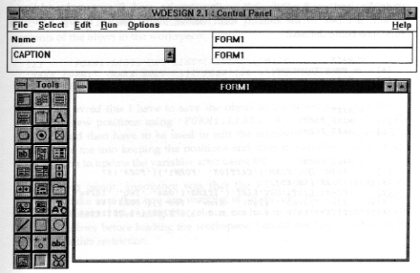
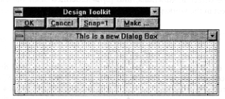
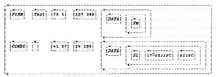
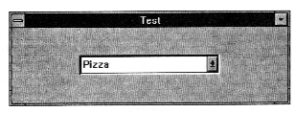

*by Jonathan Barman*
{ .byline }

### Summary

I am most impressed with Dyalog APL. It is full of ingenious and useful features and extensions to APL, and is one of the best implementations of APL on the market. However, whilst preparing this review it was quite difficult to avoid harping on those relatively minor aspects that I found annoying. The main annoyance was the manual, which is reasonably well written but is very poorly presented and is therefore difficult to use. Also, I would dearly like a CUA interface so that I did not have to learn Dyadic’s quirky key assignments for cut and paste, etc.

### New Features

Dyadic have gone down the road of providing specific Windows facilities that are embedded into APL, so that one does not have to learn C or the Windows System Development Kit (SDK). Version 6.3 of Dyalog APL completes the process of providing the Windows facilities that can be called through System Functions. The number and range of Windows functions provided is impressive. Windows applications can now be written with full control over the use of bitmaps, fonts, line drawing, the clipboard, printing, drag and drop – more than enough to enable you to create fancy Windows applications. A few things are not included, the major omission being the ability to create Multiple Document Interface (MDI) applications.

A new System Function `⎕NA` allows you to call Windows Dynamic Link Libraries (DLLs) from APL. This makes it possible to call those Windows functions that are not available in Dyalog APL to be accessed from the DLLs supplied with Windows or from DLLs that you have written yourself. However, this means that you need to become familiar with the Windows SDK and programming in C. `⎕NA` is also a useful tool to access other Windows applications that are programmed using DLLs.

There are numerous workspaces, starting with simple tutorials on how to use the new facilities, and going up to a full blown application to help you design a Windows application.

There is so much material that it is impossible to do justice to it in a single article in Vector. This review will give a brief overview of the facilities, and further articles will be needed to describe specific aspects in more detail.

### Getting Started

Installation was, initially, very simple. A glance at the User Manual showed that one did the normal thing for a Windows product, that is, poke the first disk into my A: drive, go into Program Manager and run a:setup. After a few minutes I got an odd little message asking me to edit the QUADCMD.PIF file to show the actual directory I had specified. Looking in the index of the User Manual drew a blank, as did running the thing, which just launched me into a DOS session. Later on I found the section in the manual that explains that the PIF file is required for the `⎕CMD` processor, and the last thing I should have done was to run it from File Manager. The index has an entry for DOS Command, but not `⎕CMD` or QUADCMD.

Firing up APL looked as though it was a success, but the character mapping was all over the place. Trying to type )OFF resulted in an undignified search for the ) which was finally located next to the backspace key. Back to the manuals for a look at the character mappings, which are simple and very flexible. I was able to use my favourite Unified keyboard, except that the APL quote is different from the ASCII quote, which caused a great deal of confusion as I kept getting SYNTAX ERROR when entering an apparently valid character variable. The Ctrl+K key produces the APL quote and the normal key produces the ASCII quote. George MacLeod suggested that I reversed the mapping of the two keys, and since then everything has been very easy.

I had some difficulty getting started with the Windows features of Dyalog APL. There are several reasons for this. First, I have not had the opportunity to use Dyalog APL before, so some time was spent getting to grips with the environment, such as how to cut and paste in the editor, how to edit variables, and all the little things that one takes for granted after using a product for a while. Secondly, I started by trying to implement a relatively complex Windows application that required a substantial amount of programming and I found that this was too much to handle all at once. I should have spent more of my time studying the supplied workspaces. Lastly, Dyadic have not supplied a quick reference card for the Windows facilities, and the layout of the manuals makes them difficult to use as quick reference material. Adrian Smith sent me his own ‘home-brew’ quick reference guide, which proved to be invaluable.

### Bitmap Manipulation

Ray Cannon’s article Windows BMP bitmap files and APL is an excellent introduction to bitmaps. Ray has done amazing things with Pocket APL to manipulate the bitmaps, but if he had had Dyalog APL he would have found life much easier. For example, reading a bitmap can be carried out with the simplest of functions:

```
     ∇ r←getbmp a;bm
[1]   ⍝ Get the bitmap from file <a>.BMP
[2]    'bm'⎕WC'BITMAP'a
[3]    r←'bm'⎕WG'BITS' 'CMAP'
     ∇
```

Reading the bits and palette into the workspace is then just a matter of typing `b c←getbmp 'bridge'`.

A short explanation of the function will be useful for those who have not seen the Dyalog APL facilities before. `⎕WC` on line \[2\] creates a Window, WC standing for Window Create. The left argument gives the name of the window and the right argument is a nested vector of properties. The first element of the right argument specifies the type of object. In this case ’BITMAP’ specifies that a bitmap object is to be created, which is invisible.

Each object type has a different set of properties which can be specified as the remaining elements of the nested array. In this case the name of the bitmap file is given in the variable a. The properties can be specified in the correct sequence or by name. For example I could have given the file name first and then specified that this is a bitmap object with (’FILE’a)(’TYPE’ ’BITMAP’). Specifying the properties in the default sequence means that I can omit the property names. Notice that the name of the window object, bm, is a specified as a local variable. This is necessary as `⎕WC` creates bm as a new class of object in the workspace. Windows objects have the equivalent status of a variable, but do not appear in the )VARS list, and their existence can only be displayed with `⎕NL 9`.

Line \[3\] reads the contents of the bitmap file with `⎕WG` (Window Get) which works in much the same way as `⎕WC` except that you always have to specify the names of the values of the properties required. The function specifies the properties BITS and CMAP, which are returned as a nested vector in the sequence specified.

When processing Ray’s article for Vector I used the bitmap facilities of Dyalog APL to get the images into a form that would fit nicely onto the page. For example, putting several transformations side by side on the page was carried out by the following little function:

```
     ∇ new combine list;b;c;i;n;s;b0;b1;c0;c1;bmx;⎕IO
[1]   ⍝ Combine BMP files in <list> into <new>
[2]    ⎕IO←0
[3]    n←⍴list ⍴ i←0
[4]    b0 c0←getbmp Directory,i⊃list      ⍝ Read first bitmap
[5]    s←((⊃⍴b0),10)⍴¯1+⊃⍴c0              ⍝ 10 pixel space using last plte row
[6]    c←20+⍳80⌈⌊n÷⍨10+1↓⍴b0              ⍝ Indices of portion to display
[7]    b←b0[;c]                           ⍝ First image in result
[8]    i+←1 ⋄ →L2/⍨n≤i                    ⍝ Loop for remaining images
[9]   L1:b1 c1←getbmp Directory,i⊃list    ⍝ Read ith bitmap
[10]   ⍎(c0≡c1)↓'∘'                       ⍝ Crash if different palettes
[11]   b←b,s,b1[;c]                       ⍝ Catenate selected portion of image
[12]   i+←1 ⋄ →L1/⍨n>i                    ⍝ Continue loop while images left
[13]  L2:'bmx'⎕WC'BITMAP'(Directory,new)b c0 ⍝ Create form with new bitmap
[14]   1 ⎕NQ'bmx' 91                      ⍝ Generate event to write to file
     ∇
```

All this function does is to loop around getting in each bitmap and concatenating a selected portion of them together. A properly constructed function would need to allow the preferred portion of the picture and the width between pictures to be specified as arguments, rather than the program constants of 10 20 and 80 which are hard-coded into the function. The global variable Directory contains the path to Ray’s bitmap files.

I put together a number of little utilities to view bitmaps, to copy bitmaps from and to the clipboard, and to write variables and functions to the clipboard so that I could paste them into this article. It was all very quick and easy to do, and made the job of writing the review easy.

I also had fun changing the colours of the pack of cards in the Solitaire patience game distributed with Windows. A colleague at work is colour-blind and finds red difficult to distinguish from black, which makes playing Solitaire rather difficult. Using a resource editor I copied the red cards to the clipboard and then used APL to convert the reds to other colours. Playing Solitaire where hearts and diamonds are deep blue is incredibly difficult and gives one a good idea of what it must be like to be colour blind!

### Workspaces

There are several introductory workspaces. WINTRO is an introduction to the Windows facilities with 45 simple lessons taking you through the main features of GUI programming in APL. WTUTOR is a more elaborate introduction where there are several lessons for each Windows facility. CALC is a demonstration of an implementation of a calculator. BMED is a simple bitmap editor for creating small objects such as buttons. BUDGET is an example of a spreadsheet using the `⎕SM` facilities combined with Windows. GRAPHS contains a very full demonstration of many types of graphs and should give you a flying start in the production of graphics applications. QUADNA gives some examples of using `⎕NA` to access standard Windows facilities.

There are two complete application workspaces. WDESIGN is a sophisticated tool for designing Windows applications. ARACHNID is a game of patience using bitmaps with drag and drop.

### Workspace WDESIGN

Dyadic have put a considerable amount of effort into their WDESIGN workspace, and the result is a excellent example of what can be achieved with the new facilities.

On loading the workspace three new windows pop up on your screen, a Control Panel, a Tool Bar, and a Form. As there is no MDI facility included with Dyalog APL these windows float freely on the screen and appear to be unconnected. I fact they are connected. If you press Ctrl+Esc or Alt+Tab to switch between applications only one entry is displayed for the group of windows. In the following example I have moved the three windows together to allow them to fit on the page and to remove the extraneous rubbish which I happened to have on my screen at the time. I used the Dyalog APL facilities to create the image.

## 

Everything in the picture has been created in Dyalog APL. The Tool Bar is a set of bitmaps which are held in a nested array in the workspace. The Control Panel is created by a fairly lengthy function which specifies the menu and the child controls. The Form is the first Windows object which you are about to define in your application. The only thing that you could not have created directly in Dyalog APL is the help text, where you would have needed a help compiler to create the standard Windows help file that has been provided. The help provided is excellent and quite extensive, running to about 8 pages when printed out.

The objective of the workspace is to enable you to design the forms for your Windows application and, if required, to define the main functions to create the objects and the call-back functions to process the events. The names of the 412 functions and variables in the workspace all start with the letters Wd, so you have to be careful not to use these starting letters for any objects in your own code.

Before you start using WDESIGN you should design the way in which your application is going to work. It is hopeless to expect to use this design tool, or any other design tool, without a clear idea of what it is you are about to produce. To get used to the facilities available it is probably best to copy the example from the user guide, or to implement the example Duncan Pearson gave in his review of Dyalog APL/W in Vector 9.2, on page 55.

The functions produced have text hard coded where I would normally have variables, and need editing before they can be used. For example, adding a default list box to the default form shown above results in the following functions being defined:

```
     ∇ MAIN
[1]   ⍝ Main Function
[2]    ⎕DQ'.'
     ∇

     ∇ MAKE
[1]    MAKE_ROOT
[2]    MAKE_FORM1
     ∇

     ∇ MAKE_FORM1
[1]    'FORM1'⎕WC'FORM'('CAPTION' 'FORM1')('POSN'(27 16.25))('SIZE'(65 80))
[2]    'FORM1.LIST1'⎕WC'LIST'('ITEMS'('One' 'Two' 'Three' 'Four' 'Five' 'Six' 'Seven' 'Eight' 'Nine' 'Ten'))('POSN'(18 16))('SELITEMS'(0 0 0 0 0 0 0 0 0 0))('SIZE'(42.05128098 17.96875))
     ∇
     ∇ MAKE_ROOT
[1]   ⍝ ROOT object has default properties
     ∇
```

All the functions are exactly as produced by the minimal use of the WDESIGN process. The function MAIN is presented for editing so that one can include the MAKE function and other code which would be essential for your application, but I have not altered the supplied default. Normally, an application would have a number of MAKE\_x functions which would be called by MAKE.

Line \[2\] of MAKE\_FORM1 contains the list of items that are needed when creating a list box as a vector of text strings. I would expect to use a variable for the contents of a list box, as elements are usually things that can be added or deleted elsewhere in an application. If matrix Mat is to be used to specify the contents, then I would probably edit line \[2\] as follows:

```
[2]    'FORM1.LIST1'⎕WC'LIST'('ITEMS'(↓Mat))('POSN'(18 16)) ('SELITEMS'(0⍴⍨⊃⍴Mat))('SIZE'(42 18))
```

At some later stage I might need to change the position and size of the list box, probably in conjunction with the position and size of all the other objects in order to make room for something else. To do this I would have to run the MAKE function to create the Windows objects, )COPY WDESIGN, run Wd and then drag the objects to the desired positions. However, if I request that the objects are to be saved as functions, then I lose my original definitions. In the following example I had defined `Mat←'M'⎕NL 3` and then dragged and resized the list box. On saving the object in functions, line \[2\] is redefined with the current contents of the object in the workspace:

```
[2]    'FORM1.LIST1'⎕WC'LIST'('ITEMS'('MAIN      ' 'MAKE      ' 'MAKE_FORM1' 'MAKE_ROOT '))('POSN'(10 14))('SELITEMS'(0 0 0 0))('SIZE'(58 38))
```

In order to avoid this I have to save the object in the workspace, and then to extract the new positions using `'FORM1.LIST1'⎕WG'POSN' 'SIZE'`. The results would then have to be used to edit the numbers in the functions. This would drive me into keeping the positions and sizes in variables and writing a little function to update the variables after using Wd.

Another, but minor, annoyance was that the WDESIGN cover function, Wd, checks to make sure that you are working in 16 colours, and exits if any other number is found. I like using 256 colours, so had to switch to 16 colours and restart Windows before loading the workspace. I could not find a reason in the manuals for this restriction.

Once mastered, WDESIGN will enable you to create complex applications without having to look at the manuals. The help is excellent, and it is easy to select the properties required from lists of the properties available for each object.

### Adrian Smith’s Window Designer

Adrian is currently experimenting with a completely different design approach. He has programmed a low-level set of cover functions with a different function for every type of Windows object that Dyalog APL supports. These functions are used by the design process and also by the application. All functions have the same syntax, with the left argument being the object name and the right argument a 5 element nested vector which specifies a standard set of properties.

There are some problems in implementing this design. Dyadic have specifically designed the interface so that the frequency of use of the properties of an object defines the default sequence. This means that in majority of cases you do not have to specify the property names when creating a function with the properties defined as program constants. Also, each object has its own list of properties, for example the FILE property is used for a bitmap object but will cause a DOMAIN ERROR if applied to a combo box. All objects, though, may have a DATA property in which one can store any APL variable. Adrian has used this to store parameters which are special to the various objects.

Typing `Gui_dbx 'test'` presents the following screen:

## 

To add a control you click on the Make button and a menu of controls appears. When the control is on the form you can click on it and add the properties and APL expressions for the contents of list boxes, etc. The process is much the same as with WDESIGN, but without the fancy toolbar. (Having seen how the toolbar is created in WDESIGN it would be easy to add an equivalent facility.)

I added a Combo Box in my test and specified `∆list` as the contents and `1↑⍨⍴∆list` as the selection, and then clicked the OK button, which exits from the function. The variable test is defined as a 2-element nested array, with the first element specifying the form and the second element the combo box. `DISPLAY↑test` shows the structure of the beast:

## 

Prior to displaying the variable I changed the form title using `(1 2⊃test)←'Test'`, so that the display would fit on the page.

Running Gui\_db test produced the following window:

## 

Adrian has added a sunken look to the combo box, and uses a grey background rather than the default colour that is specified in the Windows control panel.

The different design approach taken by Adrian is most interesting. I feel that holding the specifications in an array it is much more in line with the spirit of APL as an array language. The Dyadic approach results in lengthy functions with calls to `⎕WC` on every line. Adrian’s code does, of course, have to have the same number of calls to `⎕WC`, it is just that they are not so visible. I will probably use a combination of both methods when implementing an application.

Dyadic have used arrays to some extent in their WDESIGN workspace. The bitmaps for the toolbar and some other objects are held in an arrays. The function that creates the toolbar tacks on the properties required to the basic bitmap arrays and then calls `⎕WC¨` to create the toolbar in one go. A similar approach has been used in several places in the ARACHNID patience game.

### Workspace GRAPHS

The GRAPHS demonstration workspace contains the sort of functions that I would write to produce a graphics application. There are a couple of reasonably well generalised functions. GRAPH produces a graph from a nested array right argument which specifies most of the parameters required. AXES writes the axes using a number of global variables. If I was going to write a specialised graphics utility, rather than rely on the facilities available in other Windows products, I would start by using this workspace as a basis for development. No doubt by the time I had finished the functions would be entirely different, but at least I would have had a basis on which to start work.

I think Dyadic spoilt their demo by using some system fonts which are visually unattractive on the screen, with jagged edges when displayed in large font sizes. Don’t be put off by this, the demo shows you how to use fonts, and it is a simple matter to replace the system fonts with True Type fonts which look much smarter.

Needless to say Adrian Smith has an entirely different approach in converting his existing graphics code. He sent me a workspace with some impressive demonstrations. His foundation APL code is based on converting PostScript instructions into Dyalog APL graphics. Adrian has been doing a lot of work with PostScript, and basing the core graphics engine on PostScript means that he can lift applications from one version of APL graphics to another by just writing a new set of basic functions. I would have to learn PostScript to be able to use Adrian’s workspace, so for the moment I prefer to stick with Dyadic’s method.

### Manuals

I must get my beef about the manuals over first. All text is printed in a single typewriter-style font, so none of the normal methods of using different fonts for distinguishing different definitions are available. The font also makes the manuals physically much larger that they would have been with a proper proportionally spaced font. The User Guide does not have a Contents; each chapter starts with a Contents but there is no overall Contents. The User Guide and Reference Manual have indexes, but there are few entries and they have not been constructed properly, so they are virtually useless.

It is a shame that the manuals are so poorly produced because they are actually quite well written. The description of each feature is clear, and the grouping of subjects is sensible.

Dyadic should buy themselves a decent word processor and get some professional help to make their manuals more attractive.

### Problems

When writing this article I found it convenient to have Dyalog APL in one window and Microsoft Word for Windows in another. I found that I had to start Dyalog APL on entry to Windows otherwise it complained that there was not enough memory on my machine. It was no good starting Word for Windows and then closing it, I just got the same message. I can only assume that Dyalog APL requires a contiguous area of memory, and loading any other application causes memory to become fragmented.

Dyalog APL crashed four or five times whilst writing the review. It was most aggravating that I was unable to recreate the problems, so I was not able to tell Dyadic how to recreate the errors. Dyadic were most anxious to correct any errors before the final release of the product, and they tell me that several bugs have been found and corrected in the month that I have had the review copy prior to final release.

### Conclusion

Dyalog APL have created an excellent environment for the development of Windows applications. Every feature that I could wish for has been included, and once I had got over the initial learning curve I found programming easy. The ability to access DLLs will, I am sure, prove to be an invaluable tool in linking APL with other applications, which I am looking forward to exploring further.

(webpage generated: 5 December 2005, 18:50)
