\[The APL text in this article uses [APL2741](resource/apl2741.zip) (45K download).\]

## VideoSoft FlexGrid Pro with APL+Win

*by Jonathan Barman*

**Introduction**

A couple of months ago VideoSoft released Version 6.0 of their FlexGrid Pro control. It contains a mass of new features which make the standard Microsoft FlexGrid Version 5 look a very pedestrian affair. The Help About button of the Microsoft version says “Portions of this product were developed by VideoSoft”, so I assume that this really means that Microsoft took VideoSoft’s previous version and made a few modifications so that they could call it their own.

The major problem with the standard FlexGrid is that you cannot edit cells in place. Although it is reasonably straightforward to place an edit box over a cell so that it looks as though you are editing it, I never actually did that as the alternative grid TrueGrid (or the Microsoft Data Bound Grid) allows in-cell editing. Now that FlexGrid Pro allows in-cell editing and has so many seductive features I will be using it much more in future.

The thing I particularly like about VideoSoft is that they publish fully working software on the Internet ([www.componentone.com](http://www.componentone.com)). If you haven’t paid for it then you get an annoying message every time you run it. This means that you can download the OCX and really get down to business to see if you want to use it.

This is a short exposition of the FlexGrid Pro features using APL+Win.

<b>Creating a Basic Grid</b>  
In order to play with the features we need a basic grid populated with some data. I usually define `⎕io←0` as all the FlexGrid properties are index origin zero.

```
     ∇ vsFlexGridDemo;headings;data
[1]  ⍝ Generate headings and some data
[2]   headings←'Region' 'Product' 'Type' 'Sales'
[3]   data←(4/'France' 'Germany' 'UK'),(12⍴2/'Gold' 'Silver'),(12⍴'I' 'E'),[1.5]⍕¨?12⍴200
[4]  ⍝ Create the form and the grid
[5]   DemoForm←'fmFG'⎕wi'New' 'Form' 'Close' ('scale' 4)('caption' 'VideoSoft ...')('where' 0 0 20 40)
[6]   DemoGrid←⎕wself←'fmFG.vsfgDemo'⎕wi 'New' ':-) VideoSoft FlexGrid Control'
[7]  ⍝ Make sure the grid fills the form
[8]   DemoForm ⎕wi 'onResize' 'FGonResize' ⍝ ...
```

The `FGonResize` function just contains the statement

```
DemoGrid ⎕wi 'where' (0 0, 2↑⎕warg)
```

At this point the grid is displayed with the default settings of 50 rows and 10 columns with a fixed row and a fixed column:

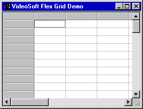

Now assign the headings and data:

```
[9]  ⍝ Define the heading row and cols
[10]  ⎕wi'xRows' 1
[11]  ⎕wi'xFixedRows' 1
[12]  ⎕wi'xCols' (1+⍴headings)
[13]  ⎕wi'xFixedCols' 1
[14]  ⎕wi'xColWidth' 0 300
[15] ⍝ Assign the headings
[16]  ⎕wi (⊂'Set'), ⊂[2](⊂'xTextMatrix'),0,(⍳⍴headings) ,[1.5]headings
[17] ⍝ Align the heading cells, from 0 1 to 0 4
[18]  ⎕wi 'xCell' flexcpAlignment 0 1 0 ,(⍴headings),flexAlignCenterCenter
[19] ⍝ Add rows using the Add Item method which needs a tab between each element
[20]  ⎕wi¨(⊂⊂'XAddItem'),¨⊂¨,/⎕tcht,¨data
```

APL+Win requires that you prefix any OCX control properties with an x, methods with a X and events with onX. Rather annoyingly, I found that that I could not assign values to the Cell property without specifying all the arguments. In VB the syntax is (setting, R1, C1, R2, C2)=value and you can omit the R2 and C2 parameters for a single cell and the R1 and C1 parameters to assign the current cell. Also, in theory, I should have been able to assign the headings using `⎕wi 'xCell' flexcpText 0 1 0 4 (¯1↓∊headings,¨⎕tcnl)`, but for some reason this does not seem to work properly for multiple columns.

I use global variables containing the constant parameters as it is much easier to read `flexAlignLeftCenter` rather than trying to remember what a 4 means. The constants and their values are in the help text so it is very easy to copy and paste them into a function which assigns all the variables.

We have now got a grid with some data that we can play with:

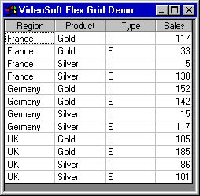

There are a few more things to improve the functioning of the basic grid. The `AllowUserResizing` property allows the user to resize rows, columns or both. The `ExplorerBar` property allows the user to click in the header to sort a column, as in Explorer, and to move columns around. The options are None, Move, Sort and Sort and Move.

```
[21] ⍝ Allow column and row resizing
[22]  ⎕wi 'xAllowUserResizing' flexResizeBoth
[23] ⍝ Allow user to sort and move columns around.
[24]  ⎕wi 'xExplorerBar' flexExSortAndMove
```

I also like to use the keyboard to move rows and columns around and to insert and delete rows. Implementing the KeyPress event is quite simple:

```
[25] ⍝ Key Press event to move rows and columns about
[26]  ⎕wi 'onXKeyDown' 'FGvsonKeyDown'
```

The functions needed to implement the event are as follows:

```
     ∇ FGvsonKeyDown
[1]  ⍝ on Key Down event handler for vs Flex Grid
[2]   :select ⎕warg
[3]    :case 37 4 ⍝ Alt-Left
[4]     GridMove ¯1 'xCol' 'xFixedCols' 'xCols' 'XColPosition'
[5]    :case 38 4 ⍝ Alt-Up
[6]     GridMove ¯1 'xRow' 'xFixedRows' 'xRows' 'XRowPosition'
[7]    :case 39 4 ⍝ Alt-Right
[8]     GridMove 1 'xCol' 'xFixedCols' 'xCols' 'XColPosition'
[9]    :case 40 4 ⍝ Alt-Down
[10]    GridMove 1 'xRow' 'xFixedRows' 'xRows' 'XRowPosition'
[11]   :case 45 4 ⍝ Alt-Insert
[12]    DemoGrid ⎕wi 'XAddItem' ((4⍴⎕tcht),'0')(DemoGrid ⎕wi 'Row')
[13]   :case 46 4 ⍝ Alt-Delete
[14]    DemoGrid ⎕wi 'XRemoveItem' (DemoGrid ⎕wi 'Row')
[15]  :endselect
     ∇
```

Notice that the AddItem method allows us to set the default values for the new row directly.

```
     ∇ GridMove a;move;posNm;minNm;maxNm;fnNm;newpos;curpos;min; max;⎕wself
[1]  ⍝ Move a grid row/column
[2]  ⍝ 5 element vector of Move, Position name, Min name,Max name, Function name
[3]   (move posNm minNm maxNm fnNm)←a
[4]   ⎕wself←DemoGrid
[5]  ⍝ Current position and new position
[6]   newpos←move+curpos←⎕wi posNm
[7]  ⍝ get min and max
[8]   (min max)←⎕wi¨minNm maxNm
[9]  ⍝ Wrap around
[10]  :if newpos<min ⋄ newpos←max+newpos-min ⋄ :endif
[11]  :if newpos≥max ⋄ newpos←min+newpos-max ⋄ :endif
[12] ⍝ move
[13]  ⎕wi fnNm curpos newpos
[14] ⍝ Set current position
[15]  ⎕wi posNm newpos
     ∇
```

<b>In-cell Editing</b>  
The default value for the Editable is False, so we have to set it before any editing can be carried out. However, this allows any sort of rubbish to be typed into the cells. If we want to limit some of the columns to a list then we can set the `ColComboList` property to provide a combo or list drop-down. There are many options. You can choose between a combo or a list drop-down, you can translate the data from codes to text and you can have multiple column lists and highlight one of the columns. In this short article there is not enough room to explore all the alternatives. One flaw is that the pipe character used to separate elements cannot be altered, so none of the list elements can contain a pipe character.

```
[27] ⍝ Allow editing
[28]  ⎕wi 'xEditable' ¯1
[29] ⍝ Restrict the Product and Type to lists
[30]  ⎕wi 'xColComboList' 2 'Gold|Silver |Platinum |Iridium'
[31]  ⎕wi 'xColComboList' 3 ('I',⎕tcht,'Import|E',⎕tcht,'Export')
```

Note the use of the split bar, as APL+Win seems to hijack the vertical bar. The horizontal tab `⎕tcht` is the separator for multiple columns in the drop down list.

We can now use drop-down lists in the Product and Type columns.

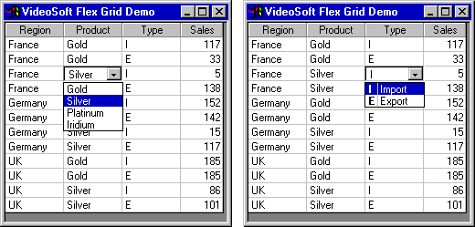

If you need to do more elaborate work you can set the `ColComboList` property to an ellipsis. A button is displayed in the cell and when the user clicks it the control fires the CellButtonClick event, at which point you can do clever things. The following is a contrived example, just to illustrate the facilities rather than doing anything useful, where we pop up an edit box just below the cell.

```
[32] ⍝ Pop up an edit box when user clicks country
[33]  DemoEdit← ⎕wi ':edCountry.New' 'Edit' ('visible' ¯1)('onUnfocus' 'FGedonUnfocus')
[34]  ⎕wi 'xColComboList' 1 '...'
[35]  ⎕wi 'onXCellButtonClick' 'FGvsonCellButtonClick'
```

```
     ∇ FGvsonCellButtonClick;top;height;left;text
[1]  ⍝ Pop up edit box when user clicks button
[2]  ⍝ Find out where to place edit box and what to put in it
[3]   (top height left text)←DemoGrid ⎕wi 'Ref' 'xCellTop' 'xCellHeight' 'xCellLeft'('xCell' flexcpText)
[4]   DemoEdit ⎕wi 'Set' ('visible' 1)('text' text)('where' (top+height),left)
[5]   DemoEdit ⎕wi 'Focus'
     ∇
```

Because the user can resize the rows and the columns it is essential to access the CellTop, CellHeight and CellLeft properties to get the cell position. A fully working system should also check that there is enough room to display the pop-up in the intended position.

The simple way out of the edit box is for it to hide itself as soon as it loses focus. Generally, you would want to have OK and Cancel buttons where the operation was sufficiently complex to warrant a pop-up.

```
     ∇ FGedonUnfocus;t;⎕wself
[1]  ⍝ Edit box has lost focus
[2]   t←DemoEdit ⎕wi 'text'
[3]   DemoEdit ⎕wi 'visible' ¯1
[4]   ⎕wself←DemoGrid
[5]   ⎕wi 'xText' t
     ∇
```

There are many more features for controlling editing. A check box can be displayed for Yes/No type columns. The EditMask property allows detailed control over the characters to be input. The editing properties can be set on a cell by cell basis as well as for complete columns. There is a full set of before, after and validate events so that detailed control can be exercised over each cell. There is a separate set of key down/up/press events which fire when edit mode is active, so a different set of routines can be coded to control in-cell editing.

You have to watch out when coding the before and after edit routines if you allow the user to move columns about. For example, if editing was not allowed in the Sales column then the code would have to look like this:

```
     ∇ FGvsonBeforeEdit
[1]   :if 'Sales'≡DemoGrid ⎕wi 'xTextMatrix' 0,⎕warg[2]
[2]     ⎕wres[3]←¯1
[3]   :endif
     ∇
```

<b>Merge Cells</b>  
Cells may be merged in a number of ways. We start by allowing a merge on the left hand 3 columns and then specifying that all items in those columns may be merged:

```
⎕wi (⊂'Set'),(⊂⊂'xMergeCol'),¨(⍳3),¨¯1
⎕wi 'xMergeCells' flexMergeFreeThe following shows what happens before and after moving the Type column:
```

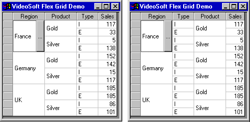

If we now restrict the merge then the lower order columns are not merged:

```
⎕wi 'xMergeCells' flexMergeRestrictAll
```

The following shows the results before and after sorting the Type column by clicking in the header:

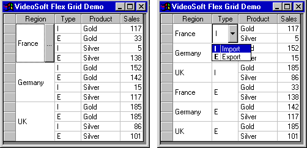

I particularly like the ability to change groups of merged cells in one operation.

Rows can be merged in exactly the same way as columns. Also, the merging can be restricted to the fixed columns or rows so that you can have pretty headings without having to merge the data.

Finally, the `flexMergeSpill` setting allows a spreadsheet style of merge where long items spill into the next column if it is blank:

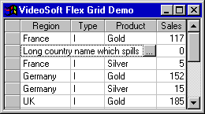

<b>Outlining</b>  
This is best demonstrated on the original data grid. First we have to specify what outlining we want and clear any existing outline:

```
'xOutlineBar' flexOutlineBarComplete
⎕wi 'xSubTotalPosition' flexSTAbove
⎕wi 'XSubtotal' flexSTClear
```

The Subtotal method has 10 arguments and all but the first are optional. The last statement above illustrates a call to the method specifying the first, mandatory, parameter which is the required action.

Each of the following Subtotal calls specifies:

- Action, in this case flexSTSum
- Grouping column, or ¯1 for a grand total
- Column to be summed
- Format string
- Background colour
- Foreground colour
- Bold

The remaining items can be left at their default values.

The grand total is added by specifying `¯1` as the grouping column.

```
⎕wi 'XSubtotal' flexSTSum ¯1 4 '#,' 1 (256⊥3⍴255) ¯1
```

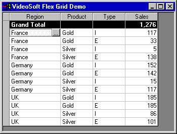

Each of the next groupings are specified by column numbers starting from the left. By using the last two of the 10 arguments to the SubTotal method you can specify groupings across arbitrary sets of columns.

The next set of totals is indicated by a dark grey background.

```
⎕wi 'XSubtotal' flexSTSum 1 4 '#,',(256⊥3 2⍴64 255),¯1
```

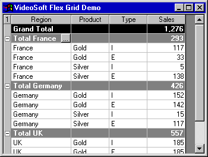

Finally, the Products are grouped with a pale grey background.

```
⎕wi 'XSubtotal' flexSTSum 2 4 '#,',(256⊥3 2⍴192 255),0
```

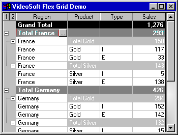

The user can then click on the outline symbols to collapse or expand the totals:

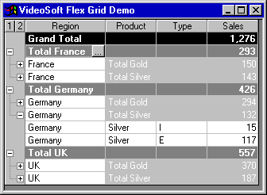

Instead of getting the method to generate totals (with flexSTSum) you can specify Percentage of Total, Count, Average, Max, Min, Standard Deviation and Variance.

If you don’t want totals inserted then there is an RowOutlineLevel method which allows you to specify the outline level of every row to get the precise effects that you need.

<b>Speed</b>  
There are several techniques for posting data into the grid. If you want to display big APL arrays in the grid then some speed test are required to see which is best.

The AddItem method adds a row, but requires tabs between each column together with a leading tab if there is a fixed column. The TextMatrix and Cell properties are designed for assigning data on a cell by cell basis. The Clip property allows a bunch of selected cells to be assigned in one go, but you have to have a character vector with tabs between columns and new line characters between rows.

The following are some little timing functions to see which method is fastest.

```
     ∇ FGTimeAddItemEach data;rows;cols
[1]   (rows cols)←⍴data
[2]   ⎕wi 'xRedraw' 0
[3]   ⎕wi 'xCols' (1+cols)
[4]   ⎕wi¨(⊂⊂'AddItem'),¨⊂¨,/⎕tcht,¨data
[5]   ⎕wi 'xRedraw' 1
     ∇
```

```
     ∇ FGTimeAddItemLoop data;rows;cols;i;t
[1]   (rows cols)←⍴data
[2]   ⎕wi 'xRedraw' 0
[3]   ⎕wi 'xCols' (1+cols)
[4]   t←(⎕wi 'xFixedCols')⍴⎕tcht
[5]   :for i :in ⍳rows
[6]     ⎕wi 'AddItem'(t,1↓∊⎕tcht,¨data[i;])
[7]   :endfor
[8]   ⎕wi 'Redraw' 1
     ∇
```

```
     ∇ FGTimeTextMatrixLoop data;rows;cols;r;c
[1]   (rows cols)←⍴data
[2]   ⎕wi 'xRedraw' 0
[3]   ⎕wi 'Set' ('xRows' (1+rows))('xCols' (1+cols))
[4]   :for r :in ⍳rows
[5]     :for c :in ⍳cols
[6]       ⎕wi 'xTextMatrix' r c (⊃data[r;c])
[7]     :endfor
[8]   :endfor
[9]   ⎕wi 'Redraw' 1
     ∇
```

```
     ∇ FGTimeClipAssign data;d;rows;cols;blocks;i
[1]   (rows cols)←⍴data
[2]   d←(1↓¨,/⎕tcht,¨data),¨⎕tcnl
[3]   ⎕wi 'xRedraw' 0
[4]   ⎕wi 'Set' ('xRows'(1+rows))('xCols'(1+cols))
[5]   blocks←rows⌊1000×⍳⌈rows÷1000
[6]   :for i :in (¯1↓0,blocks),¨blocks
[7]     ⎕wi 'XSelect' (1+1⊃i) 1 (2⊃i) cols
[8]     ⎕wi 'xClip' (∊d[(1⊃i)+⍳--/i])
[9]   :endfor
[10]  ⎕wi 'XSelect' 1 1
[11]  ⎕wi 'xRedraw' 1
     ∇
```

```
     ∇ r←FGTime data;t1;t2;⎕wself
[1]  ⍝ Time various methods of loading Flex Grid with data
[2]   ⎕wself←DemoGrid
[3]  ⍝ Set up the result
[4]   r←1 2⍴'Method' 'Seconds'
[5]  ⍝ Add item method. Use Each
[6]   ⎕wi 'Set' ('xRows' 1)('xCols' 1) ⍝ Reset grid
[7]   t1←⎕ts ⋄ FGTimeAddItemEach data ⋄ t2←⎕ts
[8]   r←r⍪('AddItem Each')(Seconds t2 t1)
[9]  ⍝ Add item method. Loop to avoid WS Full
[10]  ⎕wi 'Set' ('xRows' 1)('xCols' 1) ⍝ Reset grid
[11]  t1←⎕ts ⋄ FGTimeAddItemLoop data ⋄ t2←⎕ts
[12]  r←r⍪('AddItem Loop')(Seconds t2 t1)
[13] ⍝ Text Matrix property in loop
[14]  ⎕wi 'Set' ('xRows' 1)('xCols' 1) ⍝ Reset grid
[15]  t1←⎕ts ⋄ FGTimeTextMatrixLoop data ⋄ t2←⎕ts
[16]  r←r⍪('TextMatrix Loop')(Seconds t2 t1)
[17] ⍝ Select cells and assign Clip property. Max size 500k
[18]  ⎕wi 'Set' ('xRows' 1)('xCols' 1) ⍝ Reset grid
[19]  t1←⎕ts ⋄ FGTimeClipAssign data ⋄ t2←⎕ts
[20]  r←r⍪('Clip assign')(Seconds t2 t1)
     ∇
```

I have cheated slightly in the FGTimeAddItemEach function as it should really check to see how many fixed columns there are rather than assuming that there is exactly one. The job is done properly in the FGTimeAddItemLoop function. The loop in the FGTimeClipAssign function is required because any attempt to assign more than 500K in one go results in a GPF. The 1000 rows is just a guess that the columns won’t be bigger than 512 bytes on average.

The results on a 1000 by 10 array are as follows:

```
FGTime ⍕¨(100×⍳1000)∘.+⍳10
```

<table cellpadding="3"><tr><td>
<b>Method</b></td><td align="right"> <b>Seconds</b></td></tr><tr><td width="164">
AddItem Each</td><td align="right"> 0.33</td></tr><tr><td>
AddItem Loop</td><td align="right"> 0.44</td></tr><tr><td>
TextMatrix Loop</td><td align="right"> 2.36</td></tr><tr><td>
<p>Clip assign</p></td><td align="right"> 0.22</td></tr></table>

Obviously, APL is slow when looping like crazy assigning the TextMatrix property on every cell. Interestingly, the Flex Grid help says that assigning data using the TextMatrix property should be faster than using the AddItem method. However, the winner is selecting the required range and assigning the Clip property.

Running the timings on a bigger array shows that the looping version of AddItem is slightly faster than using Each, but the winner is still the assignment to the Clip property:

```
FGTime ⍕¨(100×⍳10000)∘.+⍳10
```

<table cellpadding="3"><tr><td>
<b>Method</b></td><td align="right"> <b>Seconds</b></td></tr><tr><td width="164">
AddItem Each</td><td align="right">4.99</td></tr><tr><td>
AddItem Loop</td><td align="right">4.45</td></tr><tr><td>
TextMatrix Loop</td><td align="right">23.35</td></tr><tr><td>
<p>Clip assign</p></td><td align="right">2.75</td></tr></table>

My initial efforts indicated that the Clip assignment was much the slowest at 58.5 seconds! An analysis of the problem showed that it was line \[8\] that was causing all the delay. The Editor kindly pointed out that if I changed `'xClip' (⊃,/d[(1⊃i)+⍳--/i]`) to be `'xClip' (∊d[(1⊃i)+⍳--/i])` then the times would be dramatically improved. It just goes to show that you have to know your version of APL to get the best out of it.

<b>Other Things</b>  
The Autosearch property allows the user to search for an item by typing the first few letters of the text. You can set it to search from the top every time or from the cursor. This enables you to use the grid like a sophisticated list box.

The AutoSize method and the AutoSizeMode property allow you to fit column widths or row heights to the data. It is easy to get two-row headings in this way:

```
⎕wi 'xSelect' 0 1 0 4
⎕wi 'xClip' (1↓∊⎕tcht,¨'Region name' 'Product code' 'Import / Export' 'Sales'))
⎕wi 'xWordWrap' 1 ⍝ True
⎕wi 'xAutoSizeMode' flexAutoSizeRowHeight
⎕wi 'XAutoSize' 1 4 ⍝ Columns to be sized
```

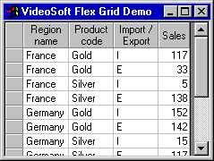

OLE Drag and Drop enables the user to highlight cells and drag them into another application. The following is a picture of where I am in the process of dragging a group of cells into Excel:

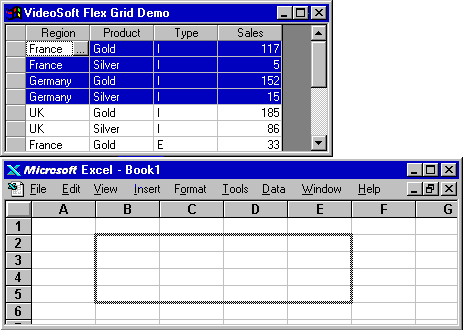

You can display a tool tip on the scroll bar by setting the ScrollTips property to True and assigning a function to the BeforeScrollTip event, which in turn assigns a value to the ScrollTipText property. For example:

```
'xScrollTips' 1
⎕wi 'onXBeforeScrollTip' 'FGvsonBeforeScrollTip'
     ∇ FGvsonBeforeScrollTip
[1]   DemoGrid ⎕wi 'xScrollTipText' ('Row: ',⍕⎕warg)
     ∇
```

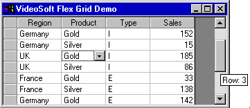

You can save the contents of the grid to a file using the SaveGrid method and then get it back again using the LoadGrid method. There is also an Archive method which enables you to save a number of different files in single, compressed, file. I found this particularly useful when putting together a little demo which needed the contents of several grids to be saved together.

Copy and Paste are nicely implemented, though Paste always seems to need extensive code to check that the values being pasted are all OK.

<b>Failures</b>  
There are several things that I have not been able to get to work from APL+Win, largely through lack of time and experience.

It ought to be possible to put icons on a grid using the Imagelist control, but I could not work out how it should be done.

There does not seem to be a tooltip property for the grid. If there was I could have assigned the following function to the MouseMove event:

```
     ∇ FGvsonMouseMove;pos;⎕wself
[1]  ⍝ Display tool tip on mouse move
[2]   ⎕wself←DemoGrid
[3]   pos←⎕wi 'Ref' 'xMouseRow' 'xMouseCol'
[4]   :if 0∊pos
[5]     ⎕wi 'tooltip' ''
[6]    :else
[7]     ⎕wi 'tooltip' ('This is ',⎕wi 'xCell' flexcpText pos)
[8]   :endif
     ∇
```

I did not attempt to try and get the BindToArray method to work as I would not expect APL to know anything about the address of a VB array. It would be marvellous to have this facility in APL as the array expands and shrinks in line with the size of the grid and you can link several grids together in useful ways. It is also very fast.

These little failures would seem to be an excellent set of topics for the Hackers’ Corner in *Vector*! Is there anyone out there who can fix the problems?

<b>Conclusion</b>  
I am an enthusiastic convert to this OCX which is stuffed full of facilities that save coding time. I have no doubt that it might be possible to replicate most of the features in APL, but why bother when it is all available?

***
