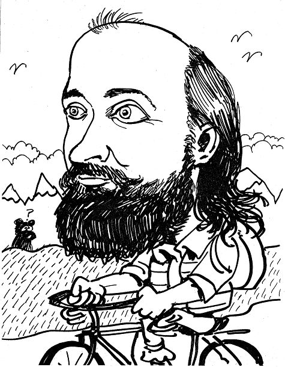

## From Bob Bernecky

{ width="234" height="299" }I am going to talk about a teacher.

In early 1971, I told a headhunter in Toronto that I was looking for a job where I could work my own hours, work on compilers, wear jeans, and I didn’t care about the pay. He told me: “There’s only one place in town like that.” I ended up talking with Ian Sharp, who told me that I’d “have to talk with Roger.” I found Roger Moore in the middle of staring at a complex piece of code and, rather than conducting an interview, he and I ended up talking for an hour or so about the code, at which point I had to go to another interview. I asked him about the job interview, at which time he said that I was hired.

Shortly thereafter, I took a 20% pay cut to join the development group at I.P. Sharp Associates, working on ways to break the IPSCOBOL compiler that was nearing completion. I used APL, a language I had seen before, but never used in practice, to generate and evaluate test suites for the large number of cases required by COBOL’s numerous data types – Packed Roman Numerals to floating-point Aztec conversion and the like.

I soon noticed that my evaluations were taking inordinate amounts of computer time, and eventually narrowed the problem down to poor performance of the “indexof”primitive, aka “dyadic iota”, in the APL interpreter. When I pointed this out to Roger, he said “Fix it”, at which time I became an APL implementor.

Sometime in next year or so, I had the honor and great luck to meet Ken Iverson. At the time, I had no idea how greatly Ken’s ideas would influence the course of my thoughts, modest future achievements, and career.

Ken and I talked on many occasions, but it was only around 1980, when Ken left IBM and joined my APL Design Group at Sharp, that we began to work closely with one another on language design issues. We had daily blackboard \[there are those who call these things chalkboards, but we know they are not made from chalk\] discussions, whose lively nature was dampened only by less enthusiastic colleagues asking us to stop shouting.

Terminology was a fundamental focus in our work, for didactic reasons as well as for the great power that we, like the ancient sorcerers and sorceresses of yore, knew arises from knowing a thing’s true name. Often, merely changing the name of a verb, adverb, or conjunction, as when “reduce” became “insert”, would give us insight into simpler, more powerful concepts.

Our quest for, and delight in finding, the right word meant that we always had a dictionary or thesaurus at hand. We shared this delight with many others in the community, including Larry Breed, Eugene McDonnell, Bob Smith, and Donald McIntyre. Yet, Ken was adamant, in the sense that McIntyre would approve of, about more than terminology: he viewed mathematical rigor as a vital force in programming language design. However, that view was always tacit – I don’t recall him ever saying it, yet, it was an *eminence grise*, omnipresent and powerful in our design talks, but unmentioned.

Around 1999, I tried to evoke that eminence, and wrote, in a paper called “Ergonomics and Language Design”, these three design rules for human-centered programming languages:

- Few rules
- Simple rules
- Consistent rules

These rules, first embodied in APL, then generalized and simplified in J, comprise the palette from which Ken created his art. As with all great art, simplicity produces beauty and insight.

As time passed, I began to comprehend that beauty and insight, and to recognize the power and brilliance of Ken’s understanding of the need to design programming languages for people, rather than for computers. His understanding produced concepts that, like a carefully tended garden, have blossomed with time, creating unexpected delights for people all over the earth.

Ken’s mathematics will play a key role in taking programming from being a craft to being an engineering discipline, by helping us to create, at long last, reliable computer programs. The power of array languages like APL and J have given us the concepts we need to construct tools to analyze programs and make assertions about their behavior, much as mechanical engineers analyze structures, for the same reason.

Ken Iverson’s Tools of Thought comprise a wonderous gift that he, like so many other great teachers and mathematicians, bequeathed to all those who come after him.

Ken taught us much and gave us much; I believe the world still has much more to learn from his teachings.

This is a slightly cleaned-up version of what I said at the Kenneth E. Iverson Memorial at OISE Auditorium, Toronto, 2004-11-18
