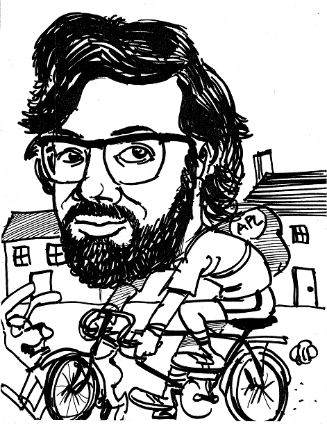

from Larry Breed
{ .byline }

## APLBUG at CHM, 10 May 2004

{ width="235" height="302" }APL\\1130 was implemented overnight in the autumn of 1967, but it took years of effort to make that possible. In 1965, Ken Iverson’s group in Yorktown was wrestling with the transition from Iverson Notation, a notation suited for blackboards and printed pages, to a machine-executable programming environment. Iverson had already developed a Selectric typeball and was writing a high-school math textbook. By autumn 1965, Larry Breed and Stanford grad student Philip Abrams had written the first implementation in 7090 Fortran (with batch execution). Eugene McDonnell was looking for applications to run on TSM, his project’s experimental time-sharing system on a virtual-memory 7090. With his help, Breed ported the Fortran code, added I/O routines for the 1050 terminals, called the result IVSYS; and Iverson Notation went interactive.

Iverson, Breed and other associates now faced issues of input and output, function definition, error handling, suspended execution, and workspaces. They also struggled with both extending the notation to multidimensional arrays and new primitives, and limiting it to what could reasonably be implemented. Whatever it was, it wasn’t “APL”; that name came later.

Iverson was also collaborating with John Lawrence of Science Research Associates (SRA), an IBM subsidiary in Chicago aimed at educational markets. Lawrence had been editor of the IBM Systems Journal when it published the Iversonian tour de force .“A Formal Description of System/360.” At SRA he was leading a project to make Iverson’s notation the heart of a line of instructional materials, both books and interactive computer applications.

SRA hoped to exploit a single-user workstation being developed at IBM’s Los Gatos Laboratory. There, veteran 1401 designer Fran Underwood and his colleague Ans Schellenberg were building a laboratory prototype of a computer workstation that they called the PCT, or IBM 1570, or “Elsie,” for Little Computer. Elsie comprised a processor, 512 bytes of core memory, a console typewriter, a card reader (cards fed by hand, one at a time), and a disk. The disk, an early version of what would become the floppy disk, held 32k 16-bit words. The processor had the architecture of a stripped-down 7090: one data register (“Accumu­la­tor/MQ”) and three index registers, all simulated by low-memory locations; a 16-bit data size and instruction size; and 64 opcodes.

SRA consultant Bill Worley (who, decades later, directed Hewlett Packard’s computer architecture effort) considered the Elsie architecture outmoded. He, Abrams and Breed proposed a redesign that looked like a stripped-down System/360: 16 general registers (actually low-memory locations), 16- and 32-bit instruction lengths, immediate operands, and just 8 basic opcodes. The arithmetic/logical capabilities were, in full, Add and Nor (each with the option to complement one operand), and Rotate. Sample programs turned out to be substantially shorter and faster, and Underwood was persuaded to adopt the new architecture and to expand the memory to two kilobytes.

With the Fortran implementation behind them, Breed and Abrams turned to assembly-coding a limited implementation for Elsie. How limited? Identifiers were a single alphabetic character; 52 in all. Arrays were of rank two or less, with dimension limited to 255. That particular limit didn’t come into play, since total data space was 350 words, or 175 data values; the only data type was 2-word floating point. (Even for character data.) Worley produced a 7090 cross-assembler and emulator, and arranged for Hirondo Kuki, mastermind of System/360’s Fortran function library, to develop floating-point arithmetic and math functions.

By spring 1966 Abrams, working at Stanford with occasional forays to Los Gatos, produced an Elsie interpreter that worked but lacked many features. In Yorktown, Breed wrote a specification that for the first time documented APL syntax, operators (not yet called “primitive functions”) and user interaction. The document bore the name “APL”, which Adin Falkoff had recently acronymized from Iverson’s pioneering book, “A Programming Language.” (The pronunciation was not yet settled. “Use Apple,” Falkoff said one day, “the language that has appeal.”)

Then the Elsie effort slowed. Circuit boards and memory were scarce and expensive, due to System/360 production demands. Only four prototypes were ever built. Breed and Roger Moore of I. P. Sharp Associates Ltd. (IPSA) started designing APL\\360. They began in July 1966 and it went into service in November, gaining immediate popularity and heavy use within IBM.

Seeking to counter the popularity of Dartmouth Basic (running on teletypes and a remote GE computer) at the prestigious Hotchkiss School in Connecticut, IBM V.P. Arthur K. Watson, who was a Hotchkiss trustee, had APL terminals and access to the Yorktown APL\\360 system installed for Hotchkiss students. The students loved it, and carefully steered newbies to the Basic teletypes so as to maximize their own APL time.

This last may be irrelevant, or it may be why IBM’s Hartford branch office knew about APL and its appeal. In late 1967, the Hartford office asked Iverson’s group to implement an APL for the 1130, a machine for which sales had apparently been flagging. Breed was at first reluctant to divert resources into this, but then thought of the Elsie implementation. The Yorktown 7090 was long gone, though, and with it Worley’s cross-assembler and emulator.

Over a few days, Breed built an Elsie assembler on APL\\360 while Reve Carberry, an 1130 programmer provided by the Hartford office, coded up an Elsie emulator. Abrams’assembler code, with some tinkering, was processed through; someone typed “2+2”, and APL\\1130 printed out

4

It was not fast. Of Elsie’s 2k memory, about half – 1k bytes, 500 words – was allocated to code space. Every operation required multiple overlays from the floppy disk. “2+2” took about five seconds; “2\*3”produced about forty-five seconds of disk activity before printing

8.00001

Improvement was possible, though. Elsie’s 2k memory limit could be expanded. The emulator accepted one new I/O operation, “Escape to 1130.” One by one, high-usage routines were coded as native 1130 instruction sequences, and APL\\1130 got faster and faster.

There were other problems. The console keyboard was adapted from a Model 029 key­punch, with only one alphabetic case; about thirty APL characters couldn’t be entered. Charles Brenner found homes for them by designing and implementing support for the notorious triple-shift keyboard. Brenner gradually took over the APL\\1130 development effort, with help from summer student Alan Nemeth. They improved execution times and implemented the rest of the primitive functions.

APL\\1130 was released to the public late in 1968 on a self-loading card deck about three inches thick. The Hartford office helped with this, providing Steve Raucher, who created the documentation and jumped through the hoops necessary to register APL\\1130 as “Type III” software: available without charge, liability, or support.

Demand was immediate, and led to purchases of several 1130s. It wasn’t hard to persuade IBM Marketing to fund development of Version 2, which added multi­character identifiers and most of the other APL\\360 features. Paul Berry adapted his informative and appealing APL\\360 Primer to APL\\1130. David Oldacre and Eric Iverson of IPSA delivered Version 2 in 1969. This is the APL\\1130 you remember and may even still be using. It became the most popular free software in IBM history.

## Acknowledgements

Thanks to Eugene McDonnell, Philip Abrams, Charles Brenner, Paul Berry, Roger Moore, Eric Iverson, and Brian Knittel for preserving and recalling essential elements of this account.
