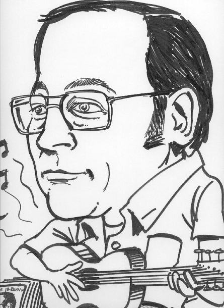

## From Jim Brown

{ width="246" height="336" }Without question, the most influential person in my professional life was Ken Iverson. You all know his many accomplishments and I will not restate them here. Rather, I’d like to give a more personal history of my involvement with Ken. Please forgive any factual errors in my recollections.

I first heard of Ken Iverson shortly after I started work with IBM in 1965. A colleague was talking in the hall about this person who “reduced the design of the System 360 to a single symbol”. I thought this was a bit of an outrageous claim (and it probably was) but I decided to check up on it. I had been interested in symbolic notations for a while and when in college read much of Alfred North Whitehead, Bertrand Russell’s *Principia Mathematica* working out all the proofs. I went out and got Ken’s book *Applied Data Processing* co-authored with Fred Brooks. Then I got *A formal description of SYSTEM/360* by Falkoff, Iverson, and Sussenguth – an amazing piece of work which later became known as the grey manual. I thoroughly enjoyed time spent on this document and came to appreciate that symbolic notation really can be used for describing real as well as formal systems. I didn’t find any fault with this document but I hope Larry Breed correctly describes how he found an error and told Ken about it at lunch at Stanford being careful to bring it up when Ken had cake in this mouth.

Ken’s name next came to my attention when a friend and I took our wives to a dinner meeting of the local ACM chapter. I always felt there was no way to impress a woman like an ACM meeting. In fact, we did go for a social evening and didn’t even make note of the speaker who was someone I never heard of anyway. It was Adin Falkoff with a portable (by some extended meaning of that word) 2741 terminal which he dialed into Yorktown and showed us APL. He carefully and patiently explained to the telephone operator that the phone line would be used to communicate with a computer and the noises on the line were normal. Nonetheless, the session was interrupted several times when the connection was terminated by the operator.

I was absolutely blown away by the whole presentation. Adin typed in “2 space 3 backspace backspace plus” and pressed return and it typed “5”. He called it visual fidelity. I recall our wives were not so impressed by this as they were apparently able to work out this result in their heads without use of a terminal and phone line.

There was APL itself which I just found amazing but I was just as impressed by the fact that Adin gave credit to the APL team – Larry Breed, Dick Lathwell, Roger Moore, and (again that name) Ken Iverson. I had never in my career (now over 20 months in duration) heard an IBM presentation that gave credit to real people.

IBM Owego had a 2741 terminal with a phone and I was able to sign on to the Yorktown APL service from work. My manager would not permit this kind of playing around so I could not continue to use it. When I heard that Syracuse University needed someone to manage a new proposed APL installation, I left IBM and went on Campus to do that.

Six months later when the money ran out, I applied to Yorktown Heights for summer work but was turned down. I also applied directly to the APL group and was invited for an interview.

Karen and I showed up at Yorktown Heights at the appointed time only to find that the interview had been canceled. Because of the death of President Eisenhower, the lab had been closed the previous day and a scheduled “APL Machine” seminar had been moved one day later. Thus, March 1969 is the first time I saw Ken – standing outside the IBM Research Auditorium, during a break in the seminar, surrounded by people engaged in animated conversation. It turns out they had tried to reach me to cancel the interview but we had taken our daughter to our parents to watch while we came to Yorktown. I don’t know why they didn’t try my cell phone or send mail.

I came back the next day for the interview and met Ken, Adin, Larry, Dick, and the team for the first time. I got the job and spent the summer at the lab with the APL team. I know now that Ken and Adin sort of took turns managing the group but the focus was always on the work not the management. I’ve told this story many times before but I had assumed that Adin was my manager. It turns out that Larry Breed was actually my manager but I didn’t find out until the exit interview at the end of the summer. Because of an administrative error, my summer job was not terminated and I continued for three years working remotely from Syracuse. Not many people had the ability to work on computers remotely in those days. Each summer I would go back to Yorktown for a few months.

Ken and the team we already thinking about extensions to APL and I left one of those summers with the idea that there was no reason that arrays needed to be entirely character or entirely numeric and that they did not necessarily need to be strictly rectangular – why not ragged! I changed my PhD thesis topic at Syracuse to deal with extensions to APL.

I had lots of ideas for extending APL in those early days and many of them were really bad. One thing I remember about Ken was his willingness to listen to ideas. No matter how bad the idea, he would listen, make some comment like “sounds interesting” and then begin to carefully analyze the various aspects and find flaws or suggest improvements. I think Ken was always the teacher and in this activity he taught me a lot about how to approach proposals – how to analyze and take thoughts to their natural conclusions.

I don’t think of Ken as a person who told a lot of jokes but when he did, there was usually something more than just a funny story – there was something to learn or something to make you think. One story he told stands out in my memory and I’ve repeated it many times because in addition to being a good story, it also describes the central fallacy of communism. What’s wrong with “From everyone according to their ability and to everyone according to their need”? And the answer is that you’re dealing with people! Here’s the story:

> A farmer is being interviewed and he’s asked: “If you had two acres of land and a friend had none, would you give him an acre of land?”
>
> The farmer replied: “If I had two acres of land and a friend had none, then for the greater good of the state, I would give him an acre.”
>
> “If you had two horses and your friend had none, would you give him one of your horses?”
>
> The farmer replied: “If I had two horses and a friend had none, then for the greater good of the state, I would give him a horse.”
>
> The interviewer continued: “If you had two cows and your friend had none, would you give him one of your cows?”
>
> “No!” said the farmer.
>
> “I don’t understand, you would give him an acre and a horse, why not a cow?”
>
> “Well,”the farmer explained, “I *have* two cows.”

After graduation from Syracuse, I joined the APL group at the Philadelphia Scientific Center. My PhD Thesis “A generalization of APL” contained my ideas of how to extend APL. My ideas did not line up exactly with the general thinking at the Center or with Trenchard More’s ideas. Trenchard was able to use my theory to prove that ‘1’equals ‘2’ – an important result I thought.

Over the next years, there were many private and spirited discussions on the right way to extend APL between Ken and I and with others. Even though Ken and I had some pretty fundamental differences, these discussions, though heated, never became unfriendly. (This was not always true in discussions with others.) My ideas and my designs for a new APL were shaped by these discussions even though I never came to completely embrace Ken’s position. At all times, Ken was the gentleman scholar. My most pleasurable times at IBM were these stimulating technical discussions.

The world will remember the work of this great man.

Perhaps the one thing of which I am most proud is that I could call this great man “friend”.

Written for the celebration of Kenneth Iverson’s life and achievements, held at the Computer History Museum, Mountain View, California, November 30, 2004.
