*by Ray Cannon*  ([ray\_cannon@compuserve.com](mailto:ray_cannon@compuserve.com))
{ .byline }

### Introduction

I have been playing around with bitmap files and found that APL was an ideal vehicle for gaining an insight into the way bitmaps can be manipulated. One of the problems with the books and documentation about bitmaps is that they assume that you are going to use C, so the explanations and general thought process is limited by that language. Bitmaps are just matrices of numbers, so the power of APL array handling is a great help in understanding how to carry out any required transformations.

This article starts with an outline of the way in which Microsoft Windows device-independent bitmap files (BMP) are constructed, along with some colour-model theory. This is followed by examples of APL functions for image enhancement and manipulation including grey scaling, noise reduction, and edge detection.

### Bitmaps

The term bitmap (according to the Windows User Guide) is “An image stored as an array of bits.” Microsoft defined a standard for PC files containing device-independent bitmaps (DIB) in version 3.0 of Windows and has not changed for version 3.1. OS/2 bitmaps are very similar, and in fact many Windows applications can read either format. Files containing Device-Independent Bitmaps, including OS/2 files, normally have an extension of BMP or DIB. For example, the Windows file CHESS.BMP contains the famous flying chess pieces bitmap.

Previous versions of Windows defined only device-dependent bitmaps, and although it is possible, it is now not usual to store them in files.

Microsoft’s BMP files are not the only bitmap graphic file standards. Others include ZSoft’s Paintbrush (PCX), CompuServe’s Graphics Interchange Format (GIF), Tagged Image File Format (TIFF), Truevision’s TARGA Format (TGA), GEM image format (IMG) and the MacPaint format (PIC).

### Device Support and Graphics

Windows is a graphics environment. The primary output device (the computer monitor) must be able to support graphics with at least 16 colours, or grey scales.

There are two main types of output graphic devices: those that draw pictures dot by dot are “raster devices” (laser printers, dot matrix printers, CRT displays and printing presses), and those that draw an image as a series of lines are “vector devices” (pen plotters and “etch-a-sketch” toys). In Windows, only devices with raster capabilities support bitmaps. Devices without raster capabilities do not support bitmaps. Some non-graphic devices, such as Daisy-wheel and Golf-ball printers, can in theory support raster graphics, via repeated use of the “.” character, but I don’t recommend trying it!

Windows does however support graphics output on vector devices via Metafiles. A Metafile contains the commands to draw an image, rather than a representation of the image itself. This is rather like Turtle graphic commands in LOGO. Metafiles are also supported on raster devices.

As a generalisation, bitmaps tend to be fast and big (require a lot of memory for storage) while Metafiles are small and slow. Bitmaps do not “scale” as well as Metafiles. A 45 degree diagonal line in a bitmap will become a staircase when enlarged, while a Metafiles line will remain a line. It is quite simple to convert a Metafile into a bitmap and this can be a quite useful technique in some instances. However, the reverse process, conversion from bitmap to Metafile, is “not trivial”. “Not trivial” is a euphemism for “I don’t know how do it”!)

An alternative to bitmap graphics and Metafiles are “Block Graphics”. Block graphics are produced by special graphic characters in text modes such as those used on TeleText and also mode 7 on the BBC micro computer. Block graphics are not in general supported by Windows.

### A Little about Colour Models

A little background about eyes and colour models might come in handy here. In the retina, there are two types of light sensitive cells: rods and cones.

Rods are very sensitive to light, but do not distinguish colour. Cones on the other hand are far less sensitive, but can distinguish colours. Hence, under low light conditions when only the rods are active, objects appear as black, white or grey.

The cones occur in 3 types (red, green, and blue) each of which has a maximum response to a different wavelength (colour) of visible light. The colour you perceive depends on the relative response of each type of cone to the wavelength of light received by it. For example, yellow light stimulates both the red and green cones. By the same process, a red and a green light together will appear as yellow. This is an additive process.

However the normal eye’s colour response is not linear; its strongest response is to green (59%) then red (30%) and lowest to blue (11%). Short wavelengths are blue (or violet) and long wavelengths are oranges and reds. Black is the absence of any wavelength in the visible spectrum. An even mix of the spectrum colours is perceived as white light. White light can also be produced by mixing 3 primary colours such as Red, Green and Blue (RGB) or Cyan, Magenta and Yellow, (CMY) or two complementary colours such as Red and Cyan, or Green and Magenta, or Blue and Yellow.

To an artist using pigments, the three primary colours are red, blue and yellow, which when mixed together in equal proportions produce black. This is because pigments work by light absorption, and only reflect the colours they do not absorb. This is a “subtractive” process, black being the result because all the colours are absorbed.

Modern colour printing tends to use a four-pigment process, often Cyan, Magenta, Yellow and Black (CMYK; “K” stands for key, a printing term for black). The black is required due to practical limitations in ink pigmentations rather than on theoretical grounds. White, on the other hand, is reproduced by not putting any pigment on the surface medium, white paper.

Just as a pixel’s colour can be adjusted by varying the mixture of primary colours used to make it up, the apparent colour of an area covering a group of pixels can be simulated by making the group up of a mixture of different colours. This process is known as dithering, and is widely used in Windows. To work, dithering depends on the eye’s inability to resolve the individual dots.

Colours possess Luminosity, Hue and Saturation. Luminosity is the brightness (or intensity) of the light. Hue is the wavelength of the light. Saturation is degree to which the colour departs from a pure spectral colour and approaches white. A pure continuous spectrum shows a continuous variation of saturated hues. When a hue is diluted with white light, the colour is classified as a tint, thus Pink is a tint.

Grey can be regarded as a tint when the hue being diluted has zero intensity. Grey is in effect low intensity white. You can’t have a “grey light”, but white pigments can look grey in low light conditions.

Windows stores colours via a RGB model, with the intensity of each primary colour in the range 0 to 255. Thus a colour requires 24 bits to define it, and the model supports 256×256×256 (about 16.7 million) colours. Actually, the standard VGA device can only resolve 64 intensity levels of any one RGB colour.

### Device-Independent Bitmaps

Microsoft’s Windows bitmaps exist in 2 distinct forms, Device-Compatible bitmaps, and Device-Independent bitmaps (DIB). Since device-compatible bitmaps of the same image will vary from one device to another, they are not very suitable for program manipulation via general utility code. A different utility would be needed for each device. The rest of this article, therefore, will deal with DIBs only.

The simplest form of the bitmap is the monochrome bitmap, where each pixel is represented by a single bit. Coloured bitmaps require multiple bits per pixel. The most common Windows bitmaps are its icons. The famous arrow and hourglass cursors are also modified forms of bitmap. Icons and cursors differ from standard bitmaps because they can contain transparent areas.

### The Windows 3.0/3.1 Device-Independent Bitmap (DIB) format

Windows supports 4 different levels of colour in its DIB format:

- 2 colours. The so-called “monochrome” being 1 colour bit per pixel;
- 16 colours. 4 bits per pixel;
- 256 colours. 8 bits per pixel; 16.7 million colours. 24 bits per pixel, that is 8 bits for each of Red, Green and Blue.

The colour level defines how many colours can be selected from the 16.7 million possible colours. For example, a 256-colour bitmap of a rain forest might use 200 different green tones. The set of colours used in a bitmap are called its colour palette.

The format of a BMP file consists of 4 distinct parts, the file header, the bitmap header, the colour palette and the bitmap bits:

     1\.     The bitmap file header

## 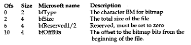

     2\.     The bitmap information header

## 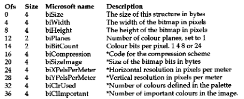

The biSize is 40 for Windows DIBs and 12 for OS/2 DIBs and provides the simplest way of distinguishing them. The colour level is defined by the biBitCount value.

Items marked with a \* are not mandatory and may often be set to zero, meaning that the default value applies.

     3\.     The RGB palette (not used in 24-bit DIBs) starts at file offset 14+biSize and consists of 2 or more RBGQuad entries each of which consists of a 4-byte entry:

## 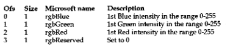

A Windows DIB may have fewer colours defined in the palette than the maximum number suggested by the biBitCount; if so biClrUsed must define the number of entries.

OS/2 DIBs use an RGB triplet, a 3-byte entry for each palette colour.

     4\.     The bitmap bits start at file offset bfOffBits. The bits (1, 4, 8 or 24 per pixel) form an array, starting at the bottom row of pixels, each row beginning with the leftmost pixel. Within each byte, the most significant bits are used before the least significant bits. Each row of the bitmap uses a multiple of 4 bytes, and may be padded to the right to ensure this. OS/2 and Windows share the same bitmap bits format.

With all but the 24-bit colour bitmaps, the bits making up the image do not actually define the colour of the pixel, but are an index into the palette of 24-bit RGB colours.

Bitmaps take up a lot of space, but can often be compressed by encoding repeated information. Some encoding algorithms are very complex, for example the JPEG algorithm, therefore they are slow to unpack, but take up much less space and require less disk I/O. DIBs support a much simpler form of run-length encoding. Since compression and expansion of bitmaps is best carried out in a compiled language, it is not discussed further.

How you get your bitmap information into and out of APL will depend on the APL you are using. The following example functions were written using STSC Pocket APL.

To allow easy cross-reference between elements of APL variables and elements of Windows structures, the function DEFINE sets up many globals with Microsoft type names.

```
    ∇ DEFINE;⎕IO
[1]  ⍝ DEFINE GLOBAL CONSTANTS
[2]   ⎕IO←0
[3]  ⍝ ALL INDEX VALUES ASSUME ⎕IO←→0
[4]  ⍝ BIT MAP FILE HEADER VECTOR BF
[5]   BFSIZE←0 ⋄ BFRESERVED←1 ⋄ BFOFFBITS←2
[6]  ⍝ BIT MAP INFO HEADER VECTOR BI
[7]   BISIZE←0 ⋄ BIWIDTH←1 ⋄ BIHEIGHT←2 ⋄ BIPLANES←3 ⋄ BIBITCOUNT←4
[8]   BICOMPRESSION←5 ⋄ BISIZEIMAGE←6 ⋄ BIXPELSPERMETER←7 ⋄ BIYPELSPERMETER←8
[9]   BICLRUSED←9 ⋄ BICLRIMPORTANT←10
[10] ⍝ PALETTE RBG QUAD BP
[11]  BPBLUE←0 ⋄ BPGREEN←2 ⋄ BPRED←2
[12] ⍝ OUTPUT GRAY PALETTE LOOKUP
[13]  PALETTEOUT← 256 4 ⍴0
[14]  PALETTEOUT[;0]←⍳256 ⍝   CLRUSED=256
[15]  PALETTEOUT[;1]←4/⍳64 ⍝  CLRUSED=64
[16]  PALETTEOUT[;2]←16/⍳16 ⍝ CLRUSED=16
[17]  PALETTEOUT[;3]←128/⍳2 ⍝ CLRUSED=2
[18] ⍝ OTHER SIZES
[19]  FILEHEADSIZE←14 ⋄ INFOHEADSIZE←40
[20] ⍝ MONO GRAY SCALE
[21]  MONO←GRAY2
    ∇
```

Separate functions are used for reading and writing the various components of the bitmap using global variables. If nested arrays were available then more elegant functions would be possible.

```
    ∇ READBITMAPHEADER TIN
[1]  ⍝ READ A BIT MAP FILE HEADER, INFO HEADER, AND PALETTE
[2]   BF←READBITMAPFILEHEADER TIN
[3]   BI←READBITMAPINFOHEADER TIN
[4]   BP←READBITMAPPALETTE TIN
    ∇

    ∇ WRITEBITMAPHEADER TOUT
[1]  ⍝ WRITE A BIT MAP FILE HEADER, INFO HEADER AND PALETTE
[2]   OBF WRITEBITMAPFILEHEADER TOUT
[3]   OBI WRITEBITMAPINFOHEADER TOUT
[4]   OBP WRITEBITMAPPALETTE TOUT
    ∇

    ∇ R←READBITMAPFILEHEADER TIE;BUFFER;⎕IO
[1]  ⍝READ THE FILE HEADER PART OF A BIT MAP, RETURNS
[2]   ⎕IO←0
[3]   BUFFER←⎕NREAD TIE,82,FILEHEADSIZE,0
[4]   ⎕ERROR(~^/'BM'=2↑BUFFER)/'NOT A BIT MAP FILE'
[5]   R←256⊥⎕AV⍳⍉⌽ 3 4 ⍴2↓BUFFER
    ∇

    ∇ BF WRITEBITMAPFILEHEADER TIE;BUFFER;⎕IO
[1]  ⍝WRITE OUT A BITMAP FILE HEADER BF
[2]   ⎕IO←0
[3]   BUFFER←'BM',,⌽⎕AV[⍉ 256 256 256 256 ⊤BF]
[4]   BUFFER ⎕NAPPEND TIE
    ∇

    ∇ R←READBITMAPINFOHEADER TIE;BUFFER;P;⎕IO
[1]  ⍝READ THE BM INFO HEADER, RETURN VECTOR OF VALUES.
[2]   ⎕IO←0
[3]   BUFFER←⎕NREAD TIE,82,INFOHEADSIZE,FILEHEADSIZE
[4]  ⍝ EXPAND 'WORD' VALUES TO 'DWORD' (BIPLANES AND BIBITCOUNT)
[5]   P←(12⍴1), 1 1 0 0 1 1 0 0 ,24⍴1
[6]   BUFFER←P\BUFFER
[7]   BUFFER[14 15 18 19]←⎕AV[0]
[8]  ⍝ CONVERT EACH 4 CHARS INTO AN INTEGER VALUE
[9]   R←256⊥⍉⎕AV⍳⌽ 11 4 ⍴BUFFER
[10]  ⎕ERROR(R[BISIZE]≠INFOHEADSIZE)/'SORRY, OS/2 BIT BITMAP NOT SUPPORTED'
[11]  ⎕ERROR(R[BIBITCOUNT]=24)/'SORRY, 24 BIT BITMAP NOT SUPPORTED'
[12]  ⎕ERROR(R[BICOMPRESSION]≠0)/'SORRY, COMPRESSED BITMAP NOT SUPPORTED'
[13] ⍝ SET UP GLOBAL DEFINING THE LENGTH OF A BITMAP ROW
[14]  LINELENGTH←4×⌈(R[BIWIDTH]×R[BIBITCOUNT])÷32
    ∇

    ∇ BI WRITEBITMAPINFOHEADER TIE;⎕IO;BUFFER
[1]  ⍝ WRITE OUT BIT MAP INFO HEADER BI TO FILE TIED TO TIE
[2]   ⎕IO←0
[3]   BUFFER←,⌽⎕AV[⍉ 256 256 256 256 ⊤BI]
[4]   BO←(12⍴1), 1 1 0 0 1 1 0 0 ,24⍴1
[5]   BUFFER←BO/BUFFER
[6]   BUFFER ⎕NAPPEND TIE
    ∇

    ∇ R←READBITMAPPALETTE TIE;NOC;MAX;DATA;⎕IO
[1]  ⍝RETURN THE PALETTE READ FOM BM FILE TIED, USE BI-GLOBALS
[2]   ⎕IO←0
[3]   R← 0 0 ⍴0
[4]   →(BI[BIBITCOUNT]=24)/0 ⍝ 24 BIT COLOURS, DONT USE PALETTE
[5]   NOC←2*BI[BIBITCOUNT]
[6]   MAX←⌊/NOC,(BI[BICLRUSED]≠0)/BI[BICLRUSED]
[7]   DATA←⎕NREAD TIE,82,(MAX×4),BI[BISIZE]+FILEHEADSIZE
[8]   R←(NOC,4)↑(MAX,4)⍴⎕AV⍳DATA
    ∇

    ∇ BP WRITEBITMAPPALETTE TIE;⎕IO;BUFFER
[1]  ⍝ WRITE OUT PALETTE BP TO TIED FILE
[2]   ⎕IO←0
[3]   BUFFER←,⎕AV[255⌊BP]
[4]   BUFFER ⎕NAPPEND TIE
    ∇
```

Pocket APL has a very limited workspace size so I have arranged for each line of the bitmap to be read in and processed separately.

```
    ∇ R←N READBITMAPLINE TIE;⎕IO
[1]  ⍝READ LINE NUMBER N FROM BITMAP FILE TIED TO TIE
[2]   ⎕IO←0
[3]   R←⎕NREAD TIE,82,LINELENGTH,BF[BFOFFBITS]+LINELENGTH×N-1
[4]   R←BI[BIBITCOUNT]UNPACK ⎕AV⍳R
[5]   R←BP[R;0] ⍝ RETURN GRAY COLOUR VALUE
    ∇

    ∇ LINE WRITEBITMAPLINE TIE
[1]  ⍝WRITE A SCAN LINE OUT TO TIED FILE
[2]   LINE←CLRUSED PACKLINE LINE
[3]   LINE ⎕NAPPEND TIE
    ∇

    ∇ R←BC UNPACK DATA;⎕IO
[1]  ⍝ UNPACK MULTIPLE PIXELS PER BYTE IF DATA IS PACKED
[2]   →(BC= 1 4 8)/L1,L4,L8
[3]   ⎕IO←0
[4]  L1:R←,⍉ 2 2 2 2 2 2 2 2 ⊤DATA ⋄ →0
[5]  L4:R←,⍉ 16 16 ⊤DATA ⋄ →0
[6]  L8:R←DATA
    ∇

    ∇ R←CLRS PACKLINE LINE;⎕IO
[1]  ⍝ PACK MULTIPLE PIXELS PER BYTE
[2]   ⎕IO←0
[3]   →('M'=1↑TYPE)/L1
[4]   LINE←PALETTEOUT[0⌈255⌊LINE;CLRCOL]
[5]   →(CLRS= 2 16 64 256)/L2,L16,L64,L256
[6]   ⎕ERROR(⍕CLRS),' COLOURS NOT SUPPORTED'
[7]  L1:R←16⊥⍉(((⍴LINE)÷2),2)⍴LINE ⋄ →ALL
[8]  L2:R←2⊥⍉(((⍴LINE)÷8),8)⍴LINE ⋄ →ALL
[9]  L16:R←16⊥⍉(((⍴LINE)÷2),2)⍴LINE ⋄ →ALL
[10] L64:
[11] L256:R←LINE
[12] ALL:R←OLINELENGTH↑⎕AV[R, 0 0 0]
    ∇
```

### Grey Scaling

The hardware in the standard VGA card can convert coloured images using a process known as “sum to grey” for display on a monochrome screen. However when sending an image to an ordinary printer, there is no hardware which is equivalent to the VGA card. Windows has to perform this task for us, which it does via the printer device driver.

Under some circumstances, it may be useful for us to do our own conversion to grey scales; for instance, processing a grey image requires one third of the work that processing a full colour image would require.

Converting a set of RGB intensities into a grey scale has to take into account the fact that the human eye’s colour response is not linear. Each colour component must be multiplied by a weight before being added together to produce the appropriate grey level. This colour weighting I have stored in the global RGBRATIO.

The function PALETTE2GRAY (below) will do this task. Note that with 2, 16 and 256-colour bitmaps, only the palette needs to be converted. With 24-bit bitmaps, each pixel in the bitmap requires conversion.

```
    ∇ R←PALETTE2GRAY OLD;NOC;⎕IO
[1]  ⍝ CONVERT OLD COLOUR PALETTE TO GRAY PALETTE
[2]   ⎕IO←0
[3]   OLD←(256 3 ⌊⍴OLD)↑OLD ⍝     ↑10 CONTRAST OLD
[4]   OLD←CONTRAST ADJCONTRAST OLD
[5]   NOC←1↑⍴OLD ⍝ NUMBER OF PALETE ENTRIES (COLOURS)
[6]   R←⌊0.5++/OLD×(⍴OLD)⍴RGBRATIO
[7]   R←(⍴OLD)↑(NOC,3)⍴(NOC⍴3)/R
    ∇
```

A pretty coloured picture of a bridge at dusk can be copied from a disk distributed with “The Programmer’s Introduction to Windows 3.1” by Brian Myers and Chris Doner (Sybex Inc 1992). The 256 colours in the palette consist of a series of sepia tones ranging from dark brown to sunset reds. This DIB will be used as the source image in many of the examples that follow.

Printing the original bitmap on an HP LaserJet direct from Windows Paintbrush, and printing the bitmap after PALETTE2GRAY conversion produced an apparently identical result.

## 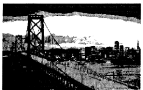

### Simplifying Over-complex Images

It may be necessary to simplify overly complex images to help the problem of edge detection, for example when converting an image into a map. Also, bitmaps using “hard coded” dithered colours do not scale well, and it can help to replace dithered colours by absolute colours.

Data averaging is the easiest simplifying method. This normally involves replacing a point with the weighted average of the point in the surrounding area (often 3×3). The weights are given in a 3×3 mask, and a variety of masks can be used to gain different effects.

In the function RUN, the function PROCESSLINE performs the process one scan line at a time. For an environment with large workspaces the whole bitmap could be processed in one go.

Bitmaps AV0.BMP, AV1.BMP, AV4.BMP, AV8.BMP use `3×3` reshape of masks `1 1 1 1 0 1 1 1 1`, `1 1 1 1 1 1 1 1 1`, `1 1 1 1 4 1 1 1 1`, and `1 1 1 1 8 1 1 1 1` respectively.

## 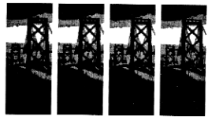

### Low and High Pass Filters

The more complex “Low pass filter mask” `1 2 1 2 4 2 1 2 1` is said to produce a good approximation of “two-dimensional Gaussian weighting”. This is very useful for “noise smoothing and interpolation of missing or damaged data elements”.

## 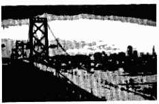

The “High pass filter mask” `-1 -2 -1 -2 12 -2 -1 -2 -1` has the opposite effect and might be used for enhancing contrast and detecting edges. In the example I have also inverted the image.

## 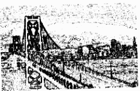

There are several other high pass filter masks which are worth trying, for example -1 -2 -1 -2 16 -2 -1 -2 -1 and -2 -3 -2 -3 20 -3 -2 -3 -2.

### Converting Images to Maps

The process of transforming an image into a map is primarily one of edge detection. Adrian Smith used this process in building a TrueType APL font, see Vector 9.4 page 138.

One technique for edge detection is similar to the above filter, but rather than using one symmetrical mask, 4 highly directional masks are used, and the results are then combined, as shown in PROCESSMAP. The final image is converted into a monochrome bitmap, using function CTOM, by comparing the result of the transformation against the original value, rather than comparing against an absolute value.

```
    ∇ R←PROCESSMAP MAP;⎕IO
[1]  ⍝FIND BOUNDIRES
[2]   ⎕IO←1
[3]   R←0 PROCESSLINE MAP[1 2 3 4 5 6 7 8 9]
[4]   R←R⌈0 PROCESSLINE MAP[4 1 2 7 5 3 8 9 6]
[5]   R←R⌈0 PROCESSLINE MAP[7 4 1 8 5 2 9 6 3]
[6]   R←R⌈0 PROCESSLINE MAP[8 7 4 9 5 1 6 3 2]
[7]   R←LTHIS CTOM R
    ∇
```

The following examples show the effects of two transformation masks. SMOOTH.BMP was produced with the mask -1 -1 -1 0 0 0 1 1 1, and SOBEL.BMP with -1 -2 -1 0 0 0 1 2 1.

## 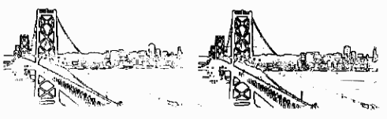

Both transformations have lost the right hand side of the bridge. If you look back at GRAY.BMP, you can see why; the river and road are almost the same grey in this area. In an attempt to recover this information, I then tried running the “smooth” mask on individual colour components to produce the bitmaps RED.BMP, GREEN.BMP and BLUE.BMP. This involved resetting the global RGBRATIO. BLUE.BMP picks up this edge the best.

## 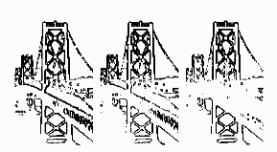

An alternative mapping algorithm (the Isotropic transform) uses a similar set of masks to the SOBEL, but with the 2 replaced by the square root of 2. However since floating-point operations are so slow compared to integer ones, integer masks with 1 replaced by 128 and the square root of 2 by 181 can be used with the final result divided by 128.

Finally I’ve included the Laplace transformation. Unlike the Smooth, Sobel and Isotropic, this uses a single symmetrical mask of the form 0 -1 0 -1 4 -1 0 -1 0, or ?1 -1 -1 -1 8 -1 -1 -1 -1, or 1 -2 1 -2 4 -2 1 -2 1. Note that the mask’s values sum to zero, unlike the High pass filter, which it resembles. The transformation is said to be good at outlining areas of constant intensity in photographs. The example LAPLACE.BMP uses the 2nd of these masks.

## 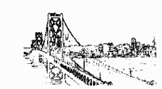

### Grey Scales to Monochrome

Some printers do not support grey-scale well, so it may be necessary to convert the image to monochrome. A 16 grey-scale bitmap can be converted into a monochrome image, with each grey pixel in the original replaced by a 4×4 matrix (cell) of bits in the output. By varying the ratio of black dots to white dots in each cell, the grey scale can be reproduced, albeit in a much larger bitmap.

The spatial resolution of a graphics printer is normally much higher than that of a monitor. For example, a 14-inch screen is approximately 10 by 6 inches with 640 by 480 pixels in standard VGA. On a 300 dots per inch printer this results in an image of 2.1 by 1.6 inches. Thus it follows that a 16 grey-scale 640 by 480 bitmap could be converted into a monochrome 2560 by 1920 image and printed, resulting in an 8.5 by 6.4 inch picture.

Two new process are involved here, first generating a set of grey masks, and second repacking the expanded bits into a monochrome bitmap.

Now comes the question: how do you select the black dots for each level of grey? Selecting the bits in a too-regular fashion may produce unintended patterns. Most systems use hard-coded patterns. I feel that an algorithm could be written to produce an expansion mask suitable for the resolution and aspect ratio of any printer, on demand.

The function GRAYSCALE was my first attempt at producing such a monochrome expansion mask, and its results can be seen in the conversion of AUTHOR.BMP into GRAYME.BMP.

## 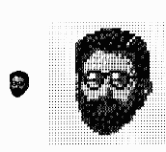

This algorithm is not entirely satisfactory, and I am sure that there are better methods. One possibility might be to use the famous N-Queens problem as a pattern to be used in spreading out the dots, but I have not yet had time to investigate this.

Graham Parkhouse in his article “APL Graphics – First Principles” (Vector Vol.7 No.4 page 83) describes a method to produce a 64-level greyscale via an 8×8 mask of the values 1 to 64. DOUBLE is a function that can be used to reproduce equivalent masks for 4, 16, 64, 256, 1024 ... levels of grey:

```
    ∇ R←DOUBLE MASK;ROWS;COLS
[1]  ⍝Expand MASK by factor of 2
[2]   ROWS←2×1↑⍴MASK
[3]   COLS←2ׯ1↑⍴MASK
[4]   R←(COLS⍴ 1 0)\(ROWS⍴ 1 0)⍀MASK
[5]   R←R+¯1⊖¯1⌽R+(R≠0)×⌈/,R
[6]   R←R+(ROWS⍴ ¯1 1)⌽R+(R≠0)×⌈/,R
    ∇

      DOUBLE 1 1⍴1
 1 3
 4 2

      DOUBLE DOUBLE 1 1⍴1
  1  9  3 11
 13  5 15  7
  4 12  2 10
 16  8 14  6

      DOUBLE DOUBLE DOUBLE 1 1⍴1
  1 33  9 41  3 35 11 43
 49 17 57 25 51 19 59 27
 13 45  5 37 15 47  7 39
 61 29 53 21 63 31 55 23
  4 36 12 44  2 34 10 42
 52 20 60 28 50 18 58 26
 16 48  8 40 14 46  6 38
 64 32 56 24 62 30 54 22
```

The resulting 16-level greyscale has been used in producing the image MONO.BMP.

## 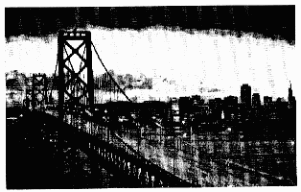

### Brightness and Contrast

With 16 and 256 colour bitmaps, the brightness and colour contrast can be easily adjusted by varying the colour palette. The brightness of an image can be increased by increasing the palette colour values. The ratio of red to green to blue in any one colour should remain the same. Colour contrast on the other hand can be changed by varying the ratios of red, green and blue in each RGB quad entry to emphasise the predominant primary colour.

```
    ∇ R←PC ADJCONTRAST RGB;RGBMIN;RGBMAX
[1]  ⍝Adjust colour contrast in palette RGB by PC percent
[2]   R←RGB
[3]   →(PC=0)/0 ⍝ Exit if zero adjustment requested
[4]   RGB←(256 3 ⌊⍴RGB)↑RGB
[5]   PC←⌊0.5+PC×RGB÷100
[6]   RGBMIN←PC×RGB=(⍴RGB)⍴3/⌊/RGB+256×RGB=0
[7]   RGBMAX←PC×RGB=(⍴RGB)⍴3/⌈/RGB+256×RGB=0
[8]   R←(⍴R)↑0⌈255⌊RGB+RGBMAX-RGBMIN
    ∇
```

Due to images in VECTOR articles being printed in grey, I am a bit restricted in showing examples; however compare bitmaps BLUE.BMP and CONTRAST.BMP. They differ only in that in CONTRAST.BMP a 15% contrast has been applied to the incoming bitmap.

## 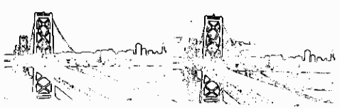

### Notes on the APL

The code was written using STSC Pocket APL but should run on almost any APL if the workspace size is big enough. The native file quad-functions will need to be replaced with the equivalent functions which can read and write ordinary DOS files. The code does not need to run under Windows, but a bitmap viewer is required to see the results.

A function GO was written to test the code and produce all the bitmaps shown in this article, and is not meant to be an “end user” function. With Pocket APL on a 20MHz 386, GO takes about 40 minutes to run. In the text I have talked about and shown 3x3 masks, but in the code I have actually used the masks in the ravelled form as a nine-element vector.

Although not used for the examples above, the function ROTATE will rotate a SQUARE matrix through multiples of 45 degrees. ROTATE is a bit of an over-kill for rotating a 3×3 mask, but more advanced processes require 5×5, 7×7 or even larger masks to be rotated. Applying ROTATE on the bits of a square bitmap can also produce interesting effects.

```
    ∇ R←T ROTATE MAT;N;I;MAX;N1;S
[1]  ⍝ROTATE SQUARE MATRIX BY T×45 DEGREES
[2]   R←MAT
[3]   N←(⍴MAT)[1]
[4]   →(N<3)/0
[5]   N1←N-1
[6]   S←-⌊0.5×N1
[7]   M4←(4,N)⍴MAT[1;],MAT[;N],(⌽MAT[N;]),⌽MAT[;1]
[8]   M4← 0 1 ↓M4
[9]   M4←(4,N1)⍴(S×T)⌽,M4
[10]  M4←(¯1⌽(⌽M4)[;1]),M4
[11]  R[1;]←M4[1;]
[12]  R[;N]←M4[2;]
[13]  R[N;]←⌽M4[3;]
[14]  R[;1]←⌽M4[4;]
[15]  S←1↓⍳N1
[16]  R[S;S]←T ROTATE R[S;S]
    ∇
```

ROTATE is quite crude compared with Morten Kromberg’s winning entry from the APL86 matrix rotation competition, which was published in Vector 3.2 page 100. This solution did 90-degree rotations on square and non-square matrices, and each shell could be rotated by different amounts and in different directions! I have not yet tried to amend this to suit my requirement for 45-degree rotations on a square matrix, but I feel sure that it should be possible. Can anyone help?

### Conclusion

Un-compressed Microsoft device-independent bitmaps are relatively simple and can be usefully and easily manipulated within APL workspaces. APL’s interactive environment offers an excellent platform which allows the programmer to experiment with different image-enhancement algorithms.

(webpage generated: 5 December 2005, 18:50)
