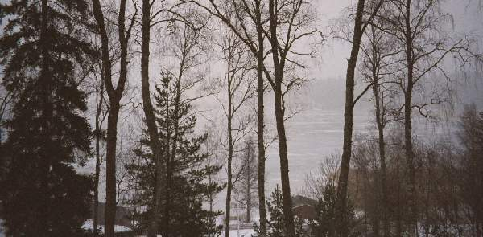
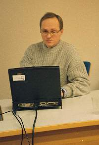
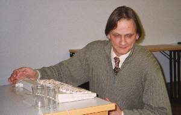
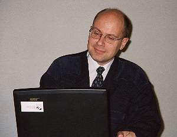
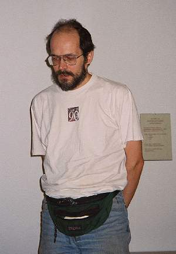
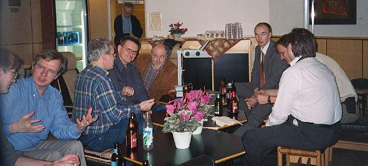
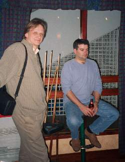

*Observations on the FinnAPL “Forest Seminar” held in Malvik, Kirkkonumi near Helsinki 8th and 9th February 2001 by Ray Cannon.*
{ .byline }

> “You’re so near to Russia,  
> So far from Japan,  
> Quite a long way from Cairo  
> A lot of miles from Vietnam”

(Quote taken from the song “Finland, Finland” available on “Monty Python’s Contractual Obligation Album” CAS 1152, 1980 Full lyrics: [www.tm.informatik.unifrankfurt.de/~andreas/finland/finland\_song.html](http://www.tm.informatik.unifrankfurt.de/~andreas/finland/finland_song.html) )

{ width="600" height="295" }

### Wednesday 7/2/2001

As I was preparing to fly to Finland for the seminar, I read that the temperature two days before had been minus 26C with a wind chill factor of minus 40C! But Tomas (Tomas Gustafsson of FinnAPL) reassured me with “Current temperature around zero degrees centigrade, 10 centimetres of snow…but we will stay in civilised areas”.

The flight from Gatwick to Helsinki was uneventful, other than that I saw (for the first time, although I remember reading about it as a child) a completely circular rainbow, with the shadow of the aircraft in its middle cast on the clouds below.

Helsinki airport was pleasant, and efficient. My complete lack of any knowledge of the Finnish language was not a problem. Within no time I was in a taxi going round “Ring III” on my way to Majvik. All the roads were clear, that is until we turned off the road into the conference centre, where for the last kilometre, we drove on snow.

Tomas had made all the arrangements, and I booked into the hotel with the very minimum of fuss. I was staying in one of the outer buildings, next to the shore of what I took to be a lake. I was later informed it was actually the sea. It’s the first time I have seen reeds growing in the sea, but if the salt content is low enough then maybe! The room was warm, well equipped, and if it were not for the mist which restricted the vision to about 500m would have had a great view.

That evening, I met up with Gitte Christensen, Morten (“may the force be with you”) Kromberg and Tomas in the bar. Later, after supper, Klaus Klug Christiansen joined us. Since he had missed the meal he was supplied with two bananas which had been liberated from somewhere. I stayed in the bar, (which was very lively) until about midnight, hoping to see John Daintree, but somehow I missed his arrival.

### Thursday 8/2/2001

Up for breakfast at 8:30, porridge, juice and cold meat. Met up with John who was slightly unnerved as he was the first speaker of the day.

At 9am, the seminar was opened promptly by Arto Juvonen – FinnAPL chairman. Following a (very) few opening remarks he introduced the first speaker John Daintree, chief Windows/GUI architect of Dyadic Systems Ltd.

John’s first (of two) talks was an introduction to what had been called Dyalog version 10, but was currently being called Dyalog.NET. (Who knows what it will be called by the time it is released.) We are hoping John will be writing up his talk for Vector.

After coffee and sandwiches, Arto introduced the next speaker Richard Eller, of RE Time Tracker Oy.

Richard gave a talk (in Finnish and English) on a case study of a large APL application for handling orders, sales and accounting at a major Finnish energy and fuel supplier. The system, written in APL2000+WIN, handles a network of trucks, keeping track of petrol (gas) deliveries to petrol stations, optimising the routes, with full regards to security, and guaranteed time scales. It handles over one billion Finn Mark (£1,000,000 approx) a year.

If the system receives a request in the morning, it would hope to provide a petrol delivery that same day, and that night receive payment via a direct debit (DD). Problems covered include that petrol prices vary during the day and petrol is bought and sold by volume, which varies with temperature. The APL system does it all including the submission of DD requests over the internet.

The system is maintained by 10 people, who are able to fix most problems over the phone. Due to the very large amount of money/petrol being traded, the system is held on a mirrored data-base with “LOTS” of back-ups!

(Richard did say he would try to write up his talk in more detail for Vector.)

The last speaker before lunch was Morten Kromberg of Insight Systems ApS. The APL supermarket in Denmark!

Morten talked about a system call SOFIA (used by most Italian insurance companies). First written in 1985 (for 16-bit APL), rewritten in 1990 in 32-bit APL+PLUS II and transferred to Dyalog APL/W in 1998 (last DOS system due to be phased out in 2002). GAMA the Russian cousin of SOFIA was written in 1995 under Dyalog APL.

SOFIA has become the dominant product in the Italian insurance market! All the largest insurance companies are customers.

Morten provided two candidates for “quote of the day”:

> “Insurance companies are in business to take money from people, keeping it as long as possible, and giving back as little as possible”;

and

> “There is always a bigger fish” (Star Wars, Episode 1);

But I quite like this one (albeit taken out of context):

> “… allows operator .. to kill users….” &lt;grin>

Lunch was excellent. The only problem was that the buffet-style starter salad was so good, (and they had not put out the main course when we first arrived) some of us (i.e. me) over-indulged, thinking that it was the main course, there being at least four types of herring. However, when the main course arrived (I had the “Trout Loaf”) it was delicious, leaving no room for the sweet or coffee.

{ width="200" height="292" } After lunch Anssi Seppälä (of Enease Oy) started giving the first part of a talk in Finnish. (Tomas gave the second half.)

Unfortunately, since Finnish (according to Klaus) is “Chinese spoken in Italian” all I had to go on was the supplied note (Attacking the big ones. Penetrating the electricity distribution markets with APL software. The “Electricity Quality and Load” concept) and the overhead foils (also almost all in Finnish).

Anssi talked (I think) about taking the first steps in developing a new application “METERING”. This project would include both the hardware and software.

The concept of “Electricity Quality and Load” (EQL) was demonstrated with a slide showing two images, the first of a happy meter plugged into a wall socket, with a smiling PC; the second showed a meter running a temperature with an ice-pack on its head, and a red-faced PC looking very sick “ejecting” a floppy disk.

{ width="300" height="191" } Tomas Gustafsson (Weis Impactor Oy) then took over and then continued in English. Tomas is working with Anssi on the EQL project, Anssi writing in J and Tomas in APL.

Tomas showed a Windows scrolling bitmap graph. Since Windows has limits of 32k in its pixel resolution, in any dimension, objects larger than this 32k limit cannot (using standard Windows API calls) be displayed without loss of resolution. Tomas showed that it could be done using their technique which involves trapping the “Expose Event”.

Tomas then went on to tell us about how to do “Property Sheets in Seconds”. Tomas showed how he has automated property sheets to a great extent, using data structures with default values and a common set of functions to manipulate property sheets. This resulted in getting a consistent look and feel, data-aware controls, pre-set and pre-filled controls with default values, pre-set controls with stored values, and “real time” updates from GUI to data.

At 3 p.m. we stopped for “Coffee and Cake”. The cake, being a doughnut with pink icing, tasted much better than its colour suggested!

{ width="300" height="232" } Olli Paavola (Pakkausalan Ympäristörekisteri PYR Oy) was next up with another talk in Finnish. He described “an APL-powered intranet/internet-enabled information system, with an approved SFS-EN ISO 9001 quality certificate (you what John?), for handling Finland’s job in the packaging area within the European Union.”

The system used Dyalog APL/W, dynamically generating HTML. Under the latest European Packaging and Waste law, each member country is supposed to produce relevant data. However most member countries failed to do so, but Finland, using this system, did provide the data and was cited as having provided the best and most useful form.

(All the talk about waste and recycling begs for the response “What a load of rubbish.” &lt;grin>. However this talk did not fall into this category and despite my complete lack of understanding of Finnish, I was able to enjoy it.)

The final talk of the day was given by the invited speaker Kari Höijärvi from Vaisala Oy.

Kari, an ex-Microsoft programmer, gave a really excellent talk entitled “The development and quality assurance process at MS, US”

*You can read Kari’s own write-up of his talk immediately after this report.*

In essence Kari stated that given a set of requested features, a realistic budget, and a deadline, you won’t get a quality product with all the features if you meet the deadline. To write quality code and meet a deadline will normally mean that you have to drop features.

Kari gave some excellent examples including how MS’s Internet Explorer version 1 was released on time, with very few of its required features. New releases adding extra features kept appearing every few months. On the other hand MS WIN2000 was released with almost all of its original design features, very very late! Meanwhile, Word for Windows-1 had 4 lead programmers in 5 years, and exceeded its schedule by 400% mainly because it had impossible goals.{ width="300" height="432" }

### Tips

- Start a project small. For a ten man-year project, required in a year’s time, start with 2 people NOT 10. Add more people after 10 weeks.
- Don’t make the best developer the project manager.
- A feature is never “almost completed”. It is either 0% or 100% done.
- Only release a system after “n” days of serious testing with no new bugs being found.
- Testing is a profession, and needs to be planned. Every line of code needs to be tested. (This may require tools to prove they have been tested.) The NASA style of 20 testers for 1 programmer is in the real world unthinkable, and a mere one tester per programmer is more realistic.
- Design for testability. Add code for data consistency checks, use backup algorithms. Bugs do NOT go away.

Kari then went on to tell us were to find bugs in code:

- In Error recovery code;
- Functions that return special values in an error case;
- “Candy machine interface”: is the 35 the code you enter or the price you pay?
- “Seattle Airport parking lot”. Requires drivers to enter into the ticket machine, the bay “number” that their car is parked in. The bay number 41 requires the driver to enter “041” not “41”.

Kari then mentioned two alternative approaches to writing quality software, the cleanroom way ([http://www.cleansoft.com](http://www.cleansoft.com)) and the Extreme Programming way which he went into in greater detail.

{ width="600" height="271" }

DINNER and SAUNA was followed by sauna barbecue and beer (Sing song beside a piano played by one of Finland’s top professional J programmers).

{ width="250" height="323" }

> Tuli saunasta tupahan, tuli tuntemattomana,  
> kasvot vallan kaunihina, poskipäät punertavina.

> When he came in from the sauna, they could hardly recognise him,  
> With his face so shining bright and his cheeks so flushing red.

Then bar, bar-pool (as in bar-billiards), dancing, and more beer. (At some stage I was chatted up by a very nice young lady, whose boyfriend plays football for Luton Town.)

### Friday 9/2/2001

Fog has lifted, clear view of the lake/sea.

Timo Teileri (of ABB Oy) kicked off the second day with a talk in Finnish on CoCoS and COPIS, two systems 95% written in APL.

(Sorry, no photo this morning, well there is one but it’s all blurred due to an excess of beer the night before.)

CoCoS – COmpany COntrol System. This boasted a data-base with “modules” on component files.

COPIS – Customer Orientated Process Information System. This included a very powerful graphics editor (C.A.D.) and in addition printed output via an RTF file.

After a coffee break, a very enthusiastic Antti Korpela (Merita Henkivkuutus Oy) talked (in Finnish and English) about improving the efficiency at the largest Finnish bank conglomerate’s insurance marketing group by using APL as a modelling tool.

Antti is a mathematician, NOT a programmer, but produced some very impressive results from very simple code, including a live demo (using a loaned laptop, connected to the internet via a mobile phone) of a Dyalog workspace on a web server.

Gitte Christensen (of Insight Systems ApS) was on next, and gave a really splendid talk on the history of Insight Systems, and on the way gave some us all some tips on managing APL programmers.

She started out working for I.P. Sharp Associates in 1987, which she described as a “brainy flat organisation”. They did not bother with “internal bills” of less than $10,000. They took pride in their product and service and strived to “Make the best product”. They had 600 employees in 50 offices.

Then, disaster struck, Reuters took over I.P. Sharp.

So in 1990 Gitte and Morten with 3 other former I.P. Sharp personnel from their Copenhagen office, formed Insight Systems where they attempted to “have fun and make money”.

There they developed “Client Server” products for their customers who were LARGE companies. They developed a no-nonsense culture, obsessed with quality.

By 1993, they were not earning quite enough money to have fun, so they merged with Adaytum, where they became Adaytum development department. Adaytum was sales and marketing focused, with mid-sized customers. A “swat” team approach, with a CMA (cover my ass) approach, “make money, and make it big!”

Adaytum grew from 8 APLers in house with 30 employees in 1995, in 1997 they moved the headquarters to the USA, and by 1998 they were heading for “IPO” (Initial Public Offering). In 1999 there were 14 APLers in-house, 27 of then in Denmark with 200 employees world-wide.

Big money, but no time to have fun. So in 1999 Insight Systems split from Adaytum, and are currently looking for “the Right Idea”.

Gitte then went on to describe the life cycle of a new project. Here are a few thoughts taken out of context:

> “Product Spec”. The challenge is to Define the Problem, NOT the solution.

> “Development Prototype”. Purpose is to verify the function and its usability. The challenge is to solve the right problem.

> “Documentation”. If you don’t want to get stuck with it, DOCUMENT it and always remember to define your ACRONYMS.

The guy who phones you needing your support, is the one who needs your product, and pays your bills. The guy who does not phone you, may not be your customer any more!

> “APL is a tool of thought. If you can’t think it, don’t say it.”

After another excellent lunch, John Daintree gave his second (and in his words, more juicy) talk, which I am hoping he will write up for Vector. In the meantime here are a few snippets.

Dyalog version 10 (as announced in Berlin) may now be called “Dyalog.NET” but this is still subject to change. With it you will be able to provide “Web Services”.

“Web Services” under “.NET” can be accessed over the internet and are (.NET) language-independent. That is they can call and be called by any other “.NET” language.

- It’s a SOAP/XML based protocol;
- It can be called from an Internet Browser (e.g. MS Internet Explorer 5.5);
- It can be called from an application;
- It’s implemented in a “.ASPX” extension file;

The APL can be in the form of a script and can be written using Notepad.

John stated this as an aside, but we all caught on to it, and then we spent the next 10 minutes or so talking about APL fonts in non-APL programs.

What Dyadic has done is to implement an APL “Input Keyboard Method” and “Input Method Editor”. This works in a Unicode environment such as NT4 Win2000 (and including Notepad under Win98SE, I know because I am using an MS supplied IKM to see Japanese, not that I can read Japanese, yet).

(For a good introduction to the topic see: [http://nim.cit.cornell.edu/usr/share/man/info/C/a\_doc\_lib/aixprggd/genprogc/input\_method.htm](http://nim.cit.cornell.edu/usr/share/man/info/C/a_doc_lib/aixprggd/genprogc/input_method.htm) from which the following is an extract.)

### Input Method Overview

For an application to run in the international environment for which National Language Support (NLS) provides a base, input methods are needed. The Input Method is an application programming interface (API) that allows you to develop applications independent of a particular language, keyboard, or code set. Each type of input method has the following features:

<table border="0" cellpadding="4"><tr>
<td valign="top"><b>Keymaps</b></td>
<td>Set of input method keymaps (imkeymaps) that works with the input method and determines the supported locales.</td></tr><tr>

<td valign="top"><b>Keysyms</b></td>
<td>Set of key symbols (keysyms) that the input method can handle.</td></tr><tr>

<td valign="top"><b>Modifiers</b></td>
<td>Set of modifiers or states, each having a mask value, that the input method supports. </td></tr>
</table>

John did give one warning of a problem he had experienced writing APL under Notepad, “You can’t exit from notepad via “)OFF”. &lt;grin>

He then ran a demo of a Dyadic Web Service application, for booking rounds of golf. (Sorry no Ducks in the demo.)

At this point, my digital recorder became full, so I think we must ask John to write up his talk in full for Vector, as my hand written notes are quite frankly, unreadable! (Something about a web based spider service, Arachnid on the Net?)

After tea, (alas NO pink doughnuts) Klaus Klug Christiansen (of Array Technology ApS of Denmark) gave the final talk of the seminar, again in English.

Klaus started out by giving a potted history of the company Array Technology. Founded in 1996, got its first patent in 1997, and set up its first “array data-base” for a Swedish Electricity company. In 1998 it became a consultant to Scan Rail. In 2000, Klaus was hired as its 4th programmer.

Array Technology’s main commercial product is the Array Data-base, which “sells well” ;-). This system handles “Logical Constraints”, ensures consistency (that is, all rules are considered) and guarantees Completeness (all rules are obeyed).

The array data-bases are prototyped in APL. The product is then made in C and made available as either an EXE or +COM/ActiveX.

For an example of it in action see [http://recguide.chipshot.com/Cybrant/Velocity/](http://recguide.chipshot.com/Cybrant/Velocity/) where you can use it to select a golf club!

> “We created this Recommendation Guide so you can have woods that are perfectly suited to your body and game. Using your answers, we’ll select clubs that match your goals, tendencies, and price range. Click the boxes at left, and your choices will appear”

Klaus then told us the secret(!) of how to build a model:

- Map overall bindings in the system
- Locate suitable primitives (building blocks)
- Implement bindings between primitives
- Build model(s) from primitives

This was followed by a case study of “Railway Security” with a small station example dealing with:

- Control of train passage
- Reservation of train routes
- Train routes excluding other train routes

This was supported with a slide showing first a pair of train routes that can exist, and then a pair that can not exist!

(I chatted to Klaus in the bar afterwards, and wondered if this system could be used to create time-tables for Schools and Colleges, but Klaus thought not. Anyway, he thought it would be far too expensive.) *You can read his own notes on the talk following this report.*

At 16:30 Arto Juvonen closed the seminar, and I retired to the bar.

That evening, Tomas took the “foreign” visitors off for a meal in a very nice restaurant (which was famous for having been the home of a very famous Finnish architect, whose name I can’t remember!) I must say the food was superb. Thank you Tomas.

### Saturday 10/2/2001

After breakfast, Klaus and I, who were both staying in Finland till Sunday afternoon, said our good-byes to Morten and Gitte, and left for Helsinki. Where we booked into the 5 star Hotel Kamp. (Tomas had made reservations for us at an extremely good weekend rate!)

“The original Hotel Kamp was built in 1887 in accordance with the architectural style of the grand continental hotels of its era – embodying the atmosphere of London, Paris and St. Petersburg. The original Hotel Kamp was a legendary venue for politicians, artists and economists at the turn of the century. It is an important monument for the Finns, a part of the national history and cultural life.” And I was particularly taken by the heated marble floor in the bathroom!

Klaus and I walked around Helsinki seeing the sights, and did some shopping. We went for an evening meal in a Lapland restaurant where we both tried the reindeer (which was excellent) followed by a few beers in a Helsinki pub.

### Sunday 11/2/2001

After breakfast (which was included in the weekend rate at the Hotel Kamp, if I plug it enough, they might give me an even better rate next time I am in Helsinki &lt;grin>) Klaus and I walked to the large park on the southern tip of the city.

Here we watched a very colourful scene of brightly dressed children (and other young at hearts) tobogganing down a snow covered hill (the temperature being about minus 2 degrees). The bright primary colours against the white background looked like it was straight out of a picture by Lowry.

After a hot chocolate in a city centre café to warm up again, we took the FinnAir bus to the airport, did our last minute shopping and caught our respective planes home.

**All in all an excellent seminar, and a FUN trip.**

***
