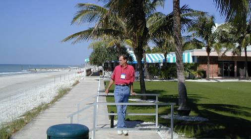
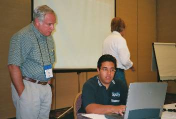
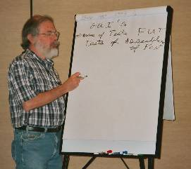
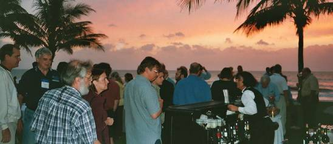

*reported by Ray Cannon (ray\_cannon@compuserve.com)  
photos by Ray and Jonathan Manktelow*
{ .byline }

## News Flash

APL2000 announce *two* new APL interpreters at their User Conference. Look out for APL2000.JS and Comic in future issues of Vector!

## When, Where, and Who

This year’s APL2000 User Conference was held at the Naples Beach Hotel & Golf Club, in Naples Florida between the 4th and 7th of November 2001.

{ width="506" height="280" }

The conference proper took place between the two training sessions (which were held on Sunday the 4th and Wednesday the 7th).

Four concurrent training sessions were available. Ray Polivka ran the two-day “Introduction to APL” training as usual. Fred Waid and Jairo Lopez ran one day on “APL Web Services” and the second on “APL, Microsoft .NET and the future”. The third session was a collection of different units: Jeremy Main on “ADO.NET ADO, DAO, ODBC”, Patrick Parks on “Cheap Grid Tricks”, Eric Baelen on “Secrets of the APL+Excel Interface” and Gary Bergquist on “Intermediate APL Programming”. The fourth session was not actually training, but reserved for re-runs (or pre-runs) of popular conference proper sessions (the equivalent of a conference VCR, allowing one to attend two sessions with overlapping schedules).

On the main days of the conference, Monday and Tuesday, each morning started with breakfast and followed with a single session (invited speakers etc.). It was then split into 3 concurrent sessions after the morning break. An excellent lunch was supplied each day, as was ice cream each afternoon. (Food and drink every two hours.) Afternoon closing sessions ended in time to watch the sunset from the poolside bar overlooking the Gulf of Mexico.

{ width="548" height="238" }

Monday had nine “papers” and Tuesday 12, some of which are /will be appearing in Vector.

## Training Days – APL2000.JS

At last year’s APL2000 conference, I really enjoyed Fred and Jairo’s JS training. (Question: What the difference between JavaScript and JS? Answer: A lawyer.) So this year I signed up for their sessions again. I was very surprised by how much progress they had made, especially with their new “baby”, an APL interpreter written in JS called “APL2000.JS”. Hopefully Fred will get time to produce a proper write-up for Vector on this new interpreter, but in the meantime I will try to convey to you what the significance of it is and how it all fits together.

### The Goal – Run APL code on your PC (the client) supplied via a web page (the server), with nothing on your machine but your web browser.

OK, using Microsoft’s fully JS-enabled Internet Explorer Browser, you visit a web page. The browser downloads 3 ASCII files being an HTML page, and two JS files (the APL interpreter APL2000.JS, and the workspace &lt;wsid>.JS). The browser displays the HTML, which invokes the JS APL interpreter, which loads and runs the APL workspace. Neat.

{ width="352" height="238" }

What is amazing is that APL2000.JS is only 30Kb of JavaScript, that is 30Kb of ASCII text, and the workspace is also simple text. (How big? How long is a piece of string?) For comparison Adrian’s APL2741 font is larger at 32Kb and that is after being zipped! How is this achieved? Fred and Jairo have written a new user command \]JSAVE which the APL programmer uses to convert functions from the workspace into the “APL JS” ASCII workspace. What about screen interactions, forms, buttons, fields, `⎕SI` calls etc.? JS supports them all via the browser. The \]JSAVE command converts the APL2000 style parameters into JS so the JS engine in the browser handles them all. This is all currently working but not yet in Beta testing, as some features still need to be finalised.

### Current “issues”, “problems” and “features”

This is all still under development, Fred and Jairo only got it working a week or so before the conference. By the time you receive the Vector containing this report, many changes will have occurred. However at the time of the conference Fred raise the following points:

- **No support for multi-dimensional vectors.** Vectors and Vectors of Vectors (nested arrays) ARE supported. JS currently just does not support multi-dimensional vectors of any data type, so neither can APL2000.JS.
- **RunAtServer**. Some operations, rather than running on the client, will need to be passed back over the network to the server, to be run there. This is supported, the server can have the standard APL2000 interpreter running, processing the RunAtServer requests.
- However the RunAtServer operation is in realty an OPERATOR not a FUNCTION (strict APL meanings here) as it takes both functions and data as its arguments. The current APL2000 interpreter does not support User Defined Operators, which is what is really needed here. Fred and Jairo have coded round this is in the time-honoured APL tradition effectively via “execute” with the subsequent requirement of doubling up on quotes, but were open to suggestions as to how they should code it.
- The result of code being RunAtServer will affect the style of writing your APL, just as happened between writing APL for running under DOS and then under “Event Driven” Windows. When running code over TCP/IP (e.g. the Internet) a result CANNOT be guaranteed. Requests time out, connections get dropped, networks go down, sites get overloaded. You cannot be sure a request has been received, or if received, actioned, until an acknowledgement has been received back. The acknowledgement itself my get lost, or delayed. As a consequence, incoming “acknowledgements” are effectively events that you use to trigger the next part of your code. (This is a requirement of writing code to run over “imperfect” networks, not a result of a poor implementation of RunAtServer.) So following a RunAtServer request, the code awaits an event that could be say, a time-out, the user aborts the process, or the acknowledgement of success. How each of these events is handled will be up to the programmer.
- **ListView**. The ListView common custom control is not available on all platforms. So running programs containing ListView controls will not work without supplying additional programs to run it on say the iMAC. (I am not clear on the exact limitations here; my notes on this point are incomplete.)
- **Zero Footprint**. (I am unsure of the exact details here, what follows is my belief, but don’t take it as gospel. Much depends on the setting of your browser privacy and security “options”. ) The average web user, armed with IE 6.0, on visiting a web page containing APL2000.JS code, will, on the first visit, invisibly and automatically download the APL2000.JS and the associated workspace along with the HTML. On subsequent visits, these files will only be downloaded if they have changed. This is normal practice at any site with JS or JavaScript, but not quite a Zero Footprint. I believe a true Zero Footprint can be obtained if really required by setting your security/privacy at the “Paranoid” type level.
- **Offline viewing.** Can the web pages with APL2000.JS be viewed off-line? Yes, if theydo not contain RunAtServer requests, and you save the web page explicitly for Offline viewing.
- **The browser BACK button.** If the user who is actively running an APL2000.JS workspace presses the BACK button on the browser, APL sees this effectively as “)OFF”. A subsequent press of the FORWARD button will re-load the web page and start the `⎕LX`. To prevent this, the initial web page should do nothing except “open in new window” the web page containing the APL2000.JS and workspace. This new window (being new) will have its BACK button greyed out, preventing any problems. By switching to the initial web page, the user can still navigate through the session history via the BACK and FORWARD buttons safely without affecting APL2000.JS.
- **Speed**. A major point of issue with APL interpreters is often speed. How fast/slow is a program? Well, in the friendly words on the back cover of the *Hitch Hiker’s Guide to the Galaxy* “DON’T PANIC!”. In tests using IE 6.0, APL2000.JS is FASTER than APL2000.EXE! (Shock! Horror! Gasp!)

APL2000.JS is a major achievement, with very far-reaching consequences.

## Conference Days

To me the highlight of Monday’s sessions (i.e. excluding the Sunset Dinner and entertainment and other meals) was the COMIC APL Interpreter sessions by Bill Rutiser (Cognos Finance) and Jonathan Manktelow (Causeway).

In “Introducing the COMIC APL Interpreter” Bill told us that this is an entirely new APL2000 interpreter (that is it contains NO legacy code left over from earlier APL\*PLUS) and is an “in-process COM server, supporting self-contained APL computational components for use with Internet Explorer, Excel, Word and other COM applications”.

What this means is that the APL workspace is combined with the COMIC interpreter to produce a single DLL for use via other Windows applications.

Jonathan’s talk on “Using the COMIC APL Interpreter” was a step-by-step guide to creating a stand-alone DLL from the current COMIC interpreter. This will be included in *Vector* when COMIC is ready for release – the interfaces in the current version are all subject to change.

The final session on Monday was Ian Clark on “The ‘Killer App’: How to Make Millions With Ground Breaking Software”. This was a repeat of the excellent talk he gave at Berlin last year.

Tuesday’s sessions included Eric Landau’s “Strategies for Dealing with Multiple Arguments: The Case for Names” (see page NN of this Vector). As a consultant who is primarily a Dyalog APL developer, I attend the APL2000 Users’ Conferences to obtain as much exposure to/experience of APL2000 code as I can get. Having read the excellent paper (supplied as part of the 300-page proceedings) and chatting with him before the session, I felt I could gain more by attending an APL2000 specific paper.

Thus I attended Marvin Renich’s “`⎕NI` Revisited”, which taught me about APL2000’s Network Interface system function for communicating with the Internet. I found this session invaluable, as the implementation methods that APL2000 and Dyadic have adopted are so fundamentally different.

{ width="271" height="241" }

Following on from last year’s conference, I could not miss Bill Rutiser’s “Test First: Design and Programming”. This was a tutorial on a fundamental *Extreme Programming* practice. It was delivered with Bill’s usual very dry wit. (“There are three types of mathematicians, those who can count, and those who can’t.”) The last concurrent session I attended was again decided by APL2000/Dyalog differences. I decided against Gary Bergquist’s “Limbering Up – Exercising Your APL Muscle” and went for Patrick Parks’s “`⎕WCALL`” session instead. This showed how to call the Win32 API, something I currently do a lot of (I wrote three new utilities in the last week).

## After Hours

In addition to learning, APL conferences are about meeting old friends and making new ones. This is done over the meal breaks, at the bars, and in “Evening Seminars”.

{ width="548" height="238" }

One such event occurred after the Banquet (where I was taught how to play a kind of poker using the serial numbers on dollar bills). Lynne Shaw, Ian Clark, and myself retired with Roy Sykes to his room, where he had a rather fine single malt whisky. This was attacked with some gusto while sitting on his balcony with a fine view of moonlight reflecting off the Gulf of Mexico framed by palm trees.

***
