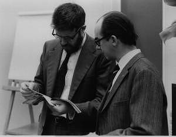
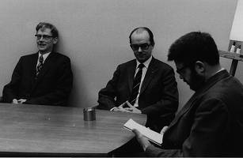

from Gitte Christensen (APL90 Chairman)
{ .byline }

The Danish APL community is glad to be able to contribute to this memorial for Ken, who has meant so much to us during our lives.

When the sad news of Ken’s passing reached us, a few of us APLers in Denmark started to collect material for an obituary and fortunately some of the APL’ers from the very early days are still around and were able to share their memories.

Per Gjerløv, who is a lifetime APL’er, and who many of you may know, had a lot to contribute. He was present when APL came to Europe in the late sixties, and I would like to share his memories with you.

In July 1967 Hans Helms arranged a summer school with the title *Programming Languages*. It was a huge success with many prominent participants. Amongst languages presented were Snobol, Lisp and Algol 98.

![Ken Iverson \[R\] photo](denmark3.jpg){ width="279" height="432" }

IBM sent a young man called Ken Iverson, from the research labs in Yorktown Heights (*in photo with Per Gjerløv*). Iverson had developed a mathematical notation which was now executable on the system 360. Along with Ken Iverson came Dick Lathwell with a magnetic tape containing the system and the intention was to do a live demonstration on a typewriter terminal 2741. The dialog was to be shown on TV cameras to the audience.

Now that was a tall order – typewriter terminal sessions were not very common then – but Dick Lathwell and a young engineer, Henrik Nyegaard, went to the University of Bergen (500 miles away, in Norway!) where computer time could be rented and installed the tape.

After a while, many members of the audience were starting to suffer from fatigue. Several complicated languages had been talked about and demonstrated before Mr. Iverson appeared. A short way into his presentation Iverson performed a number of keystrokes including keying the number 2 and the plus sign explaining that he would now create the expression 2+2 – and magically the number 4 was returned by the machine. Asked about declarations, Iverson explained that the computer was smart enough to figure out that 2 was an integer all by itself. The audience was suddenly wide awake!

Now IBM Sales heard about this system. ØK-data had just announced a timesharing service based on a system from General Electric using the language BASIC. IBM did not have anything in their portfolio to match this until APL arrived, and in November 1967 it was decided to go with APL and after a couple of hectic months IBM was able to offer an APL timesharing system on system 360 model 40. An impressive system capable of supporting 30 users simultaneously with good response.

Hans Helms wanted the system to be shown in November at the yearly SEAS meeting in Scheveningen, Holland – SEAS being the European equivalent of the American SHARE – user group meetings for large IBM customers. Again Henrik Nyegaard was charged with the task of providing a line to the APL system running in Bergen. He managed this for the second time, this time further challenged by the task of getting the connection safely through the manual extension board at the hotel where the conference took place. Unfortunately this bright young man was quickly lost to the APL community; he embarked on a management career and ended up running IBM Denmark.

The demonstration went well and was a great success and many large corporations in Europe started using APL, among them VOLVO who to this day are still using APL for some of their planning applications. The centre in Denmark was the first in Europe but soon many more came too.

Ken Iverson visited Denmark on several occasions in the early days – specially when the municipalities data centre started to offer the service to primary and secondary schools. On one occasion Ken almost lost the attention of the audience after the break. He had filled out the left side of the blackboard before the break writing with his right hand. After the break he continued filling the right side – now writing with his left hand not to obstruct the view of the audience. A heated debate broke out amongst the participants whether he had been right handed before the break or not.

As most of you will know Ken was left handed but was ambidextrous with respect to writing.

In 1980 around the time of what I would call the second wave of APL – where many customers got the in-house APL systems on mainframes – Ken retired from IBM and came to work for I. P. Sharp Associates based here in Toronto. It was at about that time that I was recruited to the Danish IP Sharp office.

Ken visited us now and again and I remember once I was struggling with translating his “An Introduction to APL” into Danish. I told Ken that I was completely unable to come up with a good translation for the APL function “Ravel”, which had previously suffered the prosaic name “make list of” in Danish. “You should use the word you use when you have knitted something and you then undo the knitting – when you are removing the structure and are left with the thread”. Suddenly the term ravel made sense to me in a completely different way.

Now the mainframe environment became very political and strategic to many companies, and the idea of end users having access to the machine on their own accord became undesired.

The saving grace was the personal computer. It brought along the third wave of APL and allowed many of us to move off the mainframe and to continue to build marvellous applications on the PC. Many commercially viable applications were born using APL and many remain there to this day.

Just last week Morten Kromberg and I were in Florida where the two main vendors of APL systems for Windows had their yearly user conferences back-to-back and I can assure you that at least half of the audience of the latter conference did not have grey hair.

Many a tribute was paid to Ken there – and surprisingly or maybe not – a good part of them contained a thank you for giving us the opportunity to have so much joy and fun in our professional lives.

John Scholes, the main language designer at Dyalog Limited – a person perfectly capable of discussing the foundations of  APL with Ken as an equal – remembered his last encounter with Ken like this: “In Scranton in 1999 during one of the sessions I was sitting next to Ken – and he leaned over and said to me – in his impish way – John, what is an array? Now I knew better than to rush into an answer to Ken. I guess I’m still working on my answers to that question.”

When Reuters took over I.P. Sharp in 1987, Ken retired from I.P. Sharp. But did he rest? – Of course not!

In 1990 I was the Chairman of the annual APL conference – in Copenhagen.

Not hampered by an installed user base and desiring to get rid of the character set problem, Ken had invented J – and submitted papers with the announcement to the APL90 conference.

Well – nothing Ken ever did left people cold – but the resulting discussion in the program committee was probably the hottest I have ever experienced. Finally I had to draw a line seeing that the rest of the programme would not come into existence if this debate was not stopped.

“We will not decline a paper from Ken Iverson – and it will go into the main conference stream”.

Not that a refusal to accept Ken’s paper at APL90 would have done anything to slow him down, of course…

Last year Morten and I had an opportunity to for the first time in our professional lives to catch our breath a bit. We went to see J software to catch up on the progress of J and we spent a wonderful week with Ken, Eric, Roger Hui and Kirk Iverson, for which we will be eternally grateful.

One of the last things Ken said to us was that, although he could understand why commercial software developers had been slower to adopt J than the educational world, he could not understand why APL vendors had not implemented some of the elegant concepts introduced in J.

And Ken – I hope you are listening in now – at the closing session of Dyalog APL’s conference last week John Scholes announced that he would implement the Rank operator in Dyalog APL – so the torch you handed us is still being carried forward. It might not sparkle as much and it might not shine as bright as when you carried it – but we will do our very best.

{ width="300" height="234" }  { width="307" height="200" }  
Ken Iverson with Per Gjerløv (L) and with Bent Rosenkrands and  Per Gjerløv (R)

Gitte Christensen, November 2005.

***
