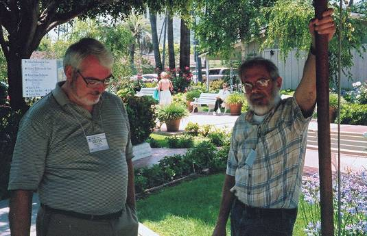
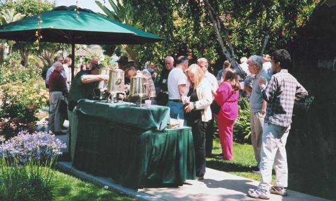

*report by Ian Clark*
{ .byline }

FCRC 2003 was a combined conference of 30 sub-conferences or workshops under the umbrella of the Association for Computing Machinery (ACM). Of these SIGAPL was just one, with some 50 delegates out of a total of 2,400. Different SIGs had their conferences on different spans of dates between June 7-14, which ensured that if you turned up for lunch outside your appointed span you got turned away.

{ width="535" height="345" }

The event took place in a hotel large enough to accommodate all the delegates, the Town and Country Hotel and Conference Center in Mission Valley, San Diego, California. The centre consists of a compound with a number of buildings both short and tall, set among rose gardens, swimming pools and gazebos with acres of chairs and tables both outside and under cover. The ubiquitous laptop users lined the corridors and the walls of the Grand Foyer, wherever they could find a wall socket to plug into. These weren’t in ample supply, but you could usually find one if you wanted one, and maybe even a chair and a table handy, though it helped to be able to sit cross-legged on the floor. Buddha contemplating his laptop is all set to become an icon of the age.

Delegates were offered the chance to book rooms at the hotel itself, if they took it early enough. Your intrepid correspondent booked a berth in a backpackers’ hostel he discovered in downtown San Diego, the Gaslight District (which wasn’t quite so Jack-the-Ripper as it sounded). This ensured a vigorous nightlife and youthful company, very appealing to the young-at-heart and earplug-equipped. He then had the problem of commuting into the conference location, which turned out to be easier than it had originally looked from the non-existent pre-conference joining instructions -- a twenty minute trip on the San Diego Trolley, the light railway which serves the town. Interestingly the end of the line is in Tijuana, Mexico, which lets people commute to work across the border –- you don’t have to swim the Rio any more. The FCRC organisers had thoughtfully provided a free trolley pass in the delegates’ joining pack, which they then tried to retrieve for a refund from delegates not using them.

{ width="561" height="336" }

The combined conference permitted an overall programme, so that delegates got a timeline of all the activities in progress. In principle this allowed one to attend any presentation in the 12 or so concurrent streams on any one day. The greatest benefit of this was the three plenary sessions of talks of general interest by invited speakers, all leaders in their fields, which were well worthwhile.

Highlights of the conference for this particular delegate were:

## Barbara Liskov, MIT: Issues in peer-to-peer computing

This plenary talk introduced us to the vocabulary and methods of peer-to-peer (P2P) communications. A P2P network differs from conventional client-server in that it consists of a group of nodes starting off undistinguished from each other, which nodes can join and leave at will. P2P has grown in importance with informal networks for sharing music and suchlike. Prof Liskov’s group is refining the initial empirical solutions of the industry to make them more suitable for corporate networks. This is speculative work insofar as there is no guarantee whether in the end the result will be better than the traditional client-server architecture. We learned about rings of ids, successor functions and slice leaders, Byzantine failure (where a node essentially lies) –- the more important source of malfunction thanks to the growth of malicious attacks – and fault-tolerant strategies to overcome it. We also learned about the Sybil attack, which ‘stacks’ a network by creating sufficient new nodes to create a quorum. This demands a configuration service, a subset of the network forming a Byzantine quorum, to validate the network periodically. Existing applications of P2P, e.g. music sharing, assume uncontrolled entry and exit of nodes from the network, whereas an admissions policy is clearly more appropriate for a corporate intranet, where the turnover of nodes is hopefully lower.

This was a clear and economical presentation, which got into the subject with very little flim-flam.

## Dan Baronet: NavPlanR – flight planning software for pilots

An entertaining talk that started off explaining the basics of aircraft navigation from “Piloting for Dummies.” Dan came to this problem from his own experience as a light aircraft pilot. The program prints out a flight plan, reading weather from a particular website. It was offered as a practical example for getting started with the J Project Manager, including packaging up an app for distribution and installation, right down to drawing the explorer icon, printing the label and locking the script. A feature was a test script packaged with the project. Dan gave away the code on diskette, which can also be downloaded from: [www.milinta.com/english](http://www.milinta.com/english)

## Tama Traberman, Linda Alvord: Simulating ordered RGB color triples using J

A literally colourful talk split between the two presenters with a little movie at the end. There were coloured visuals and handouts to explain RGB graphics, as well as artwork demonstrating the practical results of the speakers’ methods of sorting the colour palette by both hue and intensity. The effect of this was to achieve more convincing colour gradients in artwork. The technique produced most impressive results when a colour image was converted to greyscale, the results of doing so rarely being appealing in general.

## Georg Reichard: INSTRUCTOR – a new technique of guiding the user in simulation software

This talk described a courseware building package used primarily with pre-existing energy-use simulations. Such simulations typically have a number of parameters whose effective usage is far from clear, leaving the student with the dual task of learning how to drive the simulation, as well as absorbing the lesson it is supposed to convey. The speaker showed how to eliminate the first task. A significant application of Causeway, INSTRUCTOR offers the tutor an orderly way of building instruction sessions using a given simulation, acting at runtime as a non-programmer top-end to the simulation packages.

## Bernecky & Wooster: BITSLICE: Representation without taxation

Roy Sykes presented this paper on behalf of the authors, who were faced with the task of trying to speed up a mainframe application which was too well-written to offer easy gains by straightforward recoding. However the interpreter wastes a lot of machine cycles slicing and dicing Boolean strings. Addressing this issue achieved performance gains of 40%. By way of a general answer to this sort of problem the authors wrote a Sharp APL intrinsic function, comparable with APL2000’s `⎕DR`, which effectively coerces a datatype without rewriting the actual data representation in memory.

## Roy Sykes: Faster than a speeding bullet, performance enhancements for APL using Assembler

Roy described his MACfns, replacements for primitives and idioms written in Intel Assembler. The machine code is coerced to integer datatype and serves as the right argument to `⎕WCALL`. Roy described the special advantages this gives him over the interpreter’s own strategy. One of these less obvious advantages is to get consistent error messages, e.g. in cases where there are potentially two or three reasons to fail. Roy regaled the audience with the side-effects of very small numbers in 64bit versus 80bit IEEE floating point standards and the speed improvement of Log2 based on bit-shifting rather than calculating the log.

## Vendor forums

Nearly all the major interpreter vendors were there displaying their wares, viz. IBM with APL2, James Brown with SmartArrays, John Daintree of Dyalog Limited (formerly Dyadic Systems) with Dyalog APL and PocketAPL, Richard Nabavi of MicroAPL with APLX 1.1and Fred Waid of APL2000 with Windows Server 2003.

## Conclusion

For the APL delegates, the conference climaxed with the banquet on Friday night, a Mexican buffet at which the wine flowed free but the beer was controlled by ticket. Roy Sykes filled the gap left by the pre-arranged after-dinner speaker who was prevented from attending for health reasons. This degenerated into pandemonium as two teams of volunteers holding numbers representing scalar elements tried to ravel and transpose in parade-ground fashion, convincing your correspondent that APL is not yet ready for war. The assembly then adjourned to a guest room somewhere in the hotel for an evening seminar (not quite the same without the Russians).

Clearly this had been an easy, low-cost conference to organise, the bulk of the work being handled competently by the hotel and the FCRC organisers on behalf of all the participating groups. Stephen Mansour succinctly performed the role of Conference Chair, the program chair seeing fit not to attend.

The content had a somewhat lightweight feel about it, there being 14 papers in the APL proceedings, actually available at the conference, of which 11 were actually presented. But these were eked out by 5 vendor presentations, 3 tutorials and 2 invited presentations, plus the opportunity to attend 3 entertaining plenary sessions. Apart from these, the much-vaunted opportunity to attend other groups’ sessions did not appeal overmuch, because they were indeed ‘special interest groups’. However your scribe did get to show APL in the concourse poster session to a young student who had never heard of it, plus ample opportunity to remind himself how awful root beer really was.

In conclusion, a good time was had by all, with plenty of opportunity for networking.

***
