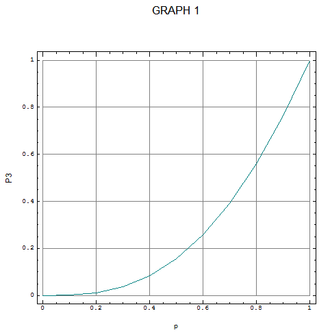
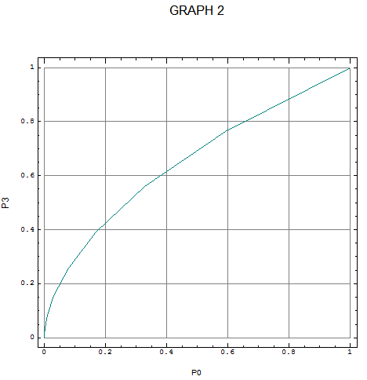

by E.A. Clough
{ .byline }

In his article in Vector Vol. 21 No. 2, Devon McCormick purports to show how, given an urn containing a known number of balls, each of which may be black or white, Bayesian statistics can be used to derive the probability that all of the balls are white after a number of white and only white balls have been drawn, with replacement. No one denies the validity of the Bayes formula, of course, but I am not convinced that it can be applied to the urn problem in the way McCormick suggests.

To understand the problem better, I asked myself how I would provide a prior probability. Since I have the opportunity to examine individual balls, I should provide a probability *p* that any particular ball is white. It will then follow that the probability of there being *x* white balls among *n* balls is given by the usual binomial formula (using the J vocabulary):

```
 (x!n)*(p^x)*(1-p)^(n-x)
```

Note that the value *p* is to be my Bayesian prior relating to the balls in a particular urn and in this context the use of the binomial formula is not itself a Bayesian prior.

\{It is normally taken that the urn is a ‘one-off’. There is no distribution of numbers of white balls involved so discussion of whether it is or is not binomial is not meaningful.\}

The Bayes formula can then be used to determine a probability, say *P3*, that all of 5 balls are white after 3 three draws. My J4.06 script is:

```
 ab=:3 :'((y.%n)^d)*(y.!n)*(py^y.)*(1-py)^(n-y.)'   NB. Bayes component
 urn=:4 :0                                          NB. e.g. (d,n) urn p [ ('d';'n';'p')=.3;5;0.5
 d=:{.x. [  n=:{:x. [  py=:y.
 (ab n)%+/ab"0 i.>:n                                NB. Bayes probability
 )
```

Graph 1 shows the relationship between *p* and *P3* over the possible range of *p*.

{ width="482" height="490" }

Choosing a value for *p* is the difficult bit. In general a person’s choice will depend on whether they are optimistic (’I am sure they will all be white balls”) or pessimistic (“I never win anything”), trusting (“Urn suppliers are good chaps”) or suspicious (“There is always one bad apple”), and also, I believe, the person will be more or less strongly influenced by the intrinsic value of making a wrong or right decision about the urn – involving assessment against their own particular utility curve (“From my point of view, the stakes are high, so I will act with caution”).

I am not quite sure where the implicit assumption is made but Devon McCormick’s result of a P-value of 0.15625 corresponds to a p-value of 0.5. This may not seem as plausible a ‘neutral’ prior as does selecting the binomial distribution as the prior; it is equivalent to assuming, before any draws have been made, that the (prior) probability of all balls being white is P0= 0.03125 (calculated by `0 5 urn 0.5`).

An alternative start point might be to choose, as the prior, a probability of P0= 0.5 of all the balls being white. By trial and error or by more formal iterative means, it can be found that this corresponds to a probability p=0.8705507 of individual balls being white. This in turn implies a probability P3=0.699031 of all balls being white after three whites have been drawn. Is this a better solution? Is there a best neutral prior?

The relationship between P0 and P3 is shown in Graph 2, J for which is:

```
       P0=:0 5 urn"1 0 p=:(10%~i.11)
       P3=:3 5 urn"1 0 p
       load'plot'
       'frame 1;grids 1;title GRAPH 2;xcaption P0;ycaption P3' plot P0;P3
```

{ width="468" height="484" }

It can be seen more clearly that in reality there is no satisfactory neutral starting point if the variable p is transformed. Probability occupies the domain (0,1). If I choose to work with odds, `z=p%(1-p)`, rather than probability so that the binomial formula becomes

```
  (x!n)*(z^x)%(1+z)^n
```

(a slightly simpler formula than the original in that `x` only appears twice), I then have a variable, which occupies the domain (`0,_`), i.e. zero to infinity. Finally, taking log odds I finish with a variable in the domain (`__,_`) or minus to plus infinity. In this more familiar territory it can be recognised that at least two parameters, a mean and a variance, are needed to describe my initial state of mind and in fact the variance is the dominant parameter, for, if there is no prior information about `p`, the appropriate value for the variance of log `z` is infinity and other parameters become indeterminate.

My conclusion is that the Bayes formula can and should be used to show the logical relationship between the various probabilities involved in a problem but if the process is taken beyond this point it may only offer fool’s gold. Perhaps those who came after Laplace to whom Devon McCormick refers were more astute than we think.

A person might still select a prior – either p or P0 – to reflect his own views but I would suggest that, if the number of draws is less than the number of balls, the best advice a statistician can give is a conditional probability of the form: If there is one black ball the probability of not drawing it in three draws is `(4%5)^3=0.512`, hence there can be no great confidence that all the balls are white.

When the number of draws is equal to or greater than the number of balls, a different question can be examined, namely what is the probability that all the balls have been seen, and if only white balls have been drawn this can be used as a measure of the probability that all the balls are white. Such a probability can be computed without reference to a prior. The rows in the following table give the probabilities for urns with different numbers of balls.

```
 +--+------------------------------------------------------------+
 |  |                      Number of Draws                       |
 +--+------------------------------------------------------------+
 |  |     2           3           5          10          20      |
 +--+------------------------------------------------------------+
 | 2|  5.000e_1    7.500e_1    9.375e_1    9.980e_1    1.000e0   |
 | 3|  0.000e0     2.222e_1    6.173e_1    9.480e_1    9.991e_1  |
 | 5|  0.000e0     0.000e0     3.840e_2    5.225e_1    9.427e_1  |
 |10|  0.000e0     0.000e0     0.000e0     3.629e_4    2.147e_1  |
 +--+------------------------------------------------------------+
```
