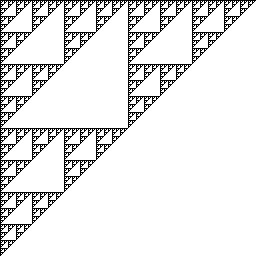
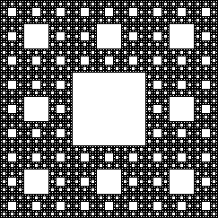
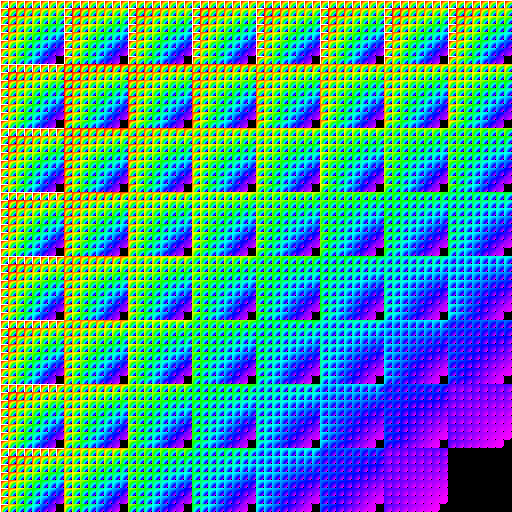
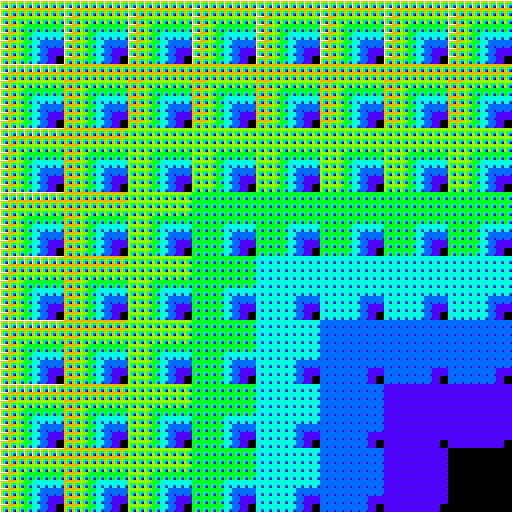
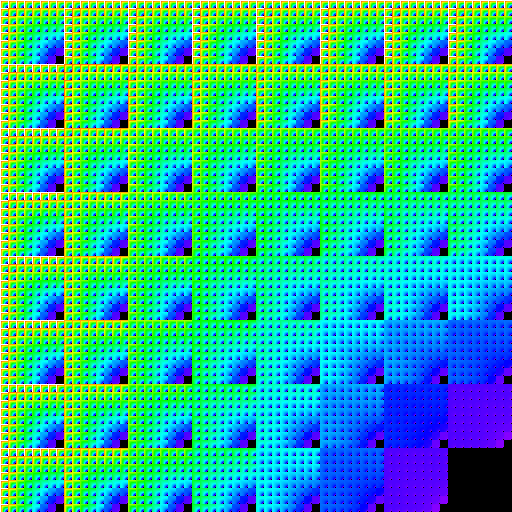
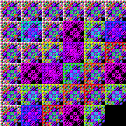

*by Angela Coxe (email: [coxea@lafayette.edu](mailto:coxea@lafayette.edu))*
{ .byline }

## Introduction

Fractals have become a popular topic to study because of their aesthetic appeal. They have been used in different fields and also as a way to depict natural landscapes [\[2\]](#note2), [\[7\]](#note7). One classic fractal is the Sierpinski Triangle [\[5\]](#note5). This fractal may be constructed using J inner products [\[3\]](#note3). In this note our goal is to explore the use of fuzzy logics with such inner products. This grew out of a project I did in a visualization class [\[4\]](#note4).

##  Boolean Inner Product Fractals

We first consider using an inner product in J to construct the Sierpinski Triangle. To make the images we start with the binary representation of the values. Here is a matrix of 3-digit and base-2 construction of binary representations.

```
   k=: 3    s=: 2    ]m=: (k#s)#: i.s^k
0 0 0
0 0 1
0 1 0
0 1 1
1 0 0
1 0 1
1 1 0
1 1 1
```

Then we take the “or” of pair-wise “and” of each row of *m* with each column of the transpose using a J inner product; see the following. The 0’s correspond to the Sierpinski Triangle.

```
   ]b=:
m +./ . *. |: m
0 0 0 0 0 0 0 0
0 1 0 1 0 1 0 1
0 0 1 1 0 0 1 1
0 1 1 1 0 1 1 1
0 0 0 0 1 1 1 1
0 1 0 1 1 1 1 1
0 0 1 1 1 1 1 1
0 1 1 1 1 1 1 1
```

We then increased the value of *k* to 8 and made the picture in Figure 1. By changing the “or” and “and” operators (`+.` and `*.`), values of the digit, and the base in the above expression, different variations on the Sierpinski Triangle can be seen. The inner product matrix above with a 5-digit base-3 representation gives the Sierpinski Carpet seen in Figure 2, where `+.` and `*.` were the gcd and lcm.

## Fuzzy Logic

Fuzzy logic is a way to quantify indefinite values of truth. There are different types of fuzzy logics and each type gives a different behaviour. Fuzzy logics use “or” and “and” operators, and variations of “or” and “and” to determine the differing types of fuzzy logics. The types we are going to examine first are the probabilistic fuzzy logic and the max/min fuzzy logic.

We start with by showing the Boolean Logic truth tables in Tables 1 and 2.

<table border="1" cellspacing="0" cellpadding="0">
 <tr>
  <td width="36" valign="middle" align="center">
  <p> </p>
  </td>
  <td width="36" valign="middle" align="center">
  <p>0</p>
  </td>
   <td width="36" valign="middle" align="center">
  <p>1</p>
  </td>
 </tr>
 <tr>
   <td width="36" valign="middle" align="center">
  <p>0</p>
  </td>
   <td width="36" valign="middle" align="center">
  <p><b>0</b></p>
  </td>
   <td width="36" valign="middle" align="center">
  <p><b>1</b></p>
  </td>
 </tr>
 <tr>
  <td width="36" valign="middle" align="center">
  <p>1</p>
  </td>
 <td width="36" valign="middle" align="center">
  <p><b>1</b></p>
  </td>
 <td width="36" valign="middle" align="center">
  <p><b>1</b></p>
  </td>
 </tr>
</table>

**Table 1. Boolean “or” truth table**

 

<table border="1" cellspacing="0" cellpadding="0">
 <tr>
    <td width="36" valign="middle" align="center">
  <p> </p>
  </td>
    <td width="36" valign="middle" align="center">
  <p>0</p>
  </td>
    <td width="36" valign="middle" align="center">
  <p>1</p>
  </td>
 </tr>
 <tr>
    <td width="36" valign="middle" align="center">
  <p>0</p>
  </td>
  <td width="36" valign="middle" align="center">
  <p><b>0</b></p>
  </td>
  <td width="36" valign="middle" align="center">
  <p><b>0</b></p>
  </td>
 </tr>
 <tr>
  <td width="36" valign="middle" align="center">
  <p>1</p>
  </td>
  <td width="36" valign="middle" align="center">
  <p><b>0</b></p>
  </td>
  <td width="36" valign="middle" align="center">
  <p><b>1</b></p>
  </td>
 </tr>
</table>

**Table 2. Boolean “and” truth table**

 

In the probabilistic fuzzy logic *x* or *y* is (*x + y*)-(*x \* y*) while *x* and *y* is *x \* y* [\[4\]](#note4), [\[6\]](#note6). Here is the implementation in J.

```
 por=:
(+ - *)”0  pand=: *
```

Tables 3 and 4 are the truth tables for the probabilistic logic. Comparing these tables to the Boolean truth tables (Tables 1 and 2), note the 0’s and 1’s are positioned as in the Boolean tables.

<table border="1" cellspacing="0" cellpadding="0" width="403">
 <tr align="center" valign="middle">
  <td width="67" align="center">
  <p> </p>
  </td>
  <td width="62" align="center">
  <p>0</p>
  </td>
  <td width="70" align="center">
  <p>0.25</p>
  </td>
  <td width="72" align="center">
  <p>0.5</p>
  </td>
  <td width="72" align="center">
  <p>0.75</p>
  </td>
  <td width="60" align="center">
  <p>1</p>
  </td>
 </tr>
 <tr>
  <td width="67" align="center">
  <p>0</p>
  </td>
  <td width="62" align="center">
  <p><b>0</b></p>
  </td>
  <td width="70" align="center">
  <p><b>0.25</b></p>
  </td>
  <td width="72" align="center">
  <p><b>0.5</b></p>
  </td>
  <td width="72" align="center">
  <p><b>0.75</b></p>
  </td>
  <td width="60" align="center">
  <p><b>1</b></p>
  </td>
 </tr>
 <tr>
  <td width="67" align="center">
  <p>0.25</p>
  </td>
  <td width="62" align="center">
  <p><b>0.25</b></p>
  </td>
  <td width="70" align="center">
  <p><b>0.4375</b></p>
  </td>
  <td width="72" align="center">
  <p><b>0.625</b></p>
  </td>
  <td width="72" align="center">
  <p><b>0.8125</b></p>
  </td>
  <td width="60" align="center">
  <p><b>1</b></p>
  </td>
 </tr>
 <tr>
  <td width="67" align="center">
  <p>0.5</p>
  </td>
  <td width="62" align="center">
  <p><b>0.5</b></p>
  </td>
  <td width="70" align="center">
  <p><b>0.625</b></p>
  </td>
  <td width="72" align="center">
  <p><b>0.75</b></p>
  </td>
  <td width="72" align="center">
  <p><b>0.875</b></p>
  </td>
  <td width="60" align="center">
  <p><b>1</b></p>
  </td>
 </tr>
 <tr>
  <td width="67" align="center">
  <p>0.75</p>
  </td>
  <td width="62" align="center">
  <p><b>0.75</b></p>
  </td>
  <td width="70" align="center">
  <p><b>0.8125</b></p>
  </td>
  <td width="72" align="center">
  <p><b>0.875</b></p>
  </td>
  <td width="72" align="center">
  <p><b>0.9375</b></p>
  </td>
  <td width="60" align="center">
  <p><b>1</b></p>
  </td>
 </tr>
 <tr>
  <td width="67" align="center">
  <p>1</p>
  </td>
  <td width="62" align="center">
  <p><b>1</b></p>
  </td>
  <td width="70" align="center">
  <p><b>1</b></p>
  </td>
  <td width="72" align="center">
  <p><b>1</b></p>
  </td>
  <td width="72" align="center">
  <p><b>1</b></p>
  </td>
  <td width="60" align="center">
  <p><b>1</b></p>
  </td>
 </tr>
</table>

<table cellspacing="0" cellpadding="0" hspace="0" vspace="0" width="317">
 <tr>
  <td align="center">
  <p><b>Table 3.   Probabilistic “or” truth table</b></p>
  </td>
 </tr>
</table>

 

 

<table border="1" cellspacing="0" cellpadding="0" width="403">
 <tr>
  <td width="67" align="center">
  <p> </p>
  </td>
  <td width="62" align="center">
  <p>0</p>
  </td>
  <td width="70" align="center">
  <p>0.25</p>
  </td>
  <td width="72" align="center">
  <p>0.5</p>
  </td>
  <td width="72" align="center">
  <p>0.75</p>
  </td>
  <td width="60" align="center">
  <p>1</p>
  </td>
 </tr>
 <tr>
  <td width="67" align="center">
  <p>0</p>
  </td>
  <td width="62" align="center">
  <p><b>0</b></p>
  </td>
  <td width="70" align="center">
  <p><b>0</b></p>
  </td>
  <td width="72" align="center">
  <p><b>0</b></p>
  </td>
  <td width="72" align="center">
  <p><b>0</b></p>
  </td>
  <td width="60" align="center">
  <p><b>0</b></p>
  </td>
 </tr>
 <tr>
  <td width="67" align="center">
  <p>0.25</p>
  </td>
  <td width="62" align="center">
  <p><b>0</b></p>
  </td>
  <td width="70" align="center">
  <p><b>0.625</b></p>
  </td>
  <td width="72" align="center">
  <p><b>0.125</b></p>
  </td>
  <td width="72" align="center">
  <p><b>0.1875</b></p>
  </td>
  <td width="60" align="center">
  <p><b>0.25</b></p>
  </td>
 </tr>
 <tr>
  <td width="67" align="center">
  <p>0.5</p>
  </td>
  <td width="62" align="center">
  <p><b>0</b></p>
  </td>
  <td width="70" align="center">
  <p><b>0.125</b></p>
  </td>
  <td width="72" align="center">
  <p><b>0.25</b></p>
  </td>
  <td width="72" align="center">
  <p><b>0.375</b></p>
  </td>
  <td width="60" align="center">
  <p><b>0.5</b></p>
  </td>
 </tr>
 <tr>
  <td width="67" align="center">
  <p>0.75</p>
  </td>
  <td width="62" align="center">
  <p><b>0</b></p>
  </td>
  <td width="70" align="center">
  <p><b>0.1875</b></p>
  </td>
  <td width="72" align="center">
  <p><b>0.375</b></p>
  </td>
  <td width="72" align="center">
  <p><b>0.5625</b></p>
  </td>
  <td width="60" align="center">
  <p><b>0.75</b></p>
  </td>
 </tr>
 <tr>
  <td width="67" align="center">
  <p>1</p>
  </td>
  <td width="62" align="center">
  <p><b>0</b></p>
  </td>
  <td width="70" align="center">
  <p><b>0.25</b></p>
  </td>
  <td width="72" align="center">
  <p><b>0.5</b></p>
  </td>
  <td width="72" align="center">
  <p><b>0.75</b></p>
  </td>
  <td width="60" align="center">
  <p><b>1</b></p>
  </td>
 </tr>
</table>

<table cellspacing="0" cellpadding="0" hspace="0" vspace="0" width="317">
 <tr>
  <td align="center">
  <p><b>Table 4.   Probabilistic “and” truth table</b></p>
  </td>
 </tr>
</table>

## Probabilistic Fuzzy Logic Inner Product Fractal

We will now look at the probabilistic fuzzy logic and apply it to inner product fractals. The expression below makes a matrix using <i>k-</i>digits and <i>s</i>-sampled values.

```
 k=: 2
   s=: 3
   ]m=: >,/{k#<(i.%<:)s
  0   0
  0 0.5
  0   1
0.5   0
0.5 0.5
0.5   1
  1   0
  1 0.5
 1   1
```

Fuzzy logics may be used on this *m* in the same construction as the inner product fractals discussed earlier with a slight variation to accommodate the fuzzy “or” and “and” operators.

```
   ]b=: m por/ . pand |:m
0    0   0    0      0     0   0     0    0
0 0.25 0.5    0   0.25   0.5   0  0.25  0.5
0  0.5   1    0    0.5     1   0   0.5    1
0    0   0 0.25   0.25  0.25 0.5   0.5  0.5
0 0.25 0.5 0.25 0.4375 0.625 0.5 0.625 0.75
0  0.5   1 0.25  0.625     1 0.5  0.75    1
0    0   0  0.5    0.5   0.5   1     1    1
0 0.25 0.5  0.5  0.625  0.75   1     1    1
0  0.5   1  0.5   0.75     1   1     1    1
```

In order to visualize a more detailed version, we assign each value in our matrix to an integer between 0 and 255. The linear visualizing is done using the function lin256, which matches integers to a palette to construct colour pictures [\[4\]](#note4). Notice how there is a block of 1’s in the lower right corner. The 1’s correspond to the color black in the palette, the 0’s correspond to the color white in the palette, and the rest of the values are different hues in between. Here is the J representation used to create pictures using the probabilistic fuzzy logic.

```
   load 'fvj2/raster5.ijs'
   lin256=: <.@(255.99&*)

   $m=: >,/^:(_1: + #@$){3#<(i.%<:)8
512 3
   $b=: m por / . pand |: m
512 512
   (P256; lin256 b) writebmp8 'pFuzzy000.bmp'
```

See Figure 3 for an example of inner product fractals using the probabilistic fuzzy logic. This figure shows the nesting with shifts of shading within the image. Recall that the lower right side is a black block because all the values in that portion of the matrix are 1’s.

## Max/Min Fuzzy Logic

Another type of fuzzy logic is max/min. This logic uses max (>.) and min (&lt;.) functions. The following is the implementation of the max/min “or” and “and” functions.

```
   mor=: >.
   mand=: <.
```

Tables 5 and 6 show the truth tables for the max/min fuzzy logic.

<table border="1" cellspacing="0" cellpadding="0" width="403">
 <tr>
  <td width="67" align="center">
  <p> </p>
  </td>
  <td width="62" align="center">
  <p>0</p>
  </td>
  <td width="70" align="center">
  <p>0.25</p>
  </td>
  <td width="72" align="center">
  <p>0.5</p>
  </td>
  <td width="72" align="center">
  <p>0.75</p>
  </td>
  <td width="60" align="center">
  <p>1</p>
  </td>
 </tr>
 <tr>
  <td width="67" align="center">
  <p>0</p>
  </td>
  <td width="62" align="center">
  <p><b>0</b></p>
  </td>
  <td width="70" align="center">
  <p><b>0.25</b></p>
  </td>
  <td width="72" align="center">
  <p><b>0.5</b></p>
  </td>
  <td width="72" align="center">
  <p><b>0.75</b></p>
  </td>
  <td width="60" align="center">
  <p><b>1</b></p>
  </td>
 </tr>
 <tr>
  <td width="67" align="center">
  <p>0.25</p>
  </td>
  <td width="62" align="center">
  <p><b>0.25</b></p>
  </td>
  <td width="70" align="center">
  <p><b>0.25</b></p>
  </td>
  <td width="72" align="center">
  <p><b>0.5</b></p>
  </td>
  <td width="72" align="center">
  <p><b>0.75</b></p>
  </td>
  <td width="60" align="center">
  <p><b>1</b></p>
  </td>
 </tr>
 <tr>
  <td width="67" align="center">
  <p>0.5</p>
  </td>
  <td width="62" align="center">
  <p><b>0.5</b></p>
  </td>
  <td width="70" align="center">
  <p><b>0.5</b></p>
  </td>
  <td width="72" align="center">
  <p><b>0.5</b></p>
  </td>
  <td width="72" align="center">
  <p><b>0.75</b></p>
  </td>
  <td width="60" align="center">
  <p><b>1</b></p>
  </td>
 </tr>
 <tr>
  <td width="67" align="center">
  <p>0.75</p>
  </td>
  <td width="62" align="center">
  <p><b>0.75</b></p>
  </td>
  <td width="70" align="center">
  <p><b>0.75</b></p>
  </td>
  <td width="72" align="center">
  <p><b>0.75</b></p>
  </td>
  <td width="72" align="center">
  <p><b>0.75</b></p>
  </td>
  <td width="60" align="center">
  <p><b>1</b></p>
  </td>
 </tr>
 <tr>
  <td width="67" align="center">
  <p>1</p>
  </td>
  <td width="62" align="center">
  <p><b>1</b></p>
  </td>
  <td width="70" align="center">
  <p><b>1</b></p>
  </td>
  <td width="72" align="center">
  <p><b>1</b></p>
  </td>
  <td width="72" align="center">
  <p><b>1</b></p>
  </td>
  <td width="60" align="center">
  <p><b>1</b></p>
  </td>
 </tr>
</table>

**Table 5. Max/Min “or” truth table**

<table border="1" cellspacing="0" cellpadding="0" width="403">
 <tr>
  <td width="67" align="center">
  <p> </p>
  </td>
  <td width="62" align="center">
  <p>0</p>
  </td>
  <td width="70" align="center">
  <p>0.25</p>
  </td>
  <td width="72" align="center">
  <p>0.5</p>
  </td>
  <td width="72" align="center">
  <p>0.75</p>
  </td>
  <td width="60" align="center">
  <p>1</p>
  </td>
 </tr>
 <tr>
  <td width="67" align="center">
  <p>0</p>
  </td>
  <td width="62" align="center">
  <p><b>0</b></p>
  </td>
  <td width="70" align="center">
  <p><b>0</b></p>
  </td>
  <td width="72" align="center">
  <p><b>0</b></p>
  </td>
  <td width="72" align="center">
  <p><b>0</b></p>
  </td>
  <td width="60" align="center">
  <p><b>0</b></p>
  </td>
 </tr>
 <tr>
  <td width="67" align="center">
  <p>0.25</p>
  </td>
  <td width="62" align="center">
  <p><b>0</b></p>
  </td>
  <td width="70" align="center">
  <p><b>0.25</b></p>
  </td>
  <td width="72" align="center">
  <p><b>0.25</b></p>
  </td>
  <td width="72" align="center">
  <p><b>0.25</b></p>
  </td>
  <td width="60" align="center">
  <p><b>0.25</b></p>
  </td>
 </tr>
 <tr>
  <td width="67" align="center">
  <p>0.5</p>
  </td>
  <td width="62" align="center">
  <p><b>0</b></p>
  </td>
  <td width="70" align="center">
  <p><b>0.25</b></p>
  </td>
  <td width="72" align="center">
  <p><b>0.5</b></p>
  </td>
  <td width="72" align="center">
  <p><b>0.5</b></p>
  </td>
  <td width="60" align="center">
  <p><b>0.5</b></p>
  </td>
 </tr>
 <tr>
  <td width="67" align="center">
  <p>0.75</p>
  </td>
  <td width="62" align="center">
  <p><b>0</b></p>
  </td>
  <td width="70" align="center">
  <p><b>0.25</b></p>
  </td>
  <td width="72" align="center">
  <p><b>0.5</b></p>
  </td>
  <td width="72" align="center">
  <p><b>0.75</b></p>
  </td>
  <td width="60" align="center">
  <p><b>0.75</b></p>
  </td>
 </tr>
 <tr>
  <td width="67" align="center">
  <p>1</p>
  </td>
  <td width="62" align="center">
  <p><b>0</b></p>
  </td>
  <td width="70" align="center">
  <p><b>0.25</b></p>
  </td>
  <td width="72" align="center">
  <p><b>0.5</b></p>
  </td>
  <td width="72" align="center">
  <p><b>0.75</b></p>
  </td>
  <td width="60" align="center">
  <p><b>1</b></p>
  </td>
 </tr>
</table>

**Table 6. Max/Min “and” truth table**

We can see the values in the max/min truth tables all appear in the domain, while the probabilistic truth tables contain additional values outside the domain.

As before, this is substituted into the inner product formula and the rest is the same as the probabilistic logic.

```
   $m=: >,/{3#<(i.%<:)8
512 3
   $b=: m max / . min |: m
512 512
  (P256; lin256 b) writebmp8 'mfuzzy000.bmp'
```

An illustration of max/min fuzzy logic inner product fractal is seen in Figure 4. Notice the uniform bands of color within the nesting of shades. This is not surprising given the patterns in Tables 5 and 6.

## Schweizer Parameterized Family of Fuzzy Logic

Next, we are using the Schweizer parameterized family of fuzzy logic to create a family of inner product fractals. For this type we are using two definitions, which give the fuzzy logic for any a>0 [\[6\]](#note6).

The Schweizer “or” definition is:

x sor y = (1/x<sup>a</sup> + 1/y<sup>a</sup> -1) <sup>–1/</sup><sup>a</sup>

and the implementation in J is:

```
sor=: 1 : 0"0
:
if. 1= x.>.y. do. 1 else.
1 - ((%((1-x.)^m.)) + (%((1-y.)^m.)) -1)^(-%m.)
end.
)
```

The Schweizer “and” definition is:

x sand y = 1 – (1/(1-x)<sup>a</sup> + 1/(1-y)<sup>a</sup> -1) <sup>–1/</sup><sup>a</sup> 

 and the implementation in J is:

```
sand=: 1 : 0"0
:
if. 0 = x.*y. do. 0 else.
((%(x.)^m.) + (%(y.)^m.) - 1)^(-%m.)
end.
)
```

The J adverbs for Schweizer families are run similar to the above fuzzy logics. The difference in the J implementation is the a-value placed in front of the sor and sand resulting in the appropriate function. Each different a-value affects the picture slightly. Here is the variation of the inner product fractal used with the a-value of 0.5.

```
   $m=: >,/^:(_1: + #@$){3#<(i.%<:)8
512 3
   $b=: m 2 sor / . (2 sand) |: m
512 512
   (P256; lin256 b) writebmp8 'sfuzzy000.bmp'
```

The Schweizer image with the a-value of 0.01 behaves virtually identically to Figure 3. In addition, Figure 4 and the Schweizer image with the a-value of 20 also have virtually identical behaviours. The images I produced with the Schweizer family showed an a-value greater than 1 had behaviour similar to a max/min fuzzy logic, and an a-value approaching 0 had behaviour similar to the probabilistic fuzzy logic. Figure 5 is an example where the a-value is between the probabilistic and max/min figures. To see an animation of this Schweizer family see [\[1\]](#note1). A beta version of image3 addon for J was used to create the animation. This page also another example of the probabilistic logic were the argument is preprocessed by the following function.

<pre>tw(x)= ½+m(x-½)+4(1-m)(x-½)<sup>3</sup></pre>

We call this the twisted family of logic, and Figure 6 contains an example of the twisted logic at the initial value of –3.

## Conclusion

We have seen how fuzzy logics in inner product constructions form fractal like images. Parameterized families of fuzzy logic show how variations on the logics according to the parameters give smooth variations between images.

\[Ed: These pictures are .png files - if you cannot read these there are lower-quality .gif versions appended at the end of the paper\]

{ width="256" height="256" }

**Figure 1. Sierpinski Triangle from inner product fractal of 8-digit base-2 representations.**

{ width="243" height="243" }

**Figure 2. Sierpinski Carpet from a base-3 construction.**

{ width="384" height="384" }

**Figure 3. Inner product fractal from 3-digit probabilistic fuzzy logic sampled at 8-points.**

{ width="384" height="384" }

**Figure 4. Inner product fractal from 3-digit max/min fuzzy logic sampled at 8-points.**

{ width="384" height="384" }

**Figure 5. Inner product fractal from 3-digit Schweizer fuzzy logic sampled at 8-points with an a-value of 2.**

{ width="310" height="310" }

**Figure 6. Twisted inner product fractal with a parameter value of –3.**

## References

 <a id="note1"></a>\[1\]Angela M. Coxe, Auxillary Materials for “Inner Product Fractals from Fuzzy Logics”, [http://www.lafayette.edu/~reiterc/sp02fp/coxe/index.html](http://www.lafayette.edu/~reiterc/sp02fp/coxe/index.html)

<a id="note2"></a>\[2\]   Barnsley, Michael. *Fractals Everywhere*. Academic Press, Inc., San Diega, CA (1988).

<a id="note3"></a>\[3\]   C. A. Reiter, Fractals and Generalized Inner Products. *Chaos, Solutions and Fractals* **3**, 695-713 (1993).

<a id="note4"></a>\[4\]   C.A. Reiter, *Fractals Visualization and J 2<sup>nd</sup> Ed*. Jsoftware, Toronto, Canada (2000).

<a id="note5"></a>\[5\]   C.A. Reiter, Sierpinski Fractals and GCDs. *Computers & Graphics*, (**18**) 6, 885-891 (1994).

<a id="note6"></a>\[6\]   H.T. Nguyen, E.A. Walker. *A First Course in Fuzzy Logic, Second Ed*. Chapman & Hall/CRC, Boca Raton, FL (2000).

<a id="note7"></a>\[7\]   Mandelbrot, Benoit B. *The Fractal Geometry of Nature.* W.H.Freeman and Company, New York, NY (1983).

Angela M. Coxe  
Lafayette College Box 8916  
Easton, PA 18042, USA  
[coxea@lafayette.edu](mailto:coxea@lafayette.edu)

***
