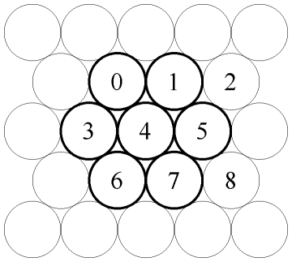
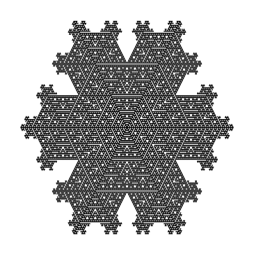
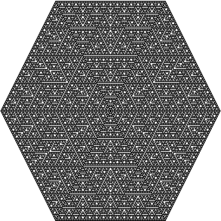
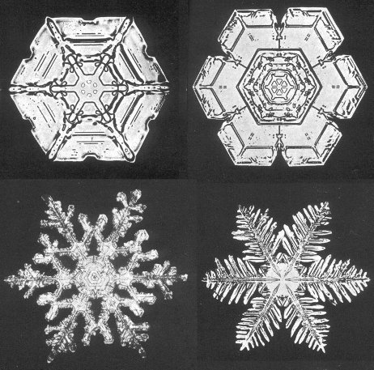
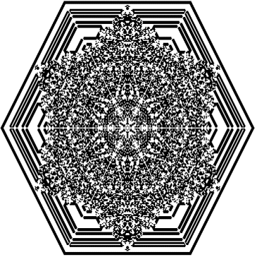
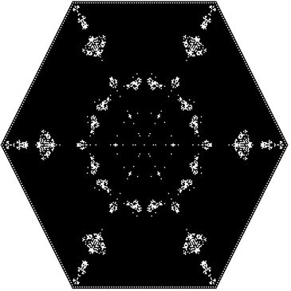
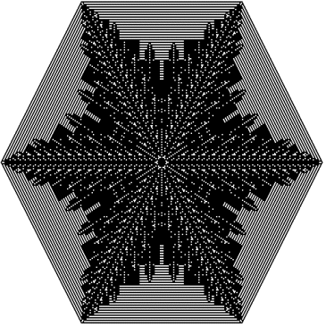

*by Angela Coxe and Cliff Reiter*
{ .byline }

\[Ed: Click on the figures for larger, more detailed versions\]

Cellular automata are local rules that are used to evolve discrete arrangements of cells. Perhaps the most famous cellular automaton is Conway’s Game of Life [\[2\]](#notes). It is based upon the iteration of simple rules on a rectangular lattice of Boolean valued cells. Incredibly rich structures have been discovered and there is a growing literature of amazing facts about that automaton [\[4\]](#notes).

One-dimensional cellular automata are also known to have rich structure, even when considering Boolean automata on size three neighbourhoods [\[7\]](#notes). Wolfram’s book, *A New Kind of Science* [\[7\]](#notes), suggests that simple automata are the principle behind many forces, whether they be artistic, physical, or social, in the world. Even without a grand view of automata, they are clearly related to important techniques, such as local filters for image processing.

One intriguing automaton that Wolfram describes is defined on a hexagonal lattice; its behavior has some features suggestive of a snowflake. A cell is either frozen (1) or not (0); it stays the same at the next generation unless it is currently unfrozen and exactly one of its neighbours is frozen, in which case it freezes. In this note we will investigate cellular automata on hexagonal lattices and their implementation in J. First we consider Wolfram’s snowflake automaton.

## Wolfram’s Snowflake Automaton

A hexagonal lattice may be viewed as a collection of points arranged like the circles in Figure 1. A hexagonal array of cells may be implemented via a rectangular array where alternate rows are imagined to be offset by half a position. In a rectangular arrangement of cells, the nearest neighbour neighbourhoods consist of 3 by 3 blocks of cells. In Figure 1, the cell labelled 4 could be thought of as the centre of a 3 by 3 block of cells, which are labelled  0-9. However, in the hexagonal view, the cell labelled 4 has six neighbours, 0 1 5 7 6 3, listed clockwise and shown in bold. We consider this hexagon to be a left configuration in the 3 by 3 neighbourhood. On alternate rows, the hexagonal neighbourhoods will alternate between left and right configurations.

{ width="360" height="323" }  
**Figure 1. A hexagonal arrangement of cells with one rectangular neighbourhood, with cells numbered 0-8, and the corresponding hexagonal neighbourhood, with cells in bold.**

The following 12 utilities implement the hexagonal automaton and allow us to view it. We explain how the utilities work below.

```
pad=: ([:-$@]++:@[) {. ($@]+[) {. ]
```

```
rep=: [ # #"1
```

```
hx_sh=:(e.&0 1@(4:|i.@#)|."0 1])@:(2&rep)
```

```
lnbr=:(4 0 1 5 7 6 3)&{@,
```

```
rnbr=:(4 1 2 5 8 7 3)&{@,
```

```
cen=: {.
```

```
nnbr=: +/@:}.
```

```
lhxauto=: (1: = nnbr)`1: @.cen
```

```
perext2=: ({:,],{.)"1@:({:,],{.)
```

```
perext2e=: ({:,],{.)"1@:(],2&{.)
```

```
hhxa=: 1 : '(2 1 ,:3 3)&(lhxauto@:u. ;._3)'
```

```
hxauto=: [: ,/ lnbr hhxa@:perext2 ,:"1 rnbr hhxa @:perext2e
```

First, pad allows us to create initial configurations. Thus, the following gives a simple configuration with a single initial frozen speck.

```
   2 pad 3=i.2 2
0 0 0 0 0 0
0 0 0 0 0 0
0 0 0 0 0 0
0 0 0 1 0 0
0 0 0 0 0 0
0 0 0 0 0 0
```

If we iterate the automaton twice, we see the following. However, the symmetry is hard to see.

```
   hxauto^:(2) 2 pad 3=i.2 2
0 0 0 0 0 0
0 0 1 0 1 0
0 0 0 1 1 0
0 1 1 1 1 1
0 0 0 1 1 0
0 0 1 0 1 0
```

By doubling the number of pixels (imagine 2 by 2 blocks to be a cell) and rotating alternate pairs of rows by one, the hexagonal symmetry becomes reasonably apparent. However, it is still easier to see the symmetry in the figures.

```
   hx_sh hxauto^:(2) 2 pad 3=i.2 2
0 0 0 0 0 0 0 0 0 0 0 0
0 0 0 0 0 0 0 0 0 0 0 0
0 0 0 0 1 1 0 0 1 1 0 0
0 0 0 0 1 1 0 0 1 1 0 0
0 0 0 0 0 1 1 1 1 0 0 0
0 0 0 0 0 1 1 1 1 0 0 0
0 0 1 1 1 1 1 1 1 1 1 1
0 0 1 1 1 1 1 1 1 1 1 1
0 0 0 0 0 1 1 1 1 0 0 0
0 0 0 0 0 1 1 1 1 0 0 0
0 0 0 0 1 1 0 0 1 1 0 0
0 0 0 0 1 1 0 0 1 1 0 0
```

The centre and left neighbourhood is produced from a 3 by 3 cell via `lnbr`; the right-hand version is produced by `rnbr`. We consider the resulting list of 7 numbers to be the hexagonal neighbourhood. The centre and number of neighbours (with value 1) of a hexagonal neighbourhood are given by `cen` and `nnbr`. The heart of the automaton is simple to describe. Recall that frozen corresponds to 1. Thus, the value of a cell only changes value when it is currently 0 but has exactly one neighbour with value 1. On a hexagonal neighbourhood, ``lhxauto=:(1: = nnbr)`1:@.cen`` gives 1 if the centre is 1; otherwise the result is the result of the test of whether there is exactly one neighbour, which completely describes the desired automaton. Now these need to be put together on all neighbourhoods (3 by 3 blocks of cells in the rectangular view). The key idea is all 3 by 3 neighbourhoods are selected, and the local automaton is applied. The adverb `hhxa` (half hexagonal automaton) accomplishes that on either the left or right neighbourhoods; the adverb argument is accordingly either `lnbr` or `rnbr`. Notice that cut `_`3 with a left argument of  `(1 2,:3 3)` is perfect for getting the 3 by 3 tesselations offset by 1 along one axis and 2 along the other. The final automaton, `hxauto`, applies the periodic extension appropriate to each axis, applies the local automaton and then the results are intertwined.

Figures 2 and 3 show iterations 107 and 127 on an initial configuration with a single initial point. While there is some structured growth at iteration 107, the growth fills in on iteration 127. This is true near other powers of two, hence the structures we see are typical for this automaton.

[{ width="365" height="365" }](fig02.gif)  
<b>Figure 2. Iteration 107 of Wolfram’s
snowflake automaton.</b>

[{ width="365" height="365" }](fig03.gif)  
<b>Figure 3. Iteration 127 of Wolfram's
snowflake automaton.</b>

### Make a Movie

We can create an animation of the evolution of this automaton using the image3 addon [\[6\]](#notes). The following function may be used to create 128 frames of the evolution; the subsequent lines illustrate how that may be done and then be assembled into a movie. The result may be viewed at [\[3\]](#notes).

```
   load 'addons\image3\prevare.ijs'
```

```
      mk_hxauto_fseq=:4 : 0
wb=.255,:0 0 0     NB. palette
b=.x. pad 0=i.2 2
for_k. i. x. do.    (wb {~ hx_sh b) write_image y.,(nfmt k),'.png'    b=. hxauto b
end.
x.
)
```

```
      128 mk_hxauto_fseq 'temp\sf_auto'
   fns=:'sf_auto*.png' files_in 'temp\'
   12 fseq_to_png_mov fns;'temp\sf_auto.mov'
```

The movie shows that while the automata exhibits beautiful growth; it also confirms our remark that only limited types of behaviour appear.

### Snowflakes

Bentley and Humphreys [\[1\]](#notes) took thousands of photographs of snowflakes and ice crystals. Figure 4 shows four examples which give a glimpse of the diversity of snowflakes.

[{ width="365" height="365" }](fig04.jpg)  
<b>Figure 4. Four of Bentley and Humphreys’ snowflakes.</b>

See [\[5\]](#notes) for a wonderful discussion of snowflake growth. We see that real snowflakes have a far more diverse structure than seen in Wolfram’s automaton. In the next section we briefly investigate other automata on a hexagonal lattice that maintain the symmetry of a hexagon.

### Other Hexagonal Automata

The symmetries of the hexagon (which is the dihedral group denoted <i>D</i><sub>6</sub>) are the six-fold rotations along with reflections through opposite vertices. Our convention is to use a list of the centre and then 6 neighbours to represent a hexagonal neighbourhood. Thus, the rotations of the hexagon correspond to rotation of the last 6 elements and the mirror symmetry corresponds to reversal of those elements. Thus, we can apply all the symmetries to a list of length six via `d6`, which is defined below.

```
   d6=: [:,/((i.6)"_ |."0 _ ])"1@:(,:|.)
   d6 'abcef'
abcef
bcefa
cefab
efabc
fabce
abcef
fecba
ecbaf
cbafe
bafec
afecb
fecba
```

Then all the Boolean values possible on the 6 neighbours may be classified into 13 classes by using “key” where the first element from the ordered application of d6 marks the class. Four of the classes are shown below.

```
   ]cl=:({.@:(/:~)@:d6"1 </. ]) #:i.2^6
+-----------+-----------+ +-----------+-----------+
|0 0 0 0 0 0|0 0 0 0 0 1| |0 0 1 0 0 1|0 0 1 0 1 1|
|           |0 0 0 0 1 0| |0 1 0 0 1 0|0 0 1 1 0 1|
|           |0 0 0 1 0 0| |1 0 0 1 0 0|0 1 0 0 1 1|
|           |0 0 1 0 0 0| |           |0 1 0 1 1 0|
|           |0 1 0 0 0 0| |           |0 1 1 0 0 1|
|           |1 0 0 0 0 0|…|           |0 1 1 0 1 0|…
|           |           | |           |1 0 0 1 0 1|
|           |           | |           |1 0 0 1 1 0|
|           |           | |           |1 0 1 0 0 1|
|           |           | |           |1 0 1 1 0 0|
|           |           | |           |1 1 0 0 1 0|
|           |           | |           |1 1 0 1 0 0|
+-----------+-----------+ +-----------+-----------+
```

The following gives the class number (from `i.13`) of each of the 64 classes.

```
   d6cl6=:{:"1 /:~ ;(i.13),"1~&.> cl
```

Since each class appears with a centre value of 0 and 1, there are 26 Boolean values to be specified in order to specify an automaton with the symmetry of a hexagon.

The function `rule`, defined below, allows us to associate a number with those 26 Boolean values. The adverb `hxsymmauto` creates a function that looks up the value from the rule of the appropriate class for the input neighbourhood. Then we need only change the local automaton, `lhxauto`, and we can apply constructions as in the earlier section.

```
   rule=: (26#2)&#:
```

```
   rule 32824527
0 1 1 1 1 1 0 1 0 0 1 1 0 1 1 1 0 0 1 1 0 0 1 1 1 1
```

```
   hxsymmauto=: 1 : '{&m.@:({&(d6cl6,13+d6cl6))@:#.'
```

```
   lhxauto=: (rule 32824527) hxsymmauto
```

Figures 5-7 show the result of rules 25629998, 27541687 and 32824527 at iteration 127.

[{ width="365" height="365" }](fig05.gif)  
<b>Figure 5. Automaton with hexagonal
symmetry (rule 25629998).</b>

[{ width="365" height="365" }](fig06.gif)  
<b>Figure 6. Automaton with hexagonal
symmetry (rule 27541687).</b>

[{ width="365" height="365" }](fig07.gif)  
<b>Figure 7. Automaton with hexagonal
symmetry (rule 27541687).</b>

Animations of the evolution of these automata appear on [\[3\]](#notes). These exhibit intricate, fairly solid and ferny behaviours.

With further experimentation, we see that nontrivial Boolean automata of this type seem to have a hexagonal frame after 127 iterations. This is not surprising given the fact that in order to be physical, we should probably require that 0 neighbourhoods remain 0. Moreover, the initial configuration involves only one other configuration that could allow growth, namely, a 0 cell with exactly one neighbour. If growth is to occur, that configuration must become 1. That is exactly the Wolfram rule that allows change. Hence, that rule tends to create an envelope of the behaviours that occur.

The automata we have studied do not exhibit the same behaviours seen in ordinary snowflakes. However, these automata have very rich behaviours. We have also seen that they are readily implemented in J and easily presented with an animation.

## References

<a id="notes"></a>

     \[1\]   W. A. Bentley and W. J. Humphreys, *Snow Crystals*, Dover Publications, New York, 1962.

     \[2\]   E. Berlekamp, J. Conway, and R. Guy, *Winning Ways For Your Mathematical Plays*, Academic Press, New York, 1982.

     \[3\]   A. Coxe and C. Reiter, Auxiliary Materials for Boolean Hexagonal Automata, *[http://www.lafayette.edu/~reiterc/mvp/hx\_auto/index.html](http://www.lafayette.edu/~reiterc/mvp/hx_auto/index.html)*

     \[4\]   A. Hensel, Conway's Game of Life, *[http://hensel.lifepatterns.net/](http://hensel.lifepatterns.net/)*

     \[5\]   K. Libbrecht, Snow Crystals, *[http://www.its.caltech.edu/~atomic/snowcrystals/physics/physics.htm](http://www.its.caltech.edu/~atomic/snowcrystals/physics/physics.htm)*

     \[6\]   C. Reiter and Z. Reiter, Image3 Addon, *[www.jsoftware.com](http://www.jsoftware.com)*, to appear.

     \[7\]   S. Wolfram, *A New Kind of Science*, Wolfram Media, Champaign, 2002.

Angela M. Coxe  
Lafayette College Box 8916  
Easton, PA 18042 USA  
[coxea@lafayette.edu](mailto:coxea@lafayette.edu)

Cliff Reiter  
Department of Mathematics  
Lafayette College  
Easton, PA 18042 USA  
[reiterc@lafayette.edu](mailto:reiterc@lafayette.edu)

***
