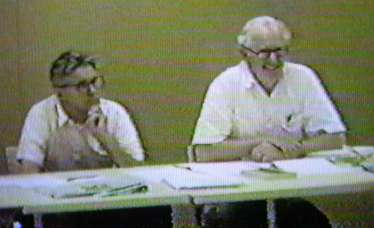
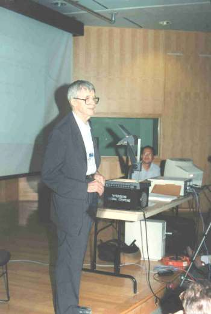
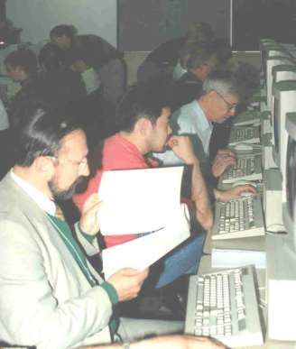
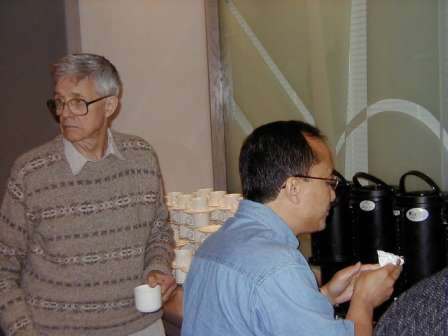

by Michel Dumontier
{ .byline }

An earlier version of this article appeared in Les Nouvelles d’APL N°41.

## An Introduction to APL – and APLers

Although Ken Iverson and I both attended APL71 in Paris (so far the only international APL conference in France) we did not meet until much later.

Kenneth E. Iverson at an AFCET APL conference in Paris, 1983 on “Teaching, Computing and APL”, a subject always close to his heart.

I started with APL in 1969 at the Centre de Calcul Scientifique de l’Armement (CCSA) in Arcueil, at the Fort de Montrouge. There I met Gérard Lacourly and got his book *Informatique par téléphone* (Computing by phone), written with Philip S. Abrams.

After this meeting, at the annual SICOB show in La Défense, I was awe-struck by the APL demonstrations, particularly of linear algebra. I practised on the APL service from Maryland University in digraph mode, and later on a Sperry Univac service with APL characters, firstly on a Tektronix terminal and then on a timesharing APL terminal.

At that time, Gilles Martin worked at the Centre Interarmées de Recherche Opérationnelle (CIRO) quite close to the CCSA. We were both linear algebra specialists and swapped Fortran programs in this field. We lost touch with each other, then in 1974, I met Paul Braffort at the Centre de Réflexions sur le Futur in Arc et Senans during a symposium. Paul told me that Gilles Martin was also using APL…

Later I worked as expert on the international standard at the beginning in 1978 at AFNOR, the French standards association. Raymond Tisserand was then president of the APL group of AFNOR. There I met Gérard Langlet, Jean-Jacques Girardot and other members of the group, and found Gilles Martin again. I had already met Raymond when he worked with Guy Varin and G. Fustier at the National Research Institute in Computing and Automation (INRIA).

From 1982, I had the benefit of the IP Sharp Associates service, and was able to exchange emails with the standards group there. One connected by typing `)LOAD 666 BOX` from a connection kindly provided by the [Ecole Nationale Supérieure des Mines](http://www.emse.fr/) at Saint Etienne, thanks to Jean-Jacques Girardot.

For a long time I wanted to attend APL conferences but could find no sponsor, even though recommended by Raymond Tisserand at AFNOR in 1984. (Given the popularity of APL, no one will be astonished!) So I went at my own expense to all 14 of the conferences from 1985 to 2000.

Ken was not in Seattle at APL85. I had brought the alpha-omega notation workspace I had written specially for the Ampère WS1. This was a portable computer with an LCD screen. I had spent my holidays working on this at the SOFREMI society. The machine was dedicated to APL – it did nothing else. (Japanese delegates also presented their own machine.)

## Meeting Ken Iverson

I did not meet Ken Iverson until APL86 in Manchester. He came to our first ISO APL meeting on extensions. Until then, we had only corresponded. In 1985, The APL standard was published, Raymond Tisserand passed the torch, and Leroy Dickey became the new convenor of the APL standards group. We had decided to continue the work of standardisation on extensions to the language.

Ken was an affable man. We agreed to speak each in our own language, and that worked well: we wanted to be sure to express our ideas clearly.

He was always cordial with me; there are many examples of that. This one is close to my heart, on a subject on which we shared common ground, the J language.

Ken and Eugene McDonnell came to Princeton for a meeting on extending the APL standard. I spoke of the functionality I’d like to find in APL; without it I was hard put to express myself in mathematics. In APL then there were only 5 operators, which took primitive functions as arguments, from which to derive new functions. I wished we could define our own operators, and that they would modify defined as well as primitive functions. Complete freedom… This would entitle APL to one of its numerous acronyms, devised at Manchester in one of those famous conference games: the ‘Art to Program in Liberty’! (This may be true compared to Pascal, one of the most restrictive languages I knew at that time — but it’s all relative…)

Eight months later, in answer to one of my letters, Ken wrote to me of his plans since Princeton. He had not only met my demands, but gone much further, starting from his previous work *A Dictionary of APL*. He was very attached to teaching APL, as the letter below shows.

> Apt. 405  
> 70 Erskine Avenue  
> Toronto, Ontario  
> Canada M4P 1Y2
>
> April 20, 1990
>
> Dear Michel:
>
> Thanks for your letter of March 1. Your news about the state of APL in France was depressing but not surprising, since the same seems to be happening here. In particular, I.P. Sharp Associates (since being bought by Reuters) appears to be moving away from the use of APL as quickly as possible, and most of the experienced APL people (such as Bob Bernecky and my son Eric) have already left the company. Furthermore, the situation of APL in education is about as bad here as you say it is in France.
>
> However, I am not discouraged. Since retiring from Sharp, I have concentrated on defining a simpler and more powerful version of the language, and developing an implementation in C that can be ported to a wide variety of machines and be distributed as Freeware. Moreover, the system uses a simple spelling scheme that uses only ASCII characters, and avoids all of the character-set problems that you pointed out in your letter. By this means, I hope to make APL easily available to schools and, perhaps more importantly, to get it into the hands of young people working outside of the school system.
>
> I enclose a copy of a paper on these matters that will be presented at APL90 in Copenhagen. I would be pleased to receive any comments that you have, and hope to see you at the conference.
>
> As to any help or advice on coming to Canada to work, I do not believe that I can offer you anything useful. Since retiring from Sharp, I have no affiliations of\* contacts that could be useful. Moreover, as I said, the state of APL here seems to be no better than in France. However, if you can afford the time to work on treatments of mathematical topics in APL for use in schools or in independent study, I would be pleased to collaborate in any way possible.
>
> I was sorry to hear the news of Gilles Martin. I do hope that I will see you at APL90.
>
> Yours truly,
>
> Ken

\*<i>sic</i> Ed.

I need hardly say how gratified I was to receive this letter, and my reply could not but show my pleasure at his asking me for comments. Of course, I went to APL90. The paper he had written of is nothing but “APL\\ ?”: the extension of APL to anything you want, no limits. That is, of course, the J language.

Ken Iverson and Eugene McDonnell at the APL ISO meeting at Princeton University in 1989

After the conference, I asked him why he named it J, and proposed: is it because the J letter is placed between I and K (Ken Iverson) and the language K already exists? Moreover, the letters H, I, J and K are in order — H for Roger Hui, who did the development in C he mentioned. He answered that it was Roger who chose J as the key we have the best chance of finding on the keyboard with closed eyes! Moreover, it is has an embossed mark for the blind.

Searching systematically in the various SHARP APL libraries, I found a library of Ken’s workspaces containing `MODEL` and further `MODEL7051`… The main function was simply: `APL`.

I told him by email in January 1986 that I had discovered this workspace and used it. I had read in *APL Quote Quad* (16.2, December 1985, page 35) of his visit to Finland in May 1985 and his two conferences, one on his paper “A Dictionary of the APL Language”, the other on teaching programmers how to take advantage of APL in applied mathematics. I asked him if he would give me the texts of those conferences.

> In his new terminology each constant is a ‘noun’, each variable is a ‘pronoun’, each function is a ‘verb’, and each operator is an ‘adverb’. Many of the ideas of Dr Iverson looked very promising as tending to clarity, simplicity, and consistency. Comparing his new syntax and APL2 he made some very critical remarks about allowing so many exceptions and vague concepts in APL2.

Ken Iverson at APL97, Toronto

I should contrast this review with my memory, some years later, of the extension of the APL standard heading “dangerously” towards APL2. I recall a lively discussion on this topic at Hellerup during an APL ISO meeting just after APL90. E. McDonnell and I were of the same mind… as would Ken have been had he been there!

Ken left me only good memories. He always helped me with information I wanted and always encouraged me. To quote a few examples, before it was sold, he gave me all the J versions I needed and also the SHARP APL version and documentation; he encouraged me to give the J tutorial at APL94 in Antwerp, where he gave me the latest J version for Windows. (I had bought the previous non-updated version). He kindly accepted the translations into French I made of *Tangible Math* and *Programming in J*. He even wished me a retirement as happy as his! (I shall try!)

There have been many tales of his ready and surprising wit on intellectual points. One evening in a restaurant (at Princeton, if I remember correctly) he was kind enough to join us at what had become the French table. He was facing me, Gérard Langlet was on my left and Jean-Jacques Girardot was opposite Gérard. During the discussion, we introduced a poser an examiner had set a candidate for the Polytechnic School: to calculate the product (x-a)(x-b) … (x-z).

Those without presence of mind begin the development at once. We were astounded (and surprised!) by the immediate and absolutely exact answer he wrote on a paper napkin: `Xâ↑⍫x â⍱← Aâ↑⍫a,b,c,…,z` the product is `Yâ↑⍫├⌈/X-A`

In his turn, he was surprised when we told him that the result was 0 since the series contains the factor (x-x). But bravo for the answer anyway — exact and fast!

I last saw Ken Iverson in Toronto at APL97.

<table style="width:100%">
	<tr valign="top">
		<td>
			

Creating pictures in Cliff Reiter’s J workshop at APL97. The author is in the foreground.

		</td>
		<td>
			

Ken Iverson and Roger Hui in Toronto at the J2000 conference, by kind permission of Ellis Cave.

		
</td>
	</tr>
</table>
