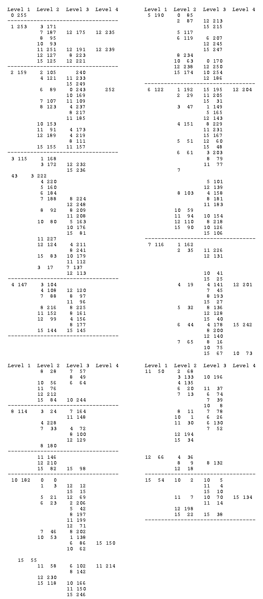

*by Ted Emms*
{ .byline }

I read the article “Cows and Bulls” (Education Vector, July, 1993) and got hung-up on the challenge in the last paragraph. I concentrated on the `4 COWBULL 4` case, which turned out to be a wise move since my first efforts kept informing me that I was out of memory. First let me give you an example of a RUN, where the correct solution is CABC:

```
       INTRO
                BULLS & COWS
                ============
 From the letters ABCD you choose a "word" composed of 4 letters, e.g. BCAD
or BBCB. The computer attempts to guess the "word". To each guess given by
the computer you respond with the number of bulls (correct letters in
correct places) and the number of cows (correct letters in incorrect
places).

 You input the two numbers together. Thus if the number of bulls is 2 and
the number of cows is 0, you input 20 and press <RET>.

 The computer arrives at your "word" in as few attempts as possible.

 Make your choice ready to play...

Guess No.1 is AABC Bulls and Cows (two nos. to be inputted together)? 30
Guess No.2 is ADBC Bulls and Cows (two nos. to be inputted together)? 21
Guess No.3 is AABD Bulls and Cows (two nos. to be inputted together)? 20
Guess No.4 is BABC Bulls and Cows (two nos. to be inputted together)? 30
Guess No.5 is CABC Bulls and Cows (two nos. to be inputted together)? 40
----------------------- It took 5 moves to find CABC ---------------------
```

The problem is solved in five gos. Most problems are solved in four and a few in less than that. The program is run by calling INTRO. This calls the routines INIT, INIT1, INIT2, INIT3, INIT4, INPUT and PLAY. I will explain those later, but first let me say how I approached the problem.

With the four letters ABCD to be used in four positions this gives 256 possible goals or targets. I decided to work with numbers rather than letters so I used the vectors 0 0 0 0 and 0 0 0 1 ... up to 3 3 3 3. The possible replies (BULL,COW) to testing a T(RY) against a G(OAL) can be 00, 01 etc. up to success which is 40. I decided to work with a V(ALUE) defined by `V←5×BULL+COW`. The vector `C←0 1 2 3 4 5 6 7 8 10 11 12 15 20` gives all the possible values of V. The routine `G TEST T` (see Appendix 2) is straightforward and corresponds to the approach in the original article with one slight difference. To get the COW score I have used the membership function.

There are 256 possible goals. Suppose we have (by applying tries) reduced the number of possible goals to be investigated to just a few. We will take a simple example putting `K←23 42 71 197 199 206`. `K` is a vector holding those possible numbers. If we try the numbers `K` against the first of these by repeated application of `23 TEST T` we will get a series of results (Vs). In this particular case we would get `20 5 12 8 11 3`. Indeed if we repeat this for the other numbers we get the table:

```
   G\T  23  42  71 197 199 206
     -------------------------
  23    20   5  12   8  11   3
  42     5  20   1   1   1   6
  71    12   1  20  12  15   7
 197     8   1  12  20  15  10
 199    11   1  15  15  20  11
 206     2   6   6  10  11  20
```

Note that the table is not symmetrical about the diagonal which arises from the fact that `X TEST Y` is not necessarily equal to `Y TEST X`.

From the table we see that if T=23 each G gives rise to a different V. In the case of T=42 there are just four different Vs with V=1 being repeated 3 times. With T=199 we get four different Vs with both V=11 and V=15 being repeated twice.

We need a criterion for the best choice of T. We want the T which gives rise to the greatest number of different Vs. (This is akin to the divide-and-conquer technique used in search procedures.) If there is a tie then we choose between the contending Ts by choosing the T having the minimum number of repeats. I have, arbitrarily selected a parameter given by `((No. of different Vs)*2)÷(No. of repeats)` to make that selection. I wrote a routine BEST (not listed) to work this all out, which (eventually) gives the result that the best T is 6 (this corresponds to AABC in letters).

Having got the best T there remains the problem of finding out what possible numbers remain for each of the possible Vs. For this I wrote another program RG (also not listed), which works with K having first been specified. Thus if we wish to know the Gs still possible after the first guess (T=6) we specify K as `K←¯1+⍳256` and call RG. When it asks for the try you input 6 and the program gives the answers, albeit slowly. Using routines BEST and RG in an orderly fashion we can build up a table giving a tree-like structure of what T should be used given a V. The results are listed in Appendix 1.

Thus if your nominated “word” is 235 then when the first try is 6 you should get V=1. Looking at V=1 in level 1 we see that the next try should be T=253. This will give a response 7, so from level 2 we see we should put T=187. This gives V=12 and the table tells us to use T=175 in the next guess. The table gives V=12 and we respond with T=235 which is recognised (V=20) as the original “word”.

Having done all the hard work there now remained the task of writing the proper program using the information in the table. But how does one enter a tree in APL? I confess I thought about this for some time and finally came up with a solution. Whether it is the “correct” way I don’t know.

I put the 13 T values in level 1 (255 253 159...) as a vector X. For V=1 in level 1, I took the 13 T values in level 2, (0 0 0 171...) and defined a vector X1 (i.e. X and the V of level 1). Similarly X17 (1 for level 1, 7 for level 2) I defined as the 175 in the V=12 position. i.e. `X17←(11⍴0),175`. Finally in column 4 I defined X17C as 235 in the V=12 position (the C in X17C means 12 using hex notation). Using this method I created all the vectors contained in INIT1, INIT2, INIT3 and INIT4. I had to use 4 routines to contain all the information to overcome the limitation of only 30 program lines. Finally I wrote the proper program, PLAY!

If there is a better way to handle trees I should appreciate hearing about it.

### Appendix 1

## 

### Appendix 2 – Program Listings

```
[0]   INTRO
[1]   '               BULLS & COWS'
[2]   '               ============'
[3]   ' From the letters ABCD you choose a "word" composed of 4 letters,'
[4]   'e.g. BCAD or BBCB. The computer attempts to guess the "word".'
[5]   'To each guess given by the computer you respond with the number'
[6]   'of bulls (correct letters in correct places) and the number of cows'
[7]   '(correct letters in incorrect places).'
[8]   ''
[9]   ' You input the two numbers together. Thus if the number of bulls is'
[10]  '2 and the number of cows is 0, you input 20 and press <RET>.'
[11]  ''
[12]  ' The computer arrives at your "word" in as few attempts as possible.'
[13]  ''
[14]  '  Make your choice ready to play...'
[15]  2 1⍴' '
[16]  ' Press <RET> when ready....'
[17]  ⍞
[18]  5 1⍴' '
[19]  INIT
[20]  PLAY
```

```
[0]   PLAY
[1]   CNT←1
[2]   T←6
[3]   D←'X'
[4]  LPPLAY:' '
[5]   'Guess No.',(⍕CNT),' is ',E[1+F⊤T]
[6]  IN: INPUT 'Bulls and Cows (two nos. to be inputted together)? '
[7]   →(2≠⍴I)/ERR
[8]   V←(⍎I[2])+5×⍎I[1]
[9]   →(V=20)/SUCC
[10]  M←⍎D
[11]  T←M[C⍳V]
[12]  D←D,A[C⍳V]
[13]  CNT←CNT+1
[14]  →LPPLAY
[15] SUCC:
[16]  28⍴'-'
[17]  'It took ',(⍕CNT),' moves to find ',(⍕E[1+F⊤T])
[18]  28⍴'-'
[19]  →0
[20] ERR: 'Incorrect input - try again!'
[21]  →IN
```

```
[0]   INIT
[1]   D←'X'
[2]   T←6
[3]   F←4⍴4
[4]   C←0 1 2 3 4 5 6 7 8 10 11 12 15
[5]   A←'012345678ABCF'
[6]   E←'ABCD'
[7]   M←255 253 159 115 147 190 122 116 114 182 50 66 54
[8]   INIT1
[9]   INIT2
[10]  INIT3
[11]  INIT4
```

```
[0]   INIT1
[1]   X←255 253 159 115 147 190 122 116 114 182 50 66 54
[2]   X0←255 0
[3]   X1←0 0 0 171 0 0 0 187 95 93 251 127 125
[4]   X17←(11⍴0),175
[5]   X17C←(11⍴0),235
[6]   X1B←(11⍴0),191
[7]   X1BC←(11⍴0),239
[8]   X1C←(11⍴0),223
[9]   X1F←(11⍴0),221
[10]  X2←0 0 105 0 121 0 89 107 123 153 91 189 155
[11]  X22←240 0
[12]  X24←(10⍴0),233 0 249
[13]  X26←243 0 0 0 0 0 0 0 0 169
[14]  X27←(10⍴0),109
[15]  X28←0 0 0 0 237 0 0 0 217 0 185
[16]  X2B←(4⍴0),173
[17]  X2C←(4⍴0),219 0 0 0 111
[18]  X2F←(10⍴0),157
[19]  X260←(11⍴0),252
[20]  X3←0 168 0 172 220 160 184 188 92 80 227 124 83
[21]  X33←(11⍴0),232 236
[22]  X37←(8⍴0),224 0 0 248
[23]  X38←(8⍴0),209 0 208
[24]  X39←(11⍴0),209 0 208
[25]  X3A←(5⍴0),163 0 0 0 176 0 0 81
[26]  X3C←(4⍴0),211 0 0 0 241
[27]  X3F←(9⍴0),179 112 113
```

```
[0]   INIT2
[1]   X4←0 0 0 104 108 0 0 88 216 0 152 99 144
[2]   X44←(11⍴0),120
[3]   X47←(8⍴0),97 0 96
[4]   X48←(8⍴0),225
[5]   X4B←(8⍴0),161
[6]   X4C←(4⍴0),156 0 0 0 177
[7]   X4F←(12⍴0),145
[8]   X5←85 0 87 0 0 117 119 0 234 63 0 238 174
[9]   X52←(11⍴0),213 215
[10]  X56←(6⍴0),207 0 0 0 0 245 247
[11]  X5A←170 0
[12]  X5C←(11⍴0),250
[13]  X5F←(9⍴0),254 0 186
[14]  X6←0 192 29 47 151 51 61 43 103 59 94 110 90
[15]  X61←(12⍴0),195
[16]  X61F←(11⍴0),204
[17]  X62←(10⍴0),205 0 31
[18]  X63←0 149 0 0 0 165 0 0 0 0 0 143
[19]  X64←(8⍴0),229 0 231 0 167
[20]  X65←(11⍴0),60 48
[21]  X66←0 0 0 203 0 0 0 0 79 0 77
[22]  X67←0 0 0 222 0 101 0 0 0 0 0 139
[23]  X68←0 0 0 0 158 0 0 0 181 0 183
[24]  X6B←(9⍴0),154
[25]  X6C←(8⍴0),218
[26]  X6F←(9⍴0),126 0 0 106
```

```
[0]   INIT3
[1]   X7←0 162 35 17 19 32 44 65 28 56 76 212 84
[2]   X72←(10⍴0),226 131
[3]   X73←(7⍴0),137 8 41 0 0 25
[4]   X74←0 0 0 0 141 0 0 45 193 0 0 0 27
[5]   X744←(11⍴0),201
[6]   X75←(8⍴0),136 0 0 128 40
[7]   X76←0 0 0 0 178 0 0 0 200 0 0 140
[8]   X764←(12⍴0),242
[9]   X77←(8⍴0),16 75 0 0 67
[10]  X77F←(9⍴0),73
[11]  X78←(7⍴0),57 49
[12]  X7A←(6⍴0),64
[13]  X7F←(9⍴0),244
[14]  X8←0 0 0 24 228 0 0 33 180 0 146 210 82
[15]  X83←(7⍴0),164 0 0 148
[16]  X87←0 0 0 0 72 0 0 0 100 0 0 129
[17]  X8F←(12⍴0),98
[18]  XA←0 3 0 0 0 21 23 46 0 53 58 230 118
[19]  XA1←(11⍴0),12 15
[20]  XA5←(11⍴0),69
[21]  XA6←0 0 206 0 0 42 0 0 197 0 199 71
[22]  XA7←(8⍴0),202
[23]  XAA←0 138 0 0 0 0 86 0 0 62 0 0 55
[24]  XAA6←(12⍴0),150
[25]  XAB←(6⍴0),102 0 142
[26]  XAB6←(10⍴0),214
[27]  XAC←(11⍴0),230
[28]  XAF←(9⍴0),166 150 0 246
```

```
[0]   INIT4
[1]   XB←0 0 68 133 135 0 20 13 11 1 30 194 34
[2]   XB3←(9⍴0),196
[3]   XB6←(10⍴0),37
[4]   XB7←(6⍴0),74 39 0 8
[5]   XB8←(7⍴0),78
[6]   XBA←(6⍴0),26
[7]   XBB←(6⍴0),130 52
[8]   XC←0 0 0 0 36 0 0 0 9 0 0 18
[9]   XC8←(8⍴0),132
[10]  XF←(9⍴0),2 7 198 22
[11]  XFA←(9⍴0),5 4 0 10
[12]  XFB←(9⍴0),70 14
[13]  XFBA←(12⍴0),134
[14]  XFF←(12⍴0),38
```

```
[0]   INPUT R
[1]   ⍞←R
[2]   I←(⍴R)↓,⍞
```

```
[0]   G TEST T
[1]   AA←F⊤G
[2]   BB←F⊤T
[3]   BULLS←+/I←AA=BB
[4]   AA←(~I)/AA
[5]   BB←(~I]/BB
[6]   COWS←+/BB∊AA
[7]   V←COWS+5×BULLS
```

(webpage generated: 5 December 2005, 19:02)
