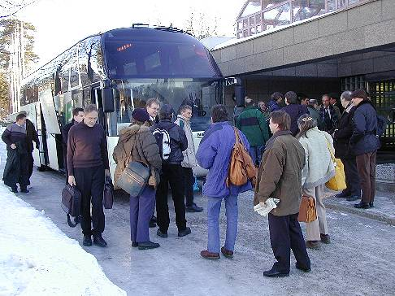
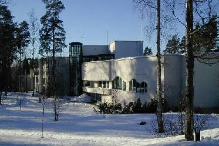
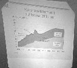
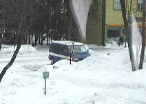
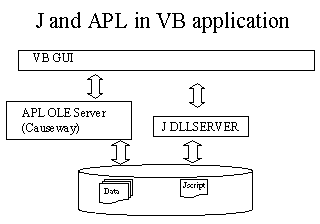
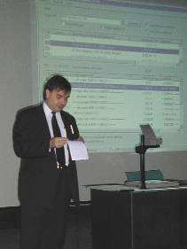
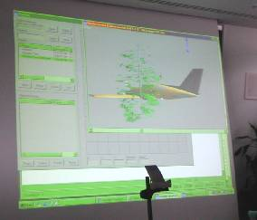
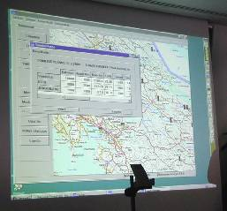
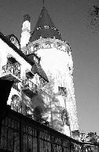
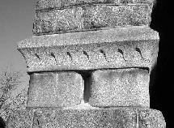

*reported by Adrian Smith (adrian@causeway.co.uk)*
{ .byline }

*“The official language of this conference is APL”* Arto Juvonen opening the seminar.

## Journey and Welcome

It has become a tradition of the Finnish APL group to gather every spring for a technical seminar on APL-related topics. This year they were a little more adventurous than usual and held the meeting at a splendidly Art Deco hotel a mere 6km from the Russian border.

{ width="486" height="364" }  
**Arriving at the hotel**

The weather was not quite as severe as one might have hoped – only just below freezing with very little new snow. However the venue was very comfortable, the food and sauna was just what you expect from a Finnish trip (excellent), and the APL was consistently interesting and well presented. Many speakers worked partially in English, and most of the other papers had sufficient visuals that there was benefit in simply watching the systems being demonstrated, or in reading the diagrams. Of course from a personal point of view, it was great to meet a bunch of keen, committed developers who are adding to APL’s installed application base with well-crafted professional systems.

## The Hotel and Seminar Facilities

The hotel was of the big, solid stone kind with immensely wide, shallow stairs and splendidly cavernous hallways. By contrast, the seminar facility was modern and well thought-out, with comfortable sitting-out areas.

{ width="372" height="248" }  
**Seminar facility viewed from the hotel**

Video-projection was very good, and the 40 or so attendees were able to spread themselves around the tables where everyone could see and hear. There were lots of breaks for coffee and cakes – essential to the success of any technical meeting where people must have the chance to talk as well as sit and listen.

## The Papers – Day One

### Actuarial Forecasting Methods *Lasse Koskinen*

{ width="151" height="133" } This was one of the few papers given entirely in Finnish, but it is so long since I worked with pension data that I probably would have missed most of the technical points anyway. The graphs were interesting though, and gave slightly more weight to my suspicion that a lot of pension funds are in deep trouble and are wondering how to start spinning the message to their subscribers.

The mortality curves which Lasse showed have moved a long way to the right since I last draw these charts (back in 1979), and the contribution curves have moved left, as everyone expects to retire at 60, or even 55. Interest rates are way down, so the compound effect of a shorter payment period, longer-living pensioners and low capital growth makes me wonder how long this system can keep going! And no, I never did ask Lasse what that bump in his graph was ... maybe it was the war?

### Modernisation of the timeseries information systems at Tilastokeskus *Jaakko Laasko and Veli-Matti Jantunen*

Statistics Finland is responsible for a massive database of economic trends data comprising some 50,000 series and around 60,000 lines of text. This is moving from an old mainframe database into a modern Windows-based information system. The system is being redeveloped in Dyalog APL and relies heavily on the tree-control to make sense of the vast hierarchy of data series which previously were accessible only after a long trawl through trees of mainframe menus.

It was also good to see some nice RainPro charts, well integrated into the system, and to find an eager volunteer to help me build proper phrase-table support into the RainPro viewer.

### Vector Markup Language and APL Graphics *Adrian Smith*

Rather late in the day, the organisers found themselves with a free slot in the programme so they were subjected to a rerun of my VML talk from Orlando. The full paper is included immediately following these notes, but it is worth mentioning that JASC (the PaintshopPro people) are working on a design tool for SVG (the proposed successor to VML) which gives me rather more confidence that SVG will happen. If you read my VML notes, you will begin to see why I think that this would be a very good thing, and would make RainPro’s life much easier! See [www.w3c.org](http://www.w3c.org) for the latest news and [www.jasc.com](http://www.jasc.com) to download a trial version of their ‘Trajectory’ SVG design tool.

### Modelling Blackjack with APL *Ian Clark*

{ width="212" height="151" }Once again, we have the full paper for you to read, following these notes. We also have a photo of Ian’s van, snapped by your intrepid Vector newshound at its most northerly location yet!

Yes, Ian *drove* to Imatra! Makes us wimps who took train, plane and bus feel pretty sheepish.

## The Papers – Day Two

### Improving APL Performance with J *Anssi Seppälä*

For me, this was by far the most stimulating session given at the conference. I am reminded of Jim Sinclair’s comment at Orlando “If you are coding in the right sweet-spot for the language, you are incredibly productive”.

{ width="320" height="224" } Anssi works with the electricity supply industry in Finland – we saw his load monitoring and forecasting (straight Dyalog/Causeway/RainPro) system at Lancaster in 1996.

His more recent work has been directed towards the statistical analysis of the quality of the electricity supply (e.g. of timeseries of noise in the networks) which is written in VB with both Dyalog APL and J acting as OLE servers. The Dyalog server is simply to allow him to drive NewLeaf as a reporting tool, but the J server is much more interesting.

The ‘quality’ of the supply is measured by a series of arcane equations which must all be faithfully replicated from the appropriate government documents. Rather than attempting to code these in VB (horrible thought!) Anssi has simply defined a collection of J verbs (like ‘sum’ and ‘mean’ and several much harder ones) which taken together form a ‘little language’ which is specifically designed for the expression of electricity supply quality. Then he can simply give his users a crib-sheet for the language and they can use Notepad to maintain the equations themselves!

With some minor irritations (“Divide – that crazy % thing”) this works really well. The J scripts are both the documentation of the algorithm and the working program; version control is easy and the J project management helps a lot, as the same script can be in several systems, but only gets changed in one place. Anssi commented “the more I can work with text files, the easier it is – I am no longer a fan of the APL workspace”.

### Reporting and control in the Finnish Health Service *Richard Eller and Wang Xiao Bei*

It would be good to have a comprehensive write-up of this system in English! Richard outlined a very complex APL+Win application which was used for invoice matching where the health service had subcontracted laboratory testing.

{ width="211" height="281" }The gui design was highly complex, as it reflected all the problems inherent in allocation and distribution of invoices, and the subsequent attempts to match payments which might be spread across several invoices.

The system design was made much more ‘interesting’ by the earlier involvement of IBM who had used this as a major pilot project for Lotus Notes. This left the APL system fronting up a humungous Notes database, and the (unsaid) impression was that the database architecture was a classic of an imposed technical solution which was totally unfit for the problem it had been used to solve. As always, the APL systems on show were very reliable, it was Notes that collapsed in a very messy heap and required a full system reset so that the demo could continue!

### Decision-making algorithms in a virtual world *Tomas Gustafsson*

This was one of those talks which could just be appreciated visually rather than technically, although the underlying design is part of a serious system. { width="284" height="243" }The slide shows a small aeroplane with a tree growing out of one wing – the whole thing spinning contentedly around in real time.

Tomas’s real application is harbour simulation, and the serious APL interest is in modelling the decision-process of pilots and captains when faced with hazards. This can lead to much more genuine (simulated) reactions of the computer-controlled vessels when faced with threats such as on-coming tankers. However the fun part was APL driving a 3D OCX (unfortunately the company where Tomas found this has gone very quiet of late, so his ‘trial version’ may be the last?) which allowed you to build 3D models very simply and then rendered them for you extremely fast.

### Managing timber movement with APL and MapX *Juha Sundström*

{ width="257" height="239" } This was a set of simple ideas put together in a very effective way to make a nice robust application. The basic idea is that you click on the map to fire off a database query, which can tell you lots of useful information about the timber located in that part of the forest.

Hopefully the screen-snap gives you some idea of the style of the system – for more background on the exact relationship between MapX, APL, Oracle and the Unix scripts which glue it together, we must wait for an English translation. Sorry!

## Summary and Acknowledgements

{ width="144" height="222" } For me, it was on almost all counts a worthwhile trip. The harder question is whether to recommend others to take the plane/boat to Helsinki to join the Finnish group next year (always assuming they keep the tradition going).

In some ways, it is a little unfair on the Finns if too many visitors turn up, as several of the presenters felt obliged to offer simultaneous translation for the benefit of the handful of non-Finnish speakers in the audience. { width="215" height="158" }Clearly, this must reduce the value of the sessions to the locals, as it cuts the amount of material which can be covered in the time available.

On the other hand, we visitors were able to throw some interesting material into the pot, and also to answer a whole variety of APL-related problems, such as ‘why do I keep getting Dels and Deltas around my text vectors when I paste code into Word97?’ (*Answer – turn off smart quotes!*). I think it depends on the type of paper on offer – the more technical the material the less the language matters!

Finally, a personal ‘thank you’ to Kimmo and Anita Kekäläinen for giving Gill and me the run of their downstairs flat in Helsinki for Friday and Saturday nights. We spent a most enjoyable day in Helsinki on the Saturday, and even managed to persuade the nice girl on the Finnair check-in that it was OK to take a couple of Reindeer skins home in hand-luggage.

***
