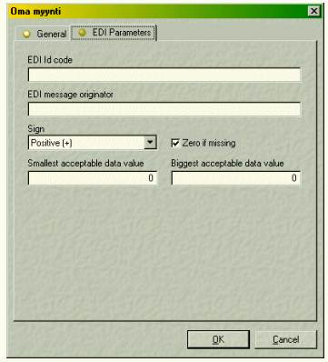

*by Tomas Gustafsson ([weis@sci.fi](mailto:weis@sci.fi))*
{ .byline }

*\[Ed: This paper uses the APL2741 font, which you can [download](resource/apl2741.zip)\]*.

“In that dialog box there, please insert an edit field for Age between Date of Birth and Id Card Number”…

The product support guy who said that did probably not realise the impact his words would cause on the program code for this almost completed application. All the GUI pieces were already in place, all the column keys in the relational database system were set, all the links and validation routines in between were functional, etc. etc. Now the coder has among others to:

- Make space for that new edit field in the page in that PropertySheet, by moving all GUI components below or to the right a number of pixels down or aside (remember consistent sizing, spacing in between, margins etc!).
- Make the code that creates the new field; give the field a name and maybe allocate a place for that name in a name collection variable.
- Modify the form population code to include this new field.
- Add code that validates this field, so that the user cannot enter an age of 200 or -5.
- Maybe add code that keeps track of the Date of Birth field's contents, to automatically calculate the content of this new field by comparing age and the current time.
- Add a new column for Age in the database table.
- Re-create that table or modify it manually if it happens to already contain nice data for current testing purposes, data that the coder does not want to get rid of yet.
- Modify the code that creates all necessary database tables upon program start, i.e. when the end user runs the system for the first time.
- In fact, do modifications to “a thousand” places which use the employee profile sheet that the new Age field is a part of.

In particular, the naming of a GUI object in combination with keeping track of its contents may cause headaches in APL (and indeed in other languages as well). APL provides a naming syntax that we know well, for this new field it could be for example (in Dyalog APL):

```
MainForm.EmployeeForm.SubForm1.EditField_Age
```

But if the application allows several instances of EmployeeForm to be open simultaneously, we can no longer refer to the Edit field easily; we would have to use something like

```
:With MainForm.EmployeeForm_instancenumber
    SubForm1.EditField_Age
:End
```

or

```
MainForm.(variable_form_reference).SubForm1.EditField_Age
```

or

```
(reference_to_the_first_three_forms).EditField_Age
```

All of above feel quite impractical to use when a GUI object is referred to numerous times. `:With` and `:End` are highly practical but only for a limited number of “flat” cases. Variable form references are very useful… but one never really knows where all the GUI objects that make a full data definition actually reside. There may be Splitter objects that force the use of additional SubForms, a property sheet holds pages that themselves are SubForms, a SubForm may contain additional SubForms for the purpose of grouping or fixing GUI element locations and eventually there may be Groups or other objects that all affect the object hierarchy. The full path to a GUI object like an Edit field is likely to change during code development and in fact my opinion is that APL code should never be based on using direct names to GUI elements.

In fact, I think we really would not like to bother ourselves with details such as “What is the name of that Edit field?” or “What caused its correct positioning?” or “When do I need to read its Text property?”.

Instead, I would like to say, assuming I am to create a propertysheet for editing the parameters of an “Employee” object in my application:

1. Create a propertysheet with tabs Identification, Address and Duty.
2. On the first tab, put fields for Code, Name, Date of Birth, Age, Id Card Number and Comments. On the second tab, put fields for Mail Address, Street Address and Phone Number. On the third tab, put fields for Position, Supervisor, Salary.
3. Ensure that the contents of the data fields is updated and easily accessible at any time.
4. Make it easy for me to maintain a link between the database and the GUI.
5. Make it look good!

The proposed solution starts with defining a structure. Everything else, like form creation, database creation, data retrieval is based on this structure. Using the example above, our structure would look like this:

*\[Code\]\[Name\]\[Date of Birth\]\[Age\]\[Id Card Number\]\[Comments\]\[Mail Address\]\[Street Address\]\[Phone Number\]\[Position\]\[Supervisor\]\[Salary\]*

As Dyalog APL uses namespaces, what could be more convenient than using a namespace that holds the data for an Employee object at any time? We could call the namespace #.EMP. At any time, no matter if we work in a propertysheet or just use the data for other processes, we could have variables by keys, like

<table>
<tr><td>#.EMP.Code</td><td> (always contains the short-code of the employee)</td></tr>
<tr><td>#.EMP.Name</td><td> (always contains the name of the employee)</td></tr>
<tr><td>#.EMP.DateOfBirth</td><td> (contains the IDN value…)</td></tr>
</table>

That is, instead of referring to the Text property of the Edit field for “Name”, we create APL code that updates the value of the `#.EMP.Name` variable whenever the user changes the corresponding field. This technique gives us a number of advantages:

1. The form creation functions can use the structure keys to automatically create appropriate data entry controls.
2. There is no need to know where the Edit field for a key actually resides, or what its name is. Callback code behind each control ensures that the control value is reflected into the namespace variables.
3. If we have a “default values” vector for a structure, we can fill the form with default values in the case of a “new employee”.
4. As we have default values for each key, we can determine when a GUI control holds a non-default value.
5. The structure can be used to create the corresponding table in the database; the keys are columns and the records are rows.

## Defining the structure

A sample structure definition function:

```
[0]  Set_EMP;a
[1]
[2]  ⍝ IDENTIFICATION
[3]   a←,'Code' '' ' adVarWChar'
[4]   a,←'Name' '' 'adVarWChar'
[5]   a,←'DateOfBirth' 0 'adInteger'
[6]   a,←'Age' 0 'adInteger'
[7]   a,←'IdCardNumber' 0 'adInteger'
[8]   a,←'Comments' '' 'adVarWChar'
[9]
[10] ⍝ ADDRESS
[11]  a,←'MailAddress' '' 'adVarWChar'
[12]  a,←'StreetAddress' '' 'adVarWChar'
[13]  a,←'PhoneNumber' '' 'adVarWChar'
[14]
[15] ⍝ DUTY
[16]  a,←'Position' '' 'adVarWChar'
[17]  a,←'Supervisor' '' 'adVarWChar'
[18]  a,←'Salary' 0 'adDouble'
[19]
[20]  a←(⌽3,(⍴a)÷3)⍴a
[21]   :With '#.EMP'⎕NS''
[22]       h def ado←↓[1]a
[23]       Get←{⍎¨⍵}
[24]       a←⎕AV[4]
[25]       ⎕FX'∇R←All',a,'[1] R←⍎¨h',a,'∇'
[26]       Set←{⍺←h ⋄ ⍎(⍕⍺),'←⍵'}
[27]       Set def
[28]       #.S_EMP←0⌿,[0.1]def
[29]   :End
```

The function does the following:

1. Creates a namespace called `#.EMP`.
2. Creates a vector `h` of key names.
3. Creates a vector `def` of default values.
4. Creates a vector `ado` of datatypes for the ADO interface to the database engine.
5. Creates a dynamic function `#.EMP.Get` which can be used to retrieve values if the key argument is a text vector.
6. Creates a function `#.EMP.All` which returns a vector of all values for the data structure.
7. Creates a dynamic function `#.EMP.Set` which can be used to set values of the data structure if the key argument is a text vector.

At row 27 the structure elements are set with default values for the purpose of program code being able to immediately refer to any element of the structure without failing with a VALUE ERROR.

At row 28 the code creates a global variable, a matrix with zero rows, to hold instances of the structure. There are situations, where more than one instance of the structure will be present in the workspace simultaneously and those will exist as rows in `#.S_EMP` in a controlled manner.

The contents of the three control variables:

<table border="1" cellpadding="3" cellspacing="0">
<tr>
<td><b>h</b></td>
<td><b>def</b></td>
<td><b>ado</b></td>
</tr>
<tr>
<td>Code</td>
<td>[empty text]</td>
<td>adVarWChar</td>
</tr>
<tr>
<td>Name</td>
<td>[empty text]</td>
<td>adVarWChar</td>
</tr>
<tr>
<td>DateOfBirth</td>
<td>0</td>
<td>adInteger</td>
</tr>
<tr>
<td></td>
<td></td>
<td></td>
</tr>
<tr>
<td>Age</td>
<td>0</td>
<td>adInteger</td>
</tr>
<tr>
<td></td>
<td></td>
<td></td>
</tr>
<tr>-
<td>IdCardNumber</td>
<td>0</td>
<td>adInteger</td>
</tr>
<tr>
<td></td>
<td></td>
<td></td>
</tr>
<tr>
<td>Comments</td>
<td>[empty text]</td>
<td>adVarWChar</td>
</tr>
<tr>
<td>MailAddress</td>
<td>[empty text]</td>
<td>adVarWChar</td>
</tr>
<tr>
<td>StreetAddress</td>
<td>[empty text]</td>
<td>adVarWChar</td>
</tr>
<tr>
<td>PhoneNumber</td>
<td>[empty text]</td>
<td>adVarWChar</td>
</tr>
<tr>
<td>Position</td>
<td>[empty text]</td>
<td>adVarWChar</td>
</tr>
<tr>
<td>Supervisor</td>
<td>[empty text]</td>
<td>adVarWChar</td>
</tr>
<tr>
<td>Salary</td>
<td>0</td>
<td>adDouble</td>
</tr>
</table>

Also notice that the default values basically define the APL datatypes (numeric, text, vector, matrix etc.). For example, an Edit field supports several `FieldType`s which affect the name of the property to set and the value to pass to that property. Even though the form maintenance code explicitly sets the GUI control types, the values in `def` must match these types.

## Creating the database

The applications using this technique interface to the MS Jet database engine (the MS Access format) through the Windows ADO interface.

It is fairly straightforward to create the database. Essentially, the only things we need are the column keys (`h`) and the column datatypes (`ado`). Being however outside the scope of this story, we won’t discuss the ADO interface further.

## Creating the GUI elements

The GUI creation is the true place for automation. I use a single function to create to propertysheet forms, the calling syntax is for example:

```
[1] txt←'Identification' 'Address' 'Duty'
[2] #._WinHL.PropForm '#._F1' 100 'EMP' '' 0 txt
```

This will create a propertysheet with three tabs on it; “Identification”, “Address” and “Duty”. Additionally, the “OK” and “Cancel” buttons will be in place, and the form look and behaviour in general is set to one which is common throughout the application. The arguments to the function are a pointer to a namespace that contains the second part of the form creation functions plus callback handlers (if any) and form population function (if any), the name of the structure to use, and additionally some control parameters.

`#.SET` does the real job. Together with its callback handler `#.Hand_SET`, it does all the essentials. These sample rows (taken out of an other context) produces a tab page below:

```
[4] #.SET('^EDI Id code' '×Edit' '⋄EDICode')
[5] #.SET('^EDI message originator' '×Edit' '⋄Notifier')
[6] #.SET('^Sign' '×Combo' '⋄Sign' '|list_SIGN')
    ('_Zero if missing' '×Check'  ⋄ZeroFill')
[7] #.SET('^Smallest acceptable data value' '×Edit' '⋄LowerLimit')
    ('^Biggest acceptable data value' '×Edit' '⋄UpperLimit')
```

Important features of `#.SET`: { width="361" height="398" }

1. Gives a common look and feel on all GUI elements, on all tab pages and throughout the application, even throughout a family of applications.
2. GUI objects are automatically placed at appropriate positions. `#.SET` maintains a "vertical pixel counter" and locates several objects on the same row if so desired.
3. Data entry controls automatically reflect the current contents of the corresponding structure upon creation (data-awareness).
4. Changes in the data entry fields automatically get reflected into the structure.
5. Trapping of non-default values. This can be seen at the tab page headers; the “lamp on” means the tab field contains a non-default value somewhere, this visible page only holds default values.
6. Supports the most common GUI controls.
7. Re-used code.
8. Uses global settings for metrics; to change the spacing between controls **throughout the application**, one only needs to set a single value.

\#.SET uses identification characters in its arguments to determine the meaning of each single argument. For example:

<table>
<tr><td width="24"></td><td><tt>^</tt></td><td>	The label above the GUI control</td></tr>
<tr><td></td><td><tt>×</tt></td><td>	The field type</td></tr>
<tr><td></td><td><tt>⋄</tt></td><td>	The name of the structure key</td></tr>
<tr><td></td><td><tt>|</tt></td><td>	The name of the <tt>Items</tt> vector for a Combo</td></tr>
</table>

Each data entry control gets a callback command attached to it. That command is contructed to update the corresponding structure element. The philosophy here is essentially to avoid calling program code where possible, and instead let the GUI objects “take care of themselves” by giving them enough information in advance and, if required, attach data to them. For example, we could let the important objects respond to message number 1200 just to get them to acknowledge themselves.

## Using the structure without GUI

Commonly, the coder faces a situation where he originally did all the code with the assumption that there is a GUI form available. Then someone sets a requirement that the program shall run in "batch" or "server" mode without any visible GUI or without any user present to respond to messages etc.

Similarly, another part of the program may require the data from the definitions set in this first part. The use of structures makes it very easy to code the rest of the application. It does not matter whether the Employee form is visible or not:

- If it’s the “thing” currently active, `#.EMP` contains data for it.
- If another part defines the source data for the Employee, we simply set `#.EMP` elements to contain data retrieved for example from the database accordingly.

In both cases, the programmer may use convenient references as `#.EMP.Code, #.EMP.Name` etc. to get the essential employee data.

If other program parts use several references to employees simultaneously, for example if the user has two instances of a salary payment editing form opened, we may fill rows of a global variable with employee structures; one row for each invoice. At any time, `#.EMP` contains data for the currently active one, where “active” is defined either by user interface states like input focus, or simply by execution stages in code.

## Advantages with structures

Using a well defined structure as the core for object definition, regardless of whether it is a question of .INI-file keys and values or Employee or Invoice or similar objects, gives us a high degree of clarity, maintainability and ease of coding.

- We create the database on the basis of the structure.
- We get input form automation with common look and feel.
- At any time, we can retrieve the value of a structure element, even during code development from the APL explorer.
- We can describe practically anything using a structure, which is very easy to document and comment in code.
- We can easily “slot in” and “slot out” structures (records in a database table, rows in a two-dimensional matrix) with minimum effort.
- We can take advantage of the Dyalog APL dot-separated syntax. For example, `#.EMP.(Code Name Age)` returns a vector with three elements.

> Tomas Gustafsson 23.5.2001

***
