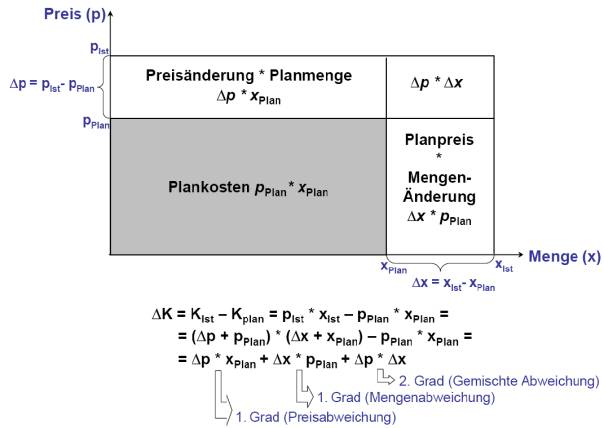

by Peter-Michael Hager (email: [hager@dortmund.net](mailto:hager@dortmund.net))
{ .byline }

Through its array functionality APL can treat masses of data, piled up in huge spreadsheets or databases, much more intelligently to generate meaningful perceptions, rather than just doing primitive operations such as column reductions.

## **Odd Man Out**

Spotting the ‘odd man out’, the exceptional figure in a mass of numbers, is a recurring task of management. A simple APL technique finds and highlights anomalous figures in arrays, where human eyes are likely to overlook them. By using these results to add colour, the tables immediately gain visual appeal.

In magazines there are sometimes intelligence test with questions like this:

<table border="1" cellpadding="6" cellspacing="0">
 <tbody><tr>
      <td valign="top">
        <b><i>Which number does not belong?</i></b>
<br>
        <br>
          
        <p><b><i>1001  
  996  1000  1005 
  2004   998   997  
  999  1004  1003</i></b></p></td>
 </tr>
</tbody></table>

**<a id="OLE_LINK1"></a>Table 1: Magazine’s level 1 IQ question**

Of course, it is easy to see that one number is twice as big as the others. Anyway, for us this indeed is a question APL can solve:

```
      IQuestion
1001 996 1000 1005 2004 998 997 999 1004 1003

      0⍕Normalize IQuestion
1 1 1 1 2 1 1 1 1 1
```

All we need for that is a little function which will average the values to 1. The rounding to whole numbers will then do the rest:

```
      Normalize←{(⍵×⍴⍵)÷+/|⍵}
```

You do not think it should have been necessary to ask APL for a solution? Then let’s take on the next level in the contest.

<table border="1" cellpadding="6" cellspacing="0">
 <tbody><tr>
  <td valign="top">
  
<p><b><i>Which number does not belong?</i></b></p>
  <br>
<p><b><i>    507    364  1196    689    611  1235      78    1001  1014  1079</i></b></p>
<p><b><i>      78      56    184    106      94    190      12      154    156    166</i></b></p>
<p><b><i>  2691  1932  6348  3657  3243  6555    414    5313  5382  5727</i></b></p>
<p><b><i>  3393  2436  8004  4611  4089  8265    522    6699  6786  7221</i></b></p>
<p><b><i>  2457  1764  5796  3339  5922  5985    378    4851  4914  5229</i></b></p>
<p><b><i>  2886  2072  6808  3922  3478  7030    444    5698  5772  6142</i></b></p>
<p><b><i>  2847  2044  6716  3869  3431  6935    438    5621  5694  6059</i></b></p>
<p><b><i>  3900  2800  9200  5300  4700  9500    600    7700  7800  8300</i></b></p>
<p><b><i>  3471  2492  8188  4717  4183  8455    534    6853  6942  7387</i></b></p>
<p><b><i>    936    672  2208  1272  1128  2280    144    1848  1872  1992</i></b></p>

  </td>
 </tr>
</tbody></table>

**Table 2: Magazine’s level 2 IQ question**

I hope you could find the non-matching number! Again APL can do it for you:

```
         Sales←(10?100)∘.×(10?100)
         Sales[5;5]×←2
         Sales
    507  364 1196  689  611 1235  78 1001 1014 1079
     78   56  184  106   94  190  12  154  156  166
   2691 1932 6348 3657 3243 6555 414 5313 5382 5727
   3393 2436 8004 4611 4089 8265 522 6699 6786 7221
   2457 1764 5796 3339 5922 5985 378 4851 4914 5229
   2886 2072 6808 3922 3478 7030 444 5698 5772 6142
   2847 2044 6716 3869 3431 6935 438 5621 5694 6059
   3900 2800 9200 5300 4700 9500 600 7700 7800 8300
   3471 2492 8188 4717 4183 8455 534 6853 6942 7387
    936  672 2208 1272 1128 2280 144 1848 1872 1992
```

```
         0⍕Normalize Sales
    1 1 1 1 1 1 1 1 1 1
    1 1 1 1 1 1 1 1 1 1
    1 1 1 1 1 1 1 1 1 1
    1 1 1 1 1 1 1 1 1 1
    1 1 1 1 2 1 1 1 1 1
    1 1 1 1 1 1 1 1 1 1
    1 1 1 1 1 1 1 1 1 1
    1 1 1 1 1 1 1 1 1 1
    1 1 1 1 1 1 1 1 1 1
    1 1 1 1 1 1 1 1 1 1
```

Imagine that the numbers in *Sales* are the revenues of item groups in several regions. Then this function will show, by colouring a table, that there were far more jackets sold in Germany, when compared to other regions. It would have been difficult to get that information just by studying the numbers.

<table border="1" cellpadding="4" cellspacing="0">
    <tbody><tr>
      <td bgcolor="white"><b>
  
       Region
  \ Items
    </b></td>
      <td bgcolor="#ff9bcd"><b>
  
       Pants
    </b></td>
      <td bgcolor="#ff67b3"><b>
  
       Jeans
    </b></td>
      <td bgcolor="#16ffff"><b>
  
       Shirts
    </b></td>
      <td bgcolor="#ffddee"><b>
  
       Skirts
    </b></td>
      <td bgcolor="#ffd8ec"><b>
  
       Jackets
    </b></td>
      <td bgcolor="aqua"><b>
  
       Suits
    </b></td>
      <td bgcolor="#ff0080"><b>
  
       Sweater
    </b></td>
      <td bgcolor="#84ffff"><b>
  
       Slippers
    </b></td>
      <td bgcolor="#7dffff"><b>
  
       Sneakers
    </b></td>
      <td bgcolor="#58ffff"><b>
  
       Socks
    </b></td>
    </tr>
    <tr>
      <td bgcolor="#ff3098"><b>
  
       Austria
    </b></td>
      <td bgcolor="#fcffff">
  
        507
    

      </td>
      <td bgcolor="#fcffff">
  
        364
    

      </td>
      <td bgcolor="#fcffff">
  
        1196
    

      </td>
      <td bgcolor="#fcffff">
  
        689
    

      </td>
      <td bgcolor="#ff0080">
  
        611
    

      </td>
      <td bgcolor="#fcffff">
  
        1235
    

      </td>
      <td bgcolor="#fcffff">
  
        78
    

      </td>
      <td bgcolor="#fcffff">
  
        1001
    

      </td>
      <td bgcolor="#fcffff">
  
        1014
    

      </td>
      <td bgcolor="#fcffff">
  
        1079
    

      </td>
    </tr>
    <tr>
      <td bgcolor="#ff0080"><b>
  
       Belgium
    </b></td>
      <td bgcolor="#fcffff">
  
        78
    

      </td>
      <td bgcolor="#fcffff">
  
        56
    

      </td>
      <td bgcolor="#fcffff">
  
        184
    

      </td>
      <td bgcolor="#fcffff">
  
        106
    

      </td>
      <td bgcolor="#ff0080">
  
        94
    

      </td>
      <td bgcolor="#fcffff">
  
        190
    

      </td>
      <td bgcolor="#fcffff">
  
        12
    

      </td>
      <td bgcolor="#fcffff">
  
        154
    

      </td>
      <td bgcolor="#fcffff">
  
        156
    

      </td>
      <td bgcolor="#fcffff">
  
        166
    

      </td>
    </tr>
    <tr>
      <td bgcolor="#c5ffff"><b>
  
       Denmark
    </b></td>
      <td bgcolor="#fcffff">
  
        2691
    

      </td>
      <td bgcolor="#fcffff">
  
        1932
    

      </td>
      <td bgcolor="#fcffff">
  
        6348
    

      </td>
      <td bgcolor="#fcffff">
  
        3657
    

      </td>
      <td bgcolor="#ff0080">
  
        3243
    

      </td>
      <td bgcolor="#fcffff">
  
        6555
    

      </td>
      <td bgcolor="#fcffff">
  
        414
    

      </td>
      <td bgcolor="#fcffff">
  
        5313
    

      </td>
      <td bgcolor="#fcffff">
  
        5382
    

      </td>
      <td bgcolor="#fcffff">
  
        5727
    

      </td>
    </tr>
    <tr>
      <td bgcolor="#53ffff"><b>
  
       France
    </b></td>
      <td bgcolor="#fcffff">
  
        3393
    

      </td>
      <td bgcolor="#fcffff">
  
        2436
    

      </td>
      <td bgcolor="#fcffff">
  
        8004
    

      </td>
      <td bgcolor="#fcffff">
  
        4611
    

      </td>
      <td bgcolor="#ff0080">
  
        4089
    

      </td>
      <td bgcolor="#fcffff">
  
        8265
    

      </td>
      <td bgcolor="#fcffff">
  
        522
    

      </td>
      <td bgcolor="#fcffff">
  
        6699
    

      </td>
      <td bgcolor="#fcffff">
  
        6786
    

      </td>
      <td bgcolor="#fcffff">
  
        7221
    

      </td>
    </tr>
    <tr>
      <td bgcolor="#ccffff"><b>
  
       Germany
    </b></td>
      <td bgcolor="#ff0080">
  
        2457
    

      </td>
      <td bgcolor="#ff0080">
  
        1764
    

      </td>
      <td bgcolor="#ff0080">
  
        5796
    

      </td>
      <td bgcolor="#ff0080">
  
        3339
    

      </td>
      <td bgcolor="aqua">
  
        5922
    

      </td>
      <td bgcolor="#ff0080">
  
        5985
    

      </td>
      <td bgcolor="#ff0080">
  
        378
    

      </td>
      <td bgcolor="#ff0080">
  
        4851
    

      </td>
      <td bgcolor="#ff0080">
  
        4914
    

      </td>
      <td bgcolor="#ff0080">
  
        5229
    

      </td>
    </tr>
    <tr>
      <td bgcolor="#a5ffff"><b>
  
       Great
  Britain
    </b></td>
      <td bgcolor="#fcffff">
  
        2886
    

      </td>
      <td bgcolor="#fcffff">
  
        2072
    

      </td>
      <td bgcolor="#fcffff">
  
        6808
    

      </td>
      <td bgcolor="#fcffff">
  
        3922
    

      </td>
      <td bgcolor="#ff0080">
  
        3478
    

      </td>
      <td bgcolor="#fcffff">
  
        7030
    

      </td>
      <td bgcolor="#fcffff">
  
        444
    

      </td>
      <td bgcolor="#fcffff">
  
        5698
    

      </td>
      <td bgcolor="#fcffff">
  
        5772
    

      </td>
      <td bgcolor="#fcffff">
  
        6142
    

      </td>
    </tr>
    <tr>
      <td bgcolor="#acffff"><b>
  
       Holland
    </b></td>
      <td bgcolor="#fcffff">
  
        2847
    

      </td>
      <td bgcolor="#fcffff">
  
        2044
    

      </td>
      <td bgcolor="#fcffff">
  
        6716
    

      </td>
      <td bgcolor="#fcffff">
  
        3869
    

      </td>
      <td bgcolor="#ff0080">
  
        3431
    

      </td>
      <td bgcolor="#fcffff">
  
        6935
    

      </td>
      <td bgcolor="#fcffff">
  
        438
    

      </td>
      <td bgcolor="#fcffff">
  
        5621
    

      </td>
      <td bgcolor="#fcffff">
  
        5694
    

      </td>
      <td bgcolor="#fcffff">
  
        6059
    

      </td>
    </tr>
    <tr>
      <td bgcolor="aqua"><b>
  
       Italy
    </b></td>
      <td bgcolor="#fcffff">
  
        3900
    

      </td>
      <td bgcolor="#fcffff">
  
        2800
    

      </td>
      <td bgcolor="#fcffff">
  
        9200
    

      </td>
      <td bgcolor="#fcffff">
  
        5300
    

      </td>
      <td bgcolor="#ff0080">
  
        4700
    

      </td>
      <td bgcolor="#fcffff">
  
        9500
    

      </td>
      <td bgcolor="#fcffff">
  
        600
    

      </td>
      <td bgcolor="#fcffff">
  
        7700
    

      </td>
      <td bgcolor="#fcffff">
  
        7800
    

      </td>
      <td bgcolor="#fcffff">
  
        8300
    

      </td>
    </tr>
    <tr>
      <td bgcolor="#46ffff"><b>
  
       Spain
    </b></td>
      <td bgcolor="#fcffff">
  
        3471
    

      </td>
      <td bgcolor="#fcffff">
  
        2492
    

      </td>
      <td bgcolor="#fcffff">
  
        8188
    

      </td>
      <td bgcolor="#fcffff">
  
        4717
    

      </td>
      <td bgcolor="#ff0080">
  
        4183
    

      </td>
      <td bgcolor="#fcffff">
  
        8455
    

      </td>
      <td bgcolor="#fcffff">
  
        534
    

      </td>
      <td bgcolor="#fcffff">
  
        6853
    

      </td>
      <td bgcolor="#fcffff">
  
        6942
    

      </td>
      <td bgcolor="#fcffff">
  
        7387
    

      </td>
    </tr>
    <tr>
      <td bgcolor="#ff61b0"><b>
  
       Sweden
    </b></td>
      <td bgcolor="#fcffff">
  
        936
    

      </td>
      <td bgcolor="#fcffff">
  
        672
    

      </td>
      <td bgcolor="#fcffff">
  
        2208
    

      </td>
      <td bgcolor="#fcffff">
  
        1272
    

      </td>
      <td bgcolor="#ff0080">
  
        1128
    

      </td>
      <td bgcolor="#fcffff">
  
        2280
    

      </td>
      <td bgcolor="#fcffff">
  
        144
    

      </td>
      <td bgcolor="#fcffff">
  
        1848
    

      </td>
      <td bgcolor="#fcffff">
  
        1872
    

      </td>
      <td bgcolor="#fcffff">
  
        1992
    

      </td>
    </tr>
  </tbody></table>

**Table 3: Sales chart**

To handle similar variables of higher rank, it is necessary to extend the Normalize function. Now it will average one dimension after another. As averaging a further dimension changes the result of previously averaged dimensions, this needs to be iterated several times until the result becomes stable. Fortunately this algorithm converges with any number of dimensions.

```
Normalize←{ ⍝ Normalize an array of arbitrary rank - Dyalog V11 version
    AxialNormalize←{(⍵×⍺⊃⍴⍵)÷[(⍳⍴⍴⍵)~⍺]+/[⍺]|⍵}
    LeftChained←{⊃⍺⍺/(⌽⍺),⊂⍵}
    Preprocess←{⍵+1E¯180×0=⍵}
    Postprocess←{⍵×1E¯160<|⍵}
    Postprocess(⍳⍴⍴⍵)AxialNormalize LeftChained⍣≡Preprocess ⍵
}

Normalize←{ ⍝ Normalize an array of arbitrary rank - Compatible version
    AxialNormalize←{(⍵×⍺⊃⍴⍵)÷[(⍳⍴⍴⍵)~⍺]+/[⍺]|⍵}
    LeftChained←{⊃⍺⍺/(⌽⍺),⊂⍵}
    Until←{⍵ ⍵⍵ x←⍺⍺ ⍵:x ⋄ ∇ x}
    Preprocess←{⍵+1E¯180×0=⍵}
    Postprocess←{⍵×1E¯160<|⍵}
    Postprocess{(⍳⍴⍴⍵)AxialNormalize LeftChained ⍵}Until≡Preprocess ⍵
}
```

(The <span class="APLU" font-size:80%>Preprocess</span> and <span class="APLU">Postprocess</span> functions are required to circumvent zero division problems.)

This population chart illustrates the power of the method very clearly:

<table border="1" cellpadding="2" cellspacing="0">
    <tbody><tr align="right">
      <td bgcolor="white">
  
        
          
        
          <b>Age \ Year</b>
        
      </td>
      <td bgcolor="#ff0080">
  
        
          <b>1999</b>
        
      </td>
      <td bgcolor="#ff6eb7">
  
        
          <b>2000</b>
        
      </td>
      <td bgcolor="#a3ffff">
  
        
          <b>2001</b>
        
      </td>
      <td bgcolor="aqua">
  
        
          <b>2002</b>
        
      </td>
      <td bgcolor="#08ffff">
  
        
          <b>2003</b>
        
      </td>
    </tr>
    <tr align="right">
      <td bgcolor="#ffb4da">
  
        
          <b>0</b>
        
      </td>
      <td bgcolor="#e6ffff">
  
        771223
      </td>
      <td bgcolor="#e9ffff">
  
        766554
      </td>
      <td bgcolor="#fffdfe">
  
        735755
      </td>
      <td bgcolor="#ffeaf5">
  
        719250
      </td>
      <td bgcolor="#ffdaed">
  
        706449
      </td>
    </tr>
    <tr align="right">
      <td bgcolor="#ffbadd">
  
        
          <b>1</b>
        
      </td>
      <td bgcolor="#e7ffff">
  
        788905
      </td>
      <td bgcolor="#f2ffff">
  
        772940
      </td>
      <td bgcolor="#f6ffff">
  
        772147
      </td>
      <td bgcolor="#ffebf5">
  
        739547
      </td>
      <td bgcolor="#ffd8ec">
  
        722845
      </td>
    </tr>
    <tr align="right">
      <td bgcolor="#ffc1e0">
  
        
          <b>2</b>
        
      </td>
      <td bgcolor="#e4ffff">
  
        814425
      </td>
      <td bgcolor="#f4ffff">
  
        789766
      </td>
      <td bgcolor="#fffefe">
  
        775918
      </td>
      <td bgcolor="#fff7fb">
  
        773772
      </td>
      <td bgcolor="#ffd8ec">
  
        741235
      </td>
    </tr>
    <tr align="right">
      <td bgcolor="#ffc6e2">
  
        
          <b>3</b>
        
      </td>
      <td bgcolor="#f6ffff">
  
        799778
      </td>
      <td bgcolor="#edffff">
  
        814674
      </td>
      <td bgcolor="#feffff">
  
        792198
      </td>
      <td bgcolor="#fff0f8">
  
        777811
      </td>
      <td bgcolor="#ffe9f4">
  
        775035
      </td>
    </tr>
    <tr align="right">
      <td bgcolor="#ffc6e3">
  
        
          <b>4</b>
        
      </td>
      <td bgcolor="#fff5fa">
  
        773303
      </td>
      <td bgcolor="#f6ffff">
  
        799910
      </td>
      <td bgcolor="#efffff">
  
        816966
      </td>
      <td bgcolor="#fffdfe">
  
        794141
      </td>
      <td bgcolor="#ffebf5">
  
        778756
      </td>
    </tr>
    <tr align="right">
      <td bgcolor="#ffc7e3">
  
        
          <b>5</b>
        
      </td>
      <td bgcolor="#fffcfd">
  
        782784
      </td>
      <td bgcolor="#fff4fa">
  
        773740
      </td>
      <td bgcolor="#f9ffff">
  
        802195
      </td>
      <td bgcolor="#f3ffff">
  
        819000
      </td>
      <td bgcolor="#fff6fb">
  
        794971
      </td>
    </tr>
    <tr align="right">
      <td bgcolor="#ffc8e4">
  
        
          <b>6</b>
        
      </td>
      <td bgcolor="#f1ffff">
  
        814607
      </td>
      <td bgcolor="#fff8fb">
  
        782802
      </td>
      <td bgcolor="#ffeef7">
  
        775663
      </td>
      <td bgcolor="white">
  
        803429
      </td>
      <td bgcolor="#faffff">
  
        819102
      </td>
    </tr>
    <tr align="right">
      <td bgcolor="#ffc9e4">
  
        
          <b>7</b>
        
      </td>
      <td bgcolor="#e7ffff">
  
        833793
      </td>
      <td bgcolor="#f3ffff">
  
        814593
      </td>
      <td bgcolor="#fff2f9">
  
        784716
      </td>
      <td bgcolor="#ffe8f3">
  
        777074
      </td>
      <td bgcolor="#fff6fb">
  
        803783
      </td>
    </tr>
    <tr align="right">
      <td bgcolor="#ffcee7">
  
        
          <b>8</b>
        
      </td>
      <td bgcolor="#ddffff">
  
        866345
      </td>
      <td bgcolor="azure">
  
        834766
      </td>
      <td bgcolor="#feffff">
  
        817082
      </td>
      <td bgcolor="#ffe5f2">
  
        786980
      </td>
      <td bgcolor="#ffd9ec">
  
        778263
      </td>
    </tr>
    <tr align="right">
      <td bgcolor="#ffdbed">
  
        
          <b>9</b>
        
      </td>
      <td bgcolor="#c0ffff">
  
        954074
      </td>
      <td bgcolor="#f3ffff">
  
        867444
      </td>
      <td bgcolor="#fff5fa">
  
        837502
      </td>
      <td bgcolor="#ffe3f1">
  
        819359
      </td>
      <td bgcolor="#ffc7e3">
  
        788064
      </td>
    </tr>
    <tr align="right">
      <td bgcolor="#ffe6f3">
  
        
          <b>10</b>
        
      </td>
      <td bgcolor="#dbffff">
  
        943186
      </td>
      <td bgcolor="#d4ffff">
  
        955399
      </td>
      <td bgcolor="#fff5fa">
  
        870230
      </td>
      <td bgcolor="#ffdbed">
  
        840052
      </td>
      <td bgcolor="#ffc8e4">
  
        820427
      </td>
    </tr>
    <tr align="right">
      <td bgcolor="#fff1f8">
  
        
          <b>11</b>
        
      </td>
      <td bgcolor="#deffff">
  
        970098
      </td>
      <td bgcolor="#ecffff">
  
        945001
      </td>
      <td bgcolor="#e8ffff">
  
        958622
      </td>
      <td bgcolor="#ffddee">
  
        873253
      </td>
      <td bgcolor="#ffc3e1">
  
        841560
      </td>
    </tr>
    <tr align="right">
      <td bgcolor="#fff9fc">
  
        
          <b>12</b>
        
      </td>
      <td bgcolor="#f6ffff">
  
        949410
      </td>
      <td bgcolor="#ebffff">
  
        972105
      </td>
      <td bgcolor="#faffff">
  
        948491
      </td>
      <td bgcolor="#f8ffff">
  
        961356
      </td>
      <td bgcolor="#ffcbe5">
  
        874970
      </td>
    </tr>
    <tr align="right">
      <td bgcolor="#fffeff">
  
        
          <b>13</b>
        
      </td>
      <td bgcolor="#fff6fb">
  
        933225
      </td>
      <td bgcolor="#fcffff">
  
        951793
      </td>
      <td bgcolor="#f3ffff">
  
        975676
      </td>
      <td bgcolor="#fff9fc">
  
        951535
      </td>
      <td bgcolor="#fffbfd">
  
        963201
      </td>
    </tr>
    <tr align="right">
      <td bgcolor="#fffbfd">
  
        
          <b>14</b>
        
      </td>
      <td bgcolor="#ffe8f4">
  
        901858
      </td>
      <td bgcolor="#fffeff">
  
        935755
      </td>
      <td bgcolor="#f8ffff">
  
        955683
      </td>
      <td bgcolor="azure">
  
        979021
      </td>
      <td bgcolor="#fffbfd">
  
        953449
      </td>
    </tr>
    <tr align="right">
      <td bgcolor="#fff8fb">
  
        
          <b>15</b>
        
      </td>
      <td bgcolor="#ffecf6">
  
        900050
      </td>
      <td bgcolor="#ffeff7">
  
        905014
      </td>
      <td bgcolor="#fcffff">
  
        940218
      </td>
      <td bgcolor="#f6ffff">
  
        959420
      </td>
      <td bgcolor="#efffff">
  
        981339
      </td>
    </tr>
    <tr align="right">
      <td bgcolor="#fff4fa">
  
        
          <b>16</b>
        
      </td>
      <td bgcolor="#fff9fc">
  
        908955
      </td>
      <td bgcolor="#fff6fa">
  
        904300
      </td>
      <td bgcolor="#fff7fb">
  
        911412
      </td>
      <td bgcolor="#f8ffff">
  
        945119
      </td>
      <td bgcolor="#f3ffff">
  
        962594
      </td>
    </tr>
    <tr align="right">
      <td bgcolor="#fff4f9">
  
        
          <b>17</b>
        
      </td>
      <td bgcolor="#f5ffff">
  
        936004
      </td>
      <td bgcolor="#fffdfe">
  
        913630
      </td>
      <td bgcolor="#fff7fb">
  
        910945
      </td>
      <td bgcolor="#fff6fa">
  
        916538
      </td>
      <td bgcolor="#faffff">
  
        948796
      </td>
    </tr>
    <tr align="right">
      <td bgcolor="#fff5fa">
  
        
          <b>18</b>
        
      </td>
      <td bgcolor="#f6ffff">
  
        937447
      </td>
      <td bgcolor="#f3ffff">
  
        942036
      </td>
      <td bgcolor="#fffcfe">
  
        922226
      </td>
      <td bgcolor="#fff4fa">
  
        917900
      </td>
      <td bgcolor="#fff1f8">
  
        921679
      </td>
    </tr>
    <tr align="right">
      <td bgcolor="#fffafc">
  
        
          <b>19</b>
        
      </td>
      <td bgcolor="#f7ffff">
  
        950649
      </td>
      <td bgcolor="#f8ffff">
  
        947452
      </td>
      <td bgcolor="#f7ffff">
  
        955826
      </td>
      <td bgcolor="#fff6fa">
  
        934459
      </td>
      <td bgcolor="#ffecf5">
  
        927797
      </td>
    </tr>
    <tr align="right">
      <td bgcolor="#fffdfe">
  
        
          <b>20</b>
        
      </td>
      <td bgcolor="#ffebf5">
  
        911786
      </td>
      <td bgcolor="#f4ffff">
  
        963406
      </td>
      <td bgcolor="#f7ffff">
  
        963199
      </td>
      <td bgcolor="#f8ffff">
  
        969933
      </td>
      <td bgcolor="#fff3f9">
  
        945735
      </td>
    </tr>
    <tr align="right">
      <td bgcolor="#fffdfe">
  
        
          <b>21</b>
        
      </td>
      <td bgcolor="#ffe7f3">
  
        908151
      </td>
      <td bgcolor="#fff1f8">
  
        922857
      </td>
      <td bgcolor="#f1ffff">
  
        978755
      </td>
      <td bgcolor="#f6ffff">
  
        976442
      </td>
      <td bgcolor="#f8ffff">
  
        980454
      </td>
    </tr>
    <tr align="right">
      <td bgcolor="#fffcfe">
  
        
          <b>22</b>
        
      </td>
      <td bgcolor="#ffebf5">
  
        910085
      </td>
      <td bgcolor="#fff1f8">
  
        920340
      </td>
      <td bgcolor="#fffafc">
  
        939322
      </td>
      <td bgcolor="#ecffff">
  
        992803
      </td>
      <td bgcolor="#f3ffff">
  
        987005
      </td>
    </tr>
    <tr align="right">
      <td bgcolor="#fffafd">
  
        
          <b>23</b>
        
      </td>
      <td bgcolor="#ffebf5">
  
        905701
      </td>
      <td bgcolor="#fff6fa">
  
        921590
      </td>
      <td bgcolor="#fffcfd">
  
        936609
      </td>
      <td bgcolor="#fdffff">
  
        952985
      </td>
      <td bgcolor="#e8ffff">
  
        1003813
      </td>
    </tr>
    <tr align="right">
      <td bgcolor="#fff6fa">
  
        
          <b>24</b>
        
      </td>
      <td bgcolor="#ffeaf4">
  
        890669
      </td>
      <td bgcolor="#fffbfd">
  
        916064
      </td>
      <td bgcolor="#fbffff">
  
        936232
      </td>
      <td bgcolor="#f8ffff">
  
        948860
      </td>
      <td bgcolor="#f6ffff">
  
        962464
      </td>
    </tr>
    <tr align="right">
      <td bgcolor="#fff5fa">
  
        
          <b>25</b>
        
      </td>
      <td bgcolor="#fffafd">
  
        912320
      </td>
      <td bgcolor="#fff1f8">
  
        898814
      </td>
      <td bgcolor="#feffff">
  
        928552
      </td>
      <td bgcolor="#f8ffff">
  
        946009
      </td>
      <td bgcolor="#f8ffff">
  
        956147
      </td>
    </tr>
    <tr align="right">
      <td bgcolor="#fff5fa">
  
        
          <b>26</b>
        
      </td>
      <td bgcolor="#f9ffff">
  
        931254
      </td>
      <td bgcolor="#fffdfe">
  
        918245
      </td>
      <td bgcolor="#fff3f9">
  
        909454
      </td>
      <td bgcolor="#feffff">
  
        936263
      </td>
      <td bgcolor="#fbffff">
  
        951628
      </td>
    </tr>
    <tr align="right">
      <td bgcolor="#fffcfe">
  
        
          <b>27</b>
        
      </td>
      <td bgcolor="#d1ffff">
  
        1029212
      </td>
      <td bgcolor="#fffbfd">
  
        935974
      </td>
      <td bgcolor="#fff2f8">
  
        927431
      </td>
      <td bgcolor="#ffe5f2">
  
        916169
      </td>
      <td bgcolor="#fff0f7">
  
        940907
      </td>
    </tr>
    <tr align="right">
      <td bgcolor="#eeffff">
  
        
          <b>28</b>
        
      </td>
      <td bgcolor="#b0ffff">
  
        1144718
      </td>
      <td bgcolor="#e8ffff">
  
        1032886
      </td>
      <td bgcolor="#ffe0f0">
  
        943227
      </td>
      <td bgcolor="#ffd5ea">
  
        933124
      </td>
      <td bgcolor="#ffc7e3">
  
        919707
      </td>
    </tr>
    <tr align="right">
      <td bgcolor="#d3ffff">
  
        
          <b>29</b>
        
      </td>
      <td bgcolor="#b6ffff">
  
        1202052
      </td>
      <td bgcolor="#cfffff">
  
        1147340
      </td>
      <td bgcolor="#fff7fb">
  
        1038983
      </td>
      <td bgcolor="#ffbdde">
  
        947840
      </td>
      <td bgcolor="#ffb0d8">
  
        935548
      </td>
    </tr>
    <tr align="right">
      <td bgcolor="#b2ffff">
  
        
          <b>30</b>
        
      </td>
      <td bgcolor="#b1ffff">
  
        1296324
      </td>
      <td bgcolor="#daffff">
  
        1203587
      </td>
      <td bgcolor="#f4ffff">
  
        1151707
      </td>
      <td bgcolor="#ffcce5">
  
        1042534
      </td>
      <td bgcolor="#ff94ca">
  
        949498
      </td>
    </tr>
    <tr align="right">
      <td bgcolor="#8cffff">
  
        
          <b>31</b>
        
      </td>
      <td bgcolor="#beffff">
  
        1362258
      </td>
      <td bgcolor="#d9ffff">
  
        1296851
      </td>
      <td bgcolor="#fffdfe">
  
        1207656
      </td>
      <td bgcolor="#ffddee">
  
        1154077
      </td>
      <td bgcolor="#ffa0d0">
  
        1043319
      </td>
    </tr>
    <tr align="right">
      <td bgcolor="#6bffff">
  
        
          <b>32</b>
        
      </td>
      <td bgcolor="#cfffff">
  
        1398811
      </td>
      <td bgcolor="#ddffff">
  
        1362199
      </td>
      <td bgcolor="#f9ffff">
  
        1299552
      </td>
      <td bgcolor="#ffd7eb">
  
        1209961
      </td>
      <td bgcolor="#ffb7db">
  
        1154414
      </td>
    </tr>
    <tr align="right">
      <td bgcolor="#51ffff">
  
        
          <b>33</b>
        
      </td>
      <td bgcolor="#d7ffff">
  
        1439408
      </td>
      <td bgcolor="#e6ffff">
  
        1398313
      </td>
      <td bgcolor="#f6ffff">
  
        1364225
      </td>
      <td bgcolor="#ffe8f3">
  
        1300709
      </td>
      <td bgcolor="#ffb9dc">
  
        1209537
      </td>
    </tr>
    <tr align="right">
      <td bgcolor="#3cffff">
  
        
          <b>34</b>
        
      </td>
      <td bgcolor="#e5ffff">
  
        1450859
      </td>
      <td bgcolor="#eaffff">
  
        1438889
      </td>
      <td bgcolor="#fbffff">
  
        1399998
      </td>
      <td bgcolor="#fff0f7">
  
        1364686
      </td>
      <td bgcolor="#ffcee6">
  
        1300032
      </td>
    </tr>
    <tr align="right">
      <td bgcolor="#2cffff">
  
        
          <b>35</b>
        
      </td>
      <td bgcolor="#e9ffff">
  
        1477274
      </td>
      <td bgcolor="#f3ffff">
  
        1450005
      </td>
      <td bgcolor="#f9ffff">
  
        1440128
      </td>
      <td bgcolor="#fff0f8">
  
        1400187
      </td>
      <td bgcolor="#ffdbed">
  
        1363600
      </td>
    </tr>
    <tr align="right">
      <td bgcolor="#22ffff">
  
        
          <b>36</b>
        
      </td>
      <td bgcolor="#f3ffff">
  
        1469050
      </td>
      <td bgcolor="#f1ffff">
  
        1476581
      </td>
      <td bgcolor="#fdffff">
  
        1450670
      </td>
      <td bgcolor="#fff8fc">
  
        1439945
      </td>
      <td bgcolor="#ffe1f0">
  
        1398377
      </td>
    </tr>
    <tr align="right">
      <td bgcolor="#20ffff">
  
        
          <b>37</b>
        
      </td>
      <td bgcolor="#fff9fc">
  
        1424872
      </td>
      <td bgcolor="#f5ffff">
  
        1468164
      </td>
      <td bgcolor="#f5ffff">
  
        1476899
      </td>
      <td bgcolor="#fffbfd">
  
        1450555
      </td>
      <td bgcolor="#fff0f8">
  
        1438447
      </td>
    </tr>
    <tr align="right">
      <td bgcolor="#23ffff">
  
        
          <b>38</b>
        
      </td>
      <td bgcolor="#fff4f9">
  
        1404723
      </td>
      <td bgcolor="#fffcfd">
  
        1424090
      </td>
      <td bgcolor="#f5ffff">
  
        1468690
      </td>
      <td bgcolor="#f7ffff">
  
        1476463
      </td>
      <td bgcolor="#fff8fb">
  
        1448475
      </td>
    </tr>
    <tr align="right">
      <td bgcolor="#2bffff">
  
        
          <b>39</b>
        
      </td>
      <td bgcolor="#ffebf5">
  
        1368060
      </td>
      <td bgcolor="#fffafd">
  
        1403988
      </td>
      <td bgcolor="white">
  
        1424674
      </td>
      <td bgcolor="#f4ffff">
  
        1468226
      </td>
      <td bgcolor="#f6ffff">
  
        1474533
      </td>
    </tr>
    <tr align="right">
      <td bgcolor="#39ffff">
  
        
          <b>40</b>
        
      </td>
      <td bgcolor="#ffe5f2">
  
        1326138
      </td>
      <td bgcolor="#fff7fb">
  
        1367322
      </td>
      <td bgcolor="#fbffff">
  
        1404263
      </td>
      <td bgcolor="#f8ffff">
  
        1424198
      </td>
      <td bgcolor="#eeffff">
  
        1466359
      </td>
    </tr>
    <tr align="right">
      <td bgcolor="#4bffff">
  
        
          <b>41</b>
        
      </td>
      <td bgcolor="#ffd9ec">
  
        1261066
      </td>
      <td bgcolor="#fff7fb">
  
        1325466
      </td>
      <td bgcolor="#f9ffff">
  
        1367630
      </td>
      <td bgcolor="#f1ffff">
  
        1403660
      </td>
      <td bgcolor="#eeffff">
  
        1422470
      </td>
    </tr>
    <tr align="right">
      <td bgcolor="#5cffff">
  
        
          <b>42</b>
        
      </td>
      <td bgcolor="#ffdfef">
  
        1238416
      </td>
      <td bgcolor="#ffe9f4">
  
        1260096
      </td>
      <td bgcolor="#fbffff">
  
        1325031
      </td>
      <td bgcolor="azure">
  
        1366909
      </td>
      <td bgcolor="#e8ffff">
  
        1401548
      </td>
    </tr>
    <tr align="right">
      <td bgcolor="#6effff">
  
        
          <b>43</b>
        
      </td>
      <td bgcolor="#ffe3f1">
  
        1210553
      </td>
      <td bgcolor="#fff0f8">
  
        1237357
      </td>
      <td bgcolor="#fff7fb">
  
        1259536
      </td>
      <td bgcolor="#f1ffff">
  
        1324022
      </td>
      <td bgcolor="#e6ffff">
  
        1364641
      </td>
    </tr>
    <tr align="right">
      <td bgcolor="#7fffff">
  
        
          <b>44</b>
        
      </td>
      <td bgcolor="#ffe5f2">
  
        1177514
      </td>
      <td bgcolor="#fff5fa">
  
        1208956
      </td>
      <td bgcolor="white">
  
        1236607
      </td>
      <td bgcolor="#fbffff">
  
        1258214
      </td>
      <td bgcolor="#e6ffff">
  
        1321898
      </td>
    </tr>
    <tr align="right">
      <td bgcolor="#8effff">
  
        
          <b>45</b>
        
      </td>
      <td bgcolor="#ffedf6">
  
        1161536
      </td>
      <td bgcolor="#fff4fa">
  
        1176030
      </td>
      <td bgcolor="#fdffff">
  
        1207862
      </td>
      <td bgcolor="#f7ffff">
  
        1234722
      </td>
      <td bgcolor="#f3ffff">
  
        1256051
      </td>
    </tr>
    <tr align="right">
      <td bgcolor="#9bffff">
  
        
          <b>46</b>
        
      </td>
      <td bgcolor="#ffeaf4">
  
        1128557
      </td>
      <td bgcolor="#fffafc">
  
        1159795
      </td>
      <td bgcolor="#fffefe">
  
        1174673
      </td>
      <td bgcolor="#f7ffff">
  
        1205707
      </td>
      <td bgcolor="#f1ffff">
  
        1232037
      </td>
    </tr>
    <tr align="right">
      <td bgcolor="#a4ffff">
  
        
          <b>47</b>
        
      </td>
      <td bgcolor="#fff7fb">
  
        1133521
      </td>
      <td bgcolor="#fff3f9">
  
        1126482
      </td>
      <td bgcolor="#feffff">
  
        1157765
      </td>
      <td bgcolor="#fcffff">
  
        1172503
      </td>
      <td bgcolor="#f4ffff">
  
        1202886
      </td>
    </tr>
    <tr align="right">
      <td bgcolor="#adffff">
  
        
          <b>48</b>
        
      </td>
      <td bgcolor="#fff7fb">
  
        1113454
      </td>
      <td bgcolor="#feffff">
  
        1131138
      </td>
      <td bgcolor="#fff9fc">
  
        1124315
      </td>
      <td bgcolor="#fbffff">
  
        1155464
      </td>
      <td bgcolor="#f9ffff">
  
        1169433
      </td>
    </tr>
    <tr align="right">
      <td bgcolor="#b3ffff">
  
        
          <b>49</b>
        
      </td>
      <td bgcolor="#fcffff">
  
        1123726
      </td>
      <td bgcolor="#fffbfd">
  
        1110862
      </td>
      <td bgcolor="#fdffff">
  
        1128577
      </td>
      <td bgcolor="#fff8fc">
  
        1121436
      </td>
      <td bgcolor="#fcffff">
  
        1152162
      </td>
    </tr>
    <tr align="right">
      <td bgcolor="#baffff">
  
        
          <b>50</b>
        
      </td>
      <td bgcolor="#fff7fb">
  
        1087755
      </td>
      <td bgcolor="#f7ffff">
  
        1120698
      </td>
      <td bgcolor="#fffeff">
  
        1108022
      </td>
      <td bgcolor="#fcffff">
  
        1125457
      </td>
      <td bgcolor="#fff9fc">
  
        1117790
      </td>
    </tr>
    <tr align="right">
      <td bgcolor="#c5ffff">
  
        
          <b>51</b>
        
      </td>
      <td bgcolor="#ffd5ea">
  
        1003191
      </td>
      <td bgcolor="#fcffff">
  
        1084091
      </td>
      <td bgcolor="azure">
  
        1117385
      </td>
      <td bgcolor="#f9ffff">
  
        1104667
      </td>
      <td bgcolor="#f6ffff">
  
        1121792
      </td>
    </tr>
    <tr align="right">
      <td bgcolor="#d6ffff">
  
        
          <b>52</b>
        
      </td>
      <td bgcolor="#ffc9e4">
  
        947557
      </td>
      <td bgcolor="#ffe8f3">
  
        999443
      </td>
      <td bgcolor="#eeffff">
  
        1080585
      </td>
      <td bgcolor="#e3ffff">
  
        1113405
      </td>
      <td bgcolor="#eeffff">
  
        1100655
      </td>
    </tr>
    <tr align="right">
      <td bgcolor="azure">
  
        
          <b>53</b>
        
      </td>
      <td bgcolor="#ffa2d1">
  
        834565
      </td>
      <td bgcolor="#ffe7f3">
  
        943614
      </td>
      <td bgcolor="#fbffff">
  
        995557
      </td>
      <td bgcolor="#d8ffff">
  
        1076523
      </td>
      <td bgcolor="#cdffff">
  
        1108775
      </td>
    </tr>
    <tr align="right">
      <td bgcolor="#fff0f8">
  
        
          <b>54</b>
        
      </td>
      <td bgcolor="#ff8fc7">
  
        742176
      </td>
      <td bgcolor="#ffcbe5">
  
        830302
      </td>
      <td bgcolor="azure">
  
        939581
      </td>
      <td bgcolor="#d9ffff">
  
        991293
      </td>
      <td bgcolor="#b3ffff">
  
        1071635
      </td>
    </tr>
    <tr align="right">
      <td bgcolor="#ffe9f4">
  
        
          <b>55</b>
        
      </td>
      <td bgcolor="#c6ffff">
  
        987985
      </td>
      <td bgcolor="#ff97cb">
  
        737949
      </td>
      <td bgcolor="#ffd1e8">
  
        826037
      </td>
      <td bgcolor="#ecffff">
  
        934937
      </td>
      <td bgcolor="#d4ffff">
  
        986273
      </td>
    </tr>
    <tr align="right">
      <td bgcolor="#ffe9f4">
  
        
          <b>56</b>
        
      </td>
      <td bgcolor="#bdffff">
  
        1006682
      </td>
      <td bgcolor="#cbffff">
  
        981853
      </td>
      <td bgcolor="#ff90c8">
  
        733724
      </td>
      <td bgcolor="#ffc9e4">
  
        821345
      </td>
      <td bgcolor="#f3ffff">
  
        929925
      </td>
    </tr>
    <tr align="right">
      <td bgcolor="#ffebf5">
  
        
          <b>57</b>
        
      </td>
      <td bgcolor="#ceffff">
  
        981990
      </td>
      <td bgcolor="#c4ffff">
  
        999971
      </td>
      <td bgcolor="#d5ffff">
  
        975354
      </td>
      <td bgcolor="#ff85c2">
  
        729066
      </td>
      <td bgcolor="#ffbcde">
  
        816200
      </td>
    </tr>
    <tr align="right">
      <td bgcolor="#faffff">
  
        
          <b>58</b>
        
      </td>
      <td bgcolor="#8bffff">
  
        1189781
      </td>
      <td bgcolor="#f9ffff">
  
        975077
      </td>
      <td bgcolor="#f3ffff">
  
        992976
      </td>
      <td bgcolor="#fffafc">
  
        968455
      </td>
      <td bgcolor="#ff5aad">
  
        723816
      </td>
    </tr>
    <tr align="right">
      <td bgcolor="#ccffff">
  
        
          <b>59</b>
        
      </td>
      <td bgcolor="#a4ffff">
  
        1258458
      </td>
      <td bgcolor="#c8ffff">
  
        1181002
      </td>
      <td bgcolor="#ffc4e2">
  
        968067
      </td>
      <td bgcolor="#ffcae4">
  
        985523
      </td>
      <td bgcolor="#ffb7db">
  
        960921
      </td>
    </tr>
    <tr align="right">
      <td bgcolor="#b7ffff">
  
        
          <b>60</b>
        
      </td>
      <td bgcolor="#c7ffff">
  
        1235197
      </td>
      <td bgcolor="#c2ffff">
  
        1247770
      </td>
      <td bgcolor="#e7ffff">
  
        1171255
      </td>
      <td bgcolor="#ffa4d1">
  
        959970
      </td>
      <td bgcolor="#ffa8d4">
  
        976976
      </td>
    </tr>
    <tr align="right">
      <td bgcolor="#aaffff">
  
        
          <b>61</b>
        
      </td>
      <td bgcolor="#f7ffff">
  
        1153916
      </td>
      <td bgcolor="#d9ffff">
  
        1223925
      </td>
      <td bgcolor="#d7ffff">
  
        1236424
      </td>
      <td bgcolor="#fbffff">
  
        1161033
      </td>
      <td bgcolor="#ff8ec7">
  
        951271
      </td>
    </tr>
    <tr align="right">
      <td bgcolor="#a3ffff">
  
        
          <b>62</b>
        
      </td>
      <td bgcolor="#ffd8ec">
  
        1078082
      </td>
      <td bgcolor="#fffafd">
  
        1142454
      </td>
      <td bgcolor="#e8ffff">
  
        1212233
      </td>
      <td bgcolor="#e7ffff">
  
        1224590
      </td>
      <td bgcolor="#fff0f7">
  
        1150029
      </td>
    </tr>
    <tr align="right">
      <td bgcolor="#b1ffff">
  
        
          <b>63</b>
        
      </td>
      <td bgcolor="#ffd8eb">
  
        1049741
      </td>
      <td bgcolor="#ffe1f0">
  
        1066784
      </td>
      <td bgcolor="#feffff">
  
        1130839
      </td>
      <td bgcolor="#e4ffff">
  
        1199711
      </td>
      <td bgcolor="#e4ffff">
  
        1211778
      </td>
    </tr>
    <tr align="right">
      <td bgcolor="#c7ffff">
  
        
          <b>64</b>
        
      </td>
      <td bgcolor="#ffddee">
  
        1012960
      </td>
      <td bgcolor="#ffebf5">
  
        1037232
      </td>
      <td bgcolor="#fff1f8">
  
        1054855
      </td>
      <td bgcolor="#f1ffff">
  
        1118264
      </td>
      <td bgcolor="#d7ffff">
  
        1186400
      </td>
    </tr>
    <tr align="right">
      <td bgcolor="#e2ffff">
  
        
          <b>65</b>
        
      </td>
      <td bgcolor="#ffd3e9">
  
        940888
      </td>
      <td bgcolor="#fff7fb">
  
        999448
      </td>
      <td bgcolor="#fdffff">
  
        1024140
      </td>
      <td bgcolor="#f8ffff">
  
        1042034
      </td>
      <td bgcolor="#dfffff">
  
        1104720
      </td>
    </tr>
    <tr align="right">
      <td bgcolor="#fff9fc">
  
        
          <b>66</b>
        
      </td>
      <td bgcolor="#ff8bc5">
  
        757258
      </td>
      <td bgcolor="#fffbfd">
  
        926714
      </td>
      <td bgcolor="#e6ffff">
  
        985463
      </td>
      <td bgcolor="#deffff">
  
        1010252
      </td>
      <td bgcolor="#d9ffff">
  
        1028050
      </td>
    </tr>
    <tr align="right">
      <td bgcolor="#ffe2f1">
  
        
          <b>67</b>
        
      </td>
      <td bgcolor="#ffadd6">
  
        752064
      </td>
      <td bgcolor="#ffa8d4">
  
        744532
      </td>
      <td bgcolor="#e8ffff">
  
        912376
      </td>
      <td bgcolor="#ccffff">
  
        970422
      </td>
      <td bgcolor="#c3ffff">
  
        995364
      </td>
    </tr>
    <tr align="right">
      <td bgcolor="#ffcee7">
  
        
          <b>68</b>
        
      </td>
      <td bgcolor="#ffdcee">
  
        762724
      </td>
      <td bgcolor="#ffc9e4">
  
        738522
      </td>
      <td bgcolor="#ffc0e0">
  
        731607
      </td>
      <td bgcolor="#d2ffff">
  
        896637
      </td>
      <td bgcolor="#b4ffff">
  
        954207
      </td>
    </tr>
    <tr align="right">
      <td bgcolor="#ffc0df">
  
        
          <b>69</b>
        
      </td>
      <td bgcolor="#eaffff">
  
        799984
      </td>
      <td bgcolor="#ffeff7">
  
        747726
      </td>
      <td bgcolor="#ffd9ec">
  
        724474
      </td>
      <td bgcolor="#ffcfe7">
  
        717779
      </td>
      <td bgcolor="#c4ffff">
  
        880013
      </td>
    </tr>
    <tr align="right">
      <td bgcolor="#ffb4d9">
  
        
          <b>70</b>
        
      </td>
      <td bgcolor="#e6ffff">
  
        770179
      </td>
      <td bgcolor="#deffff">
  
        782641
      </td>
      <td bgcolor="#fffafd">
  
        732099
      </td>
      <td bgcolor="#ffe2f1">
  
        709693
      </td>
      <td bgcolor="#ffd8eb">
  
        703388
      </td>
    </tr>
    <tr align="right">
      <td bgcolor="#ffb3d9">
  
        
          <b>71</b>
        
      </td>
      <td bgcolor="#ecffff">
  
        758324
      </td>
      <td bgcolor="#f1ffff">
  
        752048
      </td>
      <td bgcolor="#ebffff">
  
        764629
      </td>
      <td bgcolor="#ffe9f4">
  
        715508
      </td>
      <td bgcolor="#ffd2e8">
  
        693668
      </td>
    </tr>
    <tr align="right">
      <td bgcolor="#ffaed6">
  
        
          <b>72</b>
        
      </td>
      <td bgcolor="#ffeef6">
  
        695572
      </td>
      <td bgcolor="#efffff">
  
        738595
      </td>
      <td bgcolor="#f6ffff">
  
        732999
      </td>
      <td bgcolor="#f2ffff">
  
        745642
      </td>
      <td bgcolor="#ffe1f0">
  
        697782
      </td>
    </tr>
    <tr align="right">
      <td bgcolor="#ffa6d3">
  
        
          <b>73</b>
        
      </td>
      <td bgcolor="#ffecf6">
  
        673646
      </td>
      <td bgcolor="#ffeef7">
  
        676352
      </td>
      <td bgcolor="#f2ffff">
  
        718511
      </td>
      <td bgcolor="#faffff">
  
        712768
      </td>
      <td bgcolor="#f6ffff">
  
        725229
      </td>
    </tr>
    <tr align="right">
      <td bgcolor="#ff9cce">
  
        
          <b>74</b>
        
      </td>
      <td bgcolor="#fff7fb">
  
        655313
      </td>
      <td bgcolor="#fff5fa">
  
        653544
      </td>
      <td bgcolor="#fff4f9">
  
        656444
      </td>
      <td bgcolor="#efffff">
  
        696700
      </td>
      <td bgcolor="#f7ffff">
  
        691416
      </td>
    </tr>
    <tr align="right">
      <td bgcolor="#ff8fc7">
  
        
          <b>75</b>
        
      </td>
      <td bgcolor="#ffdfef">
  
        595573
      </td>
      <td bgcolor="#fbffff">
  
        633548
      </td>
      <td bgcolor="white">
  
        632558
      </td>
      <td bgcolor="#fffcfe">
  
        634908
      </td>
      <td bgcolor="#e8ffff">
  
        673450
      </td>
    </tr>
    <tr align="right">
      <td bgcolor="#ff82c1">
  
        
          <b>76</b>
        
      </td>
      <td bgcolor="#ffe9f4">
  
        568893
      </td>
      <td bgcolor="#ffeef7">
  
        574342
      </td>
      <td bgcolor="#f1ffff">
  
        610897
      </td>
      <td bgcolor="#f6ffff">
  
        610122
      </td>
      <td bgcolor="#f8ffff">
  
        613167
      </td>
    </tr>
    <tr align="right">
      <td bgcolor="#ff79bc">
  
        
          <b>77</b>
        
      </td>
      <td bgcolor="#f6ffff">
  
        573642
      </td>
      <td bgcolor="#ffebf5">
  
        545926
      </td>
      <td bgcolor="#ffeef7">
  
        551956
      </td>
      <td bgcolor="#f2ffff">
  
        587216
      </td>
      <td bgcolor="#f8ffff">
  
        586192
      </td>
    </tr>
    <tr align="right">
      <td bgcolor="#ff71b8">
  
        
          <b>78</b>
        
      </td>
      <td bgcolor="#e1ffff">
  
        574718
      </td>
      <td bgcolor="#faffff">
  
        547767
      </td>
      <td bgcolor="#ffe4f2">
  
        521892
      </td>
      <td bgcolor="#ffe6f3">
  
        528378
      </td>
      <td bgcolor="#f9ffff">
  
        561897
      </td>
    </tr>
    <tr align="right">
      <td bgcolor="#ff68b4">
  
        
          <b>79</b>
        
      </td>
      <td bgcolor="#ebffff">
  
        537637
      </td>
      <td bgcolor="#e3ffff">
  
        545651
      </td>
      <td bgcolor="#feffff">
  
        520874
      </td>
      <td bgcolor="#ffdfef">
  
        496753
      </td>
      <td bgcolor="#ffe1f0">
  
        503089
      </td>
    </tr>
    <tr align="right">
      <td bgcolor="#ff58ac">
  
        
          <b>80</b>
        
      </td>
      <td bgcolor="#ff8fc7">
  
        384281
      </td>
      <td bgcolor="#d8ffff">
  
        506703
      </td>
      <td bgcolor="#d2ffff">
  
        515478
      </td>
      <td bgcolor="#efffff">
  
        492383
      </td>
      <td bgcolor="#fff1f8">
  
        469764
      </td>
    </tr>
    <tr align="right">
      <td bgcolor="#ff40a0">
  
        
          <b>81</b>
        
      </td>
      <td bgcolor="#ff0080">
  
        235001
      </td>
      <td bgcolor="#ffc2e1">
  
        360199
      </td>
      <td bgcolor="#a5ffff">
  
        475438
      </td>
      <td bgcolor="#a0ffff">
  
        483677
      </td>
      <td bgcolor="#bfffff">
  
        462122
      </td>
    </tr>
    <tr align="right">
      <td bgcolor="#ff2793">
  
        
          <b>82</b>
        
      </td>
      <td bgcolor="#ff2190">
  
        210078
      </td>
      <td bgcolor="#ff3098">
  
        218196
      </td>
      <td bgcolor="#f7ffff">
  
        335240
      </td>
      <td bgcolor="#5cffff">
  
        442751
      </td>
      <td bgcolor="#56ffff">
  
        450653
      </td>
    </tr>
    <tr align="right">
      <td bgcolor="#ff1088">
  
        
          <b>83</b>
        
      </td>
      <td bgcolor="#ff8ec7">
  
        214385
      </td>
      <td bgcolor="#ff5cae">
  
        193387
      </td>
      <td bgcolor="#ff6cb6">
  
        201446
      </td>
      <td bgcolor="#afffff">
  
        309447
      </td>
      <td bgcolor="aqua">
  
        408189
      </td>
    </tr>
    <tr align="right">
      <td bgcolor="#ff0080">
  
        
          <b>84</b>
        
      </td>
      <td bgcolor="#a7ffff">
  
        255958
      </td>
      <td bgcolor="#ffc1e0">
  
        195477
      </td>
      <td bgcolor="#ff8ac5">
  
        177109
      </td>
      <td bgcolor="#ff99cc">
  
        184069
      </td>
      <td bgcolor="#79ffff">
  
        282744
      </td>
    </tr>
    <tr align="right">
      <td bgcolor="aqua">
  
        
          <b>85+</b>
        
      </td>
      <td bgcolor="#d6ffff">
  
        1635134
      </td>
      <td bgcolor="#deffff">
  
        1612696
      </td>
      <td bgcolor="#f8ffff">
  
        1540092
      </td>
      <td bgcolor="#ffdeef">
  
        1451680
      </td>
      <td bgcolor="#ffbadd">
  
        1374891
      </td>
    </tr>
  </tbody></table>

**Table 4: German population chart**

## Differences between Products

The second sample will show you how to quantify the reasons for deviations in calculations. Though a standard solution already exists, by doing APL examinations we quickly find out that there is something wrong with it, and we can come to more meaningful and realistic results.

A pre-calculation in its simplest form consists of the addition of item expenses, each being a product of price × quantity. These can then be compared by a post-calculation against the actual prices and quantities.

The differences between pre- and post-calculation should desirably be expressible as components of the costs, as only those can get summarized.

<table border="1" cellpadding="4" cellspacing="0">
    <tbody><tr>
      <td rowspan="2">
  
        <p align="center"><b>Item</b></p></td>
      <td colspan="3">
  
        <p align="center"><b>Pre-Calculation</b></p></td>
      <td colspan="3">
  
        <p align="center"><b>Post-Calculation</b></p></td>
      <td rowspan="2">
  
        <p align="center"><b>Diff.</b></p></td>
    </tr>
    <tr>
      <td>
  
        <p align="center"><b>Price</b></p></td>
      <td>
  
        <p align="center"><b>Qty.</b></p></td>
      <td>
  
        <p align="center"><b>Costs</b></p></td>
      <td>
  
        <p align="center"><b>Price</b></p></td>
      <td>
  
        <p align="center"><b>Qty.</b></p></td>
      <td>
  
        <p align="center"><b>Costs</b></p></td>
    </tr>
    <tr>
      <td valign="top">
  
        <b>Bricks</b></td>
      <td valign="top">
  
        <p align="right">0.75 €</p></td>
      <td valign="top">
  
        <p align="right">165 pc</p></td>
      <td valign="top">
  
        <p align="right">123.75 €</p></td>
      <td valign="top">
  
        <p align="right">0.80 €</p></td>
      <td valign="top">
  
        <p align="right">135 pc</p></td>
      <td valign="top">
  
        <p align="right">108.00 €</p></td>
      <td valign="top">
  
        <p align="right">-15.75 €</p></td>
    </tr>
    <tr>
      <td valign="top">
  
        <b>Cement</b></td>
      <td valign="top">
  
        <p align="right">2.50 €</p></td>
      <td valign="top">
  
        <p align="right">5.0 lb</p></td>
      <td valign="top">
  
        <p align="right">12.50 €</p></td>
      <td valign="top">
  
        <p align="right">2.70 €</p></td>
      <td valign="top">
  
        <p align="right">6.0 lb</p></td>
      <td valign="top">
  
        <p align="right">16.20 €</p></td>
      <td valign="top">
  
        <p align="right">3.70 €</p></td>
    </tr>
    <tr>
      <td valign="top">
  
        <b>Sand</b></td>
      <td valign="top">
  
        <p align="right">0.30 €</p></td>
      <td valign="top">
  
        <p align="right">2.0 lb</p></td>
      <td valign="top">
  
        <p align="right">0.60 €</p></td>
      <td valign="top">
  
        <p align="right">0.40 €</p></td>
      <td valign="top">
  
        <p align="right">30.0 lb</p></td>
      <td valign="top">
  
        <p align="right">12.00 €</p></td>
      <td valign="top">
  
        <p align="right">11.40 €</p></td>
    </tr>
    <tr>
      <td valign="top">
  
        <b>Total</b></td>
      <td colspan="2" valign="top">
  
        <p align="right"> </p></td>
      <td valign="top">
  
        <p align="right">136.85 €</p></td>
      <td colspan="2" valign="top">
  
        <p align="right"> </p></td>
      <td valign="top">
  
        <p align="right">136.20 €</p></td>
      <td valign="top">
  
        <p align="right">-0.65 €</p></td>
    </tr>
  </tbody></table>

**Table 5: Bricklayer’s calculation**

To determine the reasons for the differences, we need to do a more detailed analysis on a per item basis.

In the German literature about management-economics I found the chart below to explain the concept. (Sorry about not having found it in my English literature<a id="_ftnref1"></a>[\[1\]](#_ftn1).)

The pre-calculated costs of an item are represented by the grey field. The difference to the post-calculated cost consists of three fields: one resulting from the difference in the price; one from the difference in quantity; and a third one is called mixed deviation.

 

{ width="604" height="428" }

<b>Chart 1: 1<sup>st</sup> grade and 2<sup>nd</sup> grade deviations</b>  
\[Ref: Zitzmann, Betriebliches Rechnungswesen, Plankosten (chapter 9, page 31), Berner Fachhochschule\]

Differences in the prices are caused by inflation or other changes in the market. For differences in quantities the calculating person is responsible. Fortunately the third component, the mixed deviation, is not very much in this sample, so economists tend to neglect it.

Applied to the bricklayer sample, these differences may be separated into the three different causes:

<table border="1" cellpadding="4" cellspacing="0">
    <tbody><tr>
      <td rowspan="2" valign="top">
  
        <p align="center"><b>Item</b></p></td>
      <td colspan="3" valign="top">
  
        <p align="center"><b>Pre-Calculation</b></p></td>
      <td colspan="3" valign="top">
  
        <p align="center"><b>Post-Calculation</b></p></td>
      <td colspan="3" valign="top">
  
        <p align="center"><b>Differences by </b></p></td>
    </tr>
    <tr>
      <td valign="top">
  
        <p align="center"><b>Price</b></p></td>
      <td valign="top">
  
        <p align="center"><b>Qty.</b></p></td>
      <td valign="top">
  
        <p align="center"><b>Costs</b></p></td>
      <td valign="top">
  
        <p align="center"><b>Price</b></p></td>
      <td valign="top">
  
        <p align="center"><b>Qty.</b></p></td>
      <td valign="top">
  
        <p align="center"><b>Costs</b></p></td>
      <td valign="top">
  
        <p><b>Price</b></p></td>
      <td valign="top">
  
        <p><b>Qty.</b></p></td>
      <td valign="top">
  
        <p><b>Mixed</b></p></td>
    </tr>
    <tr>
      <td valign="top">
  
        <p><b>Bricks</b></p></td>
      <td valign="top">
  
        <p align="right">0.75 €</p></td>
      <td valign="top">
  
        <p align="right">165 pc</p></td>
      <td valign="top">
  
        <p align="right">123.75 €</p></td>
      <td valign="top">
  
        <p align="right">0.80 €</p></td>
      <td valign="top">
  
        <p align="right">135 pc</p></td>
      <td valign="top">
  
        <p align="right">108.00 €</p></td>
      <td valign="top">
  
        <p align="right">8.25 €</p></td>
      <td valign="top">
  
        <p align="right">-22.50 €</p></td>
      <td valign="top">
  
        <p align="right">-1.50 €</p></td>
    </tr>
    <tr>
      <td valign="top">
  
        <p><b>Cement</b></p></td>
      <td valign="top">
  
        <p align="right">2.50 €</p></td>
      <td valign="top">
  
        <p align="right">5.0 lb</p></td>
      <td valign="top">
  
        <p align="right">12.50 €</p></td>
      <td valign="top">
  
        <p align="right">2.70 €</p></td>
      <td valign="top">
  
        <p align="right">6.0 lb</p></td>
      <td valign="top">
  
        <p align="right">16.20 €</p></td>
      <td valign="top">
  
        <p align="right">1.00 €</p></td>
      <td valign="top">
  
        <p align="right">2.50 €</p></td>
      <td valign="top">
  
        <p align="right">0.20 €</p></td>
    </tr>
    <tr>
      <td valign="top">
  
        <p><b>Sand</b></p></td>
      <td valign="top">
  
        <p align="right">0.30 €</p></td>
      <td valign="top">
  
        <p align="right">2.0 lb</p></td>
      <td valign="top">
  
        <p align="right">0.60 €</p></td>
      <td valign="top">
  
        <p align="right">0.40 €</p></td>
      <td valign="top">
  
        <p align="right">30.0 lb</p></td>
      <td valign="top">
  
        <p align="right">12.00 €</p></td>
      <td valign="top">
  
        <p align="right">0.20 €</p></td>
      <td valign="top">
  
        <p align="right">8.40 €</p></td>
      <td valign="top">
  
        <p align="right">2.80 €</p></td>
    </tr>
    <tr>
      <td valign="top">
  
        <p><b>Total</b></p></td>
      <td colspan="2" valign="top">
  
        <p align="right"> </p></td>
      <td valign="top">
  
        <p align="right">136.85 €</p></td>
      <td colspan="2" valign="top">
  
        <p align="right"> </p></td>
      <td valign="top">
  
        <p align="right">136.20 €</p></td>
      <td valign="top">
  
        <p align="right">9.45 €</p></td>
      <td valign="top">
  
        <p align="right">-11.60 €</p></td>
      <td valign="top">
  
        <p align="right">1.50 €</p></td>
    </tr>
  </tbody></table>

**Table 6: Bricklayer’s calculation with 1<sup>st</sup> grade and 2<sup>nd</sup> grade deviations**

Though the total differences in the first table were as low as 65¢, they now expose as being 9.45€ and 11.60€, and furthermore having a mixed difference of 1.50€.

When exchanging the pre- and post-calculation values, peculiarly not only the deviations’ signs change, but also its values:

<table border="1" cellpadding="4" cellspacing="0">
    <tbody><tr>
      <td rowspan="2" valign="top">
  
        <p align="center"><b>Item</b></p></td>
      <td colspan="3" valign="top">
  
        <p align="center"><b>Post-Calculation</b></p></td>
      <td colspan="3" valign="top">
  
        <p align="center"><b>Pre-Calculation</b></p></td>
      <td colspan="3" valign="top">
  
        <p align="center"><b>Differences by </b></p></td>
    </tr>
    <tr>
      <td valign="top">
  
        <p align="center"><b>Price</b></p></td>
      <td valign="top">
  
        <p align="center"><b>Qty.</b></p></td>
      <td valign="top">
  
        <p align="center"><b>Costs</b></p></td>
      <td valign="top">
  
        <p align="center"><b>Price</b></p></td>
      <td valign="top">
  
        <p align="center"><b>Qty.</b></p></td>
      <td valign="top">
  
        <p align="center"><b>Costs</b></p></td>
      <td valign="top">
  
        <p><b>Price</b></p></td>
      <td valign="top">
  
        <p><b>Qty.</b></p></td>
      <td valign="top">
  
        <p><b>Mixed</b></p></td>
    </tr>
    <tr>
      <td valign="top">
  
        <p><b>Bricks</b></p></td>
      <td valign="top">
  
        <p align="right">0.80 €</p></td>
      <td valign="top">
  
        <p align="right">135 pc</p></td>
      <td valign="top">
  
        <p align="right">108.00 €</p></td>
      <td valign="top">
  
        <p align="right">0.75 €</p></td>
      <td valign="top">
  
        <p align="right">165 pc</p></td>
      <td valign="top">
  
        <p align="right">123.75 €</p></td>
      <td valign="top">
  
        <p align="right">-6.75 €</p></td>
      <td valign="top">
  
        <p align="right">24.00 €</p></td>
      <td valign="top">
  
        <p align="right">-1.50 €</p></td>
    </tr>
    <tr>
      <td valign="top">
  
        <p><b>Cement</b></p></td>
      <td valign="top">
  
        <p align="right">2.70 €</p></td>
      <td valign="top">
  
        <p align="right">6.0 lb</p></td>
      <td valign="top">
  
        <p align="right">16.20 €</p></td>
      <td valign="top">
  
        <p align="right">2.50 €</p></td>
      <td valign="top">
  
        <p align="right">5.0 lb</p></td>
      <td valign="top">
  
        <p align="right">12.50 €</p></td>
      <td valign="top">
  
        <p align="right">-1.20 €</p></td>
      <td valign="top">
  
        <p align="right">-2.70 €</p></td>
      <td valign="top">
  
        <p align="right">0.20 €</p></td>
    </tr>
    <tr>
      <td valign="top">
  
        <p><b>Sand</b></p></td>
      <td valign="top">
  
        <p align="right">0.40 €</p></td>
      <td valign="top">
  
        <p align="right">30.0 lb</p></td>
      <td valign="top">
  
        <p align="right">12.00 €</p></td>
      <td valign="top">
  
        <p align="right">0.30 €</p></td>
      <td valign="top">
  
        <p align="right">2.0 lb</p></td>
      <td valign="top">
  
        <p align="right">0.60 €</p></td>
      <td valign="top">
  
        <p align="right">-3.00 €</p></td>
      <td valign="top">
  
        <p align="right">-11.20 €</p></td>
      <td valign="top">
  
        <p align="right">2.80 €</p></td>
    </tr>
    <tr>
      <td valign="top">
  
        <p><b>Total</b></p></td>
      <td colspan="2" valign="top">
  
        <p align="right"> </p></td>
      <td valign="top">
  
        <p align="right">136.20 €</p></td>
      <td colspan="2" valign="top">
  
        <p align="right"> </p></td>
      <td valign="top">
  
        <p align="right">136.85 €</p></td>
      <td valign="top">
  
        <p align="right">-10.95 €</p></td>
      <td valign="top">
  
        <p align="right">10.10 €</p></td>
      <td valign="top">
  
        <p align="right">1.50 €</p></td>
    </tr>
  </tbody></table>

**Table 7: Same as Table 6 with exchanged values for pre- and post-calculation**

At this point, one began to have doubts about having found an appropriate solution for the problem. The situation worsens drastically when item costs are the result of three factors:

Costs = Price × Quantity × Rebate Factor <a id="_ftnref2"></a>[\[2\]](#_ftn2)

In such cases you will get:

- One deviation based on price difference,
- One deviation based on quantity difference,
- One deviation based on rebate difference and
- Four mixed deviation components.

As it is not unusual that the sum of these four mixed components will be bigger than any of the three meaningful components, the usability of this method becomes rather questionable. So we must search for a better strategy.

To help you follow the quite terse functions, I will explain the resulting strategy for two factors first.

These are the conditions:

a × b + x + y = d × e

a × b + y = a × e

a × b + x = d × b

What we further need, are these two factors…

p = (b × d)<sup> <b>E</b></sup>

q = (a × e)<sup> <b>E</b></sup>

...to offer this solution:

x = (d - a) × (b + (e - b) × p / (p + q))

y = (e - b) × (a + (d - a) × q / (p + q))

With the exponent **E=0**, the mixed deviation is cut into halves:

x = (d - a) × (b + (e - b)/2)

y = (e - b) × (a + (d - a)/2)

With **E=1**, the bigger causer gets the bigger part of a deviation:

x = (d - a) × (b + (e - b) × (b × d) / ((b × d) + (a × e)))

y = (e - b) × (a + (d - a) × (a × e) / ((b × d) + (a × e)))

Here is the same as a dynamic function:

```
ProDiff←{E←1
     b←⌽a←⍺+1E¯100
     d←⍵+1E¯100
     h←⌽g←d-a
     q←⌽p←(d×b)*E
     g×b+(h×p)÷p+q}
```

The additions in lines 2 and 3 are required to avoid division by zero.

These are the calculation results where the deviations are separated according to their origins.

<table border="1" cellpadding="4" cellspacing="0">
    <tbody><tr>
      <td rowspan="2" valign="top">
  
        <p align="center"><b>Item</b></p></td>
      <td colspan="3" valign="top">
  
        <p align="center"><b>Pre-Calculation</b></p></td>
      <td colspan="3" valign="top">
  
        <p align="center"><b>Post-Calculation</b></p></td>
      <td colspan="2" valign="top">
  
        <p align="center"><b>Differences by</b></p></td>
    </tr>
    <tr>
      <td valign="top">
  
        <p align="center"><b>Price</b></p></td>
      <td valign="top">
  
        <p align="center"><b>Qty.</b></p></td>
      <td valign="top">
  
        <p align="center"><b>Costs</b></p></td>
      <td valign="top">
  
        <p align="center"><b>Price</b></p></td>
      <td valign="top">
  
        <p align="center"><b>Qty.</b></p></td>
      <td valign="top">
  
        <p align="center"><b>Costs</b></p></td>
      <td valign="top">
  
        <p><b>Price</b></p></td>
      <td valign="top">
  
        <p><b>Qty.</b></p></td>
    </tr>
    <tr>
      <td valign="top">
  
        <p><b>Bricks</b></p></td>
      <td valign="top">
  
        <p align="right">0.75 €</p></td>
      <td valign="top">
  
        <p align="right">165 pc</p></td>
      <td valign="top">
  
        <p align="right">123.75 €</p></td>
      <td valign="top">
  
        <p align="right">0.80 €</p></td>
      <td valign="top">
  
        <p align="right">135 pc</p></td>
      <td valign="top">
  
        <p align="right">108.00 €</p></td>
      <td valign="top">
  
        <p align="right">7.50 €</p></td>
      <td valign="top">
  
        <p align="right">-23.25 €</p></td>
    </tr>
    <tr>
      <td valign="top">
  
        <p><b>Cement</b></p></td>
      <td valign="top">
  
        <p align="right">2.50 €</p></td>
      <td valign="top">
  
        <p align="right">5.0 lb</p></td>
      <td valign="top">
  
        <p align="right">12.50 €</p></td>
      <td valign="top">
  
        <p align="right">2.70 €</p></td>
      <td valign="top">
  
        <p align="right">6.0 lb</p></td>
      <td valign="top">
  
        <p align="right">16.20 €</p></td>
      <td valign="top">
  
        <p align="right">1.10 €</p></td>
      <td valign="top">
  
        <p align="right">2.60 €</p></td>
    </tr>
    <tr>
      <td valign="top">
  
        <p><b>Sand</b></p></td>
      <td valign="top">
  
        <p align="right">0.30 €</p></td>
      <td valign="top">
  
        <p align="right">2.0 lb</p></td>
      <td valign="top">
  
        <p align="right">0.60 €</p></td>
      <td valign="top">
  
        <p align="right">0.40 €</p></td>
      <td valign="top">
  
        <p align="right">30.0 lb</p></td>
      <td valign="top">
  
        <p align="right">12.00 €</p></td>
      <td valign="top">
  
        <p align="right"><b>1.60 €</b></p></td>
      <td valign="top">
  
        <p align="right">9.80 €</p></td>
    </tr>
    <tr>
      <td valign="top">
  
        <p><b>Total</b></p></td>
      <td colspan="2" valign="top">
  
        <p align="right"> </p></td>
      <td valign="top">
  
        <p align="right">136.85 €</p></td>
      <td colspan="2" valign="top">
  
        <p align="right"> </p></td>
      <td valign="top">
  
        <p align="right">136.20 €</p></td>
      <td valign="top">
  
        <p align="right">10.20 €</p></td>
      <td valign="top">
  
        <p align="right">-10.85 €</p></td>
    </tr>
  </tbody></table>

**Table 8: Bricklayer’s calculation of two factors with E=0 (mixed component shared equally)**

 

<table border="1" cellpadding="4" cellspacing="0">
    <tbody><tr>
      <td rowspan="2" valign="top">
  
        <p align="center"><b>Item</b></p></td>
      <td colspan="3" valign="top">
  
        <p align="center"><b>Pre-Calculation</b></p></td>
      <td colspan="3" valign="top">
  
        <p align="center"><b>Post-Calculation</b></p></td>
      <td colspan="2" valign="top">
  
        <p align="center"><b>Differences by</b></p></td>
    </tr>
    <tr>
      <td valign="top">
  
        <p align="center"><b>Price</b></p></td>
      <td valign="top">
  
        <p align="center"><b>Qty.</b></p></td>
      <td valign="top">
  
        <p align="center"><b>Costs</b></p></td>
      <td valign="top">
  
        <p align="center"><b>Price</b></p></td>
      <td valign="top">
  
        <p align="center"><b>Qty.</b></p></td>
      <td valign="top">
  
        <p align="center"><b>Costs</b></p></td>
      <td valign="top">
  
        <p><b>Price</b></p></td>
      <td valign="top">
  
        <p><b>Qty.</b></p></td>
    </tr>
    <tr>
      <td valign="top">
  
        <p><b>Bricks</b></p></td>
      <td valign="top">
  
        <p align="right">0.75 €</p></td>
      <td valign="top">
  
        <p align="right">165 pc</p></td>
      <td valign="top">
  
        <p align="right">123.75 €</p></td>
      <td valign="top">
  
        <p align="right">0.80 €</p></td>
      <td valign="top">
  
        <p align="right">135 pc</p></td>
      <td valign="top">
  
        <p align="right">108.00 €</p></td>
      <td valign="top">
  
        <p align="right">7.40 €</p></td>
      <td valign="top">
  
        <p align="right">-23.15 €</p></td>
    </tr>
    <tr>
      <td valign="top">
  
        <p><b>Cement</b></p></td>
      <td valign="top">
  
        <p align="right">2.50 €</p></td>
      <td valign="top">
  
        <p align="right">5.0 lb</p></td>
      <td valign="top">
  
        <p align="right">12.50 €</p></td>
      <td valign="top">
  
        <p align="right">2.70 €</p></td>
      <td valign="top">
  
        <p align="right">6.0 lb</p></td>
      <td valign="top">
  
        <p align="right">16.20 €</p></td>
      <td valign="top">
  
        <p align="right">1.09 €</p></td>
      <td valign="top">
  
        <p align="right">2.61 €</p></td>
    </tr>
    <tr>
      <td valign="top">
  
        <p><b>Sand</b></p></td>
      <td valign="top">
  
        <p align="right">0.30 €</p></td>
      <td valign="top">
  
        <p align="right">2.0 lb</p></td>
      <td valign="top">
  
        <p align="right">0.60 €</p></td>
      <td valign="top">
  
        <p align="right">0.40 €</p></td>
      <td valign="top">
  
        <p align="right">30.0 lb</p></td>
      <td valign="top">
  
        <p align="right">12.00 €</p></td>
      <td valign="top">
  
        <p align="right"><b>0.43 €</b></p></td>
      <td valign="top">
  
        <p align="right">10.97 €</p></td>
    </tr>
    <tr>
      <td valign="top">
  
        <p><b>Total</b></p></td>
      <td colspan="2" valign="top">
  
        <p align="right"> </p></td>
      <td valign="top">
  
        <p align="right">136.85 €</p></td>
      <td colspan="2" valign="top">
  
        <p align="right"> </p></td>
      <td valign="top">
  
        <p align="right">136.20 €</p></td>
      <td valign="top">
  
        <p align="right">8.92 €</p></td>
      <td valign="top">
  
        <p align="right">-9.57 €</p></td>
    </tr>
  </tbody></table>

**Table 9: Bricklayer’s calculation of two factors with E=1 (appropriately shared to its causers)**

With the exponent set to E=1 we get the best matching results, as it shares the mixed deviation component into parts appropriate to its cause.

As previously mentioned, these are calculation samples consisting of three factors. The four mixed deviations could get removed, and the calculation concept is symmetric. <a id="_ftnref3"></a>[\[3\]](#_ftn3)

<table border="1" cellpadding="4" cellspacing="0">
    <tbody><tr>
      <td rowspan="2" valign="top">
  
        <p align="center"><b>Item</b></p></td>
      <td colspan="4" valign="top">
  
        <p align="center"><b>Pre-Calculation</b></p></td>
      <td colspan="4" valign="top">
  
        <p align="center"><b>Post-Calculation</b></p></td>
      <td colspan="3" valign="top">
  
        <p align="center"><b>Differences by</b></p></td>
    </tr>
    <tr>
      <td valign="top">
  
        <p align="center"><b>Price</b></p></td>
      <td valign="top">
  
        <p align="center"><b>Qty.</b></p></td>
      <td valign="top">
  
        <p align="center"><b>Reba.</b></p></td>
      <td valign="top">
  
        <p align="center"><b>Costs</b></p></td>
      <td valign="top">
  
        <p align="center"><b>Price</b></p></td>
      <td valign="top">
  
        <p align="center"><b>Qty.</b></p></td>
      <td valign="top">
  
        <p align="center"><b>Reba</b></p></td>
      <td valign="top">
  
        <p align="center"><b>Costs</b></p></td>
      <td valign="top">
  
        <p align="center"><b>Price</b></p></td>
      <td valign="top">
  
        <p align="center"><b>Qty.</b></p></td>
      <td valign="top">
  
        <p align="center"><b>Reba</b></p></td>
    </tr>
    <tr>
      <td valign="top">
  
        <p><b>Bricks</b></p></td>
      <td valign="top">
  
        <p align="right">0.75</p></td>
      <td valign="top">
  
        <p align="right">165</p></td>
      <td valign="top">
  
        <p align="right">-12 %</p></td>
      <td valign="top">
  
        <p align="right">108.90</p></td>
      <td valign="top">
  
        <p align="right">0.80</p></td>
      <td valign="top">
  
        <p align="right">135</p></td>
      <td valign="top">
  
        <p align="right">-16 %</p></td>
      <td valign="top">
  
        <p align="right">101.52</p></td>
      <td valign="top">
  
        <p align="right">6.82</p></td>
      <td valign="top">
  
        <p align="right">-21.17</p></td>
      <td valign="top">
  
        <p align="right">6.97</p></td>
    </tr>
    <tr>
      <td valign="top">
  
        <p><b>Cement</b></p></td>
      <td valign="top">
  
        <p align="right">2.50</p></td>
      <td valign="top">
  
        <p align="right">5.0</p></td>
      <td valign="top">
  
        <p align="right">-5 %</p></td>
      <td valign="top">
  
        <p align="right">11.88</p></td>
      <td valign="top">
  
        <p align="right">2.70</p></td>
      <td valign="top">
  
        <p align="right">6.0</p></td>
      <td valign="top">
  
        <p align="right">-16 %</p></td>
      <td valign="top">
  
        <p align="right">15.23</p></td>
      <td valign="top">
  
        <p align="right">1.04</p></td>
      <td valign="top">
  
        <p align="right">2.46</p></td>
      <td valign="top">
  
        <p align="right">-0.14</p></td>
    </tr>
    <tr>
      <td valign="top">
  
        <p><b>Sand</b></p></td>
      <td valign="top">
  
        <p align="right">0.30</p></td>
      <td valign="top">
  
        <p align="right">2.0</p></td>
      <td valign="top">
  
        <p align="right">-20 %</p></td>
      <td valign="top">
  
        <p align="right">0.48</p></td>
      <td valign="top">
  
        <p align="right">0.40</p></td>
      <td valign="top">
  
        <p align="right">30.0</p></td>
      <td valign="top">
  
        <p align="right">0 %</p></td>
      <td valign="top">
  
        <p align="right">12.00</p></td>
      <td valign="top">
  
        <p align="right"><b>1.49</b></p></td>
      <td valign="top">
  
        <p align="right">8.87</p></td>
      <td valign="top">
  
        <p align="right"><b>1.17</b></p></td>
    </tr>
    <tr>
      <td valign="top">
  
        <p><b>Total</b></p></td>
      <td valign="top">
  
        <p align="right"> </p></td>
      <td valign="top">
  
        <p align="right"> </p></td>
      <td valign="top">
  
        <p align="right"> </p></td>
      <td valign="top">
  
        <p align="right">121.26</p></td>
      <td valign="top">
  
        <p align="right"> </p></td>
      <td valign="top">
  
        <p align="right"> </p></td>
      <td valign="top">
  
        <p align="right"> </p></td>
      <td valign="top">
  
        <p align="right">128.75</p></td>
      <td valign="top">
  
        <p align="right">9.34</p></td>
      <td valign="top">
  
        <p align="right">-9.84</p></td>
      <td valign="top">
  
        <p align="right">-7.99</p></td>
    </tr>
  </tbody></table>

**Table 10: Bricklayer’s calculation of three factors with E=0 (mixed component shared equally)**

 

<table border="1" cellpadding="4" cellspacing="0">
    <tbody><tr>
      <td rowspan="2" valign="top">
  
        <p align="center"><b>Item</b></p></td>
      <td colspan="4" valign="top">
  
        <p align="center"><b>Pre-Calculation</b></p></td>
      <td colspan="4" valign="top">
  
        <p align="center"><b>Post-Calculation</b></p></td>
      <td colspan="3" valign="top">
  
        <p align="center"><b>Differences by</b></p></td>
    </tr>
    <tr>
      <td valign="top">
  
        <p align="center"><b>Price</b></p></td>
      <td valign="top">
  
        <p align="center"><b>Qty.</b></p></td>
      <td valign="top">
  
        <p align="center"><b>Reba.</b></p></td>
      <td valign="top">
  
        <p align="center"><b>Costs</b></p></td>
      <td valign="top">
  
        <p align="center"><b>Price</b></p></td>
      <td valign="top">
  
        <p align="center"><b>Qty.</b></p></td>
      <td valign="top">
  
        <p align="center"><b>Reba</b></p></td>
      <td valign="top">
  
        <p align="center"><b>Costs</b></p></td>
      <td valign="top">
  
        <p align="center"><b>Price</b></p></td>
      <td valign="top">
  
        <p align="center"><b>Qty.</b></p></td>
      <td valign="top">
  
        <p align="center"><b>Reba</b></p></td>
    </tr>
    <tr>
      <td valign="top">
  
        <p><b>Bricks</b></p></td>
      <td valign="top">
  
        <p align="right">0.75</p></td>
      <td valign="top">
  
        <p align="right">165</p></td>
      <td valign="top">
  
        <p align="right">-12 %</p></td>
      <td valign="top">
  
        <p align="right">108.90</p></td>
      <td valign="top">
  
        <p align="right">0.80</p></td>
      <td valign="top">
  
        <p align="right">135</p></td>
      <td valign="top">
  
        <p align="right">-16 %</p></td>
      <td valign="top">
  
        <p align="right">101.52</p></td>
      <td valign="top">
  
        <p align="right">6.73</p></td>
      <td valign="top">
  
        <p align="right">-20.98</p></td>
      <td valign="top">
  
        <p align="right">6.88</p></td>
    </tr>
    <tr>
      <td valign="top">
  
        <p><b>Cement</b></p></td>
      <td valign="top">
  
        <p align="right">2.50</p></td>
      <td valign="top">
  
        <p align="right">5.0</p></td>
      <td valign="top">
  
        <p align="right">-5 %</p></td>
      <td valign="top">
  
        <p align="right">11.88</p></td>
      <td valign="top">
  
        <p align="right">2.70</p></td>
      <td valign="top">
  
        <p align="right">6.0</p></td>
      <td valign="top">
  
        <p align="right">-16 %</p></td>
      <td valign="top">
  
        <p align="right">15.23</p></td>
      <td valign="top">
  
        <p align="right">1.03</p></td>
      <td valign="top">
  
        <p align="right">2.46</p></td>
      <td valign="top">
  
        <p align="right">-0.14</p></td>
    </tr>
    <tr>
      <td valign="top">
  
        <p><b>Sand</b></p></td>
      <td valign="top">
  
        <p align="right">0.30</p></td>
      <td valign="top">
  
        <p align="right">2.0</p></td>
      <td valign="top">
  
        <p align="right">-20 %</p></td>
      <td valign="top">
  
        <p align="right">0.48</p></td>
      <td valign="top">
  
        <p align="right">0.40</p></td>
      <td valign="top">
  
        <p align="right">30.0</p></td>
      <td valign="top">
  
        <p align="right">0 %</p></td>
      <td valign="top">
  
        <p align="right">12.00</p></td>
      <td valign="top">
  
        <p align="right"><b>0.41</b></p></td>
      <td valign="top">
  
        <p align="right">10.81</p></td>
      <td valign="top">
  
        <p align="right"><b>0.31</b></p></td>
    </tr>
    <tr>
      <td valign="top">
  
        <p><b>Total</b></p></td>
      <td valign="top">
  
        <p align="right"> </p></td>
      <td valign="top">
  
        <p align="right"> </p></td>
      <td valign="top">
  
        <p align="right"> </p></td>
      <td valign="top">
  
        <p align="right">121.26</p></td>
      <td valign="top">
  
        <p align="right"> </p></td>
      <td valign="top">
  
        <p align="right"> </p></td>
      <td valign="top">
  
        <p align="right"> </p></td>
      <td valign="top">
  
        <p align="right">128.75</p></td>
      <td valign="top">
  
        <p align="right">8.17</p></td>
      <td valign="top">
  
        <p align="right">-7.72</p></td>
      <td valign="top">
  
        <p align="right">7.04</p></td>
    </tr>
  </tbody></table>

**Table 11: Bricklayer’s calculation of three factors with E=1 (appropriately shared to its causer)**

In detail, 8.17€ of the difference are inflation based, -7.72€ are based upon the calculator’s fault, and 7.04€ are the result of a purchase manager who failed to ask for the discounts.

<pre class="APLU">ProDiff←{ <b>⍝ Distribute differences to their causers</b>
    E←1
    2=⍬⍴⌽⍴⍵:⍺{
      b←⌽a←⍺+1E¯100
        d←⍵+1E¯100
        h←⌽g←d-a
        q←⌽p←(d×b)*E
        g×b+(h×p)÷p+q}⍵
    3=⍬⍴⌽⍴⍵:⍺{
        c←1⌽b←1⌽a←⍺+1E¯100
        d←⍵+1E¯100
        i←1⌽h←1⌽g←d-a
        r←1⌽q←1⌽p←a*E
        s←d*E
        pt←1⌽rs←r×s
        pu←2⌽qs←q×s
        puq←1⌽rtp←1⌽qsr←qs×r
        g×(b×c)+((h×c×qs)÷qs+pt)        ...
               +((i×b×rs)÷rs+pu)        ...
               +(h×i×qsr)÷qsr+rtp+puq}⍵
    ⍵-⍺
}
    
         8 2⍕PreCalc
      0.75  165.00    0.88
      2.50    5.00    0.95
      0.30    2.00    0.80
         8 2⍕PostCalc
      0.80  135.00    0.94
      2.70    6.00    0.94
      0.40   30.00    1.00
         8 2⍕PreCalc ProDiff PostCalc
      6.73  ¯20.98    6.88
      1.03    2.46   ¯0.14
      0.41   10.81    0.31</pre>

<a id="_ftn1"></a>[\[1\]](#_ftnref1) Some translations: Preis = price; Menge = quantity; Preisänderung = price change; Planmenge = planned quantity; Planpreis = planned price; Plankosten = planned costs; Preisabweichung = deviation by price; Grad = grade; Mengenabweichung = deviation by quantity; Gemischte Abweichung = mixed deviation.

<a id="ftn2"></a>

<a id="_ftn2"></a>[\[2\]](#_ftnref2) Though a rebate is usually declared as a percentage, it is easy to transform into a multipliable component. *e.g.* 3.5% corresponds to a rebate factor of 0.965.

<a id="ftn3"></a>

<a id="_ftn3"></a>[\[3\]](#_ftnref3) This means, when exchanging the left and the right argument, the result will change its sign, not its values. When having three factors, the APL solution does not fulfil this requirement completely, because the full solution would be an iterative formula, which has been terminated at an acceptable precision.

October 2005

Peter-Michael Hager  
HAGER-ELECTRONICS GmbH  
Hamburger Str. 97, 44135 Dortmund, Germany  
email: [hager@dortmund.net](mailto:hager@dortmund.net)
