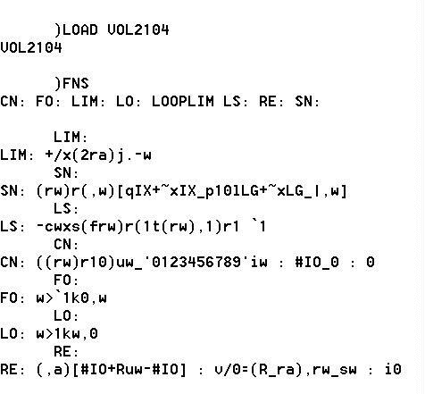
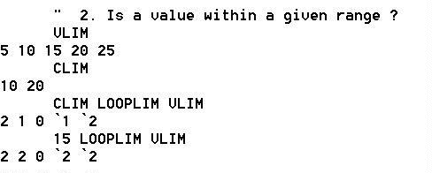
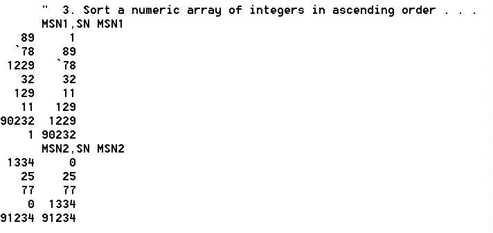
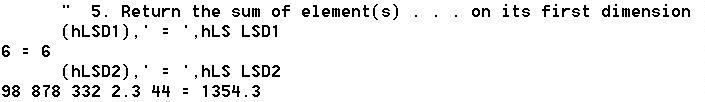
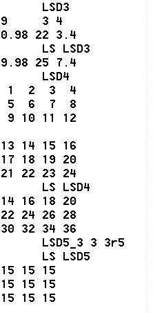
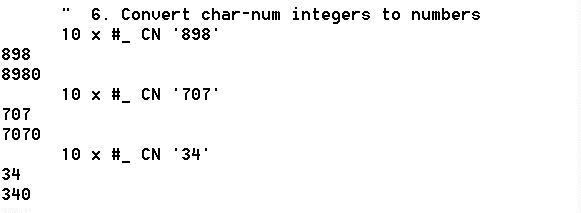
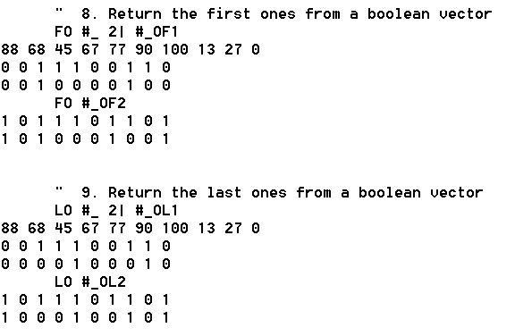
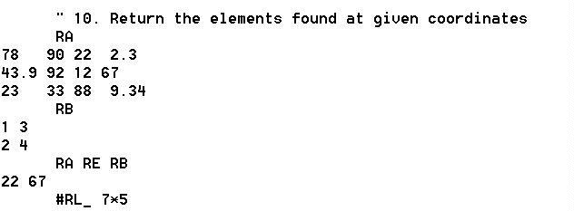
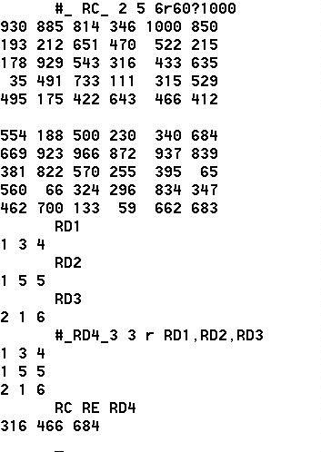

by Claude Henriod ([chenriod@vtx.ch](chenriod@vtx.ch))
{ .byline }

I present some solutions to the problems posed by Ajay Askoolum in [*APL Idioms*](trad/v214/idiom.htm)<i>, Vector</i> 21:4, pp92-96.

The development is for a great part from my libraries originated in the 198x years on :  
/APLSV IBM5110/APL68000 Wicat&Ampère/later/IBMAPL2 PS+PC/IBMwinAPL2/

All are shown as DDF valid I-APL. Tests are made in I-APL to be sure that the code is OK. But the function code is cloned in APL2 Unicode, for a better understanding.

{ width="476" height="441" }

&#61; Requested functions APL2, valid with several interpreters.

```
 LIM: +/×(2⍴⍺)∘.-⍵
 SN: (⍴⍵)⍴(,⍵)[⍋IX+~×IX←⌈10⍟LG+~×LG←|,⍵]
 LS: -⌿⍵×⍉(⌽⍴⍵)⍴(1↑(⍴⍵),1)⍴1 ˉ1
 CN: ((⍴⍵)⍴10⊥⍵←'0123456789'⍳⍵ : ⎕IO←0 : 0
 FO: ⍵>ˉ1↓0,⍵
 LO: ⍵>1↓⍵,0
 RE: (,⍺)[⎕IO+R⊥⍵-⎕IO] : ∨/0=(R←⍴⍺),⍴⍵←⍉⍵ : ⍳0
```

&#61; Functions which do not match prerequisite

```
 CE: ⍴1/⍵              ⍝ Answer fail
 LD: ˉ1↑[1↑(⍳⍴⍴⍵),1)⍵  ⍝ ⍴ is forbidden
 ZM: ~⍵÷⍵←⍵,1          ⍝ , is forbidden
```

{ width="488" height="196" }  
{ width="712" height="336" }  
{ width="705" height="102" }  
{ width="222" height="452" }  
{ width="581" height="213" }  
{ width="576" height="376" }  
{ width="632" height="233" }  
{ width="353" height="498" }

C. Henriod, retired IBM Advisory SE, chenriod@vtx.ch  
December 7, 2005.

***
