## Introduction

Following on from Ray Cannon's recent articles<sup>1, 2</sup>, I thought readers might like to know about one of the tools I have created to assist my development work in Dyalog APL.

I'm sure that I can't be the only APLer who regularly gets irritated by the hassle of looking into component files. *... Was it in the third component? ... Do I have to write a vector or a 1-row matrix? ... etc.*

To reduce this source of irritation, I have found `UCMD\FILECHK.DWS` to be increasingly useful, hopefully others will also! My requirements were as follows:

1. A component file would be share tied with as little fuss as possible, and be untied when I'm done.
2. It must work from the session as well as from the file manager.
3. It must have no residual effect on the session/workspace.
4. It must display the file name, file size and number of components
5. It must allow easy opening and closing of other component files.
6. It must display the contents of each component in such a way as to make the structure clear.
7. It must allow "alternative views" (to be explained later) of certain components.
8. It must never confuse me (tall order).
9. It must be reasonably fast and easy to use.

## In use from your APL session

All my productivity tools now work as part of Ray's `UCMD` suite although they may also be used as stand-alone utilities.

I have `FileCheck` set to appear on my menu bar, and it also appears in the `UCMD` menu structure. Figure 0 shows this.

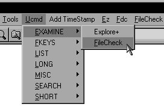{ width="272" height="178" }  
<small>Fig 0: <code>FileCheck</code> in the APL session <code>UCMD</code>
menu structure</small>

Selecting the utility will import the code into ⎕SE and run it, much as described below. There are just a few special conditions to running from the session:

1. The `Component File Inspector` window will open immediately (see figure 1).
2. If you have no files tied, you are immediately prompted with the standard file open dialogue to select one.
3. If you have files (share or exclusively) tied, you will not be prompted for another file. You may however elect to open another file using the appropriate button or menu. Note that the file name combo box will appear to be empty - pull it down and select the file you would like to examine before doing anything else.
4. On exiting, any files you had open will not be closed, but files opened by FileCheck will be. Of course, if you forced a file to close (by pressing the `Close File` button - see figure 1) this file will not be re-opened for you.
5. The system is modal. The session is "dead" until FileCheck has been closed.

## In use from your file manager

I have created a file, `FCDEMO.DCF`, to demonstrate the working utility. Double clicking on this file in the file manager of your choice immediately starts the `Component File Inspector` (CFI) window (see fig. 1).

In my case, I'm using *Windows NT Explorer*, but this can also be made to work from the Windows 3.x *File Manager* or the Windows 95/98 equivalent, as well as *dtfile* and *filemgr* (if your using CDE or OpenLook on a supported UNIX operating system).

Files are share tied by the run-time interpreter. To set this facility up so it works from *Windows NT Explorer*, start *Explorer*, select `View/Options` followed by the `File Types` tab. There should be an "APL Component File" registered file type (extension DCF) to edit, but if not, create it. Create (or edit) the action "open", which must include an "application" line like:

`<DEVICE>:\<PATH>\dyalogrt.exe <DEVICE>:\<PATH>\filechk OPENFILE="%1"`

Users of other operating can figure out from the above line how to create their command string.

## The `Component File Inspector`

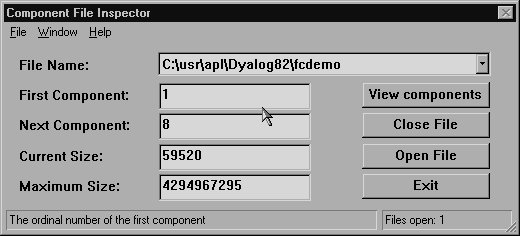{ width="520" height="236" }  
<small>Fig 1: Component File Inspector window</small>

The `CFI` has:

- A menu bar for those that like it. All functions (except the `Help/About`) are available from the buttons on the `CFI`.
- A file name drop-down combo object. This allows you to select another open file (if you have more than one open). The bottom option on the combo is always blank, and selecting this has the same effect as pressing the `Open File` button (or selecting `File/Open` from the menu bar).
- Four display only edit objects which show the ordinal number of the first component and that of the next component to be appended to the file, and the current and maximum sizes of the file.
- Buttons which have the following actions:
    - Viewing the components (also available as `Window/View` on the menu bar).
    - Closing (i.e. untying) the currently selected file (also available as `File/Close` on the menu bar).
    - Opening (i.e. tying) another file (also available as `File/Open` on the menu bar).
    - Exiting the application (also available as `File/Exit` on the menu bar).
- A status bar, with a status field for hints and another to let you know how many files you have open.

Only two of the above controls need any further explanation. Firstly, opening another file brings up the standard file open dialogue from which you merely choose the file you wish to open.

Secondly, and the main thrust of the whole exercise, is the viewing of a component:

## The `Component Viewer`

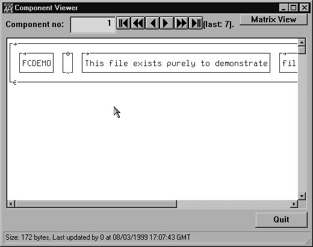{ width="520" height="411" }  
<small>Fig 2: Component Viewer</small>

Figure 2 shows the first component of the demonstration file, a vector of character vectors. Note the status field, which tells us the size and the time of last update of this component. For those viewing this in monochrome, the text is blue on a white background. Note also the prescence of the "Matrix View" button, which I press to produce figure 3 below.

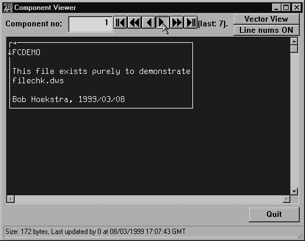{ width="520" height="411" }  
<small>Fig 3: Component Viewer showing Matrix View</small>

In figure 3 the mouse is depressing the "video control" to go to the next component and the text is white on a blue background to indicate that the contents of this component is not displayed in its "natural state". Whenever a matrix is being displayed, line numbering may be switched on. The "Vector View" button would revert to the "natural state display", but so would choosing another component. So, without further ado, let us now progress to the second component, the "index table" for the file, which I show in figure 4 with line numbering switched on and the window resized vertically to show the whole index:

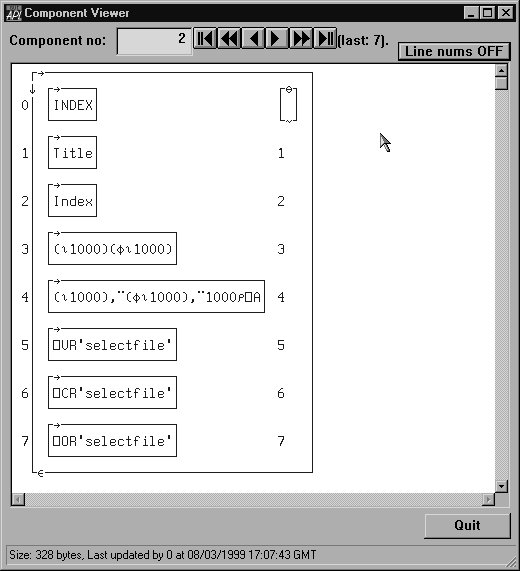{ width="520" height="571" }  
<small>Fig 4: Component Viewer showing Line Numbering</small>

Moving on to component 3 (figure 5, resized vertically again), we see a new control on the window. The display has been broken up into "chunks". The reason for this is that Microsoft apparently will not let us display more than 1024 characters without imposing its own form of wrapping, which does nothing for the clarity of the result. Hence "chunks", the first few of which are the maximum 1024 characters wide, with the last one taking up the slack.

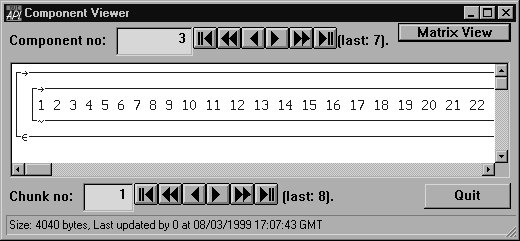{ width="520" height="241" }  
<small>Fig 5: Component Viewer showing Chunks</small>

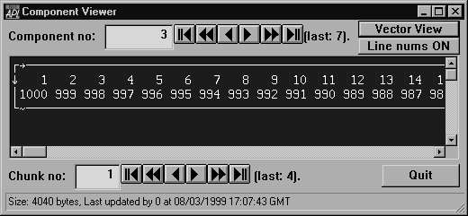{ width="520" height="241" }  
<small>Fig 6: Component Viewer showing reduced Chunking by a Matrix View</small>

Referring to the index, we can see immediately that this is a case for the "matrix view", hence figure 6 above. Not only does this clearly indicate the positional relationship between the two vectors, but it reduces the "chunking effect" as we would have expected. This effect is even more marked with component 4, 12 chunks initially, but no chunking using the matrix view.

Of course, this does not justify the existence of the "matrix view". I believe that it can, in many cases, produce a clearer view of the data in the file. This is show in figures 5 and 6 above, as well as in figures 7 and 8 below.

<table border="1">
  <tr align="center">
    <td>
      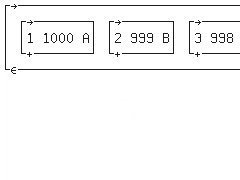<br>
      <small>Fig 7: Natural view of Component 4<br>
      (12 chunks)</small>
    </td><td>
      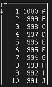<br>
      <small>Fig 8: Matrix view of Component 4<br>
      (no chunks)</small>
</td></tr></table>

Lastly, there are three representations of the same function in the <samp>FCDEMO</samp> file. The *Vector Representation* in component 5 is clearly a vector in figure 9, while the *Canonical Representation* in component 6 is clearly a matrix in figure 10.

<table border="1">
  <tr align="center">
    <td>
      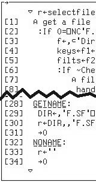<br>
      <small>Fig 9: Vector Representation of a function</small>
    </td><td>
      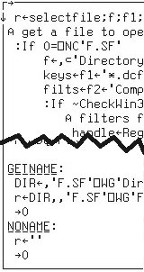<br>
      <small>Fig 10: Canonical Representation of a function</small>
    </td><td>
      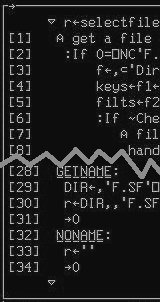<br>
      <small>Fig 11: Object Representation of a function</small>
</td></tr></table>

The *Object Representation* (component 7, figure 11) was originally a bit of a problem, as the resulting special object (not your normal APL variable) could not be treated by the <samp>display</samp> function (I use the dynamic version, not the normal <samp>DISPLAY</samp> function, as it provides, to me at least, more pleasing output and is a little faster). The code reacts to such a failure by formatting the object and running the result through <samp>display</samp> again and changing the display colour to red on black. In this case (a function) the result looks like a Vector Representation, but when viewing a Object Representation of a name space or GUI object, only the original (fully qualified) name is displayed.

## Video controls

The video buttons (which I have almost ignored) work as follows for both components and chunks:

- The single arrows move to the previous (pointing left) or next (pointing right) item. Having reached the first/last item, they will wrap on a further push and go to the last/first item.
- The extreme left and right buttons (arrow pointing towards a double bar) go to the first or last item, with no "wrap".
- The "double arrow" buttons move in steps calculated to traverse the entire range in about five clicks.

## File Filters

The file open dialogue uses filters of "Component Files(\*.dcf)" (the default) and "All Files(\*.\*)". Users of Windows NT can extend this by including filters in the registry. My registry entry is described below:

> ```
> REGEDIT4
>
> [HKEY_CURRENT_USER\Software\Dyadic\FileCheck\Filters]
> "KEYS"="*.dcf *.obj *.pch *.pln *.*"
> "*.dcf"="Component Files(*.dcf)"
> "*.obj"="APL Object Files(*.obj)"
> "*.pch"="APL patch files(*.pch)"
> "*.*"="All Files(*.*)"
> "*.pln"="AYP plan files(*.pln)"
> ```

## How to get `FileCheck`

`FileCheck` is included in the zip file on the Vector web site containing Ray's `UCMD` workspaces. The address is *http://www.vector.org.uk/v151/quadse.zip*. Alternatively the zipped workspace can be downloaded from my web site at *http://www.khamsin.demon.co.uk/sware/filechk/filechk.zip*.

## References

1. Utilities for Dyalog Developers, by Ray Cannon, Vector Vol. 15 No. 1
2. Utilities for the Dyalog Session (part 2), by Ray Cannon, Vector Vol. 15 No. 3

***
