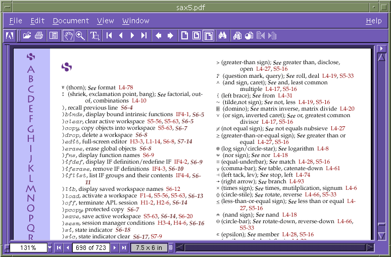
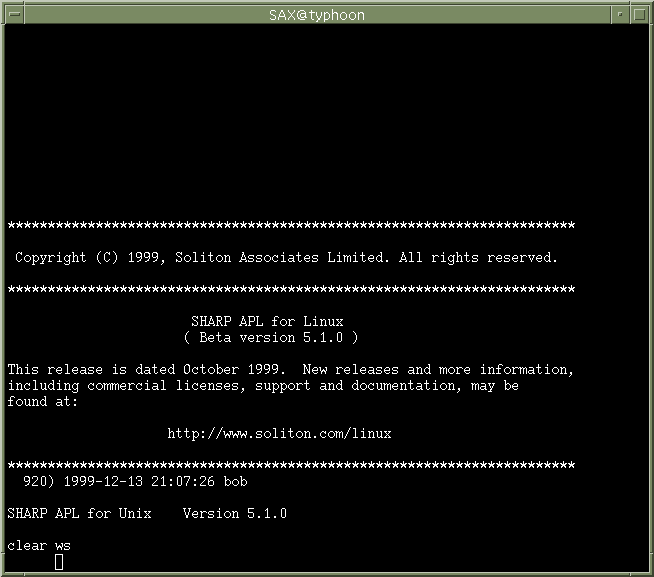

*Reviewed by Bob Hoekstra ([Bob.Hoekstra@khamsin.demon.co.uk](mailto:Bob.Hoekstra@khamsin.demon.co.uk))*

## Abstract

> Some readers may be familiar with SAM, the mainframe version of I.P. Sharp's APL interpreter. For some years SAX, the Solaris and AIX variant of this interpreter, has been establishing itself as a serious force. Now a version of SAX is becoming available for Linux, the free operating system that is rapidly growing in popularity.

## Introduction

I have written before about my fanaticism regarding the combination of APL and UNIX<sup>\[<a href="#NOTE1">1</a>\]</sup> or Linux<sup>\[<a href="#NOTE2">2</a>\]</sup>, so I won't repeat this. While at APL98 I heard the rumour that Soliton was porting SAX to Linux, I got very excited and collared their representative on the spot, demanding the full scoop and pledging my support (and a *Vector* review) if I could have a copy soon!

## Linux

I imagine that everyone has heard of Linux<sup><a href="#NOTE2">\[2\]</a></sup> by now. For those that haven't, it is an alternative (i.e. non-Microsoft) UNIX-like operating system for the PC. Its development and growth has been very rapid with many people, possibly thousands, having a hand in it. Until quite recently there were relatively few applications available for Linux, but this is rapidly being rectified with the support of some large and well known software houses<sup><a href="#NOTE5">\[5\]</a></sup>.

In the absence of good applications, Linux on the desktop was mainly of interest to those who wanted to get involved in the development of the operating system itself. However, it has been an excellent platform for providing file and print services to clients running many operating systems for a long time (in computer terms). As the applications appear, Linux is rapidly becoming a suitable platform for developing all sorts of applications in many different languages as well as providing general "office productivity" functions (word processor, spreadsheets, etc). Linux is very efficient and will support multiple simultaneous users on even quite modest hardware. With the release of SAX there is another good reason for APLers to run Linux (currently J is available for Linux, as are some "non-industrial strength" APLs).

Linux has been ported to many hardware platforms besides those based on Intel processors. In the current release, SAX is only available for the Intel platform. This may change, but I do not know Soliton's intentions in this regard.

It is my personal hope that SAX will also create some interest amongst those who have not used APL until now. I am just as interested in enticing the current Linux user to investigate APL as encouraging APLers to use Linux. I have always believed that the properties of UNIX complement those of APL very well and that the two provide a powerful combination.

## Can I use SAX?

In their announcement in <i>Vector</i><sup><a href="#NOTE3">\[3\]</a></sup>, Soliton announced that "...Personal licences for SHARP APL for Linux will be available free of charge...", all you have to do is download the files from their web site <sup><a href="#NOTE6">\[6\]</a></sup>. Note that commercial licenses will not be free. I am not sure of the exact pricing, so I will not repeat rumours I have heard. However, I am confident that the price will be acceptable.

So the answer to the question is yes: anyone can use SAX. This sounds too good to be true, and it is, for the following reasons:

Firstly, those who have not dipped their toe into the Linux waters yet will have to install the operating system. This is not a trivial operation. However, I will not devote much space to this task (this is an APL review after all) but I will make a few suggestions:

- Try to get one of the mainstream variants of Linux to install. I would recommend the Red Hat<sup><a href="#NOTE7">\[7\]</a></sup> or SuSE<sup><a href="#NOTE8">\[8\]</a></sup> distributions as easy to install. By contrast, the Debian<sup><a href="#NOTE9">\[9\]</a></sup> distribution is not meant for the first time user. Downloading a complete copy from the net is impractical, but distributions on CD are easy to come by. A how-to book might also be a good idea. In Europe I can recommend The Linux Emporium<sup><a href="#NOTE10">\[10</a>\]</sup> for all Linux requirements, but there are other suppliers.
- Anyone doing this for the first time should have a spare hard disk to install on, and take the disk containing the current operating system out of the machine (unless you are happy to lose the information on it).
- It might be useful to get some help. Most experienced Linux users are only too happy to help a newbie (maybe you can get them interested in APL). Remember to install and configure an X server, and lastly to make a new kernel to suit your particular hardware configuration.

Secondly, the SAX download can take quite a while. There is the software itself, a single gzipped tar file of around 2.5MB and an instruction file of about 1KB. You will also want the documentation, a `pdf` file of 6.1MB (see below). I had access to a T3 internet connection, but someone downloading with a conventional modem could easily take more than an hour to do this.

## The supplied documentation

The file `sax5.pdf` contains the manual. This is an impressive document: 723 pages! At times I have struggled to find what I was looking for, but in the end found the information required. This is where a powerful machine pays off, as SAX will run quite happily on a pedestrian PC with Linux installed, but using Adobe's Acrobat reader to do string searches in a document of this size is a different matter! The documentation is in general well written and the pdf file is well supplied with links, so navigation is not a problem most of the time. In fact, I got to rather like this part of SAX: `acroread` is often easier to use than a book.

{ width="774" height="509" }  
*Fig 0: SAX documentation - start of the Index*

## Installing SAX

Assuming you have Linux installed, the installation of SAX is easy. All one has to do is follow the instructions in the instruction file, `install.txt`. This file gives clear and sensible instructions on the installation, and within a few minutes it's all done.

I have just a few negative comments about these instructions:

- Using `gunzip` on the downloaded file `sax-5.1-linux.tgz` is not necessary. If we have the GNU version of `tar` (and most Linux distributions do), we can unzip and untar in one command as follows:

    ```
            $ tar xvzf sax-5.1-linux.tgz
            -rw-r--r-- root/root   2611828 1999-10-19 00:59 bundle.gz
            -r--r--r-- root/root      2543 1999-10-21 15:26 README
            -rw-r--r-- root/root      3067 1999-10-18 22:58 disclaimer
            -rwxr--r-- root/root      5529 1999-10-21 16:55 SAXLinstall
    ```

    The reason for doing this is that it saves some disk space, though in this case the saving is surprisingly small:

    ```
            # ls -l sax-5.1-linux.tgz
            -rw-rw-r--   1 root     root      2612398 Dec 14 11:49 sax-5.1-linux.tgz
            # gunzip sax-5.1-linux.tgz
            # ls -l sax-5.1-linux.tar
            -rw-rw-r--   1 root     root      2631680 Dec 14 11:49 sax-5.1-linux.tar
    ```

    This probably indicates that the file is compact and does not compress very effectively.

- More importantly, I disagree with their last instruction regarding the setting of globals. This tells the installer to adjust every user's environment by adding an environment variable `SAXDIR` and to extend the `PATH` by adding the binary subdirectory of the installation directory (`/usr/sax/rel/bin` by default). This is not always good practice, and furthermore the instruction would only work for those using the Bourne shell or its derivatives and not for those using the C-Shell family.

    For those new to Linux: Soliton doesn't say which file to edit in their instructions. This should be `/etc/profile` and corresponding adjustments should be made to `/etc/.login` if it exists. Alternatively, use a "wrapper" as I do.

    I firmly believe in "wrappers". A wrapper in this context would be a shell script in a common directory (I invariably use `/usr/local/bin`) with the same name as the required executable which sets any necessary environment variables before calling the executable. My wrapper in this case would contain:

    ```
            #!/bin/bash
            ############################################
            #       /usr/local/bin/sax
            #       Wrapper script to start SAX/L
            #       Bob Hoekstra, 1999.12.14
            ############################################
            export SAXDIR=/usr/sax/rel
            export PATH=${SAXDIR}/bin:$PATH
            exec ${SAXDIR}/bin/sax
    ```

    I won't go into all the advantages of using wrapper scripts as I don't want to get into the details of UNIX administration, so I will leave this subject here.

I am always interested to see the amount of disk space used by a new product. `du -s` gives, by default, the number of 1KB blocks used by files or directories:

```
        # du -s /usr/sax/*
        4203    /usr/sax/alpha
        8848    /usr/sax/local
        6630    /usr/sax/rel
```

Others will not have the `alpha` directory: this contains the alpha release, and is shown here to indicate that the software has grown significantly to this beta release (dated 18 October 1999). The `local` directory is not really necessary (it only contains the downloaded files and they could be elsewhere) but this is as per Soliton's installation instructions. This means that a minimum of 9MB space is required in the disk partition where you install, with 16MB being realistic following the installation instructions. Bear in mind that you will want to use the documentation, which (following Soliton's instructions) is in `local/sax5.pdf`.

## Starting SAX

Having completed the installation, I looked at the `README`, noting that SAX had been compiled on Red Hat Linux with a kernel version 2.0.36, whereas I run Debian Linux with a 2.2.1 kernel. This caused no problem as the `libc` and `libncurses` libraries were the same version.

Executing my wrapper script described above brought up an interpreter window almost instantly (see Figure 1). The interesting things to note in the window are

- The copyright statement. This clearly indicates that this is not a final release, but a beta version. It also gives the URL to find updates.

- The fact that the process number is given at startup. This is useful as separate APL processes use this number to identify each other for communication purposes. As a last resort, runaway processes can also be killed using this number. It indicates the UNIX parentage of the product. This is followed by a timestamp and the name of the user owning the APL process. See the line

    ```
            920) 1999012013 21:07:26 bob
    ```

- Lastly, immediately before the `clear ws`, is another line showing that this is "`SHARP APL for Unix`". I am curious as to whether this is
    - a hangover from the UNIX-to-Linux port,
    - a mistake,
    - an indication that Soliton thinks "Linux=UNIX", or
    - an indication that lessons learned in this version are to be implemented in future UNIX versions.

{ width="654" height="577" }  
*Fig 1: SAX startup window*

The interpreter interface is implemented in an `xterm` window. This pleased me as it means that SAX should run well across a network, running the interpreter on one machine and the interface controlled by an X server on another. This is my preferred environment: SAX running on my Linux PC with me using it from a high quality monitor and keyboard on my Sun Ultra 5.

SAX should also work fine while run from a `telnet`-type session from a PC, although such an interface may need some fiddling to get the keyboard working correctly. Unfortunately I have not been able to test this.

## Running SAX

In earlier communications, Soliton expressed satisfaction with the performance of SAX. I do not want to start comparing execution times between SAX and other APLs, as the comparison is not fair if the operating system is different.

However, I am happy to say that SAX is very fast. At no time did I feel that the system was sluggish, although users should be made aware of the fact that the start-up option `fsync`, if left at it's default value of 2, can affect file writes rather drastically. Setting this to 0 switches off file synching and makes great improvements, if at the cost of some security. This is mentioned in the `README` file and inadequately described in the documentation, although I did find a better explanation of this in the *Intrinsic Functions Manual* section on `unix.filesync` (page 252). Essentially (as I understand it) setting this to 0 allows full buffering of files, hence the speed improvement, which means that a crash before a buffer flush could result in an unusable file. My confidence in Linux lets me take this risk.

SAX was also quite careful with system resources. I tried to see how many sessions I could open: with 60 simultaneous open SAX sessions, each of 0.5MB, I had about 3MB of my 96MB memory still available and I had not started to use any of my 280MB swap space. The script to start these sessions took about a minute to run on my PC, based on a Cyrix P150+ processor. This indicates the suitability of SAX as a multiuser development platform (on more powerful hardware, of course).

## The APL

I found it a little difficult to get into SAX. It has been a few years since I last used Sharp APL under MVS on a mainframe, and I find the differences between SAX and most of the other mainstream APL variants significant. Nevertheless, this is an extremely powerful implementation of the language with much to recommend it.

Of course, anyone can write "old" APL code (users of VS/APL will feel right at home) but modern features are implemented quite differently. Fortunately for me, Dan Baronet's article<sup><a href="#NOTE11">\[11\]</a></sup> means I don't have to go into details regarding the differences between this APL and the others.

The SAX "variant" of APL shows its heritage: of all the "standard" APLs it is definitely the most like J. The concepts of *rank*, *frame* and *cell* have much less meaning (if any) in other APLs, whereas in SAX they are an integral part of the language. In certain cases the importance of axes is reversed. Then there are the differences between boxed (SAX) and nested arrays (most other APLs). See Dan's article<sup><a href="#NOTE11">\[11\]</a></sup> for more detailed information in this regard.

One of my favourite language extensions the Sharp APL family has is the extension of the logical *and* and *or* functions to provide *lowest common multiple* and *greatest common denominator* functions for non-boolean integers. This seems so logical that I cannot imagine why other APLs haven't adopted it.

Lastly, the mainframe background also shines through in the continued support for different task types. While these were developed for the mainframe, they fit naturally into the UNIX environment. As an example, starting an *S task* (this is a background APL process controlled by shared variables) using `AP 1` which loads a workspace, executes a trivial latent expression function and captures the result is almost instantaneous. Although workspaces of up to 2GB are supported (mainframe workspaces are typically much smaller) subject to available swap and memory, the technique of packaging is also still there, allowing the developer to create really complex programs while keeping memory usage at sensible levels.

After a while, SAX started to come almost naturally and I began to appreciate its features. One might conclude that the language is fully featured and includes several powerful extensions to the ISO standards. Initially there is some learning to do for those not used to it, but the effort is more than justified.

## The interface

Right now, the interface might be disappointing to those accustomed to the Dyalog APL, APL2000 or APL2 interpreters running under Microsoft Windows. The use of Windows has allowed vendors to provide a very productive development environment, which is difficult to do without once you get used to it. SAX provides nothing like this, in fact it even compares unfavourably to Dyalog APL/X version 6 (now several years old, but could be considered a comparable product) as this made much more use of the windowing services provided by the X server.

However, I'm confident that this will be addressed soon. Soliton is preparing an interface between their APL and Java which will include an integrated development environment. This will be included in a future release. While I have not yet seen any hint of this yet, it must be better than the raw session manager they currently have.

The function editor should also be mentioned. My feelings about full screen editors are subjective and fairly personal, but I must confess that I did not like Sharp's editor on the mainframe and, sadly, the editor has not been improved in SAX. As far as mainframe editors are concerned, I thought IBM did it better with VS/APL (along with a little help from GDDM I believe), as did STSC's mainframe product, which used the same editor. As far as I'm concerned APL2 was no improvement in this regard. Sharp APL's editor is a large step backward, and this is essentially the editor that comes with SAX. Perhaps the Java IDE mentioned above will provide an improvement.

A last point on this subject is the keyboard definition tables. While these are adjustable, one can hardly imagine a more boring and tedious job. In the long run, I believe Soliton would encourage customer loyalty if they addressed these niggles.

## The future

Soliton is working on further developments. I suspect several companies are keen to port tools to this new environment (I know that Causeway are porting RainPro). I think this product still has a little maturing to do between beta and final release. All in all, I am sure that this will become an important interpreter. It is the first of the serious APLs to be ported to Linux and with its innovative licensing policy, I believe it deserves to succeed, and given its excellent reputation on the mainframe, I'm sure it will.

However, Soliton is unlikely to have the field to itself for long. Dyadic Systems are probably going to announce their Linux product soon<sup><a href="#NOTE4">\[4\]</a></sup> and with IBM's support for Linux, I would not be surprised if APL2 was not far behind.

Soliton has intimated that this port is a byproduct of the POSIX port of the Solaris and AIX products. I am keen to get my hands on the Solaris version and compare that to its competitors on an even footing.

## Conclusion

Soliton has a real rough diamond here: the language is great once one gets used to it, but the development environment can do with some improvement.

I would recommend that all individuals, especially contractors/consultants, get their personal copy of SAX as soon as possible. I believe that our clients will be using this product in anger before long and we should be ready. Certainly those currently using SAX under Solaris or AIX or SAM on their mainframe should be looking at this product very seriously.

As for corporate buyers, my advice would be to look very seriously at this product. I cannot really say that it is quite ready for development of new systems right now, but I am quite confident that it soon will be. The production version has been promised for first quarter 2000<sup><a href="#NOTE3">\[3\]</a></sup>, so we don't have long to wait. When this arrives, we can use relatively cheap hardware and a free but stable operating system to create world beating products!

***

## Notes, References and web sites

1. <a id="NOTE1"></a> Refer to *Dyalog APL for Motif Version 8.1 Release 2 for Sun Solaris 5.5*, by Bob Hoekstra, *Vector* Vol. 14 No. 3.
2. <a id="NOTE2"></a> Read the [letter from Bob Hoekstra](trad/v161/bob161.htm) in *Correspondence*, *Vector* Vol. 16 No. 1
3. <a id="NOTE3"></a> Soliton made an announcement of the impending release of SAX/L in [*Sustaining Members' News*](trad/v162/susnews.htm), *Vector* Vol. 16 No. 2
4. <a id="NOTE4"></a> Dyadic Systems indicated an "expectation to announce" a Linux port in early 2000 in [*Sustaining Members' News*](trad/v162/susnews.htm), *Vector* Vol. 16 No. 2.
5. <a id="NOTE5"></a> To get an idea of growing corporate support for Linux, search for "Linux" on IBM's web site [(`http://www.ibm.com/`)](http://www.ibm.com/).
6. <a id="NOTE6"></a> The Soliton Associates web site is at [`http://www.soliton.com/`](http://www.soliton.com/) and their Linux web page is [`http://www.soliton.com/Linux/`](http://www.soliton.com/Linux/)
7. <a id="NOTE7"></a> Red Hat's web site is [`http://www.redhat.com/`](http://www.redhat.com/)
8. <a id="NOTE8"></a> SuSE's web site is [`http://www.suse.de/`](http://www.suse.de/)
9. <a id="NOTE9"></a> Debian's web site is [`http://www.debian.org/`](http://www.debian.org/)
10. <a id="NOTE10"></a> The Linux Emporium provide an excellent Linux service at their web site: [`http://www.linuxemporium.co.uk/`](http://www.linuxemporium.co.uk/)
11. <a id="NOTE11"></a> [*Sharp APL vs. APL2 coding style*](trad/v162/dan.htm), by Dan Baronet, *Vector* Vol. 16 No. 2.

***
