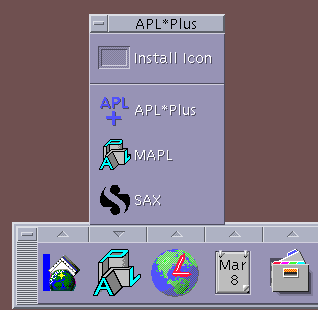
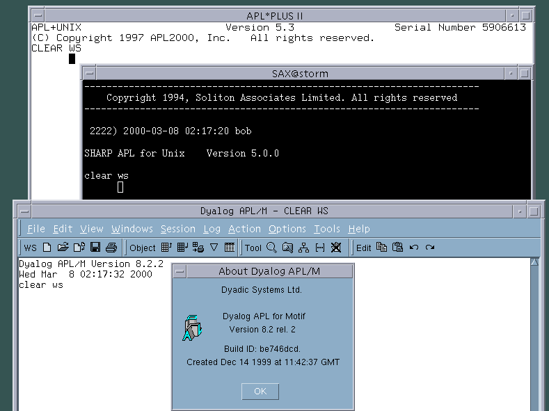
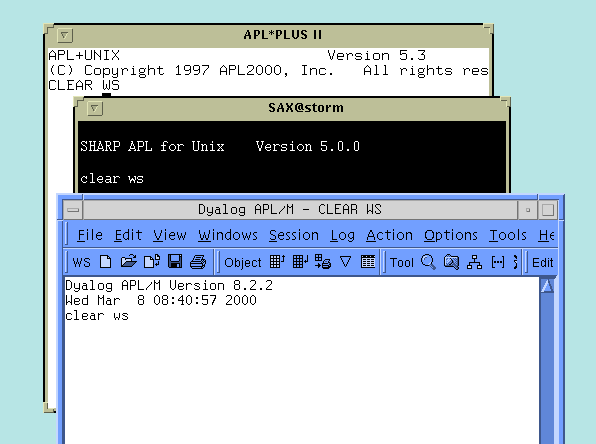
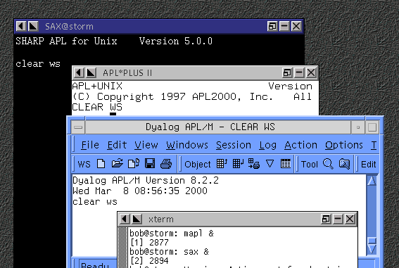
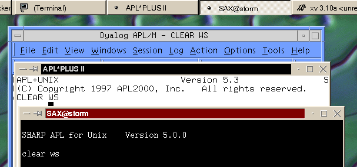
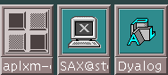
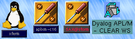
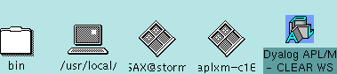
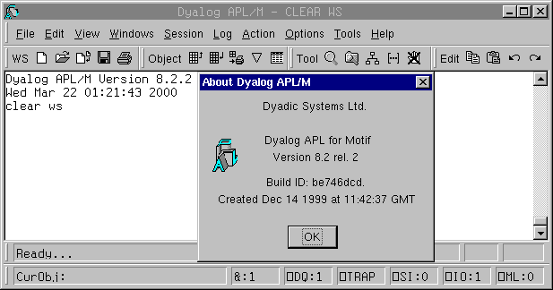

##### By Bob Hoekstra ([Bob.Hoekstra@khamsin.demon.co.uk](mailto:Bob.Hoekstra@khamsin.demon.co.uk))

## Abstract

> Some critical projects require an APL installation that is absolutely stable (i.e. where a PC running a Microsoft operating system is just not good enough) or more power than any Intel derived machine can provide. In these situations there are a number of alternatives, and running APL on a UNIX machine is a popular option. In this article and the next I examine three popular, but quite different interpreters for such a scenario: *APL+Unix version 5.3.2* from APL2000, *Dyalog APL/M version 8.2.2* from Dyadic Systems and *SAX (<b>S</b>HARP <b>A</b>PL for UNI<b>X</b>) version 5.0.0* from Soliton.

## Introduction

This article follows from my recent review of SAX for Linux\[<a href="#Note1">1</a>\], produced by Soliton\[<a href="#Note2">2</a>\]. As a long-in-the-tooth Linux user, I found this very interesting, but I am the first to admit that there are some duties that Linux is not ready for yet. Where a service is critical, I would recommend one of the established UNIX vendors.

The SAX/Linux article therefore naturally led to discussions with APL vendors regarding their UNIX product, all of which lead to this, a series of two articles.

## The test machine

Conveniently, as I was planning this article, I was also in the process of buying myself a new workstation from Sun Microsystems, so this is the first serious work being done on my new Sun Ultra 5\[<a href="#Note3">3</a>\]. My machine is close to the bottom of Sun's workstation line, equipped with a 333 MHz UltraSPARC IIi\[<a href="#Note3">3</a>\] processor and 256 MB memory.

The operating system used is Solaris 7 (based on SunOS 5.7) running in 64-bit mode. This is still fully compatible with all 32-bit SPARC executables, and so should not make any difference to the tests. I hope to be able to install the Solaris 8 beta release (SunOS 5.8) very shortly to briefly test the interpreters under the very latest operating system.

To see how the APLs react, I have a number of non-standard items installed on the machine. These include the AfterStep window manager and the KDE environment. These are popular in the Linux world, and offer some advantages over the two windowing environments, CDE and OpenWindows, that come with the operating system.

## Other UNIX Hardware

Thre are many UNIX platforms, the big names being Sun Microsystems, IBM, Hewlett Packard, Sequent, Compaq (since their purchase of DEC) and SGI (previously Silicon Graphics). Sun is unique in that their operating system runs on their own platforms (based on SPARC technology) as well as Intel based PCs and compatibles. There are several versions of UNIX that run on PCs, the biggest player here being SCO. Much of the Sequent range is also based on Intel processors, but they are definitely not PCs. Hardware and software from different suppliers is generally incompatible, although they will all share resources with each other over a network.

The scenarios I described in the abstract may require more power. Sun can provide this: processor speeds are currently up to 450 MHz, though the UltraSPARC III is about to go on sale at 600 MHz. They are planning 1.5 GHz, and machines like the Sun Enterprise 10000\[<a href="#Note3">3</a>\] (directly descended from Cray technology) can contain up to 64 of these processors, with bigger machines coming very soon.

Sun is not the only company is this class: Hewlett Packard's V-Class machines\[<a href="#Note4">4</a>\] can contain up to 128 PA-RISC processors and 128 GB of memory. IBM has multiprocessor\[<a href="#Note5">5</a>\] options in their RS/6000 range. SGI\[<a href="#Note6">6</a>\] (the current owner of all non-SPARC Cray technology) has many comparable offerings, including (possibly the ultimate power machine) the stunning Cray T3E\[<a href="#Note6">6</a>\]: up to 2048 Alpha processors at 600 MHz, each with up to 2 GB memory. Compaq\[<a href="#Note7">7</a>\] (now owner of the Alpha technology) has multiprocessor machines. There are many other examples.

Then there is clustering technology. The Linux Beowulf\[<a href="#Note8">8</a>\] project, where many machines can work together efficiently, is very interesting. This technology is not limited to Linux or Intel, but can be used with almost any UNIX-like operating system independent of hardware used. Other vendors, including Sun, have their own proprietary clustering solutions to provide extra processing power, increased reliability, or both.

The amount of computing power available today is staggering (of course, so are the prices). The truth is that the mainframes of yesterday have not managed to keep up\[<a href="#Note6">6</a>\]. If your company has a computing requirement for serious power, UNIX is a very viable option. I have no idea how many machines like those mentioned above are running APL, but those that are, are very likely using one of the interpreters discussed in this article.

## The UNIX APL market

This article includes 3 of the 4 interpreters that have really captured the "serious" UNIX market between them:

#### APL2000\[<a href="#Note9">9</a>\]: APL+Unix

This interpreter is descended from work done by the Scientific Time Sharing Corporation (STSC). STSC produced the first APL for DOS shortly after the IBM PC hit the market in the early 1980s, coded in 8086 assembler. Some time later APL\*PLUS II for Unix was developed, using C. This spawned APL\*PLUS II for 386 and later Windows, which evolved into the current product line. The UNIX product was thus the parent of the Windows product. At one time there was also a Macintosh version and a VAX (VMS) version of APL\*PLUS.

The mainframe STSC interpreter arrived first of all, but this is essentially IBM's VS/APL with STSC extensions. It may therefore be thought of as unrelated. Nevertheless, many of these extensions provide functionality similar to that in this interpreter, thus maintaining a family resemblance.

During the history of this product, the owner has changed several times. This is evident in the packaging, where some of the manuals still refer to Manugistics and others refer to the current owner, APL2000.

APL+Unix is available for running on

<ul class="indent">
	<li>IBM RS/6000 workstations and servers with AIX 3.2 or
	    later and AIXwindows,
	</li><li>Sun SPARCstations with SunOS 4.1 or later and Solaris 2.1
	    or later and OpenWindows 2.0 or later,
	</li><li>Hewlett Packard 9000 series 700 or 800 with HPUX 9.01 or
	    later andHP VUE 3.0 or later, and
	</li><li>DECstation 2100 or 3100 or DECsystem 3100, 5400 or 5800
	    with ULTRIX 4.3 or later and DECwindows and OSF/Motif.
    </li></ul>

From experience, it also runs using CDE (Common Desktop Environment) on Solaris, and I would expect that it would on AIX, HPUX, and ULTRIX as well. Note that DEC now belongs to Compaq, who have continued development and renamed ULTRIX (one of the first fully 64-bit Unixes) "TRU-64 UNIX". Potential customers will have to confirm support for this with APL2000.

#### Dyadic Systems\[<a href="#Note10">10</a>\]: APL/M

Dyalog APL has a long UNIX history. Earlier versions were strictly ASCII based, even though version 6.x included use of the X11 Windows system. Around this time (the mid 1980s) they moved the main development effort to Windows and versions 6.x, 7.x and 8.x have become increasingly GUI centered.

Using technology from MAINSoft Corporation\[<a href="#Note11">11</a>\] they have ported version 8.x back to UNIX, though it really is only compatible with Motif-based window managers, which includes the very popular CDE. I reviewed the first port in Vector several issues ago\[<a href="#Note12">12</a>\].

Dyalog APL/M is available for IBM RS/6000 machines running AIX 4.3.2 and Sun SPARC servers and workstations runing Solaris 2.5.1, 2.6 and 7. A Linux version is being developed.

#### IBM APL2\[<a href="#Note5">5</a>\]

In many respects, APL2 sets the standards. This is due to the importance of IBM in the history of APL as well as APL2's market penetration (on all platforms) particularly in the US. The UNIX version is available for IBM's version of UNIX, AIX, as well as Sun's version, Solaris.

The UNIX version of APL2 is descended from IBM's long line of APL interpreters, and in particular the mainframe implementations of APL2 that dates back to the early 1980s. I'm very sorry to report that IBM decided not to participate in this article.

#### Soliton Associates: SAX\[<a href="#Note2">2</a>\]

Soliton is well known for its mainframe interpreter, SAM. SAX is newer and closely related to SAM, having (as far as I can recall) identical functionality. A direct descendent of SAX is the port to Linux version which I reviewed recently\[<a href="#Note1">1</a>\].

Apparently, lessons learned in the Linux port are to be incorporated in a future version of SAX, making it faster and better. Unfortunately that version is not available yet: reviewed here is version 5.

SAX is really the outsider in this group. It is the interpreter most different from IBM's APL2 "standard", and is really a stepping stone between the other interpreters here and J.

SAX is available for AIX 4.2 and AIX 4.3 and Solaris 2.5 and 2.6. However, this review shows it runs fine on Solaris 7 as well. The personal edition of SAX for Linux version is available as a free download\[<a href="#Note2">2</a>\].

## So what do you get for your money?

APL2000 distribute their interpreter on three floppy disks, while the other two interpreters come on a CDROM. The sizes of the final installations vary considerably, as do the functionalities offered by each interpreter. It is impossible to say which offers "more", as each interpreter offers facilities not offered by the others. Furthermore, all three interpreters come with a suitable amount of printed documentation, but all the documentation is open to some criticism.

 { width="318" height="310" }  
Figure 0: APL Popup menu on the CDE front panel

#### APL+Unix

This interpreter takes up a small 6.8 MB of disk space, but in this space APL2000 have managed to cram interpreters for SunOS 4 as well as SunOS 5 (a.k.a. Solaris 2) operating systems. SunOS 4 is of less interest now, as it has not been actively developed by Sun for several years, but it is still in use on older Sun SPARCstations too slow to run Solaris 2 effectively.

There is support for running APL+Unix using its built-in "APL X Manager", APLXM, as well as character terminals. One can also run APL via kermit (a terminal emulator that runs on just about any operating system) and by using APL\*PLUS PC or APL\*PLUS II/386 as a terminal. Lastly, the interpreter can also be run without a terminal at all (i.e. as a background process). The actual use of the interpreter therefore has impressive flexibility - I'm impressed that this could all be compressed onto only three floppy disks.

There is no online help other than a screen showing the editor keystroke commands. The manuals supplied with the interpreter for review include:

<ul class="indent">
      <li>Two weighty, glossy colour fronted volumes, a <i>User
	  Manual</i> and a <i>Reference Manual</i>. These were
	  for APL*PLUS II/UNIX version 5 and were marked as
	  coming from Manugistics (a previous owner of
	  APL*PLUS). 
      </li><li>A much slimmer <i>Installation Manual</i>. This is
	  targeted at the system administrator, who should
	  perform the installation. 
      </li><li>A rather slim <i>Version 5.3 Update Manual</i>. This
	  was the only document carrying the APL2000 name. 
      </li><li>A rather nice set of sticky keyboard labels for the
	  APL character set. 
    </li></ul>

#### Dyalog APL/M

Dyalog APL/M takes a whopping 130 MB, far more than the other two. In this space Dyadic Systems include all the functionality of the Windows version, APL/W, thanks to the MAINWin Cross Development Kit. The exception is the runtime version of the interpreter, which is not included in the UNIX version. In APL/W the runtime interpreter provides all functionality except any form of session manager and can be used to distribute APL applications without further royalty payments to Dyadic Systems.

However there is the addition of a "console version" of APL/M. This is an APL interpreter with less functionality than the APL/W runtime interpreter as it doesn't provide a session manager or GUI support. This is very useful in the UNIX world as it can be used to create APL daemons (background processes which do a particular task). The console version does support I/O to and from files and TCP/IP connections. Despite this, I think a runtime interpreter with similar license conditions to APL/W would have been more useful.

Many developers will be familiar with APL/W and will feel right at home with APL/M. Essentially the user interface is the same within the confines of a Motif-like window manager (more about this later). There was no support for running APL/M from a terminal, but Dyadic Systems tell me that a third interpreter (currently in beta test) will be included in future to provide this, as well as the `quadSM` user interface.

The option of using a Windows-like interface, which I did not like much in the previous review\[<a href="#Note12">12</a>\] is also still available, though difficult to find. I could find no mention of it in the documentation, but managed to start APL/M in this mode by changing the value of the shell variable `MWLOOK` from `motif` to `windows` in the startup script. See [figure 8](#fig8).

Dyalog APL supports a very impressive range of input devices (keyboards mainly), including national keyboards from Denmark, Finland, France, Germany, Italy, Sweden, UK and the US, most of which have variants, making 24 in all (not counting file I/O). I could not really test these as I only have a US keyboard.

One aspect peculiar to the APL/M installation that I liked was the inclusion of an extension to the magic file. This file (`/etc/magic`) is used by the UNIX `file` command to identify file types by the value of the first few bytes in the file. To show this in action:

<pre>                bob@storm: <b>file ws/dyalog8.rtf ws/util ws/wdesign.ico</b>
                ws/dyalog8.rtf: ascii text
                ws/util:        Dyalog APL workspace version 8 .111
                ws/wdesign.ico: data</pre>

Help files take up about 6 MB of disk space. The help is exactly like that for the Windows version and provides all the same functionality. The manuals supplied with the interpreter include:

<ul class="indent">
      <li>Four substantial volumes, subtitled <i>User Guide</i>,
	  <i>Language Reference</i>, <i>Object Reference</i> and
	  <i>Interface Guide</i>. These are in fact the Windows
	  manuals: they are all titled <i>Dyalog APL/W</i>. 
      </li><li>Eleven duplexed A4 sheets stapled together which
	  explain the installation procedure, the essential
	  differences between APL/W and APL/M, something about
	  the MAINWin CDK and its effect on the interpreter and
	  some outstanding SPARC issues. This is the only
	  documentation marked as being specific to APL/M. Please
	  note that this is not really a criticism: the APL/W
	  manuals are adequate for the user, and with a good
	  system administrator to do the installation there
	  should be no problem at all. 
    </li></ul>

#### Soliton Associates: SAX\[<a href="#Note2">2</a>\]

SAX occupies some 36.6 MB on the disk. There is an array of interpreters (pun intended): *apl*, *apl-8*, *rtapl* and *rtapl-8*. The *apl* development interpreter is the default and has a built-in session manager and full screen function editor, *apl-8* is for users who prefer to use their own "session manager application" which have to be 8-bit enabled (the popular emacs seems a good option) rather than the built-in session manager. The remaining two do not provide any session manager functionality at all but are run-time interpreters for running completed applications or background tasks.

SAX also supplies an executable called NSVP, the network shared variable processor. This is a multi-user auxilliary processor which allows the sharing of variables over the network. The network can include TCP/IP and SNA protocols and this allows the APL user to use services from SAX and SAM processes, and even some non-APL OS/390 services like DB2! Neither the Dyalog nor the APL2000 interpreter has anything like this, as they can only share network-wide data by explicitly using TCP/IP sockets. The NSVP executable runs as a daemon and must be running for SAX to start.

There is about 6.3 MB worth of on-line documentation in the form of pdf files (portable document format: read with Adobe Acrobat\[<a href="#Note13">13</a>\]). This appears to contain the same text as the printed documentation, which came in two A5 ring binders. I am told that all future sales will be accompanied by bound books. Personally, I prefer the ring binders - they stay open at the page you want.

## The installation

Having installed the Windows version of APL+Win and Dyalog APL, a user new to UNIX may find that these are more complex products are to install. For all three interpreters I decided not to install in the default positions but rather to install each in a subdirectory of `/usr/apl`. While the basic installation appeared to be quite successful, this decision meant that I had to manually edit all startup scripts to "correct" hard-coded defaults. In all cases, super-user rights were needed for the installation, so usually a system administrator would do this.

The above is one of the justified complaints about UNIX: software installation is unnecessarily difficult. It doesn't have to be this way, and to demonstrate this I obtained a copy of Borland/Inprise's IDE package for Java: <i>JBuilder for Solaris</i>\[<a href="#Note14">14</a>\] (a free download) which I installed in a non-default directory. This took just one step and was as simple as it would be on any other operating system. Everything worked first time without any other messing around with installation scripts, despite the fact that I customised the location.

I must mention SAX, which was even more difficult than the others, mainly due to a lack of adequate installation instructions. As if this was not enough, the CD was named differently from the name the installation scripts were expecting, so the installation scripts had to be almost completely rewritten! Several steps were required to complete the installation, and one of them did what I definitely did **not** want: it installed the APL fonts in a standard font directory. This makes an uninstall very difficult due to the necessity to manually remove such font files - I would much rather have installed them in their own font directory and adjusted the X server's font path, which, if you know what you are doing, is a piece of cake.

None of the interpreters installed calls to themselves in the window manager's menu system. Perhaps this is nitpicking, but I did it manually, and it took a lot longer than the software install did! See [figure 0](#fig0).

My last complaint is that none of the interpreters installed as a "package". Sun have a standard whereby software installed on Solaris machines comes as packages which make custom installations, upgrades and removals very much easier and safer. This is now a standard for Solaris software and has been adopted by many software producers\[<a href="#Note15">15</a>\].

Eventually, all the interpreters were installed successfully.

## Running APL

 { width="789" height="591" }  
Figure 1: Three interpreters running under CDE

This is the proof of the pudding. As can be seen in [figure 1](#fig1), running under CDE, all three interpreters appear normal to the casual eye. Note that the window decoration for APL/W is slightly wider than for the other two interpreters. This appears to be similar to the default window decoration supplied by mwm, the Motif window manager (on which dtwm, the CDE window manager, is based). This made me curious to see what would happen if I changed window manager\[<a href="#Note16">16</a>\].

 { width="596" height="444" }  
Figure 2: Three interpreters running under OpenWindows

The first option was to run the interpreters using OpenWindows. This was Sun's default window manager prior to the introduction of Solaris 2, which introduced CDE as a default, although OpenWindows is still provided. The result can be seen in [figure 2](#fig2) (note that I reduced the window widths for the screenshot). What we see is that APL+Unix and SAX appear to be well-behaved X clients, whereas Dyalog APL looks decidedly less attractive: it forces the Motif appearance and refuses to let the window manager draw the window decorations.

The same behaviour was seen using other (totally non-standard) window managers: AfterStep (figure 3) and KDE (figure 4)

 { width="567" height="381" }  
Figure 3: Three interpreters running under AfterStep

None of the APLs tested claim compatibility with other window managers, but in my experience it is rare for applications to be dependent on a particular window manager or refuse to work at all with others. For those unfamiliar with the concept, the windowing system on most UNIX machines is quite different from that provided by Microsoft. Briefly, there is the *X server*, which provides the resources which allow drawing on the output device (i.e. the monitor) and an *X client*, which does the drawing. The *window manager* is a special client, providing resources (that other client usually use) which determine a number of properties: the "look" of the windows (essentially the window decorations) the action and look of windows when minimised or maximised, and interactions with the mouse and the keyboard.

Possibly the most impressive part of this is that these programs need not be running on the same machine: the X server always runs locally, but the X clients (including the window manager) may be running on other machines on the network, possibly with a totally different operating system or architecture. All the interpreters reviewed declared that running an X server under Microsoft Windows was supported (I did not have the opportunity to test this).

 { width="607" height="285" }  
Figure 4: Three interpreters running under KDE

The window managers I use all have the above properties, but of the APL interpreters tested, only SAX allowed the window manager to do its job!

- SAX allowed the mouse "copy/paste" action to work as it should. It was easy to copy characters from within a session as well as from other applications. SAX also behaved totally normally when minimised or maximised. However, it would have been nice to be able to move the APL cursor with the mouse and a scroll bar would help to conveniently and quickly scroll up to other parts of the session manager.
- APL+Unix allowed the mouse to move of the cursor, but the "copy/paste" action didn't work. It is, as far as I can see, not possible to copy in code or text from another application. Again, there is no scroll bar.
- Dyalog APL/M uniquely provides a scroll bar (very useful) but provides a Windows-like "copy/paste" action, which excludes use of the mouse and makes copying from other windows difficult, though not impossible. However, the only way I managed this requires a Sun keyboard - if you use a PC with an X server, this might be impossible. Lastly, APL/M forced a Windows-like behaviour on being minimised unless dtwm (CDE) was in use. This is shown by [figures 5-7](#fig5-7).

<table>
    <tr>
      <td>
        

           
          Figure 5: Minimised under CDE...
        

      </td>
      <td>
        

           
          Figure 6: ...AfterStep...
        

      </td>
    </tr>
    <tr>
      <td colspan="2">
        

           
          Figure 7: ... and OpenWindows
        

      </td>
    </tr>
  </table>

Note that these criticisms do not affect the working of the APL interpreters. All the interpreters "worked" (i.e. they interpreted APL code) with all the window managers. Nevertheless they do affect the productivity of the APLer, and a user who likes a particular window manager might not appreciate it when applications refuse to comply with the window manager's behaviour patterns, as this makes that application needlesly different from all others.

## Coming in Part 2

I have looked briefly at a few aspects of these interpreters, and probably not the points most on the readers' minds. I have not even run any APL code! Unfortunately, neither time nor space allow me to paint a complete picture, certainly not enough to base a purchase decision on. In the next issue I will concentrate on:

- The features of the language implementations.
- Compatibility with other APLs and other platforms.
- Execution speed.

 { width="617" height="324" }  
Figure 8: APL/M with the Windows look

## Thanks

The three vendors concerned each had a brief opportunity to look at a draft of this review. While they had no impact on the result, each had constructive criticisms and a few inaccuracies were removed, for which I am grateful. The blame for any remaining errors falls on me.

***

## Notes, References and web sites

1.  Refer to *[My SAX Experience](../art10003640/)*, by Bob Hoekstra, *Vector* Vol. 16 No. 3.
2.  The web site for Soliton is [http://www.soliton.com](http://www.soliton.com).
3.  The web site for Sun is [http://www.sun.com/](http://www.sun.com/), the Ultra 5 page is [http://www.sun.com/desktop/products/ultra5/](http://www.sun.com/desktop/products/ultra5/) and the Enterprise 10000 page is [http://www.sun.com/servers/highend/10000/](http://www.sun.com/servers/highend/10000/). They have information on the UltraSPARC family of processors at [http://www.sun.com/microelectronics/UltraSPARC/](http://www.sun.com/microelectronics/UltraSPARC/).
4.  Hewlett Packard's UNIX information is at [http://www.unixsolutions.hp.com/](http://www.unixsolutions.hp.com/), and the V Class machines are featured at [http://www.unixsolutions.hp.com/products/servers/vclass](http://www.unixsolutions.hp.com/products/servers/vclass). Clustering information is at [http://www.unixsolutions.hp.com/products/servers/hyperplex.html](http://www.unixsolutions.hp.com/products/servers/hyperplex.html)
5.  IBM has UNIX hardware information at [http://www.rs6000.ibm.com](http://www.rs6000.ibm.com). APL2 information is at [http://www-4.ibm.com/software/ad/apl/](http://www-4.ibm.com/software/ad/apl/).
6.  SGI's web site is at [http://www.sgi.com/](http://www.sgi.com/) and their supercomputers, including the stunning Cray T3E, can be found at [http://www.sgi.com/products/supercomputers.html](http://www.sgi.com/products/supercomputers.html). Note that this machine has a peak performance exceeding 2.4 TFLOPS with a peak I/O bandwidth of 128 GB/sec!
7.  Compaq have a web site at [http://www.compaq.com/](http://www.compaq.com/) but their multiprocessor Alpha boxes are at [http://www.digital.com/alphaserver/servers.html](http://www.digital.com/alphaserver/servers.html).
8.  The Beowulf Project's home page is [http://www.beowulf.org](http://www.beowulf.org) and an interesting implementation is described at [http://cnls.lanl.gov/avalon/](http://cnls.lanl.gov/avalon/).
9.  APL2000 have a web site at [http://www.apl2000.com/](http://www.apl2000.com/).
10.  Dyadic Systems's web site is at [http://www.dyadic.com/](http://www.dyadic.com/).
11.  MAINSoft Corporation's web site is at [http://www.mainsoft.com/](http://www.mainsoft.com/).
12.  Refer to *Dyalog APL for Motif Version 8.1 Release 2 for Sun Solaris 5.5*, by Bob Hoekstra, *Vector* Vol. 14 No. 3.
13.  Adobe Acrobat is a free download at [http://www.adobe.com/products/acrobat/readstep.html](http://www.adobe.com/products/acrobat/readstep.html)
14.  Borland/Inprise can be found at [http://www.inprise.com](http://www.inprise.com) with downloads at [http://www.inprise.com/downloads/](http://www.inprise.com/downloads/).
15.  Sun packages are used for the operating system as well as application software. Details can be found at ... Examples of non-Sun software using packages can be found on the Internet at [http://www.sunfreeware.com/](http://www.sunfreeware.com/) and many other sites. Essentially the concept is similar to the `*.rpm` files used by Red Hat's package manager ([http://www.redhat.com/](http://www.redhat.com/)) and the `*.deb` files used by Debian's package manager ([http://www.debian.org/](http://www.debian.org/)).
16.  Much information regarding Motif and other window managers can be found at [http://www.plig.org/~winman/](http://www.plig.org/~winman/).

***
