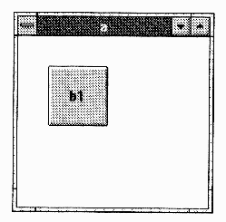
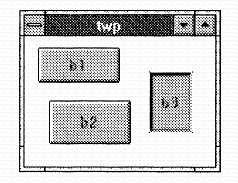
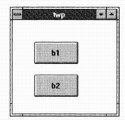
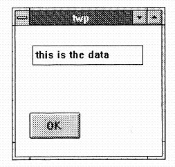
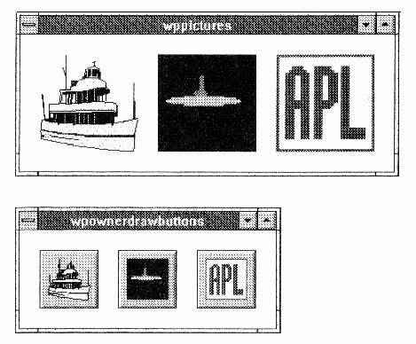
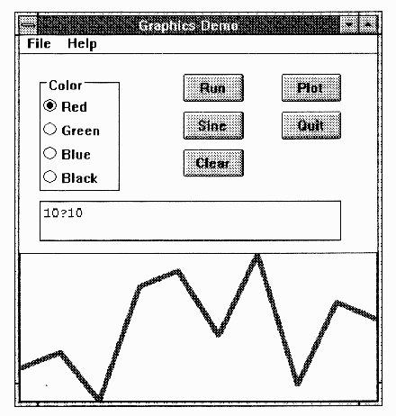
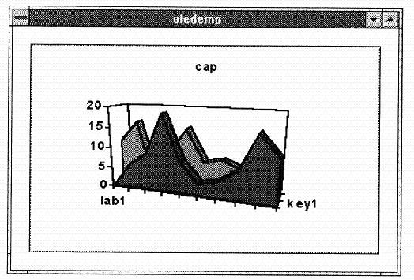

given by Eric Iverson <span class="affil">(detailed notes by Adrian Smith)</span> <span class="email"></span>
{ .byline }

### Prologue

“Visual Basic: I never had any sense that I knew what was going on - it was ‘neat’ but obscuring”

Design goals for a common window driver for APL and J:

- easy to learn and easy to use for straightforward “serious” applications
- no intention of allowing the flash whizzbang stuff!
- will be available as a DLL for any Windows product - including other APLs!
- should provide anyone with a sinple and fun way of learning Windows programming for just $30.
- APL keyboard based on the Sharp Union keyboard, with minimal adaptations to conform to Windows conventions.
- the tutorial is all in the online help, and can be printed from a .WRI file which is also on the disk.
- what you do is what you get - there is less magic this way (unlike VB)

“We have the APL character-set; we just don’t have an APL programmer” (on making a couple of excusable typing errors)”

Here we go ...

```
     )clear
clear ws
     ⎕wd 'pc abc;'     ... parent create
blah blah etc
     ⎕wd 'pshow;'     ... makes window visible
*type 2 nowait *parent sysnowait
     ⎕wd 'ptop;'     ... so it stays visible!
     ⎕wd 'reset;'     ... destroy all wdws and tidy up.
```

This sequence shows the basic philosophy and syntax of the window driver `⎕wd`. The rule is to define all the details of the form in advance with a ‘parent create’ before exposing it to view. Note the semi-colons which are mandatory statement delimiters. To make life a little easier, Eric now loaded a simple utility workspace to cover the `⎕wd` calls, and to reformat the results into a more congenial nested form.

```
)load isiwin
     ed x
del x w
[1] tackwd omega
del

x 'pc a;ptop;pshow;'
x 'xywh 15 15 30 30;'
```

Rectangles are a crucial building block in the Window Driver’s world. Here we define a rectangular patch at xy (15,15) (in Microsoft proportional co-ordinates, where (0,0) is the top left corner of the screen) which is 30 units wide and 20 high.

```
x 'cc b1 button;'
```

## 

This uses the current rectangle as the frame for the new object (cc = child create). The easy way to write programs of a more useful size is to write the entire WD script in advance as a text variable, and then pass the script to `⎕wd` for execution.

```
wp assign ''
     ed wp

     rem   This is Windows stuff
     pc a; rem more remarks here if you like
     xywh 15 15 30 20;
     cc b1 button; pshow;

x wp  ... runs it!
```

Of course just because it was made from a script doesn’t stop us adding some extra stuff dynamically:

```
     x 'xywh 100 15 30 20;'
     x 'cc b2 button;'
```

... you don’t see anything yet?! That’s because it’s not inside the visible window ... let’s stetch it a bit .... as you can see it was there all the time! This could be a real nuisance (invisible objects) so we can avoid the problem by adding a ‘`pas 10 10;`’ to the program; this is the ‘parent autosize’ command which ensures the parent is big enough to hold all defined children. Other useful tricks are ‘`pcenter;`’ to centre a dialog box on the screen and `ed ''` which re-invokes the editor on the last object. There are also several special parents for particular jobs ... try ‘`pcd msgthing;`’ which is Parent Create Dialogbox ... i.e. a simple centred window with a thick border, no resize etc.

### Visual Editing

```
     wp assign ''
     ed ''

     pc twp;
     xywh 20 20 20 20;   ... anywhere, any size
     cc b1 button;
     cc b2 button;
     cc b3 button;    .... may look silly, but wait!
```

We have the objects we want, so now let’s put them in the right place ...

```
t1wp assign wdvedit wp ... invoke visual editor
```

## 

... note that dragging a child causes an automatic resize of the parent. Sooner or later, you have to say “this is aesthetically pleasing” and hit F10 to save the new script. Note that what he editor has actually done is moved the rectangles in the script ...

```
     t1wp
blah blah
     x t1wp   ... runs it.
```

Usually it is more convenient to define one object with respect to another ...

```
     adjh 10;    ... bump xywh +10 units downwards
     x t1wp

     t2wp assign wdvedit t1wp
```

## 

You can’t grab the b2 button any more, because it has no rectangle! When we move or resize b1 all the others jump to match! Note that you are always moving the rectangles, not the objects which you placed in them.

### Moving on

The next thing we need to make is an input area, again this goes within a defined rectangle:

```
     xywh 20 20 20 20;
cc e1 edit ws_border
```

As before, you can fix it up with `wdvedit` and run it. The input box is defined by its type (‘`edit`’ is the example) and by its style (‘`ws_border`’ puts a black frame round it so the user can see where to type).

OK ... we’ve got these guys, so let’s have them talk to us! All you really need is the ability of your APL or J application to `wait`.

```
     wd 'wait;'
```

... a couple of interesting things happen:

- APL is ‘running’ but it isn’t listening to you! You can’t type anything in the session.
- you can type into the edit box on the form, and when you hit b2 you cat a result back from wd:

## 

```
*type 5 button
*parent twp
*id b2
*pinfo blah blah (usually not interesting)
ed this the data
```

So now we have everything we need to create an application. This can be driven by the simplest of message loops; it can check for a `sysclose` event (the user has killed off the form), else it loops back and keeps listening with another wait.

Q:     who decides what events you intercede on?

A:     I decide! There is no filter which the user can adjust. The wait will terminate on most “reasonable” events, but the list does not include (for example) ‘mouse-move’.

### More Examples

```
     )load isiwp   ... examples
     run ''        ... runs scripts in the ws
```

## 

This illustrates the use of Windows Metafiles, Bitmaps and Icons, which can be written either to graphics areas or on to buttons. You can also easily access the ‘common dialog boxes’:

- the standard ‘filebox’ with the ability to predefine filters and other styles
- the windows ‘fontbox’ which offers a standard way for the user to make font selections
- the colour-selection box. This offers a colour palette, and returns an RGB triple.
- the standard set of ‘msgbox’ objects for warnings, queries, critical errors and so on.

### After Coffee ...

```
     )load isidemo
     gfx ''     ... demo charting function
```

... as someone learning the system, you would play with the application - then take it apart.

- `10?10` ... you get a typical business graph, and you could take decisions based on it:

## 

- this is “sort of” an object, so you can use an invisible edit box to store state information.

```
     )load isigen     ... skeleton application
     gen     ... runs it as it stands
     appcreate 'nap'      ... evolve it into our own application
Can't
     )wsid nap     ... safety feature!
     appcreate 'nap'     ... now it will work
     nap     ... an exact clone of the skeleton
```

To add a button called ‘New’ we first edit the main script (called by convention ‘`napwp`’) and add a ‘`cci new button;`’ for ‘create child inherit’, i.e. make a new button just like the last one. When we run the form and push the button, the application displays “New isn’t defined” (because we haven’t told it what to do with the button-press event). The next step is to fix `napmain` to insert some useful code at label ‘`New:`’ (e.g. to display the system timestamp in the existing edit field).

This most basic application can be controlled from a very simple message loop - things get harder when there are several active forms as it is tricky to ensure that the “callback” is always despatched to the correct function.

### Let’s Move Outside APL

```
     )load isidde
     wd'winexec apl.exe'     ... start an new apl session
```

“DDE is a very badly designed and terribly implemented version of shared variables - but everybody uses it!”

Top window ... let’s be a server:

```
     wd'ddename serv;'
     quad assign d assign '*data' wdg wd 'wait;'
```

The wdg is a simple utility to extract the \*data item from the result of the wait command.

Bottom window (top window is waiting):

```
     wd'ddepoke serv topic item "how now cow";'
```

... top application displays “how now cow” and returns to prompt. Of course where DDE really pays off is when communicating with something other than APL - but learn it with APL&lt;->APL so you are in control of both ends of the link.

Q:     Aside from getting the link started, is it really asymetrical?

A:     No - they’ve done a lot of work to make it asymetrical, but you can overcome that!

```
     runexcel     ... start Excel at 'sheet1'
     2 2 set ?3 5rho 100
     saveas 'mum.xls'
```

The numbers show up in Excel, and get saved as a spreadsheet. You can fire quite complex command sequences from APL, but it is usually better to work up the macros in the Excel environment (where you have access to the Excel debugging tools) and simply fire the whole macro from APL.

This also works with MS Access ... but someone has been fiddling with the demo! Come and see it on the stand - but it does work, honest!

### Object Linking and Embedding

Read the Microsoft books, and try to figure out what this is ... or just use it!

```
     )load isiole
     demograph     ... runs MSGraph as an OLE client.
```

## 

```
     graphdata ?20 rho 2
     graphdata ?2 10 rho 20  ... etc
```

If you have an Excel user who is a hot-shot at graphics, he will instantly know how to use your application!

Other useful OLE servers which will sit inside your applications:

- paintbrush (everyone gets this with Windows, and most people can use it)
- object packager - this makes an excellent ‘launch-pad’ for other applications. They can be packaged up with an icon so they sit happily on a button in your system.
- most modern Windows applications (from Excel to CorelDRAW!) will act as OLE servers.

### Summary

You don’t have to be a masocistic C programmer to be a GUI programmer! The window-driver will shortly be packaged up as a DLL - it is probably easier to do it than to do the market survey, so we’ll just do it.

Q:     Motif?

A:     Right now it’s very hardwired to Windows. We believe it will trivially port to OS/2 PM and it should be reasonably easy to move to Motif.

The session closed to general acclaim.

### Commentary

<i>by Adrian Smith</i>

One of the most useful innovations of this conference was to repeat all the tutorials during the main body of the programme. This gave the participants a chance to do some serious learning, and made an excellent opportunity for us to break the normal routine.

I found Eric Iverson’s 3-hour session on the ISI Windows Driver most illuminating; Eric is an excellent teacher, and introduced the material in a logical and ‘easy to swallow’ sequence. He also fielded questions thoughtfully, and was always willing to repeat material (using different words) for the benefit of the non-English speakers in the class.

Personally, I find myself wanting to code in the union (not unfortunately the intersect) of Eric’s GUI and Dyadic’s. I think they both have things to learn from each other, and if they can move just a little way to closing the gap, I suspect that between them they have the scope to clean up on the world market for PC APLs over the next 10 years.

In no particular order:

- I understand Dyadic’s reluctance to provide native access to all the Windows common dialogs (these don’t exist under Motif), but the application hack in me wants a quick way of getting to `Fontbox` and `Colorpalette`. Maybe a distributed WS to cover `⎕NA` would suffice?
- Eric has rightly shied away from reporting all the mouse-move events, but these are pretty useless anyway. What we do need are ‘mouse-up’ and ‘mouse-down’ to allow us to put up pop-up menus at the mouse location. More useful than anything in Dyalog would be a ‘mouse-entered-object’ and ‘mouse-exited-object’ pair - I don’t know if these could be done, but I know I would like to use them!
- Dyalog are going to have to look into OLE. The stuff that Eric showed with MSGraph and Paintbrush was clearly the way forward for simple business applications. If I want a table in Word, I simply embed a spreadsheet - far faster and much more reliable than the Word ‘tables’. If I want a simple chart on a form (which my user can edit) I should use MSGraph.
- I really like Dyalog’s ‘locator’ object. Doing your own ‘rubberbanding’ with APL needs a snappy 486 - the locator does it for you and gives you an event when you let go the mouse. Eric, please copy!!

The final comment I would like to make is a tricky one about the whole philosophy of programming with callbacks. The old-style programmer in me is much more comfortable with Eric’s approach of returning to APL on every event and letting a bunch of GOTOs handle the event logic. This way I can see what is going on, and I can execute arbitrary slugs of APL code when events happen.

On the other hand, I have to say that (so far) the systems I have written with Dyalog have been quite astonishingly reliable; far more so than I have ever achieved in the same time with a conventionally structured workspace. I also managed to code Minesweeper (see this Vector) with precisely one branch arrow, and that was only needed due to sloppy thinking.

I think that what I am asking for is:

- a simple table-driven event handler to field the `⎕wd` returns and conditionally execute the corresponding code. Wildcards or inheritance could be explored. This could also include a simple ‘monitor’ to help me to see what was happening. Basically this would be doing the same job as Eric’s `napmain` function, but would be a lot more extensible, and much easier to debug.
- something in the Dyalog ‘trace’ option to let me follow what is going on during a dequeue. Because I never get back into APL until my program ends, the conventional tracing methods are almost useless. If I fire a mis-spelled callback, all I get is a `VALUE ERROR` with no clue where to look for the mistake! This is all quite awful, and has driven me to the brink of rejecting Dyadic’s approach altogether and reverting to something closer to the ISI philosophy.

The basic problem is that neither Dyalog nor ISI are programming applications with this stuff! The rest of us are just beginning to climb the learning curve, and don’t have the expertise to offer them any really sound advice. Nevertheless, I think we should try, and I would also advise owners of either interpreter to go and try out the other one! That way we stand a chance of getting them to converge, at least to the point where a common utility set could make the differences irrelevant.

(webpage generated: 8 December 2005, 00:30)
