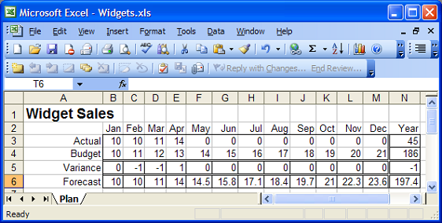

by Morten Kromberg
{ .byline }

## Chapter 5. Properties

The first four chapters of the *Introduction to Object Oriented Programming For APL Programmers* were published in [Vector 22.1](trad/v221/oop1221.htm). With luck, we are now able to find our way around simple classes and instances, and are ready to explore the next piece of OO functionality.

A *Property* is a member which is *used* in the same way as a field, but *implemented* as a one or more functions: There is usually a pair of functions, which are commonly referred to as the *getter* and the *setter*.

To explore properties, we are going to modify our <span class="aplu">TimeSeries</span> class so that an instance represents a year of monthly data. In case we do not have observations for all the months, we would like to be able to indicate which months we do have data for:

<pre class="aplu">:Class Monthly
   :Field Public Obs    ⍝ Observed values
   <b>:Field Public X     ⍝ X values for observations (Months)</b></pre>

```
   :Field Public Degree←3 ⍝ 3rd degree polynomials by default
```

```
   ∇ r←PolyFit x;coeffs
     :Access Public
     ⍝ Use cubic fit of observed points to compute values at x
```

<pre class="aplu">      <b>coeffs←Obs⌹X∘.*0,⍳Degree  ⍝ Find polynomial coeffs
</b>      r←coeffs+.×⍉x∘.*0,⍳Degree  ⍝ Compute fitted f(x)
    ∇   </pre>

<pre><span class="aplu">    ∇ make args
      :Implements Constructor
      ⍝ args: Obs [X]
      <b>args←,(⊂⍣(1=≡args))args   ⍝ Enclose if simple<sup><a href="#_ftnref1">[1]</a></sup>
</b></span><span class="aplu">      <b>Obs X←2↑args,⊂⍳⍴⊃args
</b>      <b>'Invalid Month Numbers' ⎕SIGNAL (∧/X∊⍳12)↓11
</b>    ∇

:EndClass ⍝ Class Monthly</span></pre>

Bold text highlights the changes: We have added a new field called <span class="aplu">X</span> , which will contain the <span class="aplu">X</span> co-ordinates of our observations. The <span class="aplu">PolyFit</span> function has been enhanced to use <span class="aplu">X</span> rather than (<span class="aplu">⍳⍴Obs</span>) in constructing the right argument to matrix division. The constructor <span class="aplu">make</span> has been enhanced so that it generates <span class="aplu">X</span> if it was not provided:

```
      (⎕NEW Monthly (1 4 7 9 10)).X ⍝ Instance discarded at end of line
1 2 3 4 5

      m1←⎕NEW Monthly ((1 4 7 9 10)(1 3 5 7 9))
      m1.X
1 3 5 7 9
```

Because we think we might extend our class to handle very long timeseries at some point in the future, and since the matrix division algorithm only uses the actual observations anyway, we have decided to use a “sparse”data structure: We only store the points for which we have values.

We will experiment with defining a variety of properties which can present the sparse data in ways which may be more convenient to the user.

## <a id="_Toc117440120"></a>:Property Simple

A reporting application is likely to want to see the data as a 12-element vector, so it can be tabled with other series and easily summarized. We can support this requirement using the following property:

```
   :Property Simple FullYear
   :Access Public
       ∇ r←Get
         r←(Obs,0)[X⍳⍳12]
       ∇
   :EndProperty
```

*Simple* is the default type of property, so the keyword Simple is not actually required above. Although <span class="aplu">FullYear</span> is implemented using a function, it looks, tastes and feels[<sup>\[2\]</sup>](#_ftnref2) like a field (or a variable) to the *user* of the class:

```
      ts1←⎕NEW Monthly ((1 4 2 7 3) (1 2 3 7 8))
      ts2←⎕NEW Monthly ((1 3 2 4 1) (1 3 5 7 9))
      ts1.FullYear[2] ⍝ February
4
      ↑(ts1 ts2).FullYear
1 4 2 0 0 0 7 3 0 0 0 0
1 0 3 0 2 0 4 0 1 0 0 0

      ts1.FullYear←⍳12
SYNTAX ERROR...
```

The last statement above illustrates that <span class="aplu">FullYear</span> is a read only property, which is due to our not having written the corresponding <span class="aplu">Set</span> function – we’ll get to that in a minute. APL is (of course!) able to perform indexing on the data returned by a property, as can be seen in the expression where we extracted data for February. However, the <span class="aplu">Get</span> function *did* generate all 12 elements of data, which might have been extremely inefficient if we had more data.

The <span class="aplu">:Access Public</span> statement makes the property visible from outside the instance. Without this, the property could only be used by methods belonging to the class.

## <a id="_Toc117440121"></a>:Property Numbered

*Numbered* properties are designed to allow APL to perform selections and structural operations on the property, delaying the call to your get or set function until APL has worked out which elements actually need to be retrieved or changed:

```
   :Property Numbered ObsByNum
   :Access Public
       ∇ r←Shape
       r←12
       ∇
       ∇ r←Get args
        r←(Obs,0)[X⍳args.Indexers]
       ∇
       ∇ Set args;i
        :If (⍴X)<i←X⍳args.Indexers           ⍝ New X?
            X←X,args.Indexers ⋄ Obs←Obs,args.NewValue ⍝ Add it
        :Else
            Obs[i]←args.NewValue            ⍝ Update
        :EndIf
       ∇
   :EndProperty
```

In order for APL to perform indexing and other structural operations, it needs to know the <span class="aplu">Shape</span> of the property. With this knowledge, APL is able to perform the same indexing and structural operations which would be allowed on the left side of the assignment arrow in a selective specification expression. The getter is called when APL encounters a function which actually needs the data in order to proceed.

To investigate how this works, edit the <span class="aplu">Get</span> function for the property <span class="aplu">ObsByNum</span> in the class <span class="aplu">Monthly</span> from the workspace <span class="aplu">OO4APL\\Monthly</span>, so that it outputs the contents of <span class="aplu">args.Indexers</span> to the session on each call – and experiment with different operations on the property –for example:

```
     ts1←⎕NEW Monthly ((1 4 2 7 3) (1 2 3 7 12))
     ts1.ObsByNum[2]
 Get: 2
4
```

```
     ¯2↑ts1.ObsByNum
 Get: 11
 Get: 12
0 3
```

```
     1↑⌽ts1.ObsByNum
 Get: 12
3
```

```
     ts1.ObsByNum
 Get: 1
 Get: 2
...etc... 3...11
 Get: 12
1 4 2 0 0 0 7 0 0 0 0 3
```

As can be seen above, the number of function calls is equal to the number of elements which are accessed. In a future release of Dyalog APL, it may become possible to declare the *rank* of the getter and setter, so they can work on several indices in a single call.

When APL calls a getter or setter for a numbered property, the argument is an instance of type <span class="aplu">PropertyArguments</span>, which will contain the following variables:

<table width="80%" border="1" cellspacing="0" cellpadding="4" align="center">
    <tr>
      <td valign="top">
  
        <p class="aplu">Indexers</p>
      </td>
      <td valign="top">
  
        <p>An integer vector of the same length as the
  rank of the property (as implied by the result of the <span class="aplu">Shape</span>
  function).</p>
      </td>
    </tr>
    <tr>
      <td width="108" valign="top">
  
        <p class="aplu">Name</p>
      </td>
      <td width="432" valign="top">
  
        <p>The name of the property, which is useful
  when one function is handling several properties (we’ll show how to do that
  later).</p>
      </td>
    </tr>
    <tr>
      <td width="108" valign="top">
  
        <p class="aplu">NewValue</p>
      </td>
      <td width="432" valign="top">
  
        <p>Within a setter, this is an array containing
  the new value for the selected element of the property.</p>
      </td>
    </tr>
  </table>

Note that <span class="aplu">Indexers</span> will always contain indices in the index origin of the *class*. This means that the access functions do *not* need to adapt to the index origin of the calling environment – APL adjusts the indices as appropriate. Conversely, the user of a class does not need to know the index origin used within the class. This is a good example of *encapsulation* or *information hiding*, important principles of object orientation which make it easier to share and use code without needing to understand details of the implementation.

## <a id="_Toc117440122"></a>:Property Keyed

It is common for object oriented languages to allow indexing using names or other *keys*, which are not necessarily numeric indices into an array. For example, the collection of sheets in an Excel workbook can be indexed by sheet name:

```
     XL←⎕NEW 'OleClient' 'Excel.Application'
     XL.ActiveWorkbook.Sheets.Item[⊂'Sheet2'].Index2
```

Note: To preserve compatibility, OleClient objects created using <span class="aplu">⎕WC</span> will still expose <span class="APLU">Item</span> as a method rather than a property:

```
     'XLW' ⎕WC 'OleClient' 'Excel.Application'
     XLW.ActiveWorkbook.Sheets.(Item 'Sheet1').Index
2
```

In version 11.0, *keyed* properties make it possible to support indexing of properties using arbitrary keys. If we create vector of month names to use as keys:

```
   Months←'Jan' 'Feb' 'Mar' 'Apr' 'May' ... 'Nov' 'Dec'
```

Alternatively, if we have the Microsoft.Net framework available on our machine, we can extract the names from the environment:

```
   ⎕using←'System.Globalization' ⍝ DotNet "Globalization Namespace"
   Months←12↑(DateTimeFormatInfo.New ⍬).AbbreviatedMonthNames
```

This will define a 12-element vector[<sup>\[3\]</sup>](#_ftnref3) of 3-letter month names in the local language. We can now define a property to do indexing using local month names:

```
:Property Keyed ObsByName
:Access Public
    ∇ r←get args;i
      ⎕SIGNAL((⍴Months)∨.<i←Months⍳1⊃args.Indexers)/3 ⍝ INDEX ERROR
      r←(Obs,0)[X⍳i]
    ∇
    ∇ Set args;i;m
      ⎕SIGNAL((⍴Months)∨.<i←Months⍳1⊃args.Indexers)/3 ⍝ INDEX ERROR
      m←(⍴X)<i ⍝ New months?
      X←X,m/i ⋄ Obs←Obs,m/args.NewValue ⍝ Add new months
      Obs[X⍳i]←args.NewValue
    ∇
:EndProperty
```

The <span class="aplu">ObsByName</span> property can be used as follows:

```
      ts1.ObsByName[⊂'Jan']
1
      ts1.ObsByName['Oct' 'Nov' 'Dec']←4 5 6
```

The entire index and array of new values (when provided) is passed in a single call to a *keyed* getter or setter. APL will verify that the shape of the sub-array identified by the <span class="aplu">Indexers</span> conforms to the shape of the result of get, and in the case of set, the new values. This is why <span class="aplu">'Jan'</span> must be enclosed in the first example above.

Unlike a field, a property does not map directly to an underlying array. The property provides a “virtual”array, the elements of which can be generated on demand – and created when updated. As an extreme example of this, the following class presents the APL interpreter as an infinitely large keyed property, with all possible APL expressions as keys, and the results of the expressions as the corresponding values:

```
:Class APL
    :Property Keyed ValueOf
    :Access Public
        ∇ r←Get args
          r←⍎¨1⊃args.Indexers
        ∇
    :EndProperty
:EndClass ⍝ APL
```

Allowing:

```
      iAPL←⎕NEW APL
      iAPL.ValueOf['2+2' '+/⍳5']
4 15
```

### Numeric Keyed Properties

Note that you can use *keyed* properties with integer indices, and use them in the same way as in a *numbered* property. You might do this if you were worried that a numbered property would be inefficient due to the number of calls to your access functions, or if a simple property would cause too much data to be generated, The drawback of this approach is that the only direct selection operation which is possible on a keyed property is square bracket indexing, and – since APL passes the indices unchanged – the indices will have to be provided in the index origin of the class.<a id="_Toc117440123"></a>

For readers familiar with the concept of function rank, it is possible to think of a numbered access function as having rank zero, while a keyed access function has infinite rank. Future versions of Dyalog APL may allow you to control the rank of your access functions.

## Default Properties

The :Indexer keyword defines a *default property* for a class. If a class has a default property, square bracket indexing can be applied directly to a ref to the instance. If we edit the definition of the <span class="aplu">ObsByNum</span> property and replace <span class="aplu">:Property</span> and <span class="aplu">:EndProperty</span> by the keywords :Indexer and <span class="aplu">:EndIndexer</span>, we can apply indexing as follows:

```
      ts1←⎕NEW Monthly ((1 4 2 7 3) (1 2 3 7 8))

      ts1[2]      ⍝ Short hand for the following expression
4
      ts1.ObsByNum[2] ⍝ Equivalent to the above
4

      ⍴ts1       ⍝ But: ts1 is a scalar

      2↑ts1
DOMAIN ERROR
```

The last two expressions expose a problem with indexers: An instance (or rather: a reference to an instance) *is* a scalar. The APL standard allows square bracket indexing on instance as a *conforming* extension, since indexing the instance would give a <span class="aplu">RANK ERROR</span>. However, all other selection or structural operations will view the instance as a scalar. For example, the expression <span class="aplu">(2↑ts1)</span> should return <span class="aplu">ts1</span> followed by a prototypical instance of the <span class="aplu">Monthly</span> class, but fails because none has been defined (we’ll look at how to define class prototypes when we take a closer look at *constructors*).

Version 11.0 adds support for APL2’s “squad indexing”primitive, a dyadic primitive function which provides a functional alternative to square bracket indexing:

```
      4⌷'ABCD'        ⍝ 'ABCD'[4]
D
      2 (1 2)⌷2 2⍴'ABCD'   ⍝ (2 2⍴'ABCD')[2;1 2]
CD
```

In version 11.0, <i>monadic</i><span class="aplu">⌷</span> returns the entire right argument, as if the elided left argument had selected everything along all dimensions. If the right argument is an instance, monadic <span class="aplu">⌷</span> returns the entire contents of the default property.

```
      ⍴⌷ts1
12
      2↑⌷ts1
1 4
      ⌷ts1
1 4 2 0 0 0 7 3 0 0 0 0
```

Note that the 2nd expression above only called the numbered getter twice, once for each element of the complete selection operation <span class="aplu">2↑⌷</span>. If we had picked <span class="aplu">ObsByName</span> as the <span class="aplu">:Indexer</span>, we would be able to index the instance using month names:

```
      ts1←⎕NEW TS2 ((1 4 2 7 3) (1 2 3 7 8))
      ts1['Jan' 'Jul']
1 7
```

(Obviously), there can only be one default property.

## <a id="_Toc117440124"></a>Triggers

If you want the “lightweight” characteristics of a *field*, where APL handles data access directly without your having to write access functions, but you would like to be able to react to changes to the field, you can use a *trigger*. A trigger is a function which is called when one or more fields (or other variables) are modified. For example, we could update our <span class="aplu">Monthly</span> class so that it calculates the coefficients when one of the variables involved in the calculations change, rather than doing it on every call to <span class="aplu">PolyFit</span>. <span class="aplu">PolyFit</span> can be modified to use the pre-calculated coefficients:

<pre>   <span class="aplu">∇ PreCalc args
     :Implements Trigger X,Obs,Degree
     ⎕←'PreCalc: ',args.Name
     :If OK←((⍴Obs)=⍴X)∧Degree&lt;⍴Obs
         Coeffs←Obs⌹X∘.*0,⍳Degree ⍝ Find polynomial coeffs
     :EndIf
   ∇</span></pre>

<pre>   <span class="aplu">∇ r←PolyFit x;coeffs
     :Access Public
     ⍝ Fit polynomial to observed points to compute values at x</span></pre>

<pre><span class="aplu">     'Unable to Fit Polynomial' ⎕SIGNAL OK↓5
     r←Coeffs+.×⍉x∘.*0,⍳Degree  ⍝ Compute fitted f(x)
   ∇</span></pre>

<span class="aplu">PreCalc</span> writes to the session when it is called, so we can keep an eye on things:

```
      ts1←⎕NEW Monthly ((1 4 2 7 3) (1 2 3 7 8))
PreCalc: Obs
PreCalc: X
      1⍕ts1.PolyFit 1 2 3 4
 1.7 2.0 3.5 5.3
```

<pre>     <span class="aplu">ts1.Degree←2
PreCalc: Degree
     1⍕ts1.PolyFit 1 2 3 4
 1.0 2.7 4.0 4.8</span></pre>

```
     ts1.X←1 2 3 7
Precalc: X
     1⍕ts1.PolyFit 1 2 3 4
Unable to Fit Polynomial
```

The trigger mechanism in version 11.0 is not a purely object oriented feature. It can be used to track any variable in a workspace. For example:

```
   ∇ foo args
     :Implements Trigger A
     'A ←'A'at',1↓⎕SI{⍺,'[',(⍕⍵),']'}¨⎕LC
   ∇
   ∇ goo
     A←2
     A←'Hello'
   ∇
```

If we now run goo, we will see the following output:

```
 A ←  2  at goo[2]
 A ←  Hello  at
```

**Warning:** Applications should not depend on the exact timing of, or the number or calls to, a trigger, beyond relying on each trigger function to be called at least once following the completion of the primitive function (usually assignment) which set the trigger variable. As can be seen in the above example, the trigger functions were called *after* the completion of the entire line of code containing the trigger event. In the second case, <span class="aplu">goo</span> was no longer on the stack at the time when <span class="aplu">foo</span> was called.

## <a id="_Toc117440125"></a>Chapter6. Constructors and Destructors

As we have seen, a *constructor* is a function which is called to initialize the contents of an instance, immediately *after* the instance has been created – but *before* it can be used. In the examples we have seen so far, we have used it to:

<span class="indent"> • Set an initial seed in our </span><span class="aplu">Random</span><span class="indent">
number generator class</span>

<span class="indent">• Initialise data for a new instances of </span><span class="aplu">Monthly</span><span class="indent">
and </span><span class="aplu">TimeSeries</span>

A constructor is used when it makes sense to provide initial values for fields, or allocate external resources associated with the object. For example, a constructor might open a component file, or connect to a database and execute a query.

A *destructor* is called when the instance is about to disappear. In a destructor, you can close files and database connections, or free up any other resources which will no longer be required.

The following is a simple class which provides access to Excel Workbooks, using Excel as an OLE Server:

```
:Class ExcelWorkBook
```

```
    :Field Public Application
    :Field Public Workbook
    :Field Public Sheets
    :Field Private Opened←1 ⍝ Did we open it?
```

```
∇ make book;i;books
      :Implements Constructor
      'Application' ⎕WC 'OleClient' 'Excel.Application'

      :If 0≠Application.Workbooks.Count ⍝ Currently open books
          books←Application.Workbooks.(Item¨⍳Count)
      :AndIf (⍴books)≥i←books.FullName⍳⊂book ⍝ Already open?
          Workbook←i⊃books
          Opened←0 ⍝ No we did not
      :Else
          :If book∧.=' ' ⍝ No book named => Create one
              Workbook←Application.Workbooks.Add ⍬
          :Else      ⍝ Open the requested book
              Workbook←Application.Workbooks.Open book
          :EndIf
      :EndIf
 ...

      Sheets←Workbook.Sheets.(Item¨⍳Count) ⍝ ⌷Workbook.Sheets
    ∇

    ∇ close
      :Implements Destructor
      :If Opened  ⍝ Close it if we opened it
          :Trap 0 ⍝ If workbook somehow damaged
              ⎕←'Closed workbook ',Workbook.FullName
              Workbook.Saved←1
              Workbook.Close ⍬
          :EndTrap
      :EndIf
    ∇
:EndClass ⍝ Class ExcelWorkBook
```

The constructor takes the name of a workbook as its argument, and ensures that the book is open. If the name is blank, a new workbook is created. The three public fields of this class are:

<table border="1" cellspacing="0" cellpadding="4" width="80%" align="center">
    <tr>
      <td width="152" valign="top">
  
        <p>Application</p>
      </td>
      <td width="376" valign="top">
  
        <p>A handle to Excel.Application, so we can do
  things like make Excel visible and tell it not to issue prompts.</p>
      </td>
    </tr>
    <tr>
      <td width="152" valign="top">
  
        <p>Workbook</p>
      </td>
      <td width="376" valign="top">
  
        <p>Handle to the Excel workbook instance
  corresponding to our workbook.</p>
      </td>
    </tr>
    <tr>
      <td width="152" valign="top">
  
        <p>Sheets</p>
      </td>
      <td width="376" valign="top">
  
        <p>A vector containing all the sheets in the
  book, for easy access.</p>
      </td>
    </tr>
  </table>

The following illustrates the use of the first two fields.

```
      wb1←⎕NEW ExcelWorkBook 'c:\temp\book1.xls'
      wb1.Application.Visible←1
      wb1.Workbook.FullName
C:\temp\Book1.xls
```

The following examples show how we can read data from the sheets, make a change, save the workbook, and close the object:

```
      wb1.Sheets.Name
Sheet1  Sheet2  Sheet3

      wb1.Sheets[1].(Name UsedRange.Value2)
 Sheet1 1  2  3  4  5 6  7  8
        9 10 11 12 13 14 15 16

      wb1.Sheets[1].(Range 'A1:B2').Value2←2 2⍴'Kilroy' 'was' 'here' '!'

      wb1.Workbook.SaveAs 'c:\temp\book2'

      ⎕ex 'wb1'
Closed workbook: C:\temp\Book1.xls
```

Note that the destructor is called when the *last* reference to an instance disappears. If you expunge a name and the destructor is not called as you expected, look for a leaked local variable or a temporary global created by hand, containing a reference that you had forgotten about.

The system function <span class="aplu">⎕INSTANCES</span> will return a list of refs to existing instances:

```
      wb1←⎕NEW ExcelWorkBook 'c:\temp\book1.xls'
      wb2←⎕NEW ExcelWorkBook 'c:\temp\book2.xls'
      books←wb1 wb2

      ⎕instances ExcelWorkBook
 #.[Instance of ExcelWorkBook]  #.[Instance of ExcelWorkBook]
      (⎕instances ExcelWorkBook).Workbook.Name
 Book1.xls  Book2.xls

      )erase wb1 wb2
      ⍴⎕instances ExcelWorkBook
2
```

There are still 2 instances.

## <a id="_Toc117440126"></a>Display Form

The function <span class="aplu">⎕DF</span> (Display Form) can be used to set the “display form”, of an instance (or namespace) – which defines the result returned by monadic format (<span class="aplu">⍕</span>) of the instance. By default, the display form shows the parent space and the name of the class, as in:

```
#.[Instance of Monthly]
```

This tells us that we have an instance of Monthly which was created in the root (<span class="aplu">#</span>). <span class="aplu">⎕DF</span> is often used in a constructor to set the display form to something which helps to identify the particular instance. For example, if we added the following line to the constructor of <span class="aplu">Monthly</span>:

```
     ⎕DF ⍕,[1.5]'[Timeseries]' (Months[X],'=',[1.5]Obs)
```

Then the display form would be something like:

```
     ⎕←ts1←⎕NEW Monthly ((1 4 2 7 3) (1 2 3 7 8))
[Timeseries]
 Jan = 1
 Feb = 4
 Mar = 2
 Jul = 7
 Aug = 3
```

We could also update the trigger function to keep the display form up-to-date.

## <a id="_Toc117440127"></a>Niladic Constructors and the Class Prototype

All the constructor methods we have written so far have taken an argument which has been used to initialise each new instance. If the constructor is a niladic function, this means that the class does not need any instantiation parameters. It is possible for a Dyalog APL class to have two constructors: One which takes an argument, and one which does not. A constructor with no argument is known as the *default constructor*. If <span class="aplu">⎕NEW</span> is called with no parameters following the class, the default constructor will be called. For example, we could have defined a niladic constructor for the <span class="aplu">Random</span> class, as an alternative to testing whether the argument is zero in the monadic constructor:

```
   ∇ make args
     :Implements Constructor
     InitialSeed←args
     Reset
   ∇

   ∇ make0
     :Implements Constructor
     make InitialSeed
   ∇
```

Often, the default constructor will simply call the main constructor, supplying default arguments. With the above constructors and the <span class="aplu">RL</span> function from the beginning of chapter 4, the <span class="aplu">Random</span> class could be used as follows:

```
      r1←⎕NEW Random ⍝ Nothing strange about this...
Random Generator Initialised, Seed is 42

      r1.RL 1234  ⍝ Change ⎕RL to 1234 (returns old value)
42
      (3↑r1).RL 0  ⍝ Creates two instances using default constructor
Random Generator Initialised, Seed is 42
Random Generator Initialised, Seed is 42
1234 42 42

      r0←0/r1    ⍝ Keeping none causes creation of a prototype
Random Generator Initialised, Seed is 42

      (1↑r0).RL 0  ⍝ 1↑ causes creation of a new prototype
Random Generator Initialised, Seed is 42
42

      1↑r0.RL 0
0
```

In the last example, APL determines the type of the result by calling the function <span class="aplu">RL</span> on the prototype and doing a <span class="aplu">0⍴ </span>of that result (<span class="aplu">42</span>). <span class="aplu">1↑</span> on this gives the result. **Note:** The exact timing of prototype creation during the execution of expressions involving empty arrays may change before version 11.0 is generally available.

## <a id="_Toc117440128"></a>Chapter 7. Shared Members

Almost all the members we have used up to this point have been *instance* members. An *instance field* has a distinct value for each instance. The code in *instance methods*, or associated with *instance properties,* generally refer to instance data. *Shared* fields have the same value in *all* instances. Shared methods and property accessor functions access shared data.

The meaning of the terms *public* and *private* is the same for shared members as it is for instance members. Public members are visible from outside, private members can only be seen by code which is defined and running inside the class.

The <span class="aplu">Months</span> field, which contains abbreviated month names within the <span class="aplu">Monthly</span> class, is an example of a field which might as well be shared – it is going to be the same in all instances. We can add:

```
:Field Shared Public Months
```

... to the beginning of our <span class="aplu">Monthly</span> class, and subsequently verify that the property is in fact shared:

```
     ts1←⎕NEW Monthly ((1 2 3 4)(5 6 7 8))
     ts2←⎕NEW Monthly ((3 4 5 6)(5 6 7 8))
     ts1.Months[3]←⊂'Mch'

     ts2.Months
 Jan Feb  Mch  Apr May  Jun  Jul Aug  Sep  Oct Nov  Dec

     )erase ts1 ts2
     Monthly.Months
 Jan Feb  Mch  Apr May  Jun  Jul Aug  Sep  Oct Nov  Dec
```

As the last expression illustrates, public shared properties can be referenced through the class itself, without using an instance. In this case, it is probably a good idea to declare the field as “read only”:

```
   :Field Public Shared ReadOnly Months←12↑
                    (DateTimeFormatInfo.New ⍬).AbbreviatedMonthNames
```

Most of the time, shared fields are likely to be either read only or private – or hidden behind some kind of property with careful validation in the setter.

Shared members are available to code which defines instance methods and properties. As we have seen above, they can be used as if they were members of all instances. On the other hand, instance data is *not* visible to shared code, since this would presume the selection of a particular instance. Note that code which is executed when the a class script is fixed, is shared code, executing within the class. Thus, it will not be able to see the value of instance fields, except to define default values for instance fields in :Field statements.

### <a id="_Toc117440129"></a>Shared Methods

Shared methods will either be access methods which are used to manipulated shared data, or methods which provide a service which is related to the class but does not require or apply to an instance. For example, if we extend our <span class="aplu">ExcelWorkBook</span> class with a method which lists the workbooks in a folder, we could provide this as a shared method:

```
   ∇ r←List folder;⎕USING
     :Access Public Shared

     ⎕USING←'' ⍝ DotNet Search Path
     :Trap 0
         r←((System.IO.DirectoryInfo.New folder).GetFiles'*.xls').Name
     :Else ⋄ r←⍬
     :EndTrap
   ∇
```

This would allow us to find out which workbooks there are, which is information we might need *before* we open one:

```
      ExcelWorkBook.List 'c:\temp'
 Book1.xls Book2.xls  Book3.xls
```

## <a id="_Toc117440131"></a>Chapter 8. Inheritance

It is possible to define a class which *extends* – or *inherits* the features of – an existing class. *Inheritance* is considered to be one of the most important features of Object Orientation, because inheritance provides a well-defined mechanism for sharing code.

{ width="562" height="284" }

Imagine that we would like to create a simple budgeting and forecasting application which uses Excel spreadsheets like the above for data entry.

Departmental managers will initially enter budget and subsequently actual data and send their workbooks to us at regular intervals for reporting and consolidation. Our plan is to read data from workbooks in the above format, and use code written in APL to calculate the variance to budget for those months where both actual and budget data is available and finally produce a Forecast. Something along the lines of:

```
   ∇ Calculate;real;ts
     real←+/∨\⌽Actual≠0             ⍝ # months of real data
     Variance←12↑real↑Actual-Budget ⍝ Compute VAR where we have data

     :If real>0
         ts←⎕NEW Monthly(real↑Actual)
         ts.Degree←1 ⍝ 3rd degree forecasts are a bit too exciting
         Forecast←(real↑Actual),real↓ts.PolyFit⍳12
     :EndIf
   ∇
```

We will call this special type of workbook a “PlanBook” (there is an example file called widgets.xls in the <span class="aplu">OO4APL</span> folder). The PlanBook class will extend <span class="aplu">ExcelWorkBook</span>, providing additional properties called <span class="aplu">Actual</span>, <span class="aplu">Budget</span>, <span class="aplu">Variance</span> and <span class="aplu">Forecast</span>, which access data via the <span class="aplu">Sheets</span> field which <span class="aplu">ExcelWorkBook</span> makes available.

The constructor in our new <span class="aplu">PlanBook</span> class will examine the contents of the workbook which has been opened and look for signs that it is a well-formed PlanBook. We might start with a class definition like the following:

<pre class="aplu"><span class="aplu">:Class PlanBook : ExcelWorkBook
 
    :Field Private RowNames←'Actual' 'Budget' 'Variance' 'Forecast'   
    :Field Private Instance DataRange ⍝ Will point to Excel Data Range</span></pre>

<pre>   <span class="aplu"> ∇ make book;z
      :Access Public Instance
      :Implements Constructor :Base book
   
      :If Sheets.Name≡,⊂'Plan'
      :AndIf 6 14∧.≤⍴z←Sheets[1].UsedRange.Value2
      :AndIf ((⍴RowNames)↑2↓z[;1])≡RowNames
          DataRange←Sheets[1].Range 'B3:M6'
      :Else
          (book,' is not a valid Plan Workbook')⎕SIGNAL 11
      :EndIf
    ∇
 
:EndClass ⍝ Class Plan</span></pre>

A derived class is declared by following the class name with a colon and the name of the class which we wish to extend. The <span class="aplu">:Base</span> keyword in the <span class="APLU">:Implements Constructor</span> causes a call to the base constructor, using the result of the expression following <span class="aplu">:Base</span> as the argument. In this case, the argument to the <span class="aplu">PlanBook</span> constructor, which will contain the name of the workbook, is passed unmodified to the <span class="aplu">ExcelWorkBook</span> constructor.

Once the workbook is open, <span class="aplu">make</span> takes a look at the <span class="aplu">Sheets</span> member, which we have *inherited* from <span class="aplu">ExcelWorkBook</span>, to verify that the workbook has a single sheet named “Plan”, that this has at least 6 rows and 14 columns, and that the second column contains the four names which we expect. If all is well, we create a private field called <span class="aplu">DataRange</span>, which gives us easy access to the 4×12 range of cells containing the data.

If the workbook does not look right, we signal an error, which will be reported by <span class="aplu">⎕NEW</span> and prevent the instance from being completely created. In this case, the base destructor is called as the instance disappears and the workbook is closed again.

```
      w←⎕NEW PlanBook'c:\temp\book1.xls'
c:\temp\book1.xls is not a valid Plan Workbook
      w←⎕NEW PlanBook'c:\temp\book1.xls'
     ∧
Closed workbook C:\temp\Book1.xls

      w←⎕NEW PlanBook'c:\temp\widgets.xls'
      w.Sheets.Name
 Plan
```

All that remains to make it possible for us to write <span class="aplu">Calculate</span> in the way we envisaged, is to provide the four “timeseries”as simple properties:

```
    :Property Actual,Budget,Variance,Forecast
    :Access Public Instance
        ∇ r←get args
          r←DataRange.Value2[RowNames⍳⊂args.Name;]
        ∇
        ∇ set args
          DataRange.Value2[RowNames⍳⊂args.Name;]←args.NewValue
        ∇
    :EndProperty
```

We can now open the PlanBook and work with it:

```
      w←⎕NEW PlanBook'c:\temp\widgets.xls'
      w.(↑Actual Budget)
10 10 11 14  0  0  0  0 0  0  0  0
10 11 12 13 14 15 16 17 18 19 20 21

      w.Calculate
      ↑w.(Variance Forecast)
 0 ¯1 ¯1  1  0   0 0   0   0   0  0 0
10 10 11 14 14.5 15.8 17.1 18.4 19.7 21 22.3 23.6
```

And the spreadsheet has been updated. We can now:

```
      w.Workbook.Save
      )erase w
Closed workbook C:\docs\sales\Widgets.xls
```

And our work is done.

## <a id="_Toc117440132"></a>Inherited Members

We have seen that the <span class="aplu">Sheets</span> member, inherited from <span class="aplu">ExcelWorkBook</span>, is available as a public field of instances of <span class="aplu">PlanBook</span>. Public methods are (of course) also inherited by the derived class:

```
      w.List 'c:\docs\sales'
 Book1.xls  Book2.xls  Widgets.xls
```

However – it might be more useful to have a more specific version of <span class="aplu">List</span>, which only lists valid <span class="aplu">PlanBooks</span>. We can use the base method to get the list of workbooks, and then validate them by opening each one as a <span class="aplu">PlanBook</span>:

<pre>   <span class="aplu">∇ r←List folder;m;i;z
     :Access Shared Public
     ⍝ Extend ExcelWorkBook.List to list only PlanBooks</span></pre>

```
     r←⎕BASE.List folder
     m←(⍴r)⍴1
     :For i :In ⍳⍴r
         :Trap 0 ⋄ z←⎕NEW PlanBook(folder,'\',i⊃r)
         :Else ⋄ (i⊃m)←0 ⋄ :EndTrap
     :EndFor
     r←m/r
   ∇
```

Which allows:

```
     ExcelWorkBook.List 'c:\temp'
Book1.xls Book2.xls Widgets.xls

     PlanBook.List 'c:\temp'
Closed workbook C:\temp\Book1.xls
Closed workbook C:\temp\Book2.xls
Closed workbook C:\temp\Widgets.xls
 Widgets.xls
```

It is possible to access the <span class="aplu">ExcelWorkBook</span> version of a method via an instance of <span class="aplu">PlanBook</span>, by using a technique called *casting*. Dyadic <span class="aplu">⎕CLASS</span> allows us to access members of the base class by providing a view of the instance as if it were an instance of that class. You can only *cast* to a class which is in the class hierarchy for the instance:

```
     (ExcelWorkBook ⎕CLASS w).List 'c:\temp'
Book1.xls Book2.xls Widgets.xls
```

Public members of the base class become public members of the derived class, and are (of course) also accessible to the code in the derived class. We have to refer to the base class version of <span class="aplu">List</span> as <span class="aplu">⎕BASE.List</span> because the derived class has defined its own version of <span class="aplu">List</span>. Note that <span class="aplu">⎕BASE</span> is “special syntax”which searches the class hierarchy for a particular member, and can only be used if it is followed by a dot and a base member name. <span class="aplu">⎕BASE</span> is *not* a function which can be used to return a reference to the base class.

Private members of the base class remain hidden from the outside. As any other user of <span class="aplu">ExcelWorkBook</span>, the implementor of <span class="aplu">PlanBook</span> is insulated from private changes to the implementation of the base class – which helps make it possible for both implementors to get a good night’s sleep. Which is even more important if you are the implementor of both.

Version 11.0 does not implement *protected* members, which are a kind of halfway house – visible to code in derived classes, but invisible from the outside.

## <a id="_Toc117440133"></a>Benefits of Inheritance

If we needed to process a new type of workbook, we could create a second (third and fourth) class deriving from <span class="aplu">ExcelWorkBook</span>. The benefits of working this way are:

<span class="indent">• </span>Easy reuse of the work done in writing the base class, without duplicating code.

<span class="indent">• </span>Classes are easier to learn to use, due to shared features. For example, the <span class="aplu">List</span> method is available in all classes which derive from <span class="aplu">ExcelWorkBook</span>.

<span class="indent">• </span>The rules of class inheritance guarantee that, so long as the behaviour of public members is not changed, future enhancements to the base class will be immediately available to the derived classes, unless they *decide* to implement different behaviour.

The rules of class inheritance minimize the burden of maintenance, training and documentation – so long as we adhere to some simple rules. Of course, there *are* a few rocks on the road. For one thing, the very attraction of the above benefits can quickly lead to unnecessarily general base classes with a huge collection of members, which can end up being both inefficient and difficult to learn. Huge quantities of documentation are not necessarily a good thing if only 5% of it is relevant to the job at hand.

As requirements change, deciding where in the hierarchy to add new functionality may require much thought. The bad news is that the design of complex systems is always going to require insight into the problems which need to be solved, today and in the future – regardless of the technology or paradigm used. The good news is that OO provides excellent tools both for the redesign and reimplementation of, and easy migration to, a new set of classes. Given that the public interface to a class is so well defined, it is possible to completely re-factor the implementation at any level in the hierarchy with a minimum of effort, and continue to provide the same interface to those application components which cannot easily be rewritten.

## <a id="_Toc117440134"></a>Inheriting from Several Classes

In our <span class="aplu">PlanBook</span> example, although we focused on extending the <span class="aplu">ExcelWorkBook</span> class, we also used functionality from the <span class="aplu">TimeSeries</span> class. In this case, the choice to make <span class="aplu">PlanBook</span> an extension of <span class="aplu">ExcelWorkBook</span> was fairly easy – but in many other situations, it can be difficult to decide which class to extend. Dyalog APL has followed C# in only allowing you to derive from *one* other class. Some OO platforms allow *multiple* inheritance, with rules for how name conflicts are resolved and constructors and destructors cascade. Unfortunately, while all the OO features we have discussed so far in this guide, including *single* inheritance, are supported in much the same manner in all OO systems, there is less agreement on the details of multiple inheritance. This is one of the main reasons why C# has avoided it, and we decided to follow suit.

Given the way classes work, it may be easier to work around not having multiple inheritance than it would be to understand any particular flavour of it. We had no great difficulty in using the <span class="aplu">TimeSeries</span> class from within <span class="aplu">PlanBook</span>. Even if inheritance was not available at all, we would have been able to provide the important functionality of <span class="aplu">PlanBook</span> quite easily:

The statement:

```
    :Implements Constructor :Base book
```

Would have to be replaced with:

```
    :Implements Constructor
    WorkBook←⎕NEW ExcelWorkBook book
    Sheets←WorkBook.Sheets
```

In the <span class="aplu">List</span> method, we would have to replace:

```
    r←⎕BASE.List folder
```

By:

```
    r←ExcelWorkBook.List folder
```

The big difference between the result of doing this and the original <span class="aplu">PlanBook</span> is that the other public members of <span class="aplu">ExcelWorkBook</span> would not be exposed. Extensions to <span class="aplu">ExcelWorkBook</span> would not be immediately available to users of <span class="aplu">PlanBook</span>. Whether this is a drawback or a simplification depends on your requirements. In the long term, you might be better off with a class which only exposed the specific <span class="aplu">PlanBook</span> functionality. If you subsequently decide to expose it, all you need to do is to expose the new <span class="aplu">WorkBook</span> variable as a public field, which would allow:

```
     w←⎕NEW PlanBook2 'c:\temp\widgets.xls'

     w.WorkBook.List 'c:\temp'
Book1.xls  book2.xls  widgets.xls

     w.WorkBook.Application.Version ⍝ Excel Version Number
11.0
```

If we add the <span class="aplu">List</span> method from <span class="aplu">PlanBook</span> to <span class="aplu">PlanBook2</span>, then <span class="aplu">w.List</span> would call the <span class="aplu">PlanBook</span> version of <span class="aplu">List</span>, and <span class="aplu">w.WorkBook.List</span> would allow access to the <span class="aplu">ExcelWorkBook</span> version, so both would be available.

## <a id="_Toc117440135"></a>Code Reuse with :Include

If you have a set of utility functions or methods which you wish to include in a number of classes, but these classes may be deriving from something else, <span class="aplu">:Include</span> provides another alternative to multiple inheritance. For example, if we decide that the <span class="aplu">List</span> and <span class="aplu">Delete</span> methods of our <span class="aplu">ExcelWorkBook</span> are generally useful, we can create a namespace called <span class="aplu">ExcelTools</span> and define the functions in it:

```
     )cs ExcelTools
     ⎕using←''

    ∇ Delete file
[1]   :Access Public Shared
[2]   (System.IO.FileInfo.New file).Delete
    ∇

    ∇ r←List folder
[1]   :Access Public Shared
[2]
[3]   :Trap 0
[4]       r←((System.IO.DirectoryInfo.New folder).GetFiles'*.xls').Name
[5]   :Else ⋄ r←⍬
[6]   :EndTrap
    ∇
```

If we remove <span class="aplu">List</span> from <span class="aplu">PlanBook2</span> and add the line:

```
:Include #.ExcelTools
```

This will import the functions in <span class="aplu">ExcelTools</span>, without using inheritance. The difference between this and using inheritance is that the <span class="aplu">:Included</span> functions actually become methods of the class they are imported to, so they can reference members of this class if required – which would not be the case if they were inherited methods of a base class.

Whether you use inheritance or <span class="aplu">:Include</span>, the source code is *not* copied, so if you trace into and modify a method, the change will be made in the original namespace or class, and any instance or class which currently contains it will immediately see the new version.

## <a id="_Toc117440130"></a>Summary of Chapters 5–8

New features of Dyalog APL version 11.0 which we have introduced while discussing Properties, Constructors, Destructors, Shared members – and Inheritance.

<table border="1" cellspacing="0" cellpadding="4" width="80%" align="center">
    <tr>
      <td width="259" valign="top" class="aplu">
  
        <p>:Implements
  Trigger field</p>
      </td>
      <td width="324" valign="top">
  
        <p>The function will be called whenever field is
  modified (upon completion of the line).</p>
      </td>
    </tr>
    <tr>
      <td width="259" valign="top" class="aplu">
  
        <p>:Implements
  Constructor</p>
      </td>
      <td width="324" valign="top">
  
        <p>The function is used to initialize a new
  instance of the class.</p>
      </td>
    </tr>
    <tr>
      <td width="259" valign="top" class="aplu">
  
        <p>:Implements
  Destructor</p>
      </td>
      <td width="324" valign="top">
  
        <p>Function used to clean up or de-allocate
  resources an instant before the instance disappears.</p>
      </td>
    </tr>
    <tr>
      <td width="259" valign="top" class="aplu">
  
        <p>⎕INSTANCES</p>
      </td>
      <td width="324" valign="top">
  
        <p>Return instances of [or derived from]
  class(s)</p>
      </td>
    </tr>
    <tr>
      <td width="259" valign="top" class="aplu">
  
        <p>⎕DF</p>
      </td>
      <td width="324" valign="top">
  
        <p>Set Display Form</p>
      </td>
    </tr>
    <tr>
      <td width="259" valign="top" class="aplu">
  
        <p>index⌷array</p>
      </td>
      <td width="324" valign="top">
  
        <p>Squad indexing</p>
      </td>
    </tr>
    <tr>
      <td width="259" valign="top" class="aplu">
  
        <p>⌷instance</p>
      </td>
      <td width="324" valign="top">
  
        <p>Return indexable part (indexer of an
  instance, else return entire right argument)</p>
      </td>
    </tr>
    <tr>
      <td width="259" valign="top" class="aplu">
  
        <p>:Property
  [Simple]<br>
  :EndProperty</p>
      </td>
      <td width="324" valign="top">
  
        <p>A property where getters and setters pass the
  entire array at once.</p>
      </td>
    </tr>
    <tr>
      <td width="259" valign="top" class="aplu">
  
        <p>:Property
  Numbered<br>
  :EndProperty</p>
      </td>
      <td width="324" valign="top">
  
        <p>Getter and setter work on a single item of
  the property at a time, identified by numeric indices along each dimension.
  Requires Shape function.</p>
      </td>
    </tr>
    <tr>
      <td width="259" valign="top" class="aplu">
  
        <p>:Property
  Keyed</p>

        <p>:EndProperty</p>
      </td>
      <td width="324" valign="top">
  
        <p>Entire Indexer passed in a single call to
  getter and setter. Square bracket indexing only permitted.</p>
      </td>
    </tr>
    <tr>
      <td width="259" valign="top" class="aplu">
  
        <p>:Indexer<br>
  :EndIndexer</p>
      </td>
      <td width="324" valign="top">
  
        <p>A property which is referenced if square
  bracket indexing is performed directly on the instance.</p>
      </td>
    </tr>
    <tr>
      <td width="259" valign="top" class="aplu">
  
        <p>:Field ... Shared ...<br>
  :Property ... Shared ...<br>
  :Access ... Shared ...</p>
      </td>
      <td width="324" valign="top">
  
        <p>Fields, Properties and Methods which are
  shared by all instances, and accessible through the class.</p>
      </td>
    </tr>
    <tr>
      <td width="259" valign="top" class="aplu">
  
        <p>:Field ... ReadOnly</p>
      </td>
      <td width="324" valign="top">
  
        <p>A read only field.</p>
      </td>
    </tr>
    <tr>
      <td width="259" valign="top" class="aplu">
  
        <p>:Base ...</p>
      </td>
      <td width="324" valign="top">
  
        <p>Following <span class="aplu">:Implements Constructor</span>, specifies a call to the base constructor.</p>
      </td>
    </tr>
    <tr>
      <td width="259" valign="top" class="aplu">
  
        <p>⎕BASE.member</p>
      </td>
      <td width="324" valign="top">
  
        <p>A reference to a public member in the closest
  class in the hierarchy which exposes it</p>
      </td>
    </tr>
    <tr>
      <td width="259" valign="top" class="aplu">
  
        <p>:Class
  name : baseclass</p>
      </td>
      <td width="324" valign="top">
  
        <p>Class name which <i>derives from</i> or <i>extends</i> <span class="aplu">baseclass</span>.</p>
      </td>
    </tr>
  </table>

 

***

### Footnotes

<a id="ftn1"></a>

<sup><a name="_ftnref1"></a>\[1\]</sup><span class="aplu"> ⍣ </span>is the power operator, which takes a function (enclose) on the left, number of applications (1 if simple, else 0) on the right. When right operator argument is boolean, power can be read “if’, in this case “enclose *if* simple”.

<a id="ftn2"></a>

<sup><a name="_ftnref2"></a>\[2\]</sup> However, if the access function crashes, it will not smell like one.

<a id="ftn3"></a>

<sup><a name="_ftnref3"></a>\[3\]</sup> DateTimeInfo.AbbreviatedMonthNames has 13 elements, the last element (which is empty) is provided for use in 13-month calendars.

***
