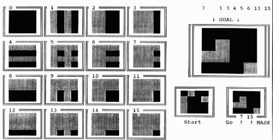
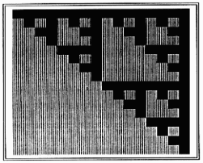
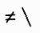

*by Gérard Langlet*
{ .byline }

This is an extended version of the puzzle which has been called “MAGIC” in VECTOR (cf. \[1\], \[2\]); recently, a short paper by J.J. Girardot \[3\] also proposed an APL90 version of the 3×3 magic game, which was given as an exercise to students in computer science at the École des Mines in St. Étienne, to make them progress with APL array capability.

## 

The goal of the present paper is to bring an ultimate solution to this class of puzzles; then, if one thinks of very complex ones, such as Queens and even chess games, a new conjecture will emerge: `≠\` would be able to solve ALL puzzles which have a unique solution... (and physical problems ARE indeed such puzzles for physicists). So, a game is not for fun only; like Cellular Automata (e.g. Conway’s Life Game), deep game study may enlighten “General Problem Solving”.

Here is a screendump of a PC at the end of a computer demo (which is available in a small WS which also plays classical “Magic” and may be easily extended to play – and teach – much more complex puzzles).

A randomly chosen binary 4-by-4 matrix (among `2*16` different possibilities) is named “GOAL” and displayed, enlarged, on the right of the screen. 1s appear as black squares on the paper, 0s as grey squares (on the screen, 1s appear as a bright foreground, in colour, on a darker background of 0s).

Another 4-by-4 matrix, different from GOAL, is also randomly chosen and is displayed as the initial configuration (on the Figure it is labelled “Start”). The computer also displays in the top left hand corner of the screen a kind of menu with 16 different masks, numbered from 0 to 15.

When a player clicks one of the masks, the bits of the current configuration in correspondence with the 1-bits of the masks are inverted, i.e. negated: 1 becomes 0 while 0 becomes 1. The rule is to determine the shortest sequence of masks which must be successively applied to the initial configuration (Start) in order to reach the GOAL.

In this demo, the computer plays by itself. At the same time it displays a new GOAL and a new Start configuration; it also tells the user what it has found as the shortest way, i.e. the exact solution. For more complex puzzles (which may also be based on frames, i.e. matrices with any shape, even irregular), instantaneous solving of the “best-path” problem by the computer is possible; so, when YOU play against the computer (or, rather, against the APL program), and ignore that the computer has found the best path, you will lose, although you play first – as the computer’s guest – after having made just ONE mistake, i.e. one bad choice from the menu.

In the present case, 7 masks are necessary to go from “Start” to “GOAL”. These are numbers: `1 3 4 5 6 13 15`. The computer has just “won”, using mask 15 after six other displays of its clever approach, on the same frame in the bottom right corner (there is not much room on the PC screen) ... with semi-graphics.

### What is the Reason for the “Fractal” Qualifier?

Indeed, all games are fractals. If this does not immediately appear in your mind, it comes from the fact that fractality is somehow hidden under the rules (very often, rules are numeric), but appears again as soon as one examines these rules with a binary approach.

In the present example, please ravel (unwind) every mask into a 16-bit vector, and form matrix M which will contain one mask per row. Plot M in the same way as masks, i.e. using semi-graphic characters on the PC (see also \[4\]). You will obtain:

## 

This is a Sierpinski matrix, a `⌽`-mirrored “geniton” (cf. \[4\] to \[9\]). The corresponding binary matrix M, now considered no more as Boolean, but as a numeric matrix in modulo-2 algebra, an algebra in which all “numbers” `∊ {0,1}` , 0 meaning “nothing”, 1 meaning “everything”, has a nice magic property.

M is its own matrix inverse, so that `2|M+.×M` or, using logical functions, `M≠.^M` returns a unitary matrix, i.e. a matrix with the same shape as `M`, and in which only the main (or first) diagonal contains 1s. The property is very general, e.g. `9 9 ↑ M` is also its own matrix inverse in modulo-2 algebra. With any number instead of 9 in order to take the same number of first rows and columns of the “infinite `⌽`-mirrored (or `⊖`-mirrored) geniton”, the property will hold.

So, the rules of this puzzle were chosen so that matrix inversion becomes unnecessary (although classical Magic involves 3-by-3 matrices, the Fractal-Magic puzzles, even extended to huge arrays, are simpler ... ).

If the GOAL matrix is ravelled into vector `G`, and if the Start matrix is ravelled into vector `S`, so that `D` is the binary difference `G≠S` or `S≠G`, then:

```
D modulo-2-matrix-divided-by M
```

will solve a pretty linear system of (here 16) equations, producing `X`, a modulo-2 vector `∊ {0,1}` which is THE MASK of the (unknown?) necessary transformations. In the example, mask `X` is:

```
     X
0 1 0 1 1 1 1 0 0 0 0 0 0 1 0 1
     X/⍳⍴X                        ⍝ in 0-origin
1 3 4 5 6 13 15                  ⍝ 7≡+/X
```

APL has no “modulo-2 matrix divide”. There are several solutions which could fill the gap made by the lack of such a (useful?) extension:

1. write the modulo-2-matrix divide using the domino;
2. write the modulo-2-matrix divide NOT using the domino;
3. do nothing but thinking.

The best way is to choose as a rule a self-inverse matrix so that the missing function becomes useless; hence the use of the `⌽`-mirrored geniton coming from the APL-Theory of Everything \[4\].

If `M` is such a matrix, the same mask `X` will be the result of

`D ≠.^ M` or of `2| D +.× M`

which is very fast, at least for “small” matrices.

Mask inversion in APL is also performed by `≠`, the difference primitive, which corresponds to PLUS modulo-2 and to MINUS modulo-2 in modulo-2 algebra at the same time. The expression

```
C←≠⍀D⍪X⌿M
```

will produce successive rows in a row-“difference-scanned” matrix (successive Current Configurations), so that, if `N` is `¯1⌽ 4 4 , 1+ +/ X` then:

```
(N⍴G)≠N⍴C
```

will return the successive current 4-by-4 matrices which display the path from Start to Goal (including both).

The conjecture that `≠` alone or in association with “scan” could model everything else (i.e. all clever computing viz. Nature’s) is reinforced by the fact that the result of the binary matrix product of a binary vector by a conforming `⌽`-mirrored geniton, i.e. result X,

<ol type="a">
<li>is one of the Fast Fourier Transforms in modulo-2 algebra (named “helix transform” in [4] to [7]), then bound to the properties of information in helices, the clue to future understanding of DNA genetic patrimony;</li>
<li>can also be obtained as <tt class="aplu">⌽V</tt>, the vector of the successive defined integrals of <tt class="aplu">K←⌽D</tt> by iteration of <tt class="aplu">V←V, ¯1↑K←≠\K</tt> 16 times in the example, starting from an empty vector;</li>
<li>can be computed using a fast algorithm in which only <tt class="aplu">≠</tt> is used (the AND <tt class="aplu">^</tt> primitive of the matrix product disappears in the holes of the Gruyère cheese of the fractal matrix!) – cf [5], [8] and refs therein.</li>
</ol>

Solving the original Magic this way can now be undertaken by pure thinking on the symmetry of the problem: the 9 matrices which ARE the rules for Magic have to respect the symmetry of the square, i.e. a 4-fold symmetry; then, the 9-by-9 matrix M in which each row is the ravelled bit-sequence of each 3-by-3 square transformer, has to be, in modulo-2 algebra, a 4th root of the conforming unitary matrix U (readers may easily verify this property, even with a free version of APL such as I-APL or TRYAPL2):

```
U ≡ M ≠.^ M ≠.^ M ≠.^ M
```

The same expression may be re-written as:

```
U ≡ M≠.^(M≠.^M≠.^M)
```

in order to show (although parentheses have no other utility within this APL identity), that `I←M≠.^M≠.^M` HAS TO BE the modulo-2 matrix-inverse of `M`. `I` can be pre-computed ONCE and memorised as 81 bits (less than 11 bytes).

Then, the short APL expression (in which `/[⎕IO]` `\[⎕IO]` and `,[⎕IO]` may replace `⌿` `⍀` and `⍪` respectively in APL):

```
C←≠⍀D⍪X⌿I
```

produces the successive Configurations for Magic as well, at the speed of light, given any difference vector D as `S≠G` (Start and Goal ravelled vectors with shape 9).

Then, the 9 matrices of Magic may be replaced by any linear combination of themselves in order to form a coherent system of rules, so that the number of NEW puzzles even for shape `3 3` will become quite large...

And the APL community can now become a puzzle generator:

Given a thick book with 1024 pages, with an image on each page as a 1024 1024 pixel binary matrix, such a book will become the “Puzzle Solver/User’s Manual”; then, on a high-definition screen, with a 1024 by 1024 image, an initial Start configuration will appear with 1 kilopixel size, as well as the Goal, e.g. in another colour if the screen allows RGB output; the user will have to choose a minimum of successive transforms from the atlas-book; even for billions of pixels and images in a collection of video-discs, the same magic formula (a tiny APL line) will hold... , as it WILL for the giant Sierpinski puzzle of our fractal universe of which any problem is a sub-problem, even tomorrow’s weather forecasting...

`≠\` is the absolute integrator at the quantum level. Many of its properties were found and proven using APL. Now, natural shapes are deduced from `≠\` algorithms \[10\].

Then, is there STILL a reason why most physicists ignore Iverson’s powerful notation for mathematics and programming, although parity and symmetry are their most basic concepts, while integration, Fourier transforms, spinors or twistors (matrix theory) are their favourite mathematical tools, and in spite of the fact that they are trying to understand what hides under the fashionable keyword fractal coined by Benoit Mandelbrot, which will NEVER be explained by continuity?

### References

1. Ziemann D, “Exploring Magic”, Vector Vol.9 no.2 pp. 16-27, October 1992.
2. McLean W W, “MAGIC”, Vector Vol.9 no.1 pp. 25-29, July 1992.
3. Girardot J J, “L’inversion Diabolique”, Les Nouvelles d’APL no. 6 pp. 54-55, March 1993.
4. Langlet G A, “Towards the Ultimate APL-TOE (Theory of Everything)”, APL92 Conference Proceedings pp.118-135.
5. Langlet G A, “Un Concours Paritonesque”, APL-CAM Journal, Vol.14 no.3, pp.412-416, July 1992.
6. Langlet G A, “From the Vital Execute to Fractals and 5-Fold Symmetry”, Vector Vol.9 no.3, pp. 91-96, January 1993.
7. Langlet G A, “New Mathematics for the Computer”, Tool of Thought VIII, pp.1-31, January 1993.
8. Langlet G A, “Symétries, Force et Phénomènes”, APL-CAM Journal Vol.15 no.1, pp. 57-80, January 1993.
9. Langlet G A, “From Risky Programming to the Baby Computer”, APL-CAM Journal Vol.15 no.1, pp.81-92, January 1993.
10. Langlet G A, “Building the APL Atlas of Natural Shapes”, APL93 (in press).

## 

(webpage generated: 5 December 2005, 18:50)
