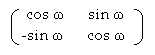

by Gérard Langlet
{ .byline }

### What is Chaotic Behaviour?

Chaotic behaviour occurs when one is unable to predict what will happen at some distance from here or from now. It has long been known (Poincaré, Lorenz with the butterfly-effect) that a small variation in the initial conditions may lead to huge differences in the behaviour of dynamical systems, which, in general, are described by differential equations as a function of time.

Hundreds of books and papers are devoted to chaos which is supposed to appear even when one iterates very simple nonlinear equations such as the “logistic equation”, proposed by Verhulst more than 130 years ago in order to model and explain population ratio (alternate growth and decay) in ecological systems.

If X is a variable which may vary in the interval \{0,1\}, then Verhulst’s **nonlinear** formula:

          Xn+1 = 4 Xn (1-Xn)

will give the next population ratio at step n+1 if one knows the ratio at step n.

Although this formula is completely deterministic (ALL equations are deterministic), the succession of Xi, Xi+1 ... Xi+p (terms of a series) exhibits a “positive Lyapunov exponent”, **proof** of its chaotic behaviour.

When the behaviour is not chaotic, this exponent is simply 0.

It is clear that iterations of linear functions may NEVER lead one to observe any chaotic behaviour.

### Hic jacet Chaos

(a non-syllogistic mathematical proof)

So, let us consider the iterations of one of the most simple **linear** formulas one can imagine:

          ωn+1=2ωn with ω an angle (e.g. expressed in radians).

By no means would the iterations of such a formula lead to chaos.

As an example, if ω0 is 1 radian, one may immediately predict that ωN shall exactly equal 2N radians.

Then, in order to obtain a variation in the closed interval \{0,1\} , let us choose variable X as sin2ω and replace the series involving powers of 2 by a series in X.

Any value of X is still predictable, as the squared sine of the corresponding ω.

For any value of Xn=sin2ωn, the next value will be Xn+1=sin2ωn+1 i.e. sin22ωn .

For any value of ω, then sin22ωn may be written as a function of ωn simply as: (2 sinωn cosωn)2 which is equivalent to: 4 sin2ωn cos2ωn .

Knowing that sin2ωn is Xn, and that cos2ωn is 1-Xn, any undergraduate student finds the “logistic” formula:

     Xn+1= 4 Xn (1-Xn)

which, consequently, MAY NOT be chaotic anymore.

Quod erat demonstrandum.

### The True Origin of Chaos for Iterated Applications

Successive iterations of the logistic equation are ALWAYS computed ... with computers.

In all computers, precision is limited. (On paper, with a slide rule or a calculator, precision is also limited.)

If any initial value of ω is coded with B bits, every new iteration would require ONE new bit on the left of the internal representation of the old ω. Doubling ωn simply appends a new 0 to the right of the previous representation of ωn.

So, the internal representation of ωn+1 is the same as the one of ωn, with a 1-bit left shift; one can also say that a 0 on the left of ωn is transferred to the right with a 1-position circular shift, in order to produce ωn+1.

Then, in order to reach the Nth iteration with NO loss in precision, a record with B+N bits is necessary. With double-precision floating-point arithmetics, e.g. with the usual IEEE standard, only 64 bits are available to code:

<ol type="a">
<li>the sign of the constant (1 bit),</li>
<li>the exponent (11 bits, hence the maximum value 10308 because 308 is 210 (i.e. 1024) divided by Log2 10, then floored – rounded to the inferior integer – knowing that one bit is also reserved for the sign of the exponent),</li>
<li>the <i>mantissa</i> in <b>52 bits</b>.</li>
</ol>

So, it is possible to predict that if the initial value of ω is 1 (radian), then coded in 1 bit, the behaviour will become completely chaotic after the 51st iteration, although the function may no longer be chaotic according to the preceding mathematical proof.

The situation becomes worse when one tries to compute the *Lyapunov exponent* of any series (which may be either experimental, or obtained by computer iteration). There is absolutely NO control of the result; even if the Lyapunov formula is good, the fact that a long series of constants is integrated or averaged in a computer is able to produce a truncated then wrong result, because the Lyapunov exponent is obtained as an average of differences, then is itself hypersensitive to floating-point arithmetic truncations.

One may consider that “proofs of chaotic behaviour”, based on iterated formulas or numeric integration should not be accepted as scientific results, unless the authors can prove that their calculations have been performed at least with B+N bits for the mantissa of the floating-point representation, given B as the number of necessary bits for the “accurate” binary encoding of the initial value(s), and N as the number of performed iterations: all results, taken for granted, which do not respect this condition, would have to be computed again; then, perhaps, some rapidly-drawn conclusions, namely about the behaviour of physical systems, after 1,000 iterations (and, sometimes, after more than 1,000,000) would have to be discussed again, if not completely revisited.

### Exercises for Tests in APL

A) Write an `ECHO` function which will iterate, with the maximum available precision, e.g. `⎕`PP`←`17 in APL\*PLUS, the function Xn+1`←`Xn near the limit of significance of the last digits of a large integer: you enter a large integer from the keyboard; the program shall display what it has understood; then, you enter exactly the same number as the one displayed by the computer, and “wait” for the answer of the computer. Iterate the dialogue until the computer echoes the same number as the one which was entered. Increment the last digit by 1 and do the same thing again and again: you will detect alternate zones of chaos (with strange attractors) and non-chaos (when the computer echoes exactly what you have typed). So you will have the proof that X`←`X is a chaotic function, with *intermittencies*, won’t you?

B) Iterate ωn+1`←`2`×`ωn starting from any value for ω0, e.g. 1 (radian). Form the rotation matrix:

## 

- 0\) Compute its determinant and display it together with the iteration number, at each iteration.
- 1\) Take the initial rotation matrix M (e.g. for 1 radian). Iterate M`←`M+.`×`M (this squares the matrix, then also doubles ω). Display the computed determinant together with the iteration number, at each iteration.

Knowing that all rotation matrices should have a determinant that **IS** 1 and nothing else, imagine first what you will obtain. Then, and only then, try (if possible with different implementations on various computers, or with languages other than APL, or on a programmable calculator, or with Excel, etc...).

Will you have proven that application “**1 becomes 1**” is chaotic?

## 

C) Write a letter to Mr Feigenbaum (or to Mr Gleick) and expose your chaotic conclusions ...

(webpage generated: 5 February 2007, 21:23)
