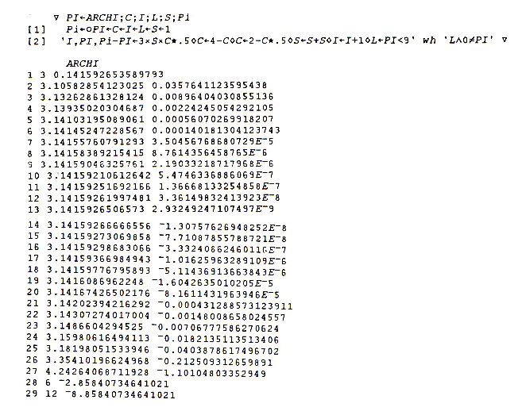

by Gérard Langlet
{ .byline }

Many thanks for the magnificent paper about dragons (*Here Be Dragons*, Vector 11.4 pp 69-75). Apart from my article in *Vector*, one appeared in APL-CAM J. and another one in *Les Nouvelles d’APL* No 12-13. In the last issue (No 14) there was a paper by F. Hilaire who studied the logistic equation (also with other values for k) and Lyapunov coefficients, thanks to the user-defined precision (from 5 to 60 decimal digits) which is available in **Mathematica**. A controversy – in France – has started with some people who are considered as “authorities” in Chaos Theory (Pierre Bergé, Ch. Vidal, J. Laskar and G. Rumèbe *inter alia*). Laskar is famous for having predicted – thanks to Chaos Theory and “powerful computers” – that planet Mercury could quit its orbit in... 100,000 million years! His calculations involve the trajectories of all major planets (Newton revisited thanks to Laplace & Leverrier, making 800 PAGES of equations – of course non-linear) to be numerically iterated about 1,000,000 times, a real overdose of floating-point arithmetic! As well as modulo2, integer algebra is unsigned, so are some of my writings in *Les Nouvelles d’APL*, e.g. in No 14 p 144. The case of Archimedes’ algorithm – the classical method for computing π – is treated in No 14 p 67. In BASIC with single precision it is well known that PI converges towards 0 after 10 iterations. Convergence towards 0, however, is true on PC-like machines; PI converges towards infinity in APL.68000 for the Macintosh...      `wh` is a “while” function.

## 

I strongly disagree with Nicholas Small: Chaos effects are, in all cases, biased by the computer. Small emits the same argument as Laskar about the iterations of *successive* matrix powers of a matrix with det=1, for which, indeed, a very small inaccuracy is detected after many iterations. Indeed, for k&lt;1, iterations of the logistic map do converge to 0. But every time a squared term, which does not converge towards 0 if one develops analytically the successive formulae, is present within a nonlinear application, we shall be in the case for which the first truncation of the last significant bit will be amplified (then will not remain constant) at the next iteration. Truncation errors will exceed the range of the variable after some iteration, because of the doubling-angle effect. One cannot escape the fact that the derivative of <i>ax</i>2 is 2<i>ax</i>. So, when *x* does converge towards 0, then 2<i>ax</i> remains low in magnitude, and everything is OK. If *x* oscillates betwen two or more non-0 values, or, statistically between 0 and 1, even with a very small magnitude for a, truncation errors will propagate exponentially. Small should try with Mathematica, which has a nice property: when the user-defined precision exceeds 16 decimal places, all classical options of arithmetic are performed with automatic error-checking, so that, even if you have asked for 100 digits, the result will be printed with its significant digits only. So, when truncation errors, cumulated or propagated, have reached 100%, then the first significant digit disappears and the result clings to 0. Visually, one has just to plot a graph of *x* as a function of the iteration numbers, for various (mathematically but not-numerically) equivalent formulae, and for various values of user-defined precision. All curves will collapse to 0. Just wait... As a conclusion, let us re-state that no paper should be accepted for publication, especially in physics, if error-windows are absent in the figures or numeric tables (of either measured or computed results).

(webpage generated: 27 June 2007, 20:22)
