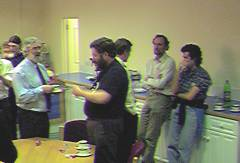
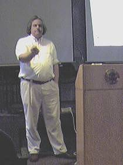
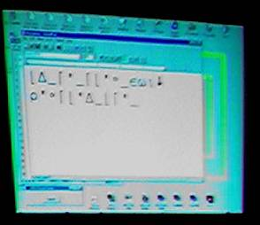

## British APL Association Vendor Forum May 21st 1999, at the RSS, following the AGM

*notes by Stefano Lanzavecchia*

{ width="240" height="163" } While waiting for the meeting to start, the attendees had a chance to look at the latest experiments of Causeway’s Adrian Smith, this time regarding the first attempts at integrating HTML with vector graphics, using Microsoft’s *Vector Markup Language* [(VML)](http://msdn.microsoft.com/msdn-online/workshop/standards/vml/ref/), as a platform to output the graphics of *Rain*. The technology is still in its infancy; so far only Internet Explorer 5 and Office 2000 implement it, and the [W3C group](http://www.w3.org/TR/NOTE-VML) has not agreed on a standard. Yet I am sure we will hear again about this; readers with IE5 can see the examples and read the source code on [www.causeway.co.uk/vmlsamp.htm](http://www.causeway.co.uk/vmlsamp.htm)

### Eric Baelen of APL2000

Eric Baelen, former CEO of APL2000, started his speech with a joke, to warm up (or maybe cool down the overheated room) the audience. There are three main differences between British people and Americans: in Great Britain, *English* is spoken; when staging a world championship, Great Britain invites people from *other nations*; when meeting a head of state, the Brits only have to go down on *one* knee. Luckily enough the projector and the laptop were quickly prepared so that the presentation could start with a series of slides off our favourite PowerPoint.

Eric described the latest acquisition of APL2000/LEX2000 by Cognos – “dramatic” news, but not in negative sense. Cognos is quite a large company, valued around 300 million dollars with some 1600 employees in 40 different countries, its expertise being in what they call “business intelligence”. It’s quite easy for an APLer to understand what they mean, by looking at their statement of intentions: to turn data, large amounts of data, into information. A task perfectly suited to APL, and Cognos decided to take over the old Manugistics to exploit the great capabilities of APL in the field. Cognos is now developing, with the aid of the APL2000 team, a new product, completely written in APL.

Knowing the interests of his audience, Eric moved quickly over the company in general, to focus his attention on the upcoming release 3.5 of the APL+Win interpreter. It was good to see that it was a live demonstration based on an internal experimental version of the code, which should be frozen in mid-June. The list of enhancements is quite long, yet none of them is so critical to have suggested that it was time for a change in the major version number. Most of the features added or improved are attempts to make the life of a programmer easier. In this summary, I will follow Eric:

- session log: the session can be saved in a file with many available options to control how these files are created;
- the long file names of Win95/98 and NTFS are now supported;
- value tips: little windows with the content of a variable pop-up when the mouse points in the session (and in the editor?) to the name of a previously assigned variable;
- both single quotes and double quotes can be used in a string to identify the quote, removing the need to double them up; does this mean that it’s now impossible to enter literal strings containing a double quote? *\[See below\]*
- )SAVEOVER removes the need for the normal sequence )WSID wsname, followed by )SAVE;
- the help key (F1) pressed on a token in the session (and the editor?) opens the online help file at the relevant page;
- stops can be set on line \[0\] of a function to inspect the explicit result just before the execution of the function is abandoned;
- `2 ⎕AT` is implemented to inspect the Fix time of a function
- the left argument of `2 ⎕DEF` can be used to force the result of `2 ⎕AT` to a particular date and time.

*\[The issue of single and double quotes was raised on comp.lang.apl; the following response should set readers minds at rest here ...\]*

<pre>
------------------------------------------------------------
From: Jim Weigang <jimw@chilton.com>
Newsgroups: comp.lang.apl
Not to worry--

      'The enhancement is "upwardly ','compatible".'
The enhancement is "upwardly compatible".

      "The enhancement is 'upwardly ","compatible'."
The enhancement is 'upwardly compatible'.

The outer quotes establish the delimiter, and within the string the
"other" quotes are treated as ordinary characters.  Nice enhancement!

                          Jim
------------------------------------------------------------</jimw@chilton.com></pre>

More items were on the list but Eric decided to skip over them, due to the limited time, and he concentrated on the enhancements of the GUI controls available in APL+Win. Following the past tradition, most of the new features introduced by Microsoft for their common controls (i.e. ListViews, TreeViews, ProgressBars) can now be accessed from APL:

- **TreeViews** can have checkboxes on every branch, leaf;
- **ListViews** can have checkboxes on every item, can display gridlines and support the highlight-on-over single-click-select typical of the new shell of Windows 98 and Windows 2000 in WebView mode;
- **ProgressBars** can be coloured, can be smooth instead of composed of blocks and can be oriented vertically;
- there is a brand new **Calendar Control** to allow input of dates; particularly interesting is the fact that it can be customised quite heavily for special needs;
- **Rebars** can be used instead of the now old-fashioned ToolBars, and, surprise, they can be made to float and dock under user or program control: time for a reaction from Dyadic...
- users of the **Printer** object will be delighted to hear that it now supports Orientation among the properties that are exposed. More will be added in the future;
- the **System** object generates events on changes in the environment.

A major extension in the language, which Eric did not have time to discuss but only to mention, is the **OnNew** event on the creation of user-designed classes. If I understand correctly it permits a developer to code new objects directly in APL composing and extending the behaviours of existing objects. It sounds quite exciting.

`⎕WCALL` now supports external functions requiring structures to be passed as arguments, allowing them to be represented as standard APL nested arrays. One doubt remains: can they be nested at any depth to simulate structures pointing to other structures?

The accuracy of `⎕MF` has been enhanced from the old 1/18th of a second to the one offered by the high performance timer provided by the modern CPUs.

The utilities shipped with the interpreter now include a Browser for resources in DLLs or executables (quite handy to extract bitmaps and icons for use in other applications) and a more advanced Workspace Explorer.

This concluded the presentation of the new upcoming release 3.5. We really look forward to laying our hands on a review copy as soon as it is available.

Eric Baelen also wanted to share with the audience the plans of Cognos/APL2000 to tighten the link between APL and the World Wide Web. He showed a web site called [OpenHere.Com](http://www.openhere.com), which is a portal site, like Yahoo to mention one, whose main characteristic was to have all its server side software written in APL. Despite its recent genesis, according to Eric, it’s already one of the 10 largest search sites on the Net. Born as a simple technological experiment, it turns out to be a good ground to test and possibly patent ideas.

To close his show, Eric had a surprise for all of us: a videogame written in APL. Using calls to Microsoft DirectX technology, it features a map of the world on which a colony of rabbits lived happily in the States, when the fierce race of the ducks started expanding. Purpose of the game: to protect the rabbits by guiding a super-hero around in his hunts for the evil ducks. I quote Eric: “The ducks usually beat me, so I asked to have programmed a key combination which kills all the ducks in one go. It’s good to be the boss”. *Applause.*

### Pete Donnelly of Dyadic Systems

Pete Donnelly from Dyadic took over. His opening quote is a curse for one of his favourite developers to whom his laptop had been lent with the result that some things had stopped working properly. His presentation did not contain the introduction of any really new features, but did show a couple of interesting enhancements. To make his point he started by recalling the story of the interpreter: some of the concepts pioneered by Dyadic were received at the beginning quite coldly; namespaces, for instance, did not generate a lot of positive feedback to start with, but now all those who tried them would not be able to live without. Especially since the cloning mechanism of namespaces has been optimised. The same happened with dynamic functions, whose fans are increasing daily. So, Pete said, it’s no surprise that the recent introduction of multithreading has not yet changed the way of working. He believes, and I am of the same opinion, that it’s only a matter of time before the APL community discovers the true power of a multithreaded APL.

Pete proceeded with a short demo of what in practice is a multithreaded APL. The `⎕SI` stack is a tree and can be split at any point with the application of the new operator “&” (ampersand) that any \*nix user will recognise. The new branch is executed in parallel with the others. The interpreter can be instructed to spawn a new thread for callbacks associated to GUI events. The demo of the bouncing duck can be written in a very elegant way using a separate thread for every duck, and this makes John Scholes very happy.

A recent enhancement to the multithreading capabilities of Dyalog APL is the ability to execute asynchronously a `⎕NA` call. Because of the scheduling mechanism implemented in the current version of Dyalog APL, a long external call (like a bulk update of a database using SQAPL), could prevent the other APL threads from continuing their processing. Now it’s possible to declare in the `⎕NA` specification that the function should be executed in a separate native thread (as provided by Win32). Some extra care should be applied, but the results can be quite amazing. On a multiprocessor machine, the second CPU can effectively execute a bulk update while the first one continues the execution of other parts of the APL program.

Another recent extension is the possibility of creating in-process **OLE servers**. The main advantage is that the protocol used by the client to communicate with the server is much faster. The disadvantage is that the DLL (such is the aspect of an in-process server) is loaded in the process space of the client, which means that it can bring down completely the client, in case of a serious crash, and that if multiple clients connect to the same server, there is duplication of data in memory. Also, at the moment it is impossible to do any debug of the server. In many cases, though, the pros balance and overweigh the cons.

Another enhancement showed by Pete is for the **Grid Object**, which has been extended to allow the locking of arbitrary rows and columns for scrolling. The mechanism is very generic and will surely find many uses. A further extension allows users to specify gridlines in detail - line colour and weight may be set for any number of gridline styles which are then applied to the individual horizontal and vertical lines.

The next topic of the demonstration was for ActiveX controls. This repeated the demonstration first shown at APL98 in Rome.

Finally, to show a first example of a real application that benefits from multithreading, Pete demonstrated the internals of the APL-based web server, which runs on an experimental site at Dyadic.com. The aim of the server is to provide a platform on which to develop and run APL web-based solutions. Pete recommended the persons interested in the deployment of web-based applications in APL to contact Dyadic Software. I also recommend all the owners of a copy of Dyalog APL to study the source code for the server that is distributed with Dyalog APL 8.2 and can be found in APLSERVE\\server.dws.

### David Leibtag of IBM’s APL2 Group

{ width="210" height="280" } After a short break for the coffee, the podium was left to David Liebtag, responsible for the development of APL2 in IBM. All the way from California, he thanked the organisers for the opportunity that was given to him to discuss the present and the future of APL2. I really feel like saying: thank you, Dave, for giving us some of your time. Admittedly it had been quite a while since the last time he had come to Europe. Two of the main topics for his presentation: Service Level 4 of the Windows version of the interpreter, and a highlight on what’s-next in IBM for APL2.

Until before the release of Service Level 4, IBM had tried to catch up: Dave explained that Service Level 4 is the first release that, based on the feedback from the users, is devoted to making the development environment more comfortable and productive.

Here’s a small list:

- show the fix time for the function in the status bar of the function editor;
- position the cursor in the line indicated by the error message;
- break points: in a way similar to what can be done in Dyalog APL, for instance, break points can be set to interrupt the execution of a function.

Various enhancements to the interface components:

- the Rexx processor allows APL to call directly the built-in functions;
- support for SQL/DB2 has been extended to include BIGINTs, LOBs, and to tolerate a WITH clause preceeding a SELECT;
- there is a new efficient way of communicating with the GUI, no longer based on the expensive shared variables, but on a GetProperty/SetProperty pair of functions;
- the GRAPHICS package now features additional marker types, new line/dash styles for the Win32 platforms, optional box corner radius.

The release is available on the IBM  [web site](http://www.software.ibm.com/ad/apl/).

So far so good. But what Dave really wanted to discuss was the future of APL2. The philosophy that drives the development is to enhance the interfaces available to and from APL2, to allow developers to easily leverage existing code and integrate more thoroughly with the rest of the environment.

{ width="294" height="254" } First of all: integration with Windows. David is working on a keyboard handler that will allow input of APL characters, using the key combinations allowed by all the popular interpreters. We were given a live demo: really quite impressive, if it wasn’t for the lack of support for WinWord, which uses its own low-level keyboard handler. David says that when the little application is finished, it will probably be freely distributed to the APL community.

Next on the agenda, was the disclosure of a project Top Secret, regarding the High Performance Link (HPF) in use on the mainframes. A change is being discussed, to reduce the overhead of function calls, which is not backward compatible. If you are interested in knowing more about this, you can contact David Liebtag at [liebtag@us.ibm.com](mailto:liebtag@us.ibm.com).

Another planned extension for the interpreter is the ability of sending and receiving APL arrays in native format. Dave asked the other APL vendors to discuss the format. My opinion is that since Dyalog APL already supports this feature, maybe that should be the starting point.

The end of David’s presentation also coincided with the end of the meeting. A group of the attendees and the three kind speakers rejoined in a neighbouring pub to enjoy the end of a good and successful afternoon.
