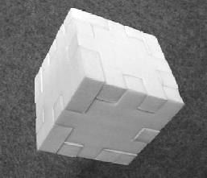
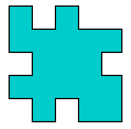

*by Bernard Legrand*
{ .byline }

During a recent exhibition, PROGILOG, held in Paris last November, the company Euriware gave me a funny advertising object: a little 3D puzzle.

<table border="0">
<td>
<p>The puzzle is made of six pieces, which are in fact the faces of a cube. The aim is to build the cube by embedding the pieces one into the other. </p>
<p>Only 6 pieces: it looks very easy! </p>
<p>In fact the multiple possibilities make the trick more complex than one might think.
</p></td><td align="center">

</td></table>

That gave me the idea of a little problem that I am offering both to the members of the French APL association (AFAPL), and to the readers of *Vector.*

## Representations

<table border="0">
<td>
<p>Each piece is a 5 by 5 square, the sides of which are notched as shown here.</p>
<p>The piece thickness is equal to 1, which makes it possible to fit pieces.</p>
</td><td align="center">

</td></table>

<table border="0">
<td>
<p>In APL, one can represent such an object by a binary matrix, like this:
</p></td><td align="center"><pre>
1 0 1 0 0
1 1 1 1 1
0 1 1 1 0
1 1 1 1 1
0 1 0 1 1
</pre>
</td></table>

Of course one may rotate that piece by multiples of p/2, to obtain four configurations, which will be named “State 0” to “State 3”, depending on the number of p/2 rotations applied.

<table width="80%" border="1" cellpadding="4" cellspacing="0">
<tr><th>State 0</th><th>State 1</th><th>State 2</th><th>State 3</th></tr>
<tr><td align="center"><pre>
1 0 1 0 0
1 1 1 1 1
0 1 1 1 0
1 1 1 1 1
0 1 0 1 1
</pre>

</td><td align="center"><pre>
0 1 0 1 1
0 1 1 1 1
1 1 1 1 0
0 1 1 1 1
1 1 0 1 0
</pre>

</td><td align="center"><pre>
1 1 0 1 0
1 1 1 1 1
0 1 1 1 0
1 1 1 1 1
0 0 1 0 1
</pre>

</td><td align="center"><pre>
0 1 0 1 1
1 1 1 1 0
0 1 1 1 1
1 1 1 1 0
1 1 0 1 0
</pre></td></tr>
</table>

But: it is strictly forbidden to turn the piece over.

## Input Data

You are given the 6 matrices which represent the six pieces, each given in its original position (State 0); here they are:

<table width="80%" border="0">
<tr><th>Piece 1</th><th>Piece 2</th><th>Piece 3</th></tr>
<tr><td align="center"><pre>
1 0 1 0 0
1 1 1 1 1
0 1 1 1 0
1 1 1 1 1
0 1 0 1 1
</pre>

</td><td align="center"><pre>
0 0 1 0 1
0 1 1 1 1
1 1 1 1 0
0 1 1 1 1
0 1 0 1 1
</pre>

</td><td align="center"><pre>
0 1 0 1 0
1 1 1 1 0
0 1 1 1 1
1 1 1 1 0
1 1 0 1 1
</pre></td></tr>

<tr><th>Piece 4</th><th>Piece 5</th><th>Piece 6</th></tr>
<tr><td align="center"><pre>
0 0 1 0 0
1 1 1 1 0
0 1 1 1 1
1 1 1 1 0
0 0 1 0 0
</pre>

</td><td align="center"><pre>
1 1 0 1 0
0 1 1 1 0
1 1 1 1 1
0 1 1 1 0
0 1 0 1 0
</pre>

</td><td align="center"><pre>
1 0 1 0 0
1 1 1 1 0
0 1 1 1 1
1 1 1 1 0
0 0 1 0 0
</pre></td></tr>
</table>

That set will be represented, in APL by a unique binary array, `Bin`, of dimensions `6×5×5`. Because one could imagine many different shapes for the pieces, that binary array `Bin` will be our input data.

```
⍝ Generate the example data (paste into your APL session!)
 Bin←6 5 5⍴0
 Bin[1;;]←5 5⍴1 0 1 0 0,1 1 1 1 1,0 1 1 1 0,1 1 1 1 1,0 1 0 1 1
 Bin[2;;]←5 5⍴0 0 1 0 1,0 1 1 1 1,1 1 1 1 0,0 1 1 1 1,0 1 0 1 1
 Bin[3;;]←5 5⍴0 1 0 1 0,1 1 1 1 0,0 1 1 1 1,1 1 1 1 0,1 1 0 1 1
 Bin[4;;]←5 5⍴0 0 1 0 0,1 1 1 1 0,0 1 1 1 1,1 1 1 1 0,0 0 1 0 0
 Bin[5;;]←5 5⍴1 1 0 1 0,0 1 1 1 0,1 1 1 1 1,0 1 1 1 0,0 1 0 1 0
 Bin[6;;]←5 5⍴1 0 1 0 0,1 1 1 1 0,0 1 1 1 1,1 1 1 1 0,0 0 1 0 0
```

## The Game

You just have to find out ALL the valid possible ways of building the cube (maybe there are more than one, who knows?)

But how can we represent each solution? Here again, we need conventions. We have decided on the following conventions:

1. Among the different representations of a cube, we have chosen the following one, where the faces have been named “A” to “F”:

    ![\[pic of faces\]](cube02.gif){ width="340" height="235" }

2. It is also decided that the face “A”, in the leftmost position, will be occupied by the piece used as an example in the first paragraph, in its original state (piece number 1, in 0 state). It will be called “*Base piece*”.

3. In order to represent each element of the solution, just give the piece number (1 to 6), followed by its rotation state (0 to 3).

<table><td>
<p>With these conventions, any solution can be represented as shown here:</p>
<p>(but, sorry: this is <b>not</b> a solution)</p>

</td><td><table border="1" cellspacing="0" cellpadding="4">
<tr><th>Place</th><th>Piece</th><th>State</th><td> </td></tr>
<tr align="center"><td><tt>A</tt>
</td><td><tt>1</tt>
</td><td><tt>0</tt>
</td><td><i>(Base piece)</i></td></tr><tr>

</tr><tr align="center"><td><tt>B</tt>
</td><td><tt>4</tt>
</td><td><tt>2</tt>
</td><td><tt> </tt></td></tr>

<tr align="center"><td><tt>C</tt>
</td><td><tt>3</tt>
</td><td><tt>0</tt>
</td><td><tt> </tt></td></tr>

<tr align="center"><td><tt>D</tt>
</td><td><tt>6</tt>
</td><td><tt>1</tt>
</td><td><tt> </tt></td></tr>

<tr align="center"><td><tt>E</tt>
</td><td><tt>5</tt>
</td><td><tt>1</tt>
</td><td><tt> </tt></td></tr>

<tr align="center"><td><tt>F</tt>
</td><td><tt>2</tt>
</td><td><tt>3</tt>
</td><td><tt> </tt></td></tr>
</table>
</td></table>

<table width="60%">
<td>Each solution can simply be represented by a 6×2 APL matrix.<br>
The “solution” above would give:
</td><td width="50"><tt>
1 0<br>
4 2<br>
3 0<br>
6 1<br>
5 1<br>
2 3</tt>
</td></table>

## Your Program

Your (monadic) program should take, as its right operand, the `6×5×5` binary matrix `Bin`, given above, and produce as its result an `N×6×2` numeric array, where `N` is the number of solutions, each of which is represented as a `6×2` matrix, according to the conventions given in the previous section.

## Extension

The problem can be extended if you are allowed to turn one or more pieces over, except the *Base piece*, which must remain unchanged (just to avoid symmetrical solutions).

To have the same representations for everybody, I suggest two additional conventions:

- the pieces will be turned over using a “reverse” along the last dimension: `⌽`
- the rotations will be made **after** a piece has been turned over.

You can write a second program which will have an optional left operand, like this:

> 0 : pieces cannot be turned (the default)  
> 1 : pieces can be turned upside down.

This new program will give a result of 3 columns:

- Piece number (1 to 6)
- Has it been turned over (0 or1) ?
- Number of p/2 rotations applied (0 to 3)

Send your solutions (in any APL, J, K, 0, [R](http://www.apl-385.demon.co.uk/rcs/programs/java/java.htm), …) to *Vector*, of course, \[email: [apl385@compuserve.com](mailto:apl385@compuserve.com). Postal address c/o Vector Production, Brook House, Gilling East, York YO62 4JJ, UK\], but please also email them to the French APL Association secretary, Mrs Ludmila Lemagnen, at the following address: [lemagnen@aol.com](mailto:lemagnen@aol.com).

I hope you will have fun with the game!

Bernard Legrand, Legrand Consultants  
President of the French APL Association AFAPL

***
