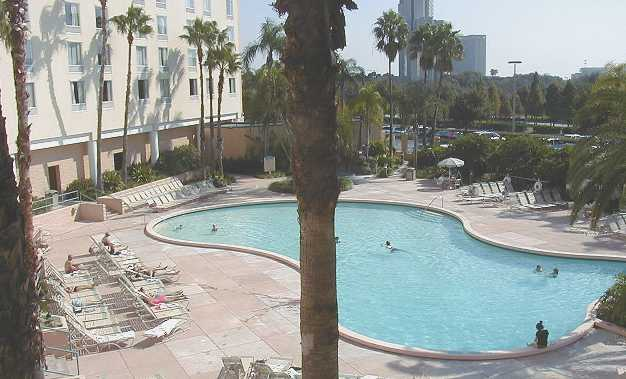
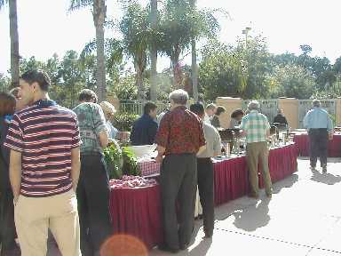
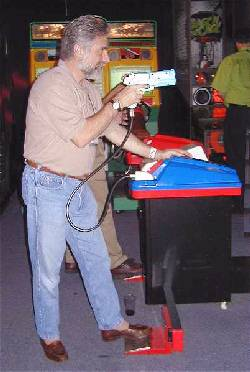
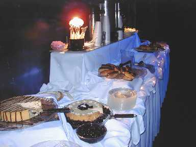
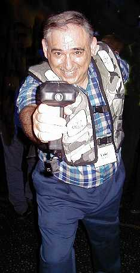
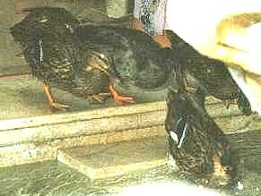

*reported by Jim Lucas (jel@danbbs.dk)*
{ .byline }

The *APL2000 Users’ Conference* (Orlando, Nov. 1999) had “Winner” written all over it. From the quality jacket (I wear mine everywhere, now), *full proceedings*, and significant software included with the registration handouts to the superb lunches (also included) to the layout of the presentation rooms around a central mini-lobby, which encouraged intercommunication as well as providing easy access to all activities. Everything was well planned, well organized, and well managed.

{ width="626" height="379" }  
**The Pool, from the Balcony outside the Conference Area**

The tone of the conference was also a winning one. No moaning about the demise of APL, in either past or future tense. No bombastic rhetoric about the inherent superiority of APL, either. Everybody was too busy saying, “Hey, look what I’ve done. Let me show you how I did it.” With enough detail that you could reproduce it directly, not just an outline that required you to figure out all the important details yourself. And the speakers were *SPEAKERS*, apparently chosen for their skill in live presentation, not just for the topics or content they were presenting.

Who were the attendees? Plenty of experienced — and successful — “old timers”, but also a refreshing scatter of not only new, but also young faces. The advance attendee list had 97 names representing 13 states and 11 countries; 59 different companies were represented. I believe there were enough late registrants to push attendance comfortably over 100. There also seemed to be a good mix between independent entrepreneurs and corporate programmers.

I attended all four days, the two Conference Days, plus the two optional Training Days, one before an one after the Conference Days. Adrian Smith was also there, as both speaker and attendee, so please read his much more detailed review in this same issue. I won’t try to duplicate his technical reports; he took much better notes, and skipped the evening entertainment and bull sessions to write them up each night. I’ll just try to say what it felt like to be a participant.

## The Program

The format for the Training Days was simple, a three-hour session in the morning and another in the afternoon. The only difficulty was in choosing which of four concurrent streams to attend. These were intensive sessions, with three of the streams each day being actually six-hour classes interrupted by lunch, and only one stream each day having a different topic in the afternoon than in the morning.

Conference Days were crowded with shorter presentations, but peppered with fifteen-minute breaks for mingling, discussion, and refreshment. In all there were seven non-technical plenary sessions, ranging in length from fifteen minutes to an hour and a quarter. Each day there were four hour-long technical presentations in each of three parallel streams. Topics ranged from the effects of APL’s internal representations on precision and efficiency, to the many ways to get what you need out of the morass of Windows® internals, to designing and managing web sites. I don’t think there was a single time slot in which I didn’t have to make a difficult choice.

I won’t take space here to list all the session topics. As I write this, the information is still available at [http://www.apl2000.com/ejblet12.htm](http://www.apl2000.com/ejblet12.htm) and its subsidiary links on the *APL2000* web site.

## The Materials

I already mentioned the “proceedings”. It’s actually a bit more than that, a binder containing the Agenda (a copy of each day’s schedule, including brief description of each session), the (advance) Attendee List, the papers for each of the Breakout Sessions, and papers for two of the Training Sessions, as well. The loose-leaf binder is a bit bulky, but that format made it easy to insert in their proper places late-arriving pages, specifically two papers, two addenda to papers already present, and a corrected copy of one paper where the original had printed APL code using the wrong font.

In the same binder — in a plastic page with snug pockets for the purpose — were five diskettes, all containing self-extracting compressed files: Disks 1 & 2 of the *APL+Win 3.5.03 Patch* (3.5 is the current version), the *APL+Win 3.6 Beta* release, and *Demos and Utilities* and *Help Files* to accompany several of the presentations and make it simple to reproduce the details after leaving the conference. These included ten workspaces, six help files, two databases, and various other files, from bitmaps to executables.

Software handouts were also provided to attendees of three of the Training Sessions, so I also got the ZarkWin software. Attendance was higher than Gary Bergquist had anticipated, and he hadn’t brought enough diskettes for everyone, but that was no problem, as several of us copied the contents of the diskette onto our notebook computers and passed it down the line.

## The Presentations

On the first Training Day I attended Gary Bergquist’s ZarkWin class. Adrian has described this in great detail, with a deep perspective coming from his own experiences in developing Causeway. There is no point in my trying to add to this. He has also reported well on the plenary presentations, and again I won’t try to add to what he has said.

## Conference Day 1

These are the Breakout Sessions I attended on the first Conference Day:

### Eric Baelen – Using APL+Win 3.6

This was an overview of what’s new in the 3.6 Beta. Mainly powerful new debugging tools and enhancements the Windows interface. Nothing new on the “raw APL” front this time around.

### Brian Chizever – Resource DLL Compiler

This was a powerful and detailed demonstration of what Windows resources are, how to view them, use them, and even create your own. The explanations and examples were both detailed and clear.

### John Walker – APL + CD

Everything you need to implement your own CD player in APL, *including* accessing the CD’s descriptive details from *CDDB*, a database of CD information on the internet.

### Fred Waid – Open Here

I attended Fred’s workshop at the *APL99* conference and felt I learned a lot. But for someone new to web-oriented design and programming it was just too much to digest in one go, so I attended this session in hopes of reinforcing some of what I had already heard. The shorter presentation was less technical; still, it filled in some gaps in my understanding. What does seem clear is that programming a web site or web tools in APL is no more difficult than programming anything else in APL. Think about that. And his demonstration shows that by various measures APL is a viable foundation for web-oriented programming.

## Conference Day 2

These are the Breakout Sessions I attended on the second Conference Day:

### Jeremy Main – APL+Win and MS Access®

Not a “how to” workshop on how to write detailed code, but a detailed view of the progress in Microsoft® database technology and the various current alternative paths for communication between APL and Access, with recommendations.

### Carl House – Fast Track to a Good Web Site

You want to create a web site fast? A *good* web site? Then don’t try to reinvent the wheel. (Now where have I heard that expression before?) Search out sites you think are well-designed and use them as templates. Then experiment a bit to see which do the best job of presenting your personal content in an informative and usable format. Carl showed us how he did this, explaining and illustrating his choices. He also talked about related issues of website maintenance.

### Eric Baelen – An Excel® Front End for APL+Win Applications

How to use an Excel Workbook as a front end to an APL+Win application. With enough detail for you to go home and do it again yourself, then proceed to doing it with your own workbooks and applications.

### Tom Atkins – APL and Powerpoint®

Frankly, I attended this session to learn about Powerpoint. I learned a lot both about Powerpoint’s capabilities and about how to construct and control Powerpoint presentations from APL+Win.

## Training Day 2

On the second Training Day I attended only the first half of what was an all-day class in order to attend a different stand-alone presentation in the afternoon.

### Brian Chizever – WCALL (part 1)

Although I skipped part 2 of this class to attend the next one, I feel I learned a great deal about the Windows API in all its variety and how to use it from APL, including using it to retrieve information on how to use it. Invaluable.

### Eric Baelen – Excel

Complementary to using Excel as a front end for APL applications is using APL to construct, populate, manipulate, and interact with Excel Workbooks and Worksheets. I.e., instead of making APL available as a tool to Excel, use Excel as a user interface for APL. This was a step-by-step introduction including all the important steps, with advice on pitfalls and quirks, and style recommendations to make maintenance easier.

## Presentations I Missed

If I attended eight different Breakout Sessions, then I missed fifteen. (Brian Chizever’s *Resource DLL Compiler* presentation was offered twice.) Here’s where the contents of the binder were really valuable. First of all, browsing the papers helped me with last-minute choices of which sessions to attend. But I could also learn a significant amount from reading the papers alone. And doing so gave me a basis for private discussion with both those who *had* attended these talks and the presenters themselves.

Adrian Smith’s *Introducing VML...* piqued my interest and gave me enough to start me working. This is clearly something I’ll be looking at more closely in the future.

Since I live in Denmark and have contacts in other countries (Poland, Finland, Russia, Japan,...) multi-language support is of great interest to me. Though I missed Bill Rutiser’s talk, I learned a great deal by reading his paper and talking with him in the breaks. That I don’t feel Unicode has solved my problems is a separate issue.

The papers on floating-point precision and nested-array internals were comforting in confirming what I thought I already knew. Rick Butterworth’s *Managing Long Running Calculations*, Patrick Parks’ *Managing APL Code*, and Colyn Phillips’ *Creating a User Interface...* all address issues that I have solved in my own ways. It’s always useful to compare approaches.

Though I’m not currently involved in such work, it was interesting to compare the two papers on migrating applications to APL+Win from older environments. And instructive to note both the similarities and differences in their stated approaches. I was also intrigued by the contrast between Walter Fil’s (*Taking the Migraine Out of Migration*) and Gary Bergquist’s (the ZarkWin Class) philosophies of the best way to upgrade from DOS-based to Windows-based user interfaces.

## Beyond the Presentations

Everything at the conference was arranged to encourage people to interact with each other, sharing ideas, helping each other, and just getting acquainted. All the presentation rooms opened onto a central mini-lobby, where could be found both refreshments and the central desk — for registration, information, and assistance of all sorts. Across the hall — if that’s the right word for a glass-sided walkway large enough to accommodate a transport truck — was a balcony terrace overlooking the swimming pool, with tables and chairs as for a café. People could easily congregate in groups of various sizes, but all in close proximity, so shifting among groups was also easy... and so was reaching out for something to eat or drink without abandoning one’s conversation.

{ width="384" height="288" }

Lunch every day was provided by the conference, and was not only ample, but excellent. The only thing comparable I’ve experienced at an *APLnn* conference was *APL99* in Rome. One day we ate in the spacious dining room on the floor below the presentation rooms, but the other days lunch was on the terrace beside the swimming pool. Some people did look for shady tables, but I don’t think anyone actually complained about the sun.

The banquet was included in the conference fee. No point in trying to find cheaper alternatives. The room was spacious, with plenty of room between the tables. The food was overwhelming, with myriad choices representing several cuisines, from pasta to carvery to sushi. I think even the vegetarians had to make choices. Unnecessary luxury? I had the distinct impression that the luxurious atmosphere had a functional effect. Once again, the atmosphere encouraged people to relax, and to share on both personal and professional levels. No one seemed to feel that stiff formality was required. There were a few speeches and presentations, but they were brief. Clearly, we were intended to pay attention to each other, and we did.

## More Beyond

The one area where one might have wished for improvement was the rooms. $119 per night as the *special conference rate* for what more than one person described as a vertical motel seemed a bit steep. I do think it was a big plus to have all the main events in the same hotel where most of the participants were staying. Unfortunately, not all attendees managed to get rooms at that hotel. Fortunately, the area is a hotel truck farm, so I think everyone managed to find rooms within walking distance. I think I was the most distant, a mile away. After finding no room at the inn, I managed to book a room at a real motel, at half the price. And that mile walk was all past a single building... Orlando’s huge, official conference centre. It was a pleasant walk, with plenty of grass, palms, ponds, and even a couple of live egrets.

On the social-activities front, we’re once more in positive territory. For when people were on their own, there were numerous restaurants and shopping and entertainment opportunities a short cab ride or even a walk away. (Not the Disney World theme parks. They’re much to big and expensive to consider visiting for just an evening.) I don’t think many of the conference goers went to the hotel’s disco (*too* loud) or restaurant, but the bar in the lobby saw several groups, and discussions both quiet and animated.

{ width="250" height="372" }Then there was Wonderworks! This was another official conference activity, free to all participants. Like everything else, it was conveniently located, just down the street from the hotel. The building looked to me like “classic courthouse”, pillars and all,... but upside down! An architect’s statement that what you’ll find inside is entertainment. I’m not sure what’s on the other floors, though I think some of it may be exploratorium-like. We all got whisked to the top floor, which was ours alone for the night. It was a games arcade, and everything was free! Video games of all sorts... Shoot the bad guys; pick your flavour. Race your car, skis, kayak, etc. Boxing and karate. But also shooting basketballs, kicking soccer balls, air hockey, and the ultimate... laser tag!

There was a cash bar, and we were provided with an incredible free dessert buffet, more than we could possibly consume.

{ width="384" height="288" }  
**The Dessert Buffet!**

The one officially optional activity with a separate price tag was a group outing to a ritzy Chinese restaurant. Personally, I thought the price was a bit high, the tastes were a bit on the touristy side, and I know where to get better for less in New York City. But it wasn’t New York; the food *was* excellent; and once again I thought the shared feeling among the participants was such that I don’t begrudge the price I paid to be among them.

## In Closing

This conference was instructional. Nothing was theoretical; it consisted entirely of demonstrations of how to use APL to get things done, including and especially using APL as a consistent and powerful tool for accessing and manipulating resources outside of APL. Too pricey? Not at all! Even without the excellent food and refreshments you would be hard pressed to find training of this quality on any subject at a comparable price, much less the broad range of subject matter covered here. And while nothing explicit was said about personal networking, all the details provided an atmosphere that encouraged it. This conference was valuable, and I plan to return next year.

In one evening discussion Roy Sykes challenged us to come up with solutions to certain problems in APL, using very few characters. I won’t steal his best one, but I will leave you with another nice one to puzzle out (those who haven’t seen it before): if V is a vector of numbers, all positive, give a four character expression which returns the average of V. Have fun.

And finally, I’m including some photos I took at the conference. I won’t bother with captions or explanations, except for two: Those of you who saw Eric Baelen present his *APL Man* computer game (written entirely in APL+Win) at *APL99* may recognize what appears to be the original character on which the game was based, namely Eric himself, playing laser tag. { height="151" }The other is a picture of some characters who were seen at the Hotel Peabody, across the street from our conference site. Contrary to vicious rumour, they are *not* spies for Dyadic Systems, but permanent residents, who have lived at the Peabody for generations and have never set foot in England.

I recommend this conference to anyone who works in APL. Even if your dialect is not APL+Win, you will probably learn a lot which is useful. Consider attending next year.

***
