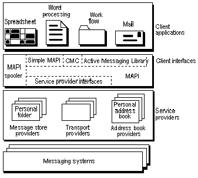

\[The APL text in this article uses [APL2741](resource/apl2741.zip) (45K download).\]

## Hackers’ Corner: APL Meets MAPI

*by Jonathan Manktelow (jonathan.manktelow@nestlegb.nestle.com)*

Whilst developing a multi-user scheduling system in Dyalog APL it became clear that it would be useful to send notification messages of various bookings, via e-mail, to other people on the network.

Nestlé have standardised on Microsoft Exchange so the obvious solution was to use Microsoft’s MAPI (Messaging Application Interface) as the underlying messaging engine.

**MAPI**

Microsoft’s MAPI is a software layer designed to sit between client software (such as our scheduling system) and the various mail systems and networks available (such as exchange or internet mail across NetBeui, TCPIP, Appletalk etc.). It is a standard abstraction layer available on all versions of Windows from 3.0 onwards. Microsoft have even declared parts of it a cross-platform standard, although I have not seen it running on anything other than Microsoft platforms yet.

As soon as I started to look at Microsoft’s MAPI documentation it became clear that MAPI presents a number of different faces to anybody wishing to develop with it. (The overall structure of MAPI is shown in Figure 1 below.)

Simple MAPI – The most basic set of API function calls available. This is an easy to understand set of DLL calls for performing various basic messaging tasks. However Microsoft’s documentation states that this is only available for backwards compatibility, and all new applications should use CMC or COM messaging.

CMC – A more up to date version of Simple MAPI that Microsoft would like us to use. Although this is more powerful than Simple MAPI it does not provide as much flexibility or control as COM Messaging.

COM Messaging – Sometimes known as Active Messaging Library or OLE Messaging this is the version of MAPI implemented through Microsoft’s COM (Component Object Model) framework. Using COM to access MAPI gives the programmer control over almost everything they will need. So much so that you could write a replacement for the Microsoft Inbox from within an OLE client such as Dyalog APL or +Win!



**Figure 1: The Structure Of MAPI**

As I discovered, leveraging existing API’s and component libraries that are a standard part of the development platform can be a quick, easy and flexible way of adding sophisticated capabilities to your applications. Once you have found the documentation for the underlying engines...

<b>The Utilities</b>  
Even though all I needed to do in the first instance was send a mail message, optionally with attachments, I wanted to build a utility set that could be extended in the future if necessary. I therefore chose to build the utility set on top of the COM Messaging MAPI interface. Which will allow the addition of more functionality, such as displaying all the addresses in the user’s address book, simply by exposing more of MAPI through simple APL cover functions.

The utilities consist of 3 Mail functions and a windows API cover function in an APL namespace called #.mail.

`#.mail.connect` connects the Dyalog session to MAPI

`#.mail.disconnect` disconnects the Dyalog session from MAPI

`[disconnect] #.mail.send_mail [subject] [message] [recipients] [attachments] [show_dialog]` sends some mail. This will connect and then disconnect from MAPI as needed.

The optional left argument (boolean) tells the function whether or not it should disconnect from the MAPI engine once the mail has been sent. The default of 0 will disconnect. If you need to send more than one mail message then you should not disconnect from MAPI between calls to `send_mail` to avoid slowing down your application.

You may specify as many of the arguments on the right as you need, but you must supply them in order, starting with *subject* and including all arguments up to the last one you need. i.e. if you want to specify the *recipients*, you must also specify the *subject* and *message*.

*subject* is a text vector.

*message* is a vector of text vectors containing the main text of the e-mail.

*recipients* is a vector of text vectors containing the names of all the people you would like to send the message to.

*attachments* is a vector a text vectors containing the fully qualified filenames of any attachments you would like to send with the e-mail.

*show\_dialog* is a Boolean flag indicating whether or not the user should be shown the e-mail before it is sent. This defaults to 1 (do show the mail before it is sent.)

`short_filename←#.mail.getshortpathname long_filename` This converts a windows long\_filename into its equivalent short filename. E.g. “c:\\program files” becomes “c:\\progra~1” This is necessary because MAPI only accepts short filenames.

The utilities have one configuration variable that you must specify in the `#.mail` namespace:

`#.mail.profile` – This is a text vector containing the name of the exchange profile that should be used. For example ‘Microsoft Exchange Profile’. This has been left as a configuration variable as it is likely to change from user to user.

With these functions you can add the ability to send e-mails from all of your Dyalog APL/W applications, with a single line of code. However there is still room for improvement! The functions do not return a flag to indicate whether or not the message was actually sent. If you can see a tidy way to do this, or of adding any other features you feel would be useful please tell me. If there is sufficient interest I will put together another article developing this utility set further.

<b>Other Information</b>  
This particular case only skims the surface of what is possible using MAPI. To find out more you should look at some of the following resources provided by Microsoft. My favourite is the on-line SDK documentation, as it is freely available to anyone with a web browser and an Internet connection.

- On-Line documentation library at [http://msdn.microsoft.com/](http://msdn.microsoft.com/) is an excellent resource for technical information on any Microsoft product.
- Microsoft Technet – The subscription based source of CDs full of technical information, service packs etc. From Microsoft.

The Dyalog APL/W 8.1 New Features help file for information on using COM/OLE objects from within Dyalog.

<b>The Code</b>

```
[0]   connect
[1]  ⍝ Connect to the MAPI server
[2]   :If #.mail.connected=0
[3]    '#.mail.mapi'⎕WC'OleClient' 'MAPI.Session'
[4]    #.mail.mapi.Logon #.mail.profile
[5]    #.mail.connected←1
[6]   :EndIf
```

```
[0]   disconnect
[1]   ⍝ Disconnect from a mail session
[2]   :If #.mail.connected=1
[3]    #.mail.mapi.Logoff
[4]    ⎕EX↑'#.mail.mapi'
[5]    #.mail.connected←0
[6]   :EndIf
```

```
[0]   {disconnect}send_mail args;⎕TRAP;message_text;subject_text;recipients_list; recipients_supplied;next_recipient;r;attachments_list;attachments_supplied; next_attachment;show_dlg
[1]  ⍝ Send an e-mail. The user will be asked for the details of the mail
[2]  ⍝ The arguments are subject text to files display
[3]  ⍝ where subject is a text vector
[4]  ⍝ message is a vector of text vectors, or a text vector
[5]  ⍝ to is a vector of text vectors of people to send the mail to.
[6]  ⍝ files is a vector of text vectors of valid file names
[7]  ⍝ display is a boolean indicating whether or not to show the send box before sending the message
[8]  ⍝ You can supply 1 ... 5 of the arguments, but they must be in order!
[9]  ⍝ Set up the error handling
[10]  ⎕TRAP←⊂(0 1000)'E' '→⎕lc+1'
[11] ⍝ Make sure that the system is connected to the mail server
[12]  #.mail.connect
[13] ⍝ Extract the argumants
[14]  :If 1≤⍴args
[15]    subject_text←⊃args[1]
[16]   :Else
[17]    subject_text←''
[18]  :EndIf
[19]  :If 2≤⍴args
[20]    message_text←∊ :Else
[22]    message_text←''
[23]  :EndIf
[24]  :If 3≤⍴args
[25]    recipients_list←⊃args[3]
[26]    recipients_supplied←1
[27]   :Else
[28]    recipients_supplied←0
[29]  :EndIf
[30]  :If 4≤⍴args
[31]    attachments_list←⊃args[4]
[32]    attachments_supplied←1
[33]   :Else
[34]    attachments_supplied←0
[35]  :EndIf
[36]  :If 5≤⍴args
[37]    show_dlg←⊃args[5]
[38]   :Else
[39]    show_dlg←1
[40]  :EndIf
[41] ⍝ Create a new message
[42]  '#.mail.mapi.outbox'⎕NS #.mail.mapi.Outbox
[43]  '#.mail.mapi.outbox.messages'⎕NS #.mail.mapi.outbox.Messages
[44]  r←'#.mail.mapi.outbox.messages.message'#.mail.mapi.outbox.messages.Add
[45] ⍝ Set the subject
[46]  :If ⎕NC'#.mail.mapi.outbox.messages.message.subject'
[47]    #.mail.mapi.outbox.messages.message.Subject←subject_text
[48]   :Else
[49]    #.mail.mapi.outbox.messages.message.subject←subject_text
[50]  :EndIf
[51] ⍝ Set the message text
[52]  :If 0=⎕NC'#.mail.mapi.outbox.messages.message.text'
[53]    #.mail.mapi.outbox.messages.message.Text←message_text
[54]   :Else
[55]    #.mail.mapi.outbox.messages.message.text←message_text
[56]  :EndIf
[57] ⍝ If there were any supplied then set the recipients
[58]  :If recipients_supplied=1
[59]    '#.mail.mapi.outbox.messages.message.recipients'⎕NS #.mail.mapi.outbox.messages.message.Recipients
[60]    :For next_recipient :In ⍳⍴recipients_list
[61]       r←#.mail.mapi.outbox.messages.message.recipients.Add⊃recipients_list[next_recipient]
[62]    :EndFor
[63]   ⍝ If the user does not want the dialog box showing, resolve the names
[64]    :If show_dlg=0
[65]       r←#.mail.mapi.outbox.messages.message.recipients.Resolve
[66]    :EndIf
[67]  :EndIf
[68] ⍝ Add any attachments that are required
[69]  :If attachments_supplied
[70]    '#.mail.mapi.outbox.messages.message.attachments'⎕NS #.mail.mapi.outbox.messages.message.Attachments
[71]    :For next_attachment :In ⍳⍴attachments_list
[72]      r←'#.mail.mapi.outbox.messages.message.attachments.attachment'#.mail.mapi.outbox.messages.message.attachments.Add
[73]      #.mail.mapi.outbox.messages.message.attachments.attachment.Position←0  ⍝ End of text
[74]      #.mail.mapi.outbox.messages.message.attachments.attachment.Type←1 ⍝ File data
[75]      #.mail.mapi.outbox.messages.message.attachments.attachment.Name←⌽(-0<+\'\'=⌽⊃attachments_list[next_attachment])/⌽⊃attachments_list[next_attachment]
[76]      #.mail.mapi.outbox.messages.message.attachments.attachment.ReadFromFile #.mail.getshortpathname⊃attachments_list[next_attachment]
[77]    :EndFor
[78]  :EndIf
[79] ⍝ Send the mail
[80]  #.mail.mapi.outbox.messages.message.Send 1 show_dlg
[81] ⍝ Tidy up
[82]  ⎕EX↑'#.mail.mapi.outbox'
[83] ⍝ If we have been asked to disconnect - default= disconnect
[84]  :If 0=⎕NC'disconnect'
[85]    disconnect←1
[86]  :EndIf
[87]  :If disconnect=1
[88]   ⍝ disconnect from the server
[89]    #.mail.disconnect
[90]  :EndIf
```

```
[0]   short_filename←getshortpathname long_filename;func;r;buffer_length
[1]  ⍝ Cover for the windows get short fileneame function
[2]   buffer_length←1000
[3]   'func'⎕NA'U4 kernel32.dll.C32|GetShortPathNameA <0T>0T U4'
[4]   r←func long_filename buffer_length(buffer_length+1)
[5]   short_filename←⊃r[2]
```

***
