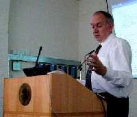
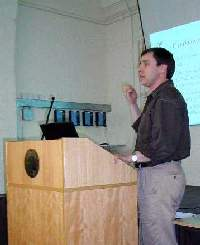

## Report of the AGM and Vendor Forum of the British APL Association 2000

Approximately 40 members were present for the AGM and Vendor Forum, held at the Royal Statistical Society in London on Friday May 19, 2000.

The first part of the meeting, from 2:00 – 2:15pm was the Annual General Meeting, recorded in the [Minutes](agm2000.htm), including reports from the [Chairman](agm2000.htm#chair) and [Treasurer/Administration](agm2000.htm#treas).

## British APL Association: Vendor Forum

*reported by Jonathan Manktelow ([jonathan@causeway.co.uk](mailto:jonathan@causeway.co.uk))*

There were three presentations:

<ul>

	<a href="#scholes"><li>John Scholes of Dyadic Systems Ltd.</li></a>
	<a href="#benoit"><li>Benoit Paquin of Soliton Associates Ltd.</li></a>
	<a href="#acds"><li>Adrian Smith of Causeway Graphical Systems Ltd.</li></a>
</ul>

### Dyadic

{ width="200" height="171" } John Scholes took this opportunity to promote one of his favourite, and possibly one of the most under utilised features of Dyalog – dynamic functions.

His session was a whirlwind tour of the various techniques he uses to build powerful utilities built purely in dynamic functions. From the most simple – sink (a function that simply takes an argument and does nothing) all the way through to a powerful workspace difference tool, which produced a clear and comprehensive report of the differences between two workspaces.

The most striking thing about this presentation was that dynamic functions enable us to write procedural code in APL. Efficiently! Many classes of problem are much easier to solve using procedural and recursive code, than array manipulation. However using a lot of procedural looping code in APL can be quite slow when compared to the equivalent array based code. But because dynamic functions have a very simple syntax, the interpreter can execute them far quicker than the equivalent traditional APL.

The session clearly showed not only the power of dynamic functions, but also the fact that we do not have to throw away the procedural paradigm to enjoy the manipulation of matrices!

### Soliton

{ width="200" height="245" } Benoit Paquin, from Soliton, came to the conference to give most of us our first glimpse of the new SAX for Linux. This is the new Linux port of the Soliton APL interpreter. He quickly explained the pricing structure (the cheapest option being free for non-commercial use) and moved on to give us an overview of the structure of the system. The SAX development environment consists of a number of modules, with an APL interpreter running on a Linux machine at the core.

For most of his session Benoit concentrated on showing us how to build an APL powered calculator. With a Java user interface! This allows the front end of the calculator to be run on any Java enabled system that is connected to the Linux server.

After being shown how easy it was to move the simple user interface handling out to a Java GUI, but keep the power of a mainframe APL interpreter to process the data, it was not difficult to see how this technology could be used to produce very powerful multi-user APL systems, with good looking front ends, that will run on any machine attached to the network.

### Causeway

The Causeway session started by showing some of the new features that have recently been added to CPro, Rain and NewLeaf, including drag and drop technology in CPro. Many of these new features will be explored in more detail at the Berlin conference at the end of July.

We then moved on to show a preview of GraPL, server edition (Graphing Power unleashed). This technology wraps the Rain graphics engine in an OCX, which allows users to embed quality publication graphics into systems developed in almost any programming tool under Windows.

To illustrate the power of this technology we showed a couple of web pages containing graphs generated on the fly by the web server. The server side code consisted of a few lines of VBScript, which could easily be extended to read data values from a database on the server before plotting the latest information.

***
