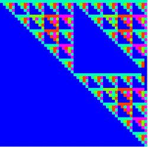
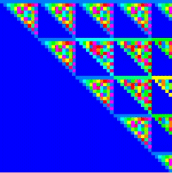
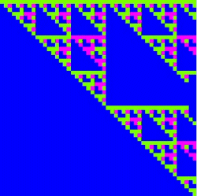
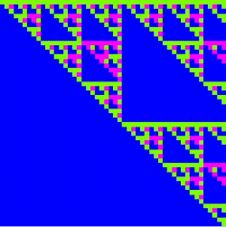

<table border="1" cellspacing="0" cellpadding="4">
    <tr>
      <td valign="top">
	  
  
        <pre class="J">   Pascal =: i. !/ i.
   Pascal 51 
1 1 1 10 1 2 3 4
0 0 1 3 6
0 0 0 1 4
0 0 0 0 1
   load 'viewmat'
   $pt50=. Pascal 50
50 50
   viewmat 5|pt50
   load 'logo'
   'save*' names 3
saveBMPFl
   saveBMPFl 'C:\amisc\j\nycjug\Pascal50mod5.bmp'</pre>

        </td>
      <td valign="top">
  
        

      </td>
    </tr>
    <tr>
      <td valign="top">
  
        <pre class="J">   viewmat 11|pt50
   saveBMPFl 'C:\amisc\j\nycjug\Pascal50mod11.bmp'</pre>

                
  </td>
      <td valign="top">
  
        

      </td>
    </tr>
    <tr>
      <td valign="top">

        <pre class="J">   viewmat 3|pt50  
   saveBMPFl 'C:\amisc\j\nycjug\Pascal50mod3.bmp'  
   NB. Why does it look "broken" on the right?  
   &gt;./,pt50
6 .3205303e13  
   /:~,pt50
0 0 0 0 0 0...  
   \:~,pt50
6.3205303e13 6.3205303e13 5.8343357e13...  
   3|10{.\:~,pt50
0 0 0 0 0 0 0 0 0 0      NB. Aha! Looks suspicious……………..</pre>

      </td>
      <td valign="top">
  
        

      </td>
    </tr>
    <tr>
      <td valign="top">

        <pre class="J">   $pt50=. Pascal 50x
50 50  
   \:~,pt50
63205303218876 63205303218876...  
   3|10{.\:~,pt50
0 0 0 0 1 1 1 1 0 0  
   viewmat 3|pt50  
   saveBMPFl 'C:\amisc\j\nycjug\Pascal50xmod3.bmp'</pre>

      </td>
      <td valign="top">
  
        

      </td>
    </tr>
  </table>
