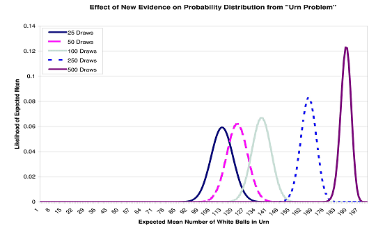

from Devon McCormick
{ .byline }

In his response to my article on Bayesian statistics as used in dynamic linear modelling (in Vector Vol. 21 No. 2), E. A. Clough raises an interesting point about prior probabilities as they relate to “the urn problem”. This problem is to estimate, given an urn known to contain only black and white balls, the probability that all of the balls are white after a number of white and only white balls have been drawn, with replacement.

In the original article, I did not delve deeply into this problem as it was mostly intended to introduce the notion of probability as a distribution in contrast to the naïve notion of probability as a point estimate. The ubiquity of this naïve notion is evident by how frequently we see probability estimates quoted without any mention of a measure of dispersion. A strength of the dynamic linear models that were the focus of the article is that they simultaneously estimate both means and variances, so it’s important to understand probabilities as distributions. I attempted to give readers a picture of this by means of the simple urn example. The follow-up to the simple example with 5 balls in the urn is one with 200 balls in order to give smoother curves when graphed, as we see below.

{ width="563" height="328" }

This illustrates how we see probabilities as distributions, not point estimates. It also shows how the shape and location of the curve changes with additional evidence.

Inasmuch as this was my aim, I paid scant attention to the notion of a “prior probability” and how we might derive one, though this is an important concept in Bayesian statistics. Much of Clough’s response to the article focuses on deriving the prior probability, or “prior”, assumed in my example. As he correctly derives, my initial prior for the distribution of white balls in the urn is 50%.

So, up to a certain point, we are in agreement. However, beyond this point, where we get to the question of how to establish a prior, Clough misrepresents the valid criteria for settling on one. Apparently the long-standing slur on Bayesian methods as “subjective” continues to distort the discussion. This is evident in the assertion that begins “In general a person’s choice will depend on whether they are optimistic ... or pessimistic....”

This is completely unwarranted. My initial assumption of a distribution of 50% white balls is based solely on the only piece of evidence I have: there are only two colours of balls. Given this, absent any other evidence, the best prior assumption is that the distribution is evenly divided between black and white.

There is a theory, called “maximum entropy”, behind this sort of simple assumption. I refer anyone interested in further pursuing this or any other aspect of Bayesian statistics to the excellent book by E. T. Jaynes “Probability Theory – The Logic of Science” (Cambridge University Press, 2003). Jaynes’s work also used to be available on the Web though I have not looked for it recently.

## Flawed Assumptions not Unique to Bayesian Statistics

Mr. Clough makes a good point that priors are important in Bayesian methods and that a poor choice of prior tends to undermine subsequent estimates. However, conventional statistics, like any chain of reasoning, is subject to the same sort of problem. Consider an article published in the New Scientist magazine (3 September 2005, *[www.newscientist.com/channel/life/mg18725155.400](http://www.newscientist.com/channel/life/mg18725155.400)*) on a re-analysis of an earlier study that estimated the number of species of bacteria in soil.

The original study, in the early 1990s, used a technique called DNA re-association to estimate the diversity of bacterial DNA in a soil sample. From this, researchers inferred how many species of bacteria were in the sample. This indirect method was used because direct counting of unknown bacteria is difficult since only a few species can be cultured in a lab. This study estimated that there are about 16,000 species per gram of dirt.

However, the initial study assumed roughly equally-sized populations for the different species. A recent re-analysis of the data, using a different assumption about the distribution of population sizes, estimated that the number of species per gram of dirt is closer to one million.

So, while a Bayesian prior may be flawed, this is no different from any of the many assumptions we must make in a statistical analysis. The important point is that, in all cases, assumptions should be based on evidence.

***
