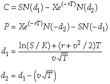

*by Eugene McDonnell*
{ .byline }

## Beware Scholes!

This article is about a J version of the Black-Scholes formulas, the brainchild of Myron Scholes and the late Fischer Black. The document:  
           [http://bradley.bradley.edu/~arr/bsm/pg04.html](http://bradley.bradley.edu/~arr/bsm/pg04.html)  
gives a lot of information on the formula and its creators (which won the surviving creator the Nobel Prize in economics in 1997), and if you want to find out more about Black and Scholes or the theory behind their formula, I recommend it.

A *call* is an option to *buy* a stipulated amount of stock at a specified time and price, and a *put* is an option to *sell* ditto. A person might acquire a call option who expects the price of the asset to rise. The Black-Scholes formulas enable the seller of the option to determine quite accurately what price to charge for such options.

Here are the formulas in conventional mathematical notation:

*C* = Theoretical Call Premium       *S* = Current Stock Price  
*P* = Theoretical Put Premium        *X* = Option Strike Price  
*r* = Risk-Free Interest Rate              *v* = volatility, or Standard Deviation of Asset Price  
*T* = Time in years until strike date  
*N* = Cumulative Standard Normal Distribution  
*ln* = Natural Logarithm

Many different programming languages have been used to write programs for these formulas. The document:  
            http://home.online.no/~espehaug/SayBlackScholes.html

contains a couple of dozen of these programs, written in these languages:

C#                               O'Caml  
C++                            Pascal  
Fortran                       Perl  
Haskell                      PHP  
HP48                          Python  
Icon                             Real Basic  
IDL                             Rebol  
JAVA                          Scheme  
JavaScript                  S-Plus  
K                                 Squeak  
Maple                         Transact SQL  
Mathematica             VBA  
Matlab

The programs are in one of two forms, both adhering closely to the original mathematical formulas shown above. Some have separate programs for calls and puts; some exploit the family resemblance of calls and puts and so write just one general program that requires an additional parameter to indicate whether a solution for a call or a put is desired. Here is a typical general program, this one written in C++:

Double BlackScholes(char CallPutFlag, double S, X, T, r, v)  
\{  
double d1, d2  
  
d1=(log(S/X)+(r+v\*v/2)\*T)/(v\*sqrt(T));  
d2=d1-v\*sqrt(T);  
  
if(CallPutFlag) == 'c'  
return S \* CND(d1)-X \* exp(-r\*T)\*CND(d2)  
elseif(CallPutFlag == 'p')  
return X \* exp(-r \* T) \* CND(-d2) – S \* CND(-d1);  
\}

This program includes as its first argument the letter ’c’ for a call option, and ‘p’ for a put option, and then discriminates between the two by an if/elseif control structure. Otherwise, it follows the Black-Scholes formulas closely. The entry includes a long separate program for the required cumulative normal distribution function, as do many of the other entries.

At present the document has no contribution written in J (or APL, for that matter). The rest of this paper describes the evolution of J programs for the Black-Scholes formulas. Five different people made transformations of the formulas that ended in a J version radically different from all the others.

My attention was first called to this subject by a message from Hu Zhe to the J Forum that uses separate functions for call and put.

load 'c:\\j406\\system\\packages\\stats\\statdist.ijs'  
cnd =: 3 : 'normalprob 0, 1,\_\_,y.'  
  
d1 =: 3 : 0  
'S X T r v' =. y.  
((^.S%X)+(r+-:\*:v)\*T)%(v\*%:T)  
)  
  
d2 =: 3 : 0  
'S X T r v' =. y.  
((^.S%X)+(r--:\*:v)\*T)%(v\*%:T)  
)  
  
BlackScholesCall =: 3 : 0  
'S X T r v' =. y.  
(S\*cnd d1 y.) - (X\*(^-r\*T)\*cnd d2 y.)  
)  
  
BlackScholesPut =: 3 : 0  
'S X T r v' =. y.  
(X\*(^-r\*T)\*cnd -d2 y.) - (S\*cnd -d1 y.)  
)

These are reasonably concise and straightforward. They show what was to be expected: that J, as well as any other programming language, can translate the mathematical notation directly into computer programs. Notice that he loads a J library function for the cumulative normal distribution.

Shortly after this appeared, Oleg Kobchenko sent the following version, a single function for both calls and puts, that incorporates d1 and d2:

BlackScholes=: 4 : 0  
'S X T r v' =. y.  
d1=. ((ln S%X)+(r+-:\*:v)\*T)%(v \* sqrt T)  
d2=. d1 - v \* sqrt T  
(S, X \* exp-r\*T) (-/ . \* cnd)&(-^:x.) (d1, d2)  
)

The lines forming d1 and d2 are like those in the C++ program. The last line is an instance of array thinking. They exploit the similarity of the call and put functions. The put option definition can be rewritten.

Here are the call and put options, with put in its new form.

c =:  (s\*cnd( d1))-((x\*exp-r\*t)\*cnd( d2))  
p =: -(s\*cnd(-d1))-((x\*exp-r\*t)\*cnd(-d2))

This shows that p differs from c solely in the use of negation of d1 and d2, and in negating the overall result. Kobchenko exploits this by rearranging things so that a left argument of 0 or 1 discriminates call and put, respectively,

More abstractly, the last line of his function can be written as:

a ((b c)&d) e  
(d a)(b c)(d e)  
(d a) b (c(d e))  
(d      a         ) b      (c  (d e    ))  
(-^:x.)(S,X\*^-r\*T)(-/ . \*) (cnd(-^:x.)(d1,d2))

This shows the conditional negation of the left and right hand sides, the application of cnd to the right hand side, and the difference of the product, so that for a call we would have: 

c =: ( s,x\*exp-r\*t) -/ . \* cnd( d1,d2)

and for a put we would have:

c =: (-s,x\*exp-r\*t) -/ . \* cnd(-d1,d2) 

At the same time that Kobchenko was working on his array approach, I had been working on the other main part of the program, the formation of d1 and d2. I wrote down the definition of d2:

d2 =: d1 - v\*%:t

Then I replaced d1 by its definition, and with a bit of algebra arrived at:

d2 =: ((^.s%x)+(r--:\*:v)\*t)%(v \* %:t)

and if you compare this with the definition for d1, you will find that the only difference is that <tt>(r+-:\*:v)</tt> is changed to <tt>(r--:\*:v)</tt>. This being the case, it was simple to replace the two lines defining d1 and d2 by a single line that forms a two-item list d that uses the fork <tt>(+,-)</tt>:

d =: ((^.s%x)+(r(+,-)-:\*:v)\*t)%v\*%:t

This permitted the definition of BlackScholes to become:

BlackScholes =: dyad define  
's x t r v' =. y.  
d =: ((^.s%x)+(r(+,-)-:\*:v)\*t)%v\*%:t  
(s,x\*^-r\*t)(-/ .\*cnd)&(-^:x.)d  
)

The only thing about this that I found not to my liking was the need to specify a left argument to indicate call or put. Happily for me, just about this time Arthur Whitney posted a message to the K forum that showed that v can be used to discriminate the two cases, by using it positively for call, and negatively for put. Thus it became possible to do without the left argument, and write:

BS =: monad define  
'S X T r v' =. y.  
d=.((^.S%X)+T\*r(+,-)-:\*:v)%v\*%:T  
\-/(S,X\*^-r\*T) \* cnd d  
)

Notice that I have separated the parts of (`-/ . *`), giving, I believe, a program easier to explain and understand.

Here are examples of call and put. The result for put is negative, and this differs from the usual put result, which is positive. The negative result can be useful to distinguish a call result from a put result. If a positive put result is necessary, a magnitude sign ( `|` ) can be placed in front of the last line of BS.

   yc=:60 65 0.25 0.08     0.3  
   BS yc  
2.13337  
   yp=:60 65 0.25 0.08 \_0.3  
   BS yp  
\_5.84628

We haven’t ended quite yet. Perhaps you remember the article by Ewart Shaw in *Vector 18.4*, in which he defined the error function erf using J’s hypergeometric conjunction:

erf =: (\*&(%:4p\_1)%^@:\*:)\*\[:1 H. 1.5\*:   NB. A&S 7.1.21 (right)

and then defined the cumulative distribution function of the normal distribution by:

cnd =: \[:-:1:+\[:erf%&(%:2)       NB. A&S 26.2.29 (solved for P)

All of the functions written in other languages must do something special to define cnd, either using a library function, or writing the definition using approximation A&S 26.2.16.

I’m going to contribute BS, erf, and cnd to the Black-Scholes web site, but in the following training-wheels versions so that the innocent reader may come close to understanding them without having to learn any J.

BS =: monad define  
'S X T r v' =. y.  
d=.((ln S dv X) + T \* r (+,-) hlf sqr v) dv (v \* sqrt T)  
diff (S , X \* exp - r \* T) \* cnd d  
)

erf =: monad define  NB. A&S 7.1.21 (rightmost)  
((2 \* y.) dv (sqrt pi)) \* (exp - y. ^ 2) \* (1 H. 1.5) y. ^2  
)  
  
cnd =: monad define           NB. A&S 26.2.29 (solved for P)  
(1 + erf y. \* sqrt 0.5) dv 2  
)

Where:

diff =: -/  
dv   =: %  
exp  =: ^  
hlf  =: -:  
ln   =: ^.  
pi   =: 1p1  
sqr  =: \*:  
sqrt =: %:

***
