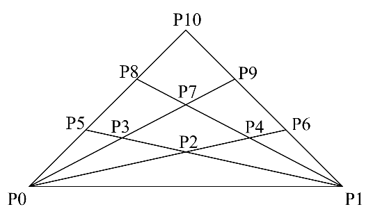
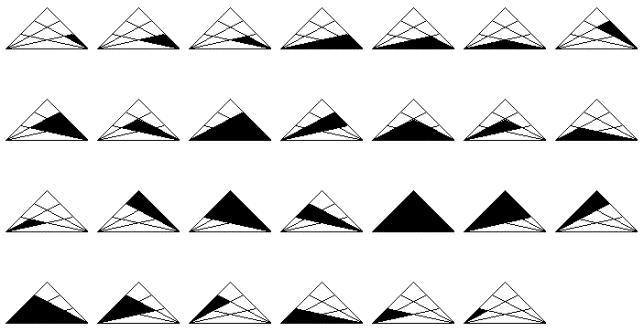
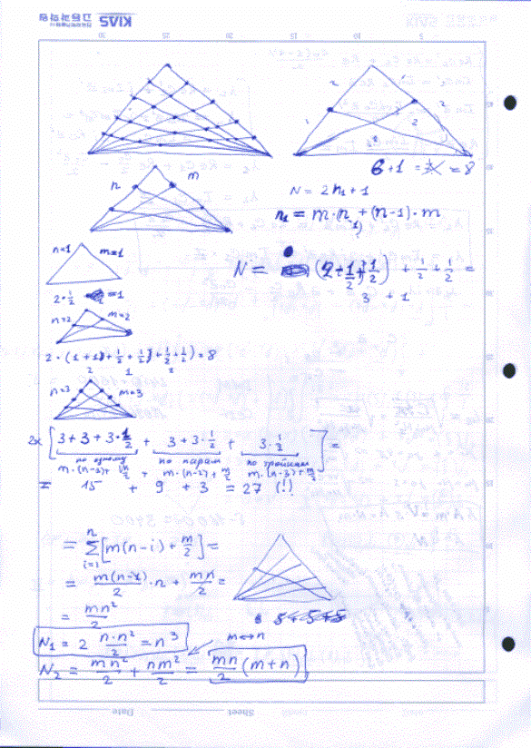

*by Eugene McDonnell*
{ .byline }

A puzzle was recently announced by Frank Buss on the Internet that led to some interesting discoveries. The puzzle is to be found by Googling “Frank Buss Triangle Problem” and then clicking on “Triangles Challenge” or browsing directly to *[http://www.frank-buss.de/challenge/](http://www.frank-buss.de/challenge/)* if you prefer. It says:

The challenge is to write a program, which counts all triangles with area >0 in this figure:

{ width="536" height="311" }

But count only the triangles, which are bounded by lines, like (P0, P7, P8), not all possible connections between the points, like (P7, P8, P9). If anything is unclear, the solution is 27 and looks like this: (see below).

Graphic output is not needed, but you can do what you want. If a GUI or something else is included, it would be nice to write: how long you needed for the pure algorithm and for the rest.

This is not a quantitative, but more a qualitative challenge. Neither the number of lines nor the time (which I can’t verify anyway) is important, but I’m interested in good solutions, which show the advantages of the chosen language.

Every program should be documented enough to understand how it works and it should not simply print 27, but somewhere it should read from a file or integrate the points and geometry, so that it is easy to change it for similar problems, for example if another line is added, but it need not to be so general as to count the number of squares.

{ width="644" height="332" }

There were 31 entries: The languages they used, the number of entries in that language, and the average number of lines in the programs are tabulated below:

<table border="1" cellspacing="0" cellpadding="2">
    
  <tr>
      
    <th width="174" valign="top" class="Normal">
  
      Language
    

    </th>
    <th width="162" valign="top" class="Normal">
  
     Number of entries
    </th>
    <th width="168" valign="top" class="Normal">
  
        
Average number of lines
    </th>
  </tr>
    
  <tr>
      
    <td width="174" valign="top" class="Normal">
  
        
      <p class="tablecell" align="left">C++</p>
    </td>
    <td width="162" valign="top" class="Normal">
  
        
      <p class="tablecell" align="center">3</p>
    </td>
    <td width="168" valign="top" class="Normal">
  
        
      <p class="tablecell" align="center">115</p>
    </td>
  </tr>
    
  <tr>
      
    <td width="174" valign="top" class="Normal">
  
        
      <p class="tablecell" align="left">Java</p>
    </td>
    <td width="162" valign="top" class="Normal">
  
        
      <p class="tablecell" align="center">4</p>
    </td>
    <td width="168" valign="top" class="Normal">
  
        
      <p class="tablecell" align="center">105</p>
    </td>
  </tr>
    
  <tr>
      
    <td width="174" valign="top" class="Normal">
  
        
      <p class="tablecell" align="left">Python</p>
    </td>
    <td width="162" valign="top" class="Normal">
  
        
      <p class="tablecell" align="center">1</p>
    </td>
    <td width="168" valign="top" class="Normal">
  
        
      <p class="tablecell" align="center">94</p>
    </td>
  </tr>
    
  <tr>
      
    <td width="174" valign="top" class="Normal">
  
        
      <p class="tablecell" align="left">Haskell</p>
    </td>
    <td width="162" valign="top" class="Normal">
  
        
      <p class="tablecell" align="center">1</p>
    </td>
    <td width="168" valign="top" class="Normal">
  
        
      <p class="tablecell" align="center">93</p>
    </td>
  </tr>
    
  <tr>
      
    <td width="174" valign="top" class="Normal">
  
        
      <p class="tablecell" align="left">Ruby</p>
    </td>
    <td width="162" valign="top" class="Normal">
  
        
      <p class="tablecell" align="center">1</p>
    </td>
    <td width="168" valign="top" class="Normal">
  
        
      <p class="tablecell" align="center">75</p>
    </td>
  </tr>
    
  <tr>
      
    <td width="174" valign="top" class="Normal">
  
        
      <p class="tablecell" align="left">Scheme</p>
    </td>
    <td width="162" valign="top" class="Normal">
  
        
      <p class="tablecell" align="center">1</p>
    </td>
    <td width="168" valign="top" class="Normal">
  
        
      <p class="tablecell" align="center">66</p>
    </td>
  </tr>
    
  <tr>
      
    <td width="174" valign="top" class="Normal">
  
        
      <p class="tablecell" align="left">Awk</p>
    </td>
    <td width="162" valign="top" class="Normal">
  
        
      <p class="tablecell" align="center">1</p>
    </td>
    <td width="168" valign="top" class="Normal">
  
        
      <p class="tablecell" align="center">59</p>
    </td>
  </tr>
    
  <tr>
      
    <td width="174" valign="top" class="Normal">
  
        
      <p class="tablecell" align="left">Lisp</p>
    </td>
    <td width="162" valign="top" class="Normal">
  
        
      <p class="tablecell" align="center">17</p>
    </td>
    <td width="168" valign="top" class="Normal">
  
        
      <p class="tablecell" align="center">56</p>
    </td>
  </tr>
    
  <tr>
      
    <td width="174" valign="top" class="Normal">
  
        
      <p class="tablecell" align="left">Kogut</p>
    </td>
    <td width="162" valign="top" class="Normal">
  
        
      <p class="tablecell" align="center">1</p>
    </td>
    <td width="168" valign="top" class="Normal">
  
        
      <p class="tablecell" align="center">29</p>
    </td>
  </tr>
    
  <tr>
      
    <td width="174" valign="top" class="Normal">
  
        
      <p class="tablecell" align="left">J</p>
    </td>
    <td width="162" valign="top" class="Normal">
  
        
      <p class="tablecell" align="center">1</p>
    </td>
    <td width="168" valign="top" class="Normal">
  
        
      <p class="tablecell" align="center">1</p>
    </td>
  </tr>
  
</table>

Most of these had a generous amount of documentation along with the actual program. I don’t know most of the languages used, but I could come to some conclusions about them. It seems to me that most of the authors were more programmers than mathematicians. Almost all of them tackled the problem as one of establishing the proper way to represent the points, lines, and intersections in the triangle. Most of them gave solutions which were wired in, and their programs could not easily be extended to variations of the problem.

Since Haskell is supposed to be a functional programming language, I thought it might give an interesting and useful result, but I was disappointed. It hard-coded the geometry of the problem, so that it, like many others, couldn’t be extended.

The J solution was submitted by Dr. K. L. Metlov. Here it is:

```
* -: @ * +
```

Metlov is a physicist, with many publications in his field, and he obviously studied the triangle puzzle as a mathematical one. In his notes, one sees that he experiments with variations of the problem, and in a relatively short time had concluded that a simple expression could be formed that would apply to a triangle with any number of lines.

This is a fork, and a dyad, and it is better understood by emphasizing its forkiness.

```
     *   +
      \ /
       |
       *
       |
       -:
```

The arguments are multiplied and added, this product and sum are multiplied, and the product is halved.

## I give Metlov’s Documentation below:

> “When both sides of the triangle are divided into an equal number of steps (let’s call this number – n), the number of triangles is n^3 (n to the third power). For the example Frank Buss gives n=3 and the answer is  
> `3^3 = 27`.
>
> When sides are subdivided into a different number of subdivisions, say, n and m, the number of triangles is equal to
>
> ½m × n(m + n)
>
> which is integer for any integer m and n.
>
> In J language (see [http://www.jsoftware.com/](http://www.jsoftware.com/) for description and download) the first formula is coded and invoked as
>
> ```
>     nt =: ^&3
>     nt 3
> 27
> ```
>
> The second formula is coded and invoked as
>
> ```
>     nt =: * -: @ * +
>     3 nt 3
> 27
>     2 nt 5
> 35
> ```
>
> The first variant of the program is three characters, the second is 6 characters.
>
> It took me 15-20 minutes of drawing rectangles to derive the formula. J is an array-oriented language, descendent of APL. Therefore, the above programs (without change) can indeed be used to process millions of rectangles very fast. In order to achieve this the arguments must be arrays (of equal length in the second case). For example:
>
> ```
>     (3 2) nt (3 5)
> 27 35
> ```
>
> How the formula was developed:
>
> Here is the link to the page of notes I made when thinking about the problem. *[http://www.livejournal.com/users/dr\_klm/51584.html?thread=435072#t435072](http://www.livejournal.com/users/dr_klm/51584.html?thread=435072#t435072)* and \[overleaf\] is a copy of the page.
>
> The direct link is here: *[http://galaxy.fzu.cz/~metlov/Triangles\_Deriv.gif](http://galaxy.fzu.cz/%7Emetlov/Triangles_Deriv.gif%20)*
>
> { width="585" height="824" }
>
> I do not know if that will be enough to communicate the basic idea used for deriving the formula. On the other hand I do not have time to explain it in full detail.
>
> The interesting part occupies the lower left quarter of the page. Triangles are counted separately for two lower corners of the big triangle (left and right) and then the result is multiplied by 2 (if n=m), or added up with exchanging n&lt;->m (if n!=m). To count triangles for one corner I sum up the triangles, occupying all single sub-sectors, the triangles, occupying all pairs of two consecutive sub-sectors, ... three sub-sectors... etc... In this sum, the triangles, which include both left and right corners of the big triangle are counted with weight 1/2 (to note that they will be counted again, in the sum for the other corner).
>
> I ran this procedure for n=3, m=3 approximately in the middle of the page. Then, by induction, wrote a general formula with the sum. The sum is nothing else but an arithmetic progression, which is immediately summed up. Then, with very basic algebra, the final formulas are obtained.”

Comment from Frank Buss<i>: This is a nice
solution and the language looks interesting. It is the same concept as the Scheme
solution, which uses a formula instead of counting the triangles, but this
formula is much easier than the one used in the Scheme solution.</i>

***
