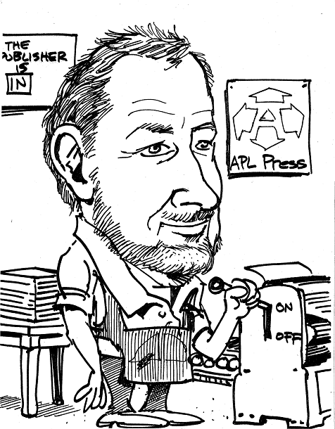

## From Eugene McDonnell

<b>Ken at Harvard</b>: Just today I tried to remember the economist that Ken worked for at Harvard – and a Google search led me to the right man: Wassily Leontief – the originator of the input-output matrix for the economy of nations. Leontief was on Ken’s PhD committee – and it must have stimulated his interest in matrices. Leontief won the 1973 Nobel Economics medal for this work.

In his (French) obituary Sylvain Baron mentioned Ken’s PhD thesis (1954) “Machine Solutions of Differential Equations”, which topic I imagine was suggested to him by Howard Aiken – the developer of three or four Harvard relay computers during WWII. I once made an attempt to read this – to no avail. I had studied differential equations as the last portion of Integral Calculus while I was in the Army (1945) – and could solve differential equations with my army-issued K&E loglog duplex decitrig poyphase slide rule – and the final test was three differential equations. I held up my hand and asked Dr Downing if we could use our slide rules, and he said yes – so I handed in my twice-checked test paper in ten minutes, while the rest of my fellow soldiers sweated for two hours.

I remember being told that [Fred Brooks](http://www.cs.unc.edu/~brooks/brooks_cv.html "Fred Brooks CV") was Ken’s teaching assistant, and this led to their partnership in writing “Automatic Data Processing”, the first edition of which used the IBM 650 as the model machine – and I think they had a formal description of the machine in the book.

And I think it was Brooks who, after he had left Harvard to work at IBM, recruited Ken to come work there too – after Ken didn’t get tenure at Harvard. In his introduction to *A Programming Language* Ken mentions the large debts he owed to Aiken and Brooks.

While at Harvard Ken wrote a report to Bell Labs which was the earliest publication using his notational schemes. I remember that the specification arrow pointed to the right!

While still at Harvard, in 1960, Ken wrote “The Description of Finite Sequential Machines”, which is the first place in which the notation for floor and ceiling appears. This was read by Mike Montalbano, then at Stanford, who had worked with George Dantzig, the developer of the simplex method for linear programming at the National Bureau of Standards, in Washington, D.C. He writes:

> The page had an illustration that, in a few short lines, described George Dantzig’s simplex algorithm simply and precisely. That was the overwhelming, crucial experience. In the previous thirteen years, I had participated in so many murky discussions of what was here presented with crystal clarity that I knew that what I was reading was of enormous significance to the future of computing.

I had a fellowship at Harvard 1949-1951 and left before Ken began to study there. My major study there was Dante’s Divine Comedy – in Italian.
